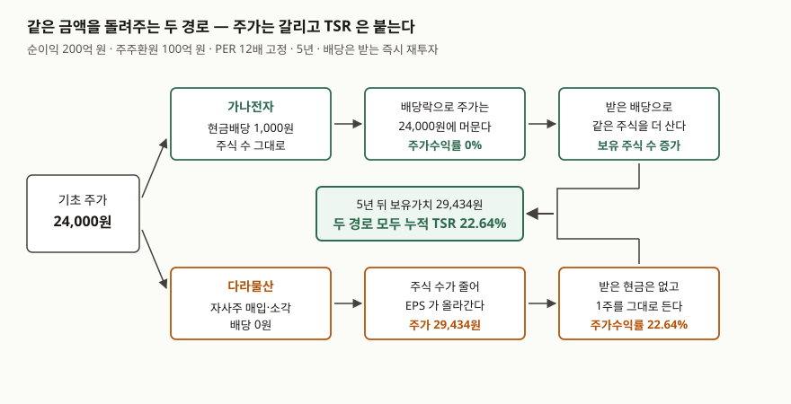

> 예제의 회사 `가나전자`·`다라물산`과 그 숫자는 계산 원리를 보이려고 만든 가상 값이다. 실제 기업과 관계가 없다. 순이익·주가·배수·환원액은 모두 설명용 가정값이다.

## 들어가며

관심 종목 몇 개를 5년 차트로 나란히 놓고 보는 일이 있다. 한 회사는 5년 내내
거의 그 자리에 있고, 다른 회사는 20% 넘게 올라 있다. 보통 여기서 횡보한 쪽을
목록에서 지운다. 5년을 들고 있었으면 아무것도 못 벌었을 회사라는 판단이다.

그런데 횡보한 회사가 매년 주가의 4%가 넘는 배당을 줬다면 이야기가 달라진다.
배당은 지급되는 순간 주가에서 그만큼 빠지므로, 많이 주는 회사일수록 주가
차트는 평평해진다. 차트만 보고 거르는 것은 배당을 꼬박꼬박 준 회사를 골라
떨어뜨리는 셈이다. 반대쪽도 같다. 자사주를 사서 소각한 회사는 주주에게 현금을
한 푼도 보내지 않고도 주가가 오른다. 주가 상승률 하나로 두 회사를 비교하면,
회사가 돌려준 금액이 아니라 **돌려준 방식**을 비교하게 된다.

## 개념

총주주수익률(TSR, Total Shareholder Return)은 그 둘을 한 자로 재려고 만든
지표다. 일정 기간 주가가 움직인 몫과 그 기간에 받은 배당을 합쳐, 기초 주가로
나눈다.

```text
TSR = (기말 주가 - 기초 주가 + 기간 중 배당금) ÷ 기초 주가
```

한국거래소의 「기업가치 제고 계획」 가이드라인 해설서는 주주환원 범주의 종합
지표로 TSR을 들면서, 주주가 일정기간(통상 1년) 얻을 수 있는 총수익률이며
"주가변동률과 배당수익률이 합산된 값"으로 볼 수 있다고 적는다. 2026년 2월판
6쪽이고, 2024년 5월 최초 확정판의 같은 쪽도 문장이 같다.

여기서 같은 쪽에 나란히 적힌 **주주환원율**과 헷갈리지 않아야 한다. 해설서는
주주환원율을 "순이익 중 배당과 자사주 매입액에 얼마를 썼는지"를 나타내는
비중으로 설명한다. 둘은 재는 대상이 다르다. 주주환원율은 회사가 번 돈 중
얼마를 내보냈는지를 재고, TSR은 주주가 결과적으로 얼마를 쥐었는지를 잰다.
분모가 순이익이냐 기초 주가냐에서 이미 갈린다.

## 구조



> **출처**: [한국거래소, 「기업가치 제고 계획」 가이드라인 해설서(2026년 2월), 6쪽 — 주주환원 지표(TSR·주주환원율)](https://kind.krx.co.kr/external/dst/valueupReference/11664/%282026%EB%85%842%EC%9B%94%29%EA%B8%B0%EC%97%85%EA%B0%80%EC%B9%98%20%EC%A0%9C%EA%B3%A0%20%EA%B3%84%ED%9A%8D%20%EA%B0%80%EC%9D%B4%EB%93%9C%EB%9D%BC%EC%9D%B8%20%ED%95%B4%EC%84%A4%EC%84%9C.pdf), 수치는 아래 예제의 계산 결과

## 동작 원리

두 경로가 왜 같은 곳에 도착하는지는 각각이 어디에 기록되는지를 따라가면 보인다.

**배당은 주가에서 빠져 주주의 현금으로 옮겨 간다.** 배당기준일이 지나면 그
배당을 받을 권리가 없는 주식이 되므로 이론상 주가는 주당배당금만큼 내려간다.
회사 밖으로 나간 현금만큼 기업가치가 줄었기 때문이다. 그래서 배당을 많이 주는
회사의 주가수익률은 구조적으로 낮게 찍힌다. 낮게 찍힌 그 몫이 주주의 계좌에
현금으로 들어와 있을 뿐이다.

**자사주 매입·소각은 현금을 주주에게 보내지 않고 주식 수를 줄인다.** 회사가
자기주식을 사면 그 주식은 취득 시점부터 가중평균유통보통주식수에서 빠지므로
주당순이익이 바로 올라간다. 시장이 같은 배수를 매긴다면 주가도 그만큼 오른다.
주주 입장에서 받은 현금은 없지만, 들고 있는 1주가 대표하는 회사의 몫이 커진다.
이 몫은 전부 주가에 기록된다.

같은 금액을 돌려준다면 두 경로는 같은 곳에 도착한다. 배당 쪽은 받은 현금으로
같은 주식을 다시 사서 보유 주식 수를 늘리고, 자사주 쪽은 전체 주식 수가 줄어
들고 있던 1주의 비중이 커진다. 늘어나는 것이 내 주식 수냐 내 주식의 지분율이냐가
다를 뿐 결과는 같다. 아래 예제가 이것을 소수점 아래까지 맞춰 보인다.

## 실습 예제

발행주식수 1,000만 주, 매년 당기순이익 200억 원, 배수 12배 고정. 매년 순이익의
50%인 100억 원을 주주에게 돌려준다. `가나전자`는 전액을 현금배당으로,
`다라물산`은 전액을 자사주 매입·소각으로 돌려준다. 5년을 따라간다.

전체 소스: [`code/`](code/) · 수행 기록: [`code/output.txt`](code/output.txt)

```python
def path_buyback(per, premium=0.0):
    shares = SHARES_0
    price = per[0] * NET_INCOME / shares
    for t in range(1, YEARS + 1):
        cap_post = per[t] * NET_INCOME
        price_buy = (cap_post + PAYOUT) / shares * (1 + premium)  # 매입 단가
        bought = PAYOUT / price_buy
        shares -= bought
        price = cap_post / shares
```

연차별 경로는 이렇게 갈린다.

```text
[2] 가나전자 — 전액 배당
연차  발행주식수      주당배당금  배당락전주가  배당락후주가  주가수익률  배당수익률
  1   10,000,000         1,000        25,000        24,000     0.00%     4.17%
  5   10,000,000         1,000        25,000        24,000     0.00%     4.17%

[3] 다라물산 — 전액 자사주 매입·소각
연차  발행주식수      소각주식수    매입단가      기말주가      주가수익률  배당수익률
  1    9,600,000       400,000        25,000        25,000     4.17%     0.00%
  5    8,153,727       339,739        29,434        29,434     4.17%     0.00%
```

5년 뒤를 두 가지 자로 재면 이렇게 된다.

| | 가나전자 | 다라물산 |
|---|---|---|
| 5년 뒤 주가 | 24,000원 | 29,434원 |
| 누적 주가수익률 | 0.00% | 22.64% |
| 5년 뒤 보유가치 | 29,434원 | 29,434원 |
| 누적 TSR | 22.64% | 22.64% |

주가만 보면 22.64%포인트 차이가 나고, TSR로 보면 차이가 없다.

**연도별 수익률을 그냥 더하면 복리 몫을 놓친다.** 해설서의 "주가변동률과
배당수익률이 합산된 값"은 1년을 보는 말이다. 여러 해를 볼 때 연도별 값을
단순히 더하면 재투자된 배당이 다시 벌어들인 몫이 빠진다.

```text
[5] 단순합산 TSR 과 재투자 TSR — 가나전자
5개 연도를 그냥 더한 값        20.83%
배당을 재투자한 누적 TSR       22.64%
차이                            1.81%  (복리로 붙은 몫)
```

**TSR을 움직이는 것은 환원 방식이 아니라 배수다.** 순이익과 환원액을 그대로 두고
배수만 바꾸면 두 회사가 나란히 움직인다.

```text
[6] 배수가 움직일 때
PER 경로        가나전자 TSR   다라물산 TSR    차이    다라물산 5년 소각비율
12 → 9           -4.57%         -4.57%      0.00%          21.41%
12 → 12          22.64%         22.64%      0.00%          18.46%
12 → 15          49.44%         49.44%      0.00%          16.36%
```

배수가 내려간 경로에서는 자사주를 싸게 사서 소각비율이 21.41%까지 올라가지만
TSR은 오히려 마이너스다. 싸게 산 만큼 기말 주가도 낮아져 상쇄된다. 100억 원을
어떻게 돌려주느냐는 TSR에 들어가지 않고, 시장이 매기는 배수가 세 줄을 결정한다.

**등가는 '공정한 값에 산다'는 가정 위에 서 있다.** 그 가정을 흔들면 자사주 쪽만
움직인다.

```text
[7] 매입 단가가 흔들리면
매입 단가     다라물산 TSR   가나전자 대비    5년 소각비율
20% 싸게       29.24%          6.59%         22.62%
공정가         22.64%          0.00%         18.46%
20% 비싸게     18.47%         -4.17%         15.59%
40% 비싸게     15.60%         -7.05%         13.49%
```

배당은 지급액이 정해져 있어 이런 줄이 생기지 않는다. 같은 100억 원이라도 자사주는
언제 샀느냐가 소각 주식 수를 바꾸고, 그게 그대로 TSR에 남는다.

**세금도 한쪽만 깎는다.** 배당소득에는 지급 시점에 소득세 14%와 지방소득세 1.4%를
더한 15.4%가 원천징수된다. 재투자에 쓸 원금이 그만큼 줄어든다.

```text
[8] 배당에 원천징수가 붙으면
세전 재투자 TSR                22.64%
세후 재투자 TSR                18.91%
차이                           -3.73%
```

자사주 매입·소각은 받는 현금이 없어 이 단계에서 떼이는 세금이 없다. 다만 과세가
주식을 파는 시점으로 미뤄지는 것이고, 양도 시 과세 여부는 보유 규모와 그때의
제도에 따라 달라진다.

## 실무에서 주의할 점

**첫째, 공시에서 TSR이라는 글자를 봤을 때 산식부터 확인한다.** 해설서의 TSR은
주가변동률과 배당수익률을 합친 값이지만, 실제 공시에서는 같은 약어를 "총주주
환원율", 즉 `(배당총액 + 자사주 취득·소각액) ÷ 당기순이익`의 뜻으로 쓰는 경우가
있다. 이쪽은 해설서 기준으로는 주주환원율이다. 둘은 분모도 분자도 다르므로,
산식을 안 보고 회사 간에 비교하면 서로 다른 것을 비교하게 된다. 예제의 두 회사는
주주환원율이 똑같이 50%지만, 배수가 12에서 9로 내려간 경로에서는 둘 다 TSR이
-4.57%다. 환원율은 그대로인데 TSR만 음수로 간다.

**둘째, 기간을 어디서 끊느냐가 값을 지배한다.** TSR은 기초 주가와 기말 주가라는
단 두 점에 달린 지표다. 기초 시점이 저점 근처면 값이 부풀고, 고점 근처면 같은
회사가 형편없어 보인다. 위 `[6]`에서 배수 경로만 바꿨는데 TSR이 -4.57%에서
49.44%까지 벌어진 것이 그 민감도다. 기간이 다른 TSR끼리는 비교하지 않는 편이
낫고, 비교해야 한다면 여러 기간을 겹쳐 본다.

**셋째, 재투자 가정과 세전·세후를 밝히지 않은 TSR은 비교가 안 된다.** 배당을
재투자했다고 보는지, 받은 그대로 두는지에 따라 5년에 1.81%포인트가 갈린다.
세전이냐 세후냐로는 3.73%포인트가 갈린다. 같은 회사 같은 기간인데도 네 가지 값이
나올 수 있다. 지수 제공자가 계산한 TSR은 대개 배당 재투자를 가정하므로, 손으로
단순 합산한 값과 나란히 놓으면 맞지 않는다.

**넷째, 자사주는 '샀다'가 아니라 '소각했다'까지 봐야 한다.** 취득한 자기주식은
가중평균유통보통주식수에서 빠지므로 EPS에는 바로 반영되지만, 소각하지 않고
보유하고 있으면 나중에 처분되어 다시 유통될 수 있다. 다만 2026년 3월 6일 시행된
개정 상법은 취득한 자기주식을 원칙적으로 1년 안에 소각하도록 정했으므로, 이
간격은 이전보다 좁아졌다. 같은 블로그의
[자사주 매입과 소각](../../market/2026-10-08-share-buyback-cancellation/index.md) 글이
보유 중과 소각 후에 달라지는 숫자를 따로 다룬다.

**다섯째, TSR을 경영 성과 지표로 읽을 때는 배수가 섞여 들어온다는 것을 감안한다.**
`[6]`의 세 줄은 회사가 한 일이 전부 같은데도 TSR이 54%포인트 차이로 벌어진다.
시장 평가가 움직인 몫을 회사가 한 일로 읽으면 평가가 엇나간다. 해설서가 TSR을
주주환원 지표의 '종합' 자리에 놓고 배당금액·배당성향·자사주 소각내역을 따로
나열한 것도, 하나만으로는 읽히지 않기 때문이다.

## 정리

- TSR은 주가가 움직인 몫과 받은 배당을 기초 주가로 나눠 합친 값이다. 배당을 많이
  주는 회사의 주가 차트가 평평한 것은 배당이 주가에서 빠져 나갔기 때문이고,
  그 몫은 TSR에서 되돌아온다.
- 돌려주는 금액이 같으면 배당이든 자사주 매입·소각이든 TSR은 같아진다. 예제에서
  주가수익률은 0%와 22.64%로 갈렸지만 TSR은 둘 다 22.64%였다.
- 그 등가는 공정한 값에 산다는 가정 위에 있다. 매입 단가가 20% 비싸지면 TSR이
  4.17%포인트 깎이고, 배당 원천징수 15.4%는 재투자 쪽을 3.73%포인트 깎는다.
- TSR을 실제로 움직이는 가장 큰 변수는 배수다. 환원 정책을 평가할 자료로 쓸 때는
  배당성향·자사주 소각내역 같은 지표를 함께 본다.
- 주주환원율과 TSR은 다른 지표다. 공시에서 TSR이라는 글자를 보면 산식부터 확인한다.

## 참고 자료

- [한국거래소, 「기업가치 제고 계획」 가이드라인 해설서(2026년 2월)](https://kind.krx.co.kr/external/dst/valueupReference/11664/%282026%EB%85%842%EC%9B%94%29%EA%B8%B0%EC%97%85%EA%B0%80%EC%B9%98%20%EC%A0%9C%EA%B3%A0%20%EA%B3%84%ED%9A%8D%20%EA%B0%80%EC%9D%B4%EB%93%9C%EB%9D%BC%EC%9D%B8%20%ED%95%B4%EC%84%A4%EC%84%9C.pdf) — 6쪽 주주환원 지표. TSR과 주주환원율의 정의. 발행처는 한국거래소(KIND)
- [한국거래소, 「기업가치 제고 계획」 가이드라인(2026년 2월)](https://kind.krx.co.kr/external/dst/valueupReference/11663/%282026%EB%85%842%EC%9B%94%29%EA%B8%B0%EC%97%85%EA%B0%80%EC%B9%98%20%EC%A0%9C%EA%B3%A0%20%EA%B3%84%ED%9A%8D%20%EA%B0%80%EC%9D%B4%EB%93%9C%EB%9D%BC%EC%9D%B8.pdf) — 현행판. 현황진단·목표설정·계획수립·이행평가·소통 체계
- [한국거래소, 「기업가치 제고 계획」 가이드라인 해설서(2024년 5월 확정판)](https://kind.krx.co.kr/external/dst/valueupNotice/11058/%5B%EB%B3%84%EC%B2%A82%5D%20%EA%B8%B0%EC%97%85%EA%B0%80%EC%B9%98%20%EC%A0%9C%EA%B3%A0%20%EA%B3%84%ED%9A%8D%20%EA%B0%80%EC%9D%B4%EB%93%9C%EB%9D%BC%EC%9D%B8%20%ED%95%B4%EC%84%A4%EC%84%9C.pdf) — 같은 6쪽. TSR·주주환원율 문장이 현행판과 같다는 것을 대조한 자료
- [한국회계기준원 — 기업회계기준서 제1033호 주당이익](https://www.kasb.or.kr/front/board/ingAccountingList.do) — 원문 발행처
- [K-IFRS 제1033호 주당이익 — 문단 20 가중평균유통보통주식수](https://accountingwiki.co.kr/standards/1033) (제3자 전재) — 자기주식 취득 시점부터 유통주식수에서 차감
- [국가법령정보센터 — 소득세법](https://www.law.go.kr/%EB%B2%95%EB%A0%B9/%EC%86%8C%EB%93%9D%EC%84%B8%EB%B2%95) — 원천징수 세율 원문 발행처
- [소득세법 제129조 원천징수세율](https://casenote.kr/%EB%B2%95%EB%A0%B9/%EC%86%8C%EB%93%9D%EC%84%B8%EB%B2%95/%EC%A0%9C129%EC%A1%B0) (제3자 전재) — 배당소득 100분의 14. 지방소득세는 소득세의 10%가 더 붙는다
- [금융위원회 보도자료 — 자기주식 보유·처분 공시 강화 (2026-03-31)](https://www.fsc.go.kr/no010101/86581) — 개정 상법 2026년 3월 6일 시행, 취득 자기주식 1년 내 소각 원칙
