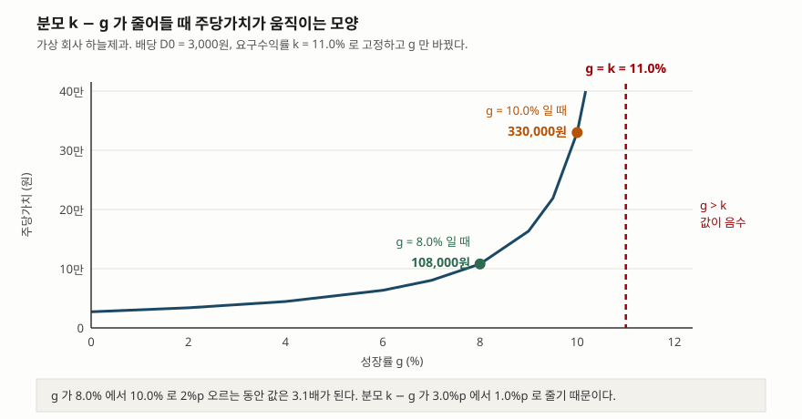

> 예제의 회사 `하늘제과`·`여울전기`와 모든 숫자는 계산 원리를 보이려고 만든 가상 값이다. 실제 기업과 관계가 없다. 요구수익률 11.0%는 설명용 가정값이다.

## 들어가며

배당을 꼬박꼬박 주는 회사를 하나 보고 있다고 하자. 주당 3,000원씩 들어오고, 작년에도 그랬고 재작년에는 2,800원이었다. 이 주식이 얼마짜리인지를 따져 보려는데 PER이나 PBR은 결국 다른 회사와 견주는 값이라 "비슷한 회사가 그 값에 거래되니까"라는 말밖에 못 한다.

그래서 돌아가는 곳이 배당이다. 주주가 회사에서 실제로 받는 현금은 배당뿐이니, 앞으로 받을 배당을 전부 현재가치로 당기면 그게 값이라는 발상이다. 식은 한 줄이고 입력은 세 개뿐이다. 그런데 이 세 개 중 하나를 0.5%p만 바꿔도 결과가 20% 움직이고, 어떤 조합에서는 값이 무한대로 날아가거나 음수가 된다. 식이 간단한 만큼 어디까지가 쓸 수 있는 구간인지를 아는 것이 이 모형의 전부다.

## 개념

배당할인모형(Dividend Discount Model, DDM)은 주식의 값을 앞으로 받을 배당의 현재가치 합으로 본다. Gordon과 Shapiro가 1956년 `Management Science`에 실은 논문이 출발점이고, 논문의 식 (1)이 이것이다.

```text
P0 = Σ Dt / (1+k)^t        (t = 1, 2, … ∞)

P0 : 현재 주가       Dt : t 시점에 기대되는 배당       k : 요구수익률
```

이 식만으로는 계산할 수 없다. `Dt`를 무한히 알아야 하기 때문이다. 두 사람은 가정 두 개로 이것을 닫았다. 하나, 회사가 세후이익의 일정 비율 `b`를 유보한다. 둘, 회사가 자기자본 장부가에 대해 `r`의 수익률을 올린다. 그러면 이익은 해마다 `br`의 비율로 자라고 배당도 같은 비율로 자란다.

```text
g = b × r               유보율 × 자기자본이익률
```

논문은 연속 배당·연속 할인을 가정해 적분하고 식 (7)에 이르는데, 그 결과가 `P0 = D0 / (k − g)`다. 여기에 붙는 조건을 논문은 이렇게 적는다. 해가 존재할 조건은 `k > g`이며, 그렇지 않으면 `P0`가 무한대이거나 음수가 된다는 것이다. 이 한 줄이 모형이 쓸 수 있는 구간 전체를 정한다.

식 (7)을 `k`에 대해 풀면 식 (8)이 나온다.

```text
k = D0 / P0 + g         배당수익률 + 성장률
```

주식이 거래되는 가격에 내포된 요구수익률은 배당수익률에 성장률을 더한 값이라는 뜻이다. 논문은 이 `k`를 배당수익률·이익수익률과 구분해 **성장을 반영한 이익률**이라 부른다.

자기자본이익률이 어디서 오는지는 [수익성 비율 — ROE와 ROA](../../ratios/2026-10-01-roe-vs-roa/index.md)와 [듀폰 분석](../../ratios/2026-10-02-dupont-roe-three-factors/index.md)에, 요구수익률 `k`를 만드는 쪽은 [WACC](../2026-10-15-wacc-capital-structure/index.md)에, 장부가에서 출발하는 다른 계열의 모형은 [잔여이익모형(RIM)](../2026-10-15-residual-income-model-book-value/index.md)에 정리해 두었다.

## 구조



> **출처**: [Myron J. Gordon and Eli Shapiro, "Capital Equipment Analysis: The Required Rate of Profit," *Management Science* 3(1), 1956, pp. 102–110 — 식 (7) P0 = D0/(k−g), 식 (8) k = D0/P0 + g, "The condition for a solution is k > g"](https://doi.org/10.1287/mnsc.3.1.102)

가로축이 성장률, 세로축이 그 가정에서 나오는 주당가치다. 왼쪽 절반은 거의 평평하다가 오른쪽으로 갈수록 가팔라진다. 붉은 점선이 `g = k = 11.0%` 자리이고, 곡선은 여기에 닿지 못하고 위로 달아난다. 분모가 `k − g`이므로 둘의 거리가 줄어드는 만큼 값이 커지기 때문이다. 점선 오른쪽은 분모가 음수가 되는 구간이라 곡선을 그리지 않았다.

## 동작 원리

### D0 와 D1 — 교과서와 원 논문이 다른 자리

교과서는 이 모형을 `P0 = D1 / (k − g)`로 쓴다. 분자가 **다음 해 배당**이다. 원 논문의 식 (7)은 분자가 **현재 배당** `D0`다. 베끼는 과정에서 생긴 오류가 아니라 할인 방식이 다른 데서 오는 차이다. 논문은 배당이 연속으로 지급되고 연속으로 할인된다고 가정했고, 교과서는 1년 뒤에 한 번 지급되고 한 번 할인된다고 가정한다.

예제 `[2]`가 금액 차이를 보인다. 같은 `D0 = 3,000원`, `k = 11.0%`, `g = 8.0%`를 넣으면 이산 형태는 108,000원, 연속 형태는 100,000원이다. 두 값의 비는 1.0800으로 정확히 `(1 + g)`다. 성장률이 높을수록 둘이 멀어진다.

실무에서 쓰는 것은 이산 형태다. 다만 **같은 식이라고 생각하고 두 자료의 숫자를 비교하면 안 된다.** 어느 쪽을 썼는지에 따라 8%가 그냥 차이난다.

예제 `[3]`이 이것을 거꾸로 확인한다. 연속 형태로 나온 100,000원에 식 (8)을 적용하면 배당수익률 3.00%에 성장률 8.00%를 더해 정확히 11.00%가 돌아온다. 분자 가정이 맞아떨어질 때만 식이 닫힌다.

### 장부가와 시장가가 같으면 두 수익률이 같아진다

논문의 식 (10)과 (11)에 재미있는 관계가 하나 있다. 이익수익률 `y = Y/P`와 성장을 반영한 이익률 `k = D/P + br`은 **장부가와 시장가가 같을 때 값이 같아진다.** 논문은 그 이유를 이렇게 설명한다. 이익수익률은 주주가 받는 금액이 주당순이익과 같다고 가정해 지급액을 부풀리고, 동시에 그것이 자라지 않는다고 가정해 지급액을 줄인다. 장부가와 시장가가 같은 경우에 두 오차가 정확히 상쇄된다.

예제 `[4]`가 이것을 계산한다. 하늘제과의 주당 장부가는 25,000원이고 주당순이익은 5,000원이다. 가격이 장부가와 같다면 이익수익률은 20.00%, `D/P + br`도 12.00% + 8.00% = 20.00%로 같다. 가격이 100,000원이면 4배로 벌어진 장부가·시장가 차이만큼 두 값이 5.00%와 11.00%로 갈린다.

[PBR과 청산가치](../2026-10-03-pbr-below-book-value/index.md)에서 다룬 1배라는 선이 여기서도 경계로 등장하는 셈이다.

### 분모가 줄어드는 만큼 값이 커진다

예제 `[5]`가 발산 구간을 숫자로 적는다. `k`를 11.0%로 고정하고 `g`만 올리면 이렇게 된다.

- `g = 4.0%` → 44,571원
- `g = 8.0%` → 108,000원
- `g = 10.0%` → 330,000원 (8.0%일 때의 3.1배)
- `g = 10.9%` → 3,327,000원 (30.8배)
- `g = 11.0%` → 분모가 0이라 정의되지 않는다
- `g = 12.0%` → -336,000원

분자인 `D1`은 3,120원에서 3,360원으로 7.7%밖에 움직이지 않는데 값은 75배가 된다. 전부 분모에서 일어나는 일이다. `g = 12.0%`에서 나온 음수는 계산 결과일 뿐 뜻이 없다. 논문이 `k > g`를 해의 존재 조건으로 못 박은 자리다.

### 0.5%p 의 가정 차이가 20%의 값 차이가 된다

예제 `[6]`은 기준점에서 가정을 조금씩 흔든 것이다. `g`를 8.0%에서 8.5%로 0.5%p 올리면 값은 108,000원에서 130,200원으로 20.6% 오른다. `k`를 11.0%에서 10.5%로 0.5%p 내리면 20.0% 오른다.

성장률 추정치가 0.5%p 틀리는 것은 흔한 일이다. 요구수익률도 베타를 어떻게 잡느냐에 따라 그 정도는 쉽게 움직인다. 그래서 이 모형의 결과를 하나의 숫자로 제시하는 것은 그 자체로 오해를 만든다. **가정을 범위로 두고 값도 범위로 적는 쪽이 정직하다.**

### 배당성향을 바꿀 때 값이 어디로 움직이는지는 ROE 가 정한다

`g = br`이므로 배당성향을 낮추면 `D0`가 줄고 `g`가 는다. 분자가 작아지고 분모도 작아진다. 어느 쪽이 이기는지는 자기자본이익률과 요구수익률의 대소가 정한다.

예제 `[7]`은 자기자본이익률 20.0%인 경우다. 배당성향을 100%에서 60%로 낮추면 값이 45,455원에서 108,000원으로 오른다. 유보한 돈이 요구수익률보다 높은 수익을 내니 당연한 방향이다. 그런데 40%로 더 낮추면 `g`가 12.0%가 되어 `k`를 넘고, 모형이 발산해 버린다. **자기자본이익률이 요구수익률보다 높은 회사에서 유보율을 계속 높이면 이 모형은 유한한 값을 내놓지 못한다.**

예제 `[8]`은 자기자본이익률 9.0%인 경우다. 배당성향 100%에서 20,455원, 20%에서 12,695원으로 반대 방향이다. 유보한 돈이 요구수익률에 못 미치는 수익을 내므로 쌓아 둘수록 값이 내려간다. 같은 "배당을 줄인다"는 행동이 두 회사에서 정반대로 읽히는 것이다.

배당 지급과 자사주 매입을 합쳐 보는 관점은 [총주주수익률(TSR)](../2026-10-16-tsr-dividend-buyback/index.md)에 따로 적어 두었다.

### 고성장 구간은 두 단계로 나눠 넘긴다

성장률이 요구수익률보다 높은 회사를 평가해야 한다면 단일 성장 모형으로는 할 수 없다. 흔히 쓰는 우회로는 고성장 기간을 따로 할인하고, 그 뒤부터 안정 성장으로 내려앉는다고 보고 고든 식을 붙이는 것이다.

예제 `[9]`가 그 계산이다. 배당 1,000원이 5년간 20.0%로 자라고 그 뒤 4.0%로 내려앉는다고 두면, 5년치 배당의 현재가치 합은 6,356원이고 5년 말 종가치의 현재가치는 21,939원이다. 합계 28,295원 중 **77.5%가 종가치에서 나온다.**

이 비중이 이 방법의 약점이다. 5년치 배당은 비교적 가늠할 수 있는 숫자인데, 값의 대부분은 그 뒤에 쓰는 영구 성장률 하나가 정한다. 고성장 구간을 늘려도 사정은 크게 달라지지 않는다. 단일 성장 모형의 민감도를 피하려고 두 단계로 나눴지만 민감도가 종가치로 옮겨 갔을 뿐이다.

## 실습 예제

주당 장부가 25,000원을 공통으로 두고 자기자본이익률만 20.0%와 9.0%로 다르게 잡은 두 회사를 만들었다. 요구수익률은 둘 다 11.0%로 고정한 가정값이다.

전체 소스: [`code/`](code/) · 수행 기록: [`code/output.txt`](code/output.txt)

```text
[1] 가상 회사 둘의 주당 수치 — 요구수익률은 둘 다 11.0% 로 둔다 (원, %)
                 장부가     ROE       순이익      배당성향        배당     유보율    g=br
하늘제과          25,000    20.0     5,000      60.0     3,000    40.0     8.0
여울전기          25,000     9.0     2,250      60.0     1,350    40.0     3.6

[2] 하늘제과 — 같은 입력에서 나오는 두 개의 값 (원)
                                      분자        분모        주당가치
이산 P0 = D1/(k-g)                   3,240    0.0300     108,000
연속 P0 = D0/(k-g)                   3,000    0.0300     100,000
두 값의 비는 1.0800 로 (1+g) 와 같다.

[4] 하늘제과 — 값이 장부가와 같을 때 두 수익률 (원, %)
                          가격       이익수익률 y  k = D/P + br
장부가와 같을 때             25,000         20.00         20.00
연속 형태의 값             100,000          5.00         11.00

[5] 하늘제과 — 성장률이 요구수익률 11.0% 에 다가갈 때 (원, %)
       g       k-g       분자 D1          주당가치     g=8.0% 대비
     4.0       7.0       3,120        44,571          0.4배
     6.0       5.0       3,180        63,600          0.6배
     8.0       3.0       3,240       108,000          1.0배
     9.0       2.0       3,270       163,500          1.5배
    10.0       1.0       3,300       330,000          3.1배
    10.5       0.5       3,315       663,000          6.1배
    10.9       0.1       3,327     3,327,000         30.8배
    11.0       0.0           —       정의되지 않음
    12.0      -1.0       3,360      -336,000    음수 — 뜻이 없다

[6] 하늘제과 — 가정을 0.5%p 씩 흔들면 (원, %)
                             g       k        주당가치        변화
기준                         8.0    11.0     108,000     +0.0%
g 를 +0.5%p                 8.5    11.0     130,200    +20.6%
g 를 -0.5%p                 7.5    11.0      92,143    -14.7%
k 를 +0.5%p                 8.0    11.5      92,571    -14.3%
k 를 -0.5%p                 8.0    10.5     129,600    +20.0%

[7] 하늘제과처럼 ROE 20.0% 일 때 배당성향을 바꾸면 (원, %)
      배당성향       배당 D0      g=br       k-g            주당가치
     100.0       5,000       0.0      11.0          45,455
      80.0       4,000       4.0       7.0          59,429
      60.0       3,000       8.0       3.0         108,000
      40.0       2,000      12.0      -1.0      g ≥ k — 발산
      20.0       1,000      16.0      -5.0      g ≥ k — 발산
       0.0           0      20.0      -9.0   배당이 0 — 적용 불가

[8] 여울전기처럼 ROE 9.0% 일 때 배당성향을 바꾸면 (원, %)
      배당성향       배당 D0      g=br       k-g            주당가치
     100.0       2,250       0.0      11.0          20,455
      80.0       1,800       1.8       9.2          19,917
      60.0       1,350       3.6       7.4          18,900
      40.0         900       5.4       5.6          16,939
      20.0         450       7.2       3.8          12,695
       0.0           0       9.0       2.0   배당이 0 — 적용 불가
```

`[1]`에서 두 회사의 차이는 자기자본이익률 하나뿐이다. 장부가도 배당성향도 같다. 그 하나가 `g = br`를 통해 성장률을 8.0%와 3.6%로 갈라 놓는다.

`[2]`와 `[4]`는 원 논문의 식을 그대로 확인하는 자리다. 두 값의 비 1.0800이 `(1 + g)`와 같고, 가격이 장부가와 같을 때 이익수익률 20.00%와 `D/P + br` 20.00%가 일치한다.

`[5]`의 마지막 세 줄이 이 모형의 경계다. `g = 10.9%`에서 3,327,000원이 나오는데, 이 값을 "이 주식의 적정가치"라고 부를 수는 없다. 분모가 0.1%p까지 좁혀졌을 뿐이다. `g = 11.0%`에서 식은 정의되지 않고, 그 위에서는 음수가 나온다.

`[7]`과 `[8]`을 나란히 읽으면 배당성향의 방향이 자기자본이익률에 달려 있다는 것이 보인다. 20.0%인 회사는 배당성향을 낮출수록 값이 오르다가 40%에서 발산하고, 9.0%인 회사는 배당성향을 낮출수록 값이 내려간다. 두 표의 마지막 줄은 같다. 배당성향이 0이면 분자가 0이라 모형을 적용할 수 없다. 원 논문도 이익과 배당이 모두 0일 때 이 측정치를 믿을 수 없다고 적는다.

`[3]`과 `[9]`는 [`code/output.txt`](code/output.txt)에 있다. `[9]`의 2단계 계산에서 5년치 배당 현재가치 6,356원, 종가치의 현재가치 21,939원으로 합계 28,295원이 나오고, 그중 77.5%가 종가치에서 온다.

## 실무에서 주의할 점

- **분자가 `D0`인지 `D1`인지 먼저 확인한다.** 예제 `[2]`에서 같은 입력의 두 값이 100,000원과 108,000원이었다. 성장률이 높을수록 차이가 커지므로, 다른 사람이 계산한 값을 받을 때는 이것부터 묻는다.
- **`k > g`를 만족하는지 계산 전에 확인한다.** 식은 조건을 어겨도 숫자를 내놓는다. 예제 `[5]`의 -336,000원이 그것이다. 음수가 나오면 회사가 아니라 가정이 잘못된 것이다.
- **영구 성장률에 상한을 둔다.** 영구히 자란다는 가정이므로 한 회사의 `g`가 그 경제의 장기 명목성장률을 넘으면, 시간이 충분히 지났을 때 그 회사가 경제 전체보다 커진다는 뜻이 된다. 상한을 쓰려면 그 수치의 출처를 함께 적는다.
- **값을 하나로 제시하지 않는다.** 예제 `[6]`에서 가정 하나가 0.5%p 흔들릴 때 값이 20% 움직였다. `g`와 `k`를 각각 범위로 두고 결과도 범위로 적는 편이 쓸모 있다.
- **배당을 주지 않는 회사에는 쓸 수 없다.** 분자가 0이면 값이 0으로 떨어진다. 이익을 내면서 배당하지 않는 회사의 가치가 0일 리 없으므로, 그런 경우에는 잉여현금흐름이나 잔여이익처럼 분자가 다른 모형으로 간다.
- **`g = br`의 `r`은 장부가 기준 수익률이다.** 원 논문은 `r`을 보통주 장부가에 대한 수익률로 정의한다. 시장가 기준 수익률을 넣으면 식이 닫히지 않는다. 자기자본이익률이 자산재평가나 자사주 취득으로 흔들리면 `g`도 같이 흔들린다.
- **2단계로 나눠도 민감도는 사라지지 않는다.** 예제 `[9]`에서 값의 77.5%가 종가치에서 왔다. 고성장 기간을 자세히 추정해도 결론은 영구 성장률 하나에 달려 있다.
- **배당 외의 주주환원을 빠뜨리지 않는다.** 자사주 매입으로 돌려주는 회사라면 배당만 세는 이 모형이 값을 낮게 잡는다. 이때는 배당과 자사주를 합쳐 보는 쪽이 맞다.

## 정리

- 배당할인모형은 주식의 값을 앞으로 받을 배당의 현재가치 합으로 본다. Gordon과 Shapiro(1956)가 유보율 `b`와 자기자본이익률 `r` 두 가정으로 무한급수를 닫아 `g = br`을 얻고 `P0 = D0/(k−g)`에 이르렀다.
- 교과서의 `P0 = D1/(k−g)`는 이산 할인을 가정한 형태다. 같은 입력에서 두 값이 `(1 + g)`배만큼 갈린다. 예제에서 108,000원과 100,000원이었다.
- 모형이 성립할 조건은 `k > g` 하나다. 원 논문이 그렇지 않으면 값이 무한대이거나 음수가 된다고 적어 두었고, 예제에서 `g = 11.0%`는 정의되지 않고 `g = 12.0%`는 -336,000원이었다.
- 분모가 작아지는 만큼 값이 커진다. `g`가 8.0%에서 10.9%로 2.9%p 오르는 동안 값은 30.8배가 됐다. 가정 0.5%p의 차이가 값 20%의 차이로 돌아온다.
- 배당성향을 낮출 때 값이 오르는지 내리는지는 자기자본이익률과 요구수익률의 대소가 정한다. 자기자본이익률이 더 높으면 오르다가 `g`가 `k`에 닿는 지점에서 발산한다.
- 고성장 회사는 2단계로 나눠 계산하지만, 예제에서 값의 77.5%가 종가치에서 나왔다. 민감도가 없어진 것이 아니라 영구 성장률 쪽으로 옮겨 간 것이다.

## 참고 자료

- [Myron J. Gordon and Eli Shapiro, "Capital Equipment Analysis: The Required Rate of Profit," *Management Science* 3(1), October 1956, pp. 102–110](https://doi.org/10.1287/mnsc.3.1.102) — INFORMS 발행. 식 (1) 배당의 현재가치 합, 식 (3)~(6) `b`와 `r` 가정에서 `g = br`을 얻는 과정, 식 (7) `P0 = D0/(k−g)`와 해의 존재 조건 `k > g`, 식 (8) `k = D0/P0 + g`, 식 (10)(11) 장부가와 시장가가 같을 때 이익수익률과 `k`가 일치하는 관계, 이익과 배당이 모두 0일 때의 한계
- [Kentucky Public Service Commission, Case No. 2026-00099, AG 1-161 Attachment U](https://psc.ky.gov/pscecf/2026-00099/allyson%40hloky.com/07072026110131/2026-00099_PSC_AG_DR_Set_1_No_161_Attachment_U.pdf) (제3자 전재) — 위 논문 전문을 규제기관 제출자료에 첨부한 사본. 원문 발행처는 INFORMS이며 이 링크는 본문을 바로 열기 위한 편의 링크다
- John Burr Williams, *The Theory of Investment Value*, Harvard University Press, 1938, pp. 87–96 — 배당의 현재가치로 주식을 평가하는 접근을 먼저 제시한 저작. Gordon과 Shapiro가 성장을 다룬 선행 연구로 인용하며, 그 모형이 임의적이고 복잡했다고 평가한다
- [한국회계기준원 — 시행 중인 K-IFRS 기준서 목록](https://www.kasb.or.kr/front/board/ingAccountingList.do) — 배당과 자기자본 항목의 측정·표시 근거가 되는 기업회계기준서 원문 발행처
