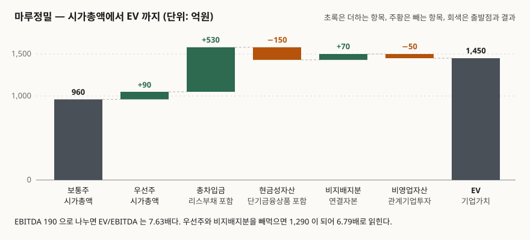

> 예제의 회사 `마루정밀`·`새벌소프트`와 모든 숫자는 계산 원리를 보이려고 만든 가상 값이다. 실제 기업과 관계가 없다. 주가·차입금·리스료는 전부 설명용 가정값이다.

## 들어가며

업종 비교표를 만들려고 회사 다섯 곳의 EV/EBITDA 를 나란히 적어 두었다고 하자. 숫자는 7배에서 9배 사이에 모여 있고, 그중 한 곳만 7.2배라 싸 보인다. 그런데 그 회사는 상장 우선주가 따로 있고 종속기업 지분도 70%만 들고 있다. 계산할 때 쓴 공식은 "시가총액 + 차입금 − 현금"이었고, 우선주와 비지배지분은 들어가지 않았다.

이 상태로 다시 세어 보면 그 회사의 배수는 7.6배가 된다. 싸 보이던 자리가 사라진다. EV 는 재무제표에 그대로 찍혀 나오는 항목이 아니라 여러 줄을 모아 조립하는 값이라, 무엇을 넣고 무엇을 빼느냐가 사람마다 다르다. 그런데 비교표는 그 차이를 보여 주지 않는다. 배수 하나만 남기 때문이다.

## 개념

EV(Enterprise Value, 기업가치)는 **회사의 영업을 통째로 사는 데 드는 값**이다. 주식 대금만 치르고 끝나는 것이 아니라 그 회사가 지고 있는 빚도 함께 넘겨받고, 금고에 있는 현금은 되돌려 받는다는 발상에서 나온다.

출발점은 보통주 시가총액이고, 거기서 **보통주주보다 앞서거나 보통주주 바깥에 있는 청구권을 모두 더한 뒤, 영업과 무관한 자산을 뺀다.**

| 항목 | 부호 | 왜 |
|---|---|---|
| 보통주 시가총액 | 출발점 | 보통주주에게 돌아갈 몫 |
| 우선주 | + | 보통주보다 앞선 청구권. 인수하려면 이쪽도 사야 한다 |
| 총차입금 | + | 채권자 몫. 리스부채도 이자를 내는 부채다 |
| 현금성자산 | − | 인수한 날 그대로 되찾는 돈 |
| 비지배지분 | + | EBITDA 는 종속기업 100% 인데 시가총액은 지배지분 몫뿐이다 |
| 비영업자산 | − | EBITDA 를 만들지 않으면서 값은 갖고 있는 자산 |

총차입금에서 현금성자산을 뺀 값을 **순차입금(Net Debt)** 이라 부른다. 실무에서 `EV = 시가총액 + 순차입금`이라고 줄여 쓰는 일이 많은데, 이 줄임말이 우선주와 비지배지분을 조용히 떨어뜨린다.

항목 하나하나는 회계기준이 정의하거나 표시하게 한 것들이다.

- **현금및현금성자산**: K-IFRS 제1007호 현금흐름표는 현금성자산을 유동성이 매우 높고 가치변동 위험이 경미한 단기 투자자산으로 정의하고(문단 6), 대개 취득일부터 만기 3개월 이내인 것으로 본다(문단 7). 만기 3개월을 넘는 단기금융상품은 이 정의 밖이다.
- **비지배지분**: K-IFRS 제1110호 연결재무제표는 비지배지분을 연결재무상태표의 자본에 포함하되 지배기업 소유주지분과 구분해 별도로 표시하게 한다(문단 22). K-IFRS 제1001호 재무제표 표시도 재무상태표에 표시할 항목으로 "자본에 표시된 비지배지분"과 "지배기업의 소유주에게 귀속되는 납입자본과 적립금"을 따로 든다(문단 54 (17)·(18)).
- **우선주**: K-IFRS 제1032호 금융상품 표시는 확정된 시점에 확정된 금액을 발행자가 의무적으로 상환해야 하는 우선주를 금융부채로 본다(문단 18). 이런 우선주는 이미 부채 항목에 들어 있으므로 차입금 쪽에서 한 번 세어진다. 반대로 자본으로 분류된 우선주, 특히 국내 시장에서 흔한 상장 구형·신형 우선주는 부채 항목에 없으므로 **따로 더해 주지 않으면 EV 에서 통째로 빠진다.**
- **리스부채**: K-IFRS 제1116호 리스를 적용한 뒤로 운용리스도 자산과 부채로 올라온다. 리스료는 감가상각비와 이자비용으로 갈라지므로 EBITDA 는 그만큼 커진다. 분모가 커졌는데 분자에서 리스부채를 빼면 두 숫자의 기준이 어긋난다.

## 구조



> **출처**: [K-IFRS 제1007호 현금흐름표 — 문단 6·7 현금성자산 정의](https://accountingwiki.co.kr/standards/1007) (제3자 전재) · [K-IFRS 제1110호 연결재무제표 — 문단 22 비지배지분 별도 표시](https://accountingwiki.co.kr/standards/1110) (제3자 전재) · [K-IFRS 제1032호 금융상품 표시 — 문단 18 의무상환 우선주의 금융부채 분류](https://accountingwiki.co.kr/standards/1032) (제3자 전재) · 가산·차감 순서는 [Wall Street Prep, Equity Value to Enterprise Value Bridge](https://www.wallstreetprep.com/knowledge/equity-value-to-enterprise-value-bridge) (2차 자료). 금액은 이 글의 [`code/output.txt`](code/output.txt) `[2]`에서 옮겼다.

막대 하나가 항목 하나다. 보통주 시가총액 960 에서 출발해 우선주와 차입금을 쌓아 1,580 까지 올라갔다가, 현금성자산을 빼고 비지배지분을 더하고 비영업자산을 빼서 1,450 에 닿는다. 중간 봉우리 1,580 과 결론 1,450 의 차이가 130 인데, 이 130 이 "공식을 어떻게 썼느냐"로 갈리는 구간이다.

## 동작 원리

왜 비지배지분을 **더하는지**가 가장 자주 막히는 자리다. 비지배지분은 내 주주의 몫이 아닌데 왜 기업가치에 넣느냐는 물음이다.

답은 분모에 있다. 연결손익계산서의 매출·영업이익·EBITDA 는 **종속기업을 100% 합산한 값**이다. 지분을 70%만 들고 있어도 EBITDA 에는 종속기업 것이 전부 들어간다. 그런데 보통주 시가총액은 지배기업 주주에게 돌아갈 30% 바깥의 몫을 반영하지 않는다. 분모가 100% 인데 분자가 70% 면 배수가 실제보다 작게 나온다. 비지배지분을 더하는 것은 **분자를 분모와 같은 범위로 맞추는 조정**이다.

비영업자산을 빼는 것도 같은 논리를 거꾸로 적용한 것이다. 관계기업투자는 지분법으로 처리되어 영업이익에 들어가지 않는다. EBITDA 를 만들지 않는 자산이 분자에만 남아 있으면 배수가 부풀려진다.

현금성자산의 범위에서도 같은 문제가 생긴다. 만기 3개월을 넘는 단기금융상품은 제1007호의 현금성자산 정의 밖이지만, 영업에 묶여 있지 않다는 점에서는 현금과 다르지 않다. 그래서 뺄 것인가가 갈린다. **갈린다는 사실 자체를 적어 두는 것이 비교표에서 할 수 있는 최선이다.**

## 실습 예제

가상 회사 마루정밀의 연결 숫자로 다리를 조립하고, 항목을 하나씩 빠뜨렸을 때 배수가 어디까지 움직이는지 계산했다.

```python
MARKET_CAP = to_eok(COMMON_SHARES, COMMON_PRICE)     # 보통주 8,000,000주 × 12,000원
PREFERRED_CAP = to_eok(PREFERRED_SHARES, PREFERRED_PRICE)
TOTAL_DEBT = SHORT_TERM_DEBT + LONG_TERM_DEBT + LEASE_LIABILITY
TOTAL_CASH = CASH + SHORT_TERM_FINANCIAL
NET_DEBT = TOTAL_DEBT - TOTAL_CASH

BASE_EV = (MARKET_CAP + PREFERRED_CAP + TOTAL_DEBT
           - TOTAL_CASH + NON_CONTROLLING - NON_OPERATING)
```

전체 소스: [`code/`](code/)

조립 과정은 이렇게 찍힌다.

```text
[2] 시가총액에서 EV 까지 — 더하고 빼는 순서 (단위: 억원)
--------------------------------------------------------------------------
  보통주 시가총액            +960.0  →  누계     960.0   출발점. 보통주주 몫
  + 우선주 시가총액           +90.0  →  누계   1,050.0   보통주보다 앞선 청구권
  + 총차입금                 +530.0  →  누계   1,580.0   채권자 몫. 리스부채 포함
  - 현금성자산               -150.0  →  누계   1,430.0   인수하면 그대로 돌려받는 돈
  + 비지배지분                +70.0  →  누계   1,500.0   EBITDA 는 100% 인데 시가총액은 지배지분뿐
  - 비영업자산                -50.0  →  누계   1,450.0   EBITDA 를 만들지 않는 자산
--------------------------------------------------------------------------
  EV = 1,450.0        EV/EBITDA = 7.63배
```

항목을 빠뜨리면 이렇게 갈린다. 아래 값은 [`code/output.txt`](code/output.txt) `[3]`의 숫자다.

| 경우 | EV | EBITDA | 배수 | 기준 대비 |
|---|---:|---:|---:|---:|
| 기준 — 전부 반영 | 1,450.0 | 190.0 | 7.63배 | 0.0% |
| 우선주를 빼먹음 | 1,360.0 | 190.0 | 7.16배 | −6.2% |
| 비지배지분을 빼먹음 | 1,380.0 | 190.0 | 7.26배 | −4.8% |
| 우선주·비지배지분을 함께 빼먹음 | 1,290.0 | 190.0 | 6.79배 | −11.0% |
| 비영업자산을 안 뺌 | 1,500.0 | 190.0 | 7.89배 | +3.4% |
| 단기금융상품을 현금으로 안 봄 | 1,490.0 | 190.0 | 7.84배 | +2.8% |
| 리스부채만 제외 | 1,390.0 | 190.0 | 7.32배 | −4.1% |
| 리스부채 제외 + EBITDA 도 리스료만큼 내림 | 1,390.0 | 172.0 | 8.08배 | +5.9% |

같은 회사, 같은 재무제표인데 6.79배에서 8.08배까지 1.29배 폭으로 벌어진다. 기준 배수 7.63배의 16.9% 다. 업종 비교표에서 7배와 8배는 전혀 다른 자리에 놓이는 숫자인데, 그 차이가 회사의 사정이 아니라 계산한 사람의 공식에서 나왔다.

마지막 두 줄을 따로 볼 만하다. 리스부채를 빼면서 EBITDA 는 그대로 두면 배수가 **내려가고**(7.32배), 리스료만큼 EBITDA 도 내리면 **올라간다**(8.08배). 같은 "리스를 빼자"는 결정인데 분자만 손대느냐 분모까지 손대느냐로 방향이 뒤집힌다.

순현금 회사는 다리가 거꾸로 선다.

```text
[4] 새벌소프트 — 순현금 회사에서는 EV 가 시가총액보다 작다 (단위: 억원)
--------------------------------------------------------------------------
  시가총액 620.0   총차입금 15.0   현금성자산 280.0   EBITDA 48.0
  순차입금 = 15.0 - 280.0 = -265.0  (음수 = 순현금)
  EV = 620.0 + 15.0 - 280.0 = 355.0
  EV 가 시가총액의 57.3% 다
  EV/EBITDA = 7.40배   (시가총액/EBITDA 로 재면 12.92배)
--------------------------------------------------------------------------
```

현금이 차입금보다 많으면 순차입금이 음수가 되고 EV 가 시가총액보다 작아진다. 시가총액 기준으로는 12.92배인 회사가 EV 기준으로는 7.40배다. 현금을 많이 쌓아 둔 회사에서 두 배수가 크게 어긋나는 것이 이 때문이다.

## 실무에서 주의할 점

- **공식을 먼저 맞추고 숫자를 넣는다.** 비교표를 만들 때 가장 먼저 할 일은 "우선주를 넣는가, 비지배지분을 넣는가, 리스부채를 넣는가, 현금은 어디까지인가" 네 가지를 정하고 표 어딘가에 적어 두는 것이다. 회사별로 공식이 다르면 비교표는 아무것도 비교하지 않는다.
- **비지배지분을 장부금액으로 넣는 것은 어림값이다.** 연결자본에 찍힌 비지배지분은 취득 시점 이후의 장부가 누적이라 시장가와 다르다. 종속기업이 상장돼 있으면 그 시가로, 아니면 종속기업 EBITDA 에 같은 배수를 적용해 환산하는 쪽이 일관되지만, 환산 배수가 구하려는 배수와 얽혀 순환이 생긴다. 어느 쪽을 썼는지 적어 둔다.
- **우선주는 부채로 분류됐는지부터 본다.** 제1032호 문단 18에 걸려 금융부채로 분류된 우선주를 시가총액에 또 더하면 두 번 세는 것이 된다. 재무상태표의 부채 항목과 자본 항목을 같이 펴 놓고 어느 쪽에 있는지 확인한 뒤 더한다.
- **분자와 분모의 회계 기준을 맞춘다.** 리스가 대표적이지만, 연금 미적립액이나 이연 인수대금처럼 부채성 항목을 EV 에 더할 때도 그것이 EBITDA 에 어떤 영향을 주는지 같이 본다. 한쪽만 조정하면 배수가 잘못된 방향으로 움직인다.
- **배수 하나가 아니라 범위를 남긴다.** 공식을 바꿔 가며 계산한 6.79~8.08배 같은 범위가, 정밀해 보이는 7.63배 하나보다 실제로 아는 것에 가깝다.

## 정리

- EV 는 재무제표에 찍히는 항목이 아니라 여러 줄을 모아 조립하는 값이고, 조립 규칙이 사람마다 다르다.
- 보통주 시가총액에 우선주·총차입금·비지배지분을 더하고 현금성자산·비영업자산을 뺀다. `시가총액 + 순차입금`이라는 줄임말은 우선주와 비지배지분을 떨어뜨린다.
- 비지배지분을 더하는 이유는 분모인 EBITDA 가 종속기업을 100% 합산하기 때문이다. 분자를 같은 범위로 맞추는 조정이다.
- 가상 회사로 계산해 보면 같은 재무제표에서 배수가 6.79배~8.08배, 폭 1.29배로 갈렸다. 기준 배수의 16.9% 다.
- 순현금 회사에서는 EV 가 시가총액보다 작아진다. 예제에서는 시가총액 기준 12.92배가 EV 기준 7.40배였다.

## 참고 자료

- [한국회계기준원 — 시행 중인 K-IFRS 기준서 목록](https://www.kasb.or.kr/front/board/ingAccountingList.do) — 제1001호·제1007호·제1032호·제1110호·제1116호 원문 발행처
- [K-IFRS 제1007호 현금흐름표 — 문단 6·7](https://accountingwiki.co.kr/standards/1007) (제3자 전재) — 현금성자산 정의와 만기 3개월 기준
- [K-IFRS 제1032호 금융상품 표시 — 문단 18](https://accountingwiki.co.kr/standards/1032) (제3자 전재) — 의무상환 우선주의 금융부채 분류
- [K-IFRS 제1110호 연결재무제표 — 문단 22](https://accountingwiki.co.kr/standards/1110) (제3자 전재) — 비지배지분의 자본 내 별도 표시
- [K-IFRS 제1001호 재무제표 표시 — 문단 54](https://accountingwiki.co.kr/standards/1001) (제3자 전재) — 재무상태표 표시 항목 (17)·(18)
- [IFRS Foundation — IAS 32 Financial Instruments: Presentation](https://www.ifrs.org/issued-standards/list-of-standards/ias-32-financial-instruments-presentation/) — 부채·자본 분류 원문
- [IFRS Foundation — IFRS 10 Consolidated Financial Statements](https://www.ifrs.org/issued-standards/list-of-standards/ifrs-10-consolidated-financial-statements/) — 비지배지분 표시 원문
- [Wall Street Prep — Equity Value to Enterprise Value Bridge](https://www.wallstreetprep.com/knowledge/equity-value-to-enterprise-value-bridge) — 가산·차감 항목 순서(2차 자료)
