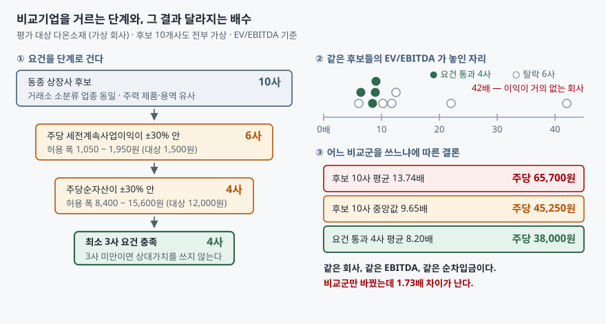

## 들어가며

종목 토론방이든 증권사 리포트든, 밸류에이션 이야기는 대개 이렇게 흘러간다.
"동종업계 평균 PER이 15배인데 이 회사는 9배다." 숫자 두 개가 나란히 놓이면
반박하기가 어렵다. 배수 자체는 나누기 한 번이라 틀릴 구석이 없어 보이기 때문이다.

그런데 "동종업계 평균 15배"라는 말에는 **어느 회사들을 동종으로 봤는지**가
빠져 있다. 몇 개 회사를 어떤 기준으로 골라 평균을 냈는지에 따라 그 15배는
9배도 되고 25배도 된다. 배수 계산은 나누기 한 번이지만, 분모를 이루는
비교군을 짜는 일은 판단이 열 번쯤 들어가는 작업이다. 틀리는 곳도 거기다.

## 개념

비교기업 평가법(상대가치 평가)은 **비슷한 회사들이 시장에서 받는 배수를 가져와
평가 대상에 적용하는 방식**이다. 회계기준에서는 이것이 시장접근법에 해당한다.
K-IFRS 제1113호 '공정가치 측정'은 널리 쓰는 세 가지 가치평가기법으로
시장접근법·원가접근법·이익접근법을 들고(문단 62), 비슷한 자산의 시장가격처럼
직접·간접으로 관측할 수 있는 값을 수준 2 투입변수로 분류한다(문단 81).

여기서 "비슷한"이 전부를 결정한다. 관측 가능한 값을 쓴다는 점에서 이 방법은
객관적으로 보이지만, 무엇을 관측할지 고르는 일은 관측이 아니다.

한국에서는 이 선택에 **법으로 정해진 기준이 하나 있다.** 합병할 때
비상장법인의 가치를 산정하면서 상대가치를 구하는 경우인데,
금융위원회 고시 「증권의 발행 및 공시 등에 관한 규정 시행세칙」 제7조가
유사회사를 이렇게 제한한다.

| 요건 | 내용 |
|---|---|
| 업종 | 한국거래소 업종분류의 소분류가 동일할 것 |
| 제품·용역 | 매출액에서 비중이 가장 큰 제품 또는 용역의 종류가 유사할 것 |
| 이익 규모 | 주당 법인세비용차감전계속사업이익이 평가 대상의 ±30% 안일 것 |
| 자산 규모 | 주당순자산이 평가 대상의 ±30% 안일 것 |
| 최소 수 | 유사회사가 3사 미만이면 비교가치를 산출하지 않는다 |

이 조문이 흥미로운 이유는 "비슷하다"를 **숫자로 못 박았다**는 데 있다.
업종이 같은 것만으로는 부족하고, 이익과 자산의 규모까지 비슷해야 한다고 본 것이다.
규정이 적용되는 범위는 합병 공시로 한정되지만, 기준 자체는 어느 평가에서나
그대로 써 볼 수 있다.

## 구조



> **출처**: 유사회사 요건은 금융위원회 고시 「[증권의 발행 및 공시 등에 관한 규정 시행세칙](https://www.law.go.kr/%ED%96%89%EC%A0%95%EA%B7%9C%EC%B9%99/%EC%A6%9D%EA%B6%8C%EC%9D%98%EB%B0%9C%ED%96%89%EB%B0%8F%EA%B3%B5%EC%8B%9C%EB%93%B1%EC%97%90%EA%B4%80%ED%95%9C%EA%B7%9C%EC%A0%95%EC%8B%9C%ED%96%89%EC%84%B8%EC%B9%99)」 제7조 — 조문 내용은 한국거래소 상장공시시스템에 올라온 [합병 증권신고서의 상대가치 산정 근거](https://kind.krx.co.kr/external/2025/06/11/000595/20250611001639/10081.htm)에서 확인했다 · 시장접근법의 위치는 [K-IFRS 제1113호 공정가치 측정 — 문단 62·81](https://accountingwiki.co.kr/standards/1113) (제3자 전재) · 배수와 금액은 이 글의 [`code/output.txt`](code/output.txt) `[1]`·`[2]`에서 옮겼다.

왼쪽은 요건이 후보를 10사에서 4사로 줄이는 과정이고, 오른쪽은 그 10사의 배수가
축 위 어디에 놓였는지다. 통과한 4사(채운 점)는 전부 왼쪽 끝에 몰려 있고,
오른쪽으로 길게 뻗은 두 점이 평균을 끌고 간다.

## 동작 원리

### 평균이 분포를 대표하지 못하는 경우

후보 10사의 EV/EBITDA를 낮은 순으로 늘어놓으면
6.1 · 6.4 · 8.4 · 8.9 · 9.1 · 10.2 · 11.8 · 12.5 · 22.0 · 42.0 이다.
열 개 중 여덟 개가 6~13배 구간에 있는데 평균은 13.74배다.
**여덟 개 어느 것보다도 큰 값이 평균으로 나온다.**

42.0배를 만든 회사는 이익이 거의 사라진 상태다. 배수의 분모가 0에 가까워지면
배수는 무한대로 발산한다. 적자로 돌아서면 아예 음수가 되고, 그래서 실무에서는
적자 회사를 비교군에서 빼지만, **적자 직전 회사는 빼지 않는다.** 이 한 칸이
평균을 3.67 끌어올린다.

중앙값은 이 문제를 피한다. 값의 크기가 아니라 순위만 보기 때문이다.
조화평균은 또 다른 방식으로 피한다. 배수의 역수(EBITDA/EV, 즉 수익률)를 평균한 뒤
되돌리는 계산이라 큰 배수일수록 역수가 0에 가까워져 영향력이 줄어든다.

### 요건을 거는 것이 평균을 고르는 것보다 세다

여기서 갈림길이 하나 생긴다. 이상치를 걸러내는 방법은 둘이다.
**비교군을 좁히거나, 더하는 방법을 바꾸거나.**

예제에서 두 방법의 효과를 나란히 재 보면, 비교군을 좁히는 쪽이 더 멀리 간다.
후보 10사에 중앙값을 써도 9.65배까지만 내려오는데, 시행세칙 요건을 걸어
4사로 좁히면 평균만 써도 8.20배다. 통계적 처리가 지우지 못한 차이가
**요건이 지운 차이**다.

왜 그런가. 평균·중앙값·조화평균은 모두 **이미 비교군에 들어온 숫자들**을 어떻게
합칠지만 결정한다. 애초에 들어오지 말았어야 할 회사를 걸러내지는 못한다.
42.0배짜리 회사는 "배수가 커서" 문제인 것이 아니라 **평가 대상과 규모가 달라서**
문제이고, 그 판단은 배수를 보고는 할 수 없다.

### 비교군이 작으면 한 회사가 결론을 쥔다

반대 방향의 함정도 있다. 요건을 엄격하게 걸수록 남는 회사가 줄고,
줄어든 비교군에서는 한 회사의 포함 여부가 곧 결론이 된다. 시행세칙이
3사 미만이면 아예 상대가치를 쓰지 말라고 정한 이유도 여기에 있을 것이다.

예제의 4사 비교군은 한 회사를 빼면 결론이 12% 움직인다. 10사 비교군은
30% 움직인다. 이 경우에는 좁은 쪽이 더 안정적인데, 넓은 쪽이 이상치를
품고 있기 때문이다. **회사 수가 많다고 안정적인 것이 아니라,
비슷한 회사가 많아야 안정적이다.**

## 실습 예제

전체 소스: [`code/`](code/)

평가 대상은 가상 회사 **다온소재**다. 주당 세전계속사업이익 1,500원,
주당순자산 12,000원, EBITDA 500억원, 순차입금 300억원, 발행주식 1,000만주로 둔다.
후보 10개사도 전부 실재하지 않는 회사다.

시행세칙 제7조의 ±30% 폭을 그대로 걸면 이렇게 걸러진다.

```text
[1] 요건을 걸어 본다 — 평가 대상(다온소재)의 ±30% 안에 드는가
  주당세전이익 허용 폭 1,050 ~ 1,950 원   (대상 1,500 원)
  주당순자산   허용 폭 8,400 ~ 15,600 원   (대상 12,000 원)

  회사                  주당세전이익       주당순자산  EV/EBITDA     PER  판정
  가람케미칼                1,400      11,200        6.4     9.5  통과
  나루머티리얼               1,750      14,000        8.9    12.1  통과
  다솜첨단소재               1,150       9,800        9.1    10.8  통과
  라온테크                   600       6,200       22.0    31.0  탈락 (둘 다)
  마루정밀                 2,600      21,000        6.1     8.2  탈락 (둘 다)
  바로소재                 1,300       5,900       11.8    14.0  탈락 (순자산)
  사월바이오                  150      10,500       42.0    88.0  탈락 (이익)
  아람전자                 1,900      16,800       10.2    13.3  탈락 (순자산)
  자온신소재                1,020      11,500       12.5    18.4  탈락 (이익)
  차율소재                 1,600      13,100        8.4    11.0  통과

  통과 4사 / 후보 10사   (최소 요건 3사)
```

자온신소재가 1,020원으로 하한 1,050원에서 30원 모자라 탈락한다는 점을 눈여겨본다.
요건은 연속이 아니라 선이고, 선 위에 걸친 회사가 있으면 그 판단이 결론을 흔든다.

비교군을 네 가지로 짜서 같은 회사를 평가하면 이렇다.

```text
[2] 같은 자료, 다른 비교군 — 적정주가가 어디까지 갈리는가
  비교군                         EV/EBITDA       기업가치       지분가치          주당가치
  후보 10사 전부 · 평균                  13.74      6,870      6,570     65,700 원
  후보 10사 전부 · 중앙값                  9.65      4,825      4,525     45,250 원
  이상치 1사만 뺀 평균                    10.60      5,300      5,000     50,000 원
  요건 통과 4사 · 평균                    8.20      4,100      3,800     38,000 원

  가장 높은 값 / 가장 낮은 값 = 1.73배
```

EBITDA도 순차입금도 그대로인데 주당가치가 38,000원에서 65,700원까지 간다.
리포트 두 장이 두 배 가까이 갈려 있다면, 전망이 달라서가 아니라
이 표의 어느 줄을 골랐는지가 달라서일 가능성이 크다.

더하는 방법만 바꾸면 폭이 훨씬 좁다.

```text
[3] 더하는 방법만 바꿔 본다 — 평균이냐 중앙값이냐 조화평균이냐
  비교군                       산술평균       중앙값      절사평균      조화평균       평균-조화
  후보 10사 전부                13.74      9.65     11.16     10.07        3.67
  요건 통과 4사                  8.20      8.65      8.65      8.04        0.16
```

10사 비교군에서는 산술평균과 조화평균이 3.67 벌어지는데, 4사 비교군에서는 0.16이다.
**비교군이 제대로 짜여 있으면 어떤 평균을 쓰든 결론이 거의 같다.**
반대로 어떤 평균을 쓰느냐로 결론이 크게 갈린다면, 그것은 평균을 고르는 문제가
아니라 비교군이 잘못됐다는 신호다.

한 회사씩 빼고 다시 계산하면 각 비교군이 얼마나 단단한지 나온다.

```text
[4] 한 회사를 빼 본다 — 어느 비교군이 더 흔들리는가
  후보 10사 — 기준 평균 13.74배 · 주당 65,700 원
    가장 많이 내리는 회사: 사월바이오        제외 시 10.60배 · 주당 50,000 원
    가장 많이 올리는 회사: 마루정밀         제외 시 14.59배 · 주당 69,944 원
    한 회사 교체로 벌어지는 폭: 19,944 원 (기준 대비 30%)

  요건 통과 4사 — 기준 평균 8.20배 · 주당 38,000 원
    가장 많이 내리는 회사: 다솜첨단소재       제외 시 7.90배 · 주당 36,500 원
    가장 많이 올리는 회사: 가람케미칼        제외 시 8.80배 · 주당 41,000 원
    한 회사 교체로 벌어지는 폭: 4,500 원 (기준 대비 12%)
```

## 실무에서 주의할 점

**"동종업계 평균"이라는 말만 나오면 그 명단을 먼저 찾는다.** 리포트에 비교기업
표가 붙어 있지 않으면 그 배수는 검증할 수 없는 숫자다. 명단이 있으면
`[1]` 표처럼 규모를 나란히 놓고 보는 데 몇 분이면 된다.

**적자 회사를 빼는 것만으로는 부족하다.** 이익이 0에 수렴하는 회사는 배수가
발산하지 양수에서 멈추지 않는다. 비교군의 배수를 낮은 순으로 늘어놓고
꼬리가 길게 뻗어 있으면, 그 꼬리를 만든 회사의 이익 규모를 확인한다.

**업종 분류는 시작점이지 결론이 아니다.** 같은 소분류 안에도 성장 단계가
다른 회사가 섞인다. 시행세칙이 업종 요건 위에 이익·자산 규모 요건을 더 얹은 것이
그 때문이고, 실제로 예제에서 업종을 통과한 10사 중 6사가 규모 요건에서 탈락한다.

**경계에 걸친 회사는 포함 여부를 둘 다 계산해 둔다.** 자온신소재는 하한에서
30원 모자라 탈락했다. 이런 회사를 넣고 뺀 두 결과를 함께 적어 두면,
읽는 사람이 결론의 폭을 알고 본다. 하나만 적으면 그 폭이 사라진다.

**비교군을 바꿔 가며 원하는 숫자가 나올 때까지 돌리지 않는다.** 이 글의 계산은
비교군을 먼저 정하고 결과를 봤다. 순서를 뒤집으면 같은 도구가 결론을
정당화하는 데 쓰인다.

## 정리

- 상대가치 평가에서 틀리는 곳은 나누기가 아니라 비교군을 짜는 판단이다.
- 「증권의 발행 및 공시 등에 관한 규정 시행세칙」 제7조는 유사회사를 업종·제품·
  이익 규모 ±30%·자산 규모 ±30%·최소 3사로 못 박는다.
- 같은 회사의 적정주가가 비교군만 바꿔 38,000원에서 65,700원까지, 1.73배 갈린다.
- 평균을 중앙값이나 조화평균으로 바꾸는 것보다 비교군을 좁히는 쪽이 효과가 크다.
- 어떤 평균을 쓰느냐로 결론이 크게 갈린다면 비교군이 잘못됐다는 신호다.

## 참고 자료

- [국가법령정보센터 — 「증권의 발행 및 공시 등에 관한 규정 시행세칙」](https://www.law.go.kr/%ED%96%89%EC%A0%95%EA%B7%9C%EC%B9%99/%EC%A6%9D%EA%B6%8C%EC%9D%98%EB%B0%9C%ED%96%89%EB%B0%8F%EA%B3%B5%EC%8B%9C%EB%93%B1%EC%97%90%EA%B4%80%ED%95%9C%EA%B7%9C%EC%A0%95%EC%8B%9C%ED%96%89%EC%84%B8%EC%B9%99) (금융위원회 고시) — 제7조 상대가치와 유사회사 요건의 발행처
- [한국거래소 상장공시시스템(KIND) — 합병 증권신고서의 상대가치 산정 근거](https://kind.krx.co.kr/external/2025/06/11/000595/20250611001639/10081.htm) — 위 조문이 실제 공시에서 어떻게 적용되는지, 유사회사 3사 미만이면 상대가치를 쓰지 않는다는 처리까지
- [한국회계기준원 — 시행 중인 K-IFRS 기준서 목록](https://www.kasb.or.kr/front/board/ingAccountingList.do) — 제1113호 원문 발행처
- [K-IFRS 제1113호 공정가치 측정 — 문단 62·81](https://accountingwiki.co.kr/standards/1113) (제3자 전재) — 세 가지 가치평가기법과 수준 2 투입변수의 정의
- [SOTP — 사업부를 따로 평가해 더하는 법](../2026-10-26-sotp-sum-of-the-parts/index.md) — 여기서 고른 배수를 부문별로 나눠 쓸 때의 합산 순서
- [PER — 이익 대비 주가를 재는 법](../2026-10-02-per-trailing-vs-forward/index.md) — 비교군을 맞춰도 분모로 삼은 이익의 기간이 어긋나면 배수가 어긋난다
