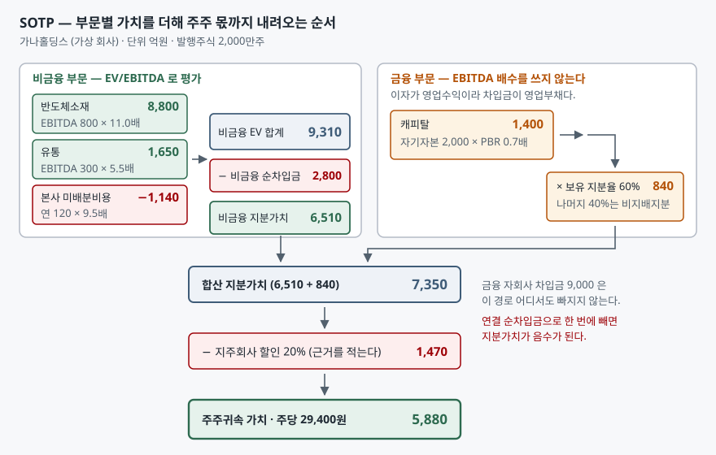

## 들어가며

한 회사를 들여다보는데 사업보고서에 부문이 셋이 적혀 있다. 반도체 소재를 만들고,
대형마트를 돌리고, 할부금융 자회사를 거느린다. 증권사 리포트 두 장을 펴 놓으면
목표주가가 한쪽은 2만원대, 한쪽은 4만원대다. 둘 다 근거란에는 똑같이
"EV/EBITDA 기준"이라고 적혀 있다.

이 상황에서 대개는 둘 중 더 그럴듯해 보이는 쪽을 고르거나, 가운데를 취한다.
그런데 두 배 차이가 나는 두 숫자의 평균에는 아무 의미가 없다. 갈린 이유가
"전망이 다르다"가 아니라 **더하는 방법이 다르다**일 때가 많기 때문이다.
사업이 셋이면 EBITDA 한 줄에 배수 한 개를 곱하는 계산은 셋 중 어느 사업도
제대로 평가하지 않는다.

## 개념

SOTP(Sum of the Parts)는 **사업부마다 따로 가치를 매긴 뒤 합치고, 전사 차원의
가감 항목을 마지막에 반영하는 평가 방식**이다. 전사 손익 한 줄에 배수 하나를
곱하는 방식과 대비된다.

왜 쪼개야 하는가. 배수는 그 사업이 얼마나 빨리 크고 얼마나 안정적인지를
한 숫자로 눌러 담은 것이다. 성장률이 다른 사업에 같은 배수를 쓰면,
느린 사업은 과대평가되고 빠른 사업은 과소평가된다. 둘을 더하면 오차가
상쇄될 것 같지만 그렇지 않다. 부문 규모가 같지 않으면 큰 쪽의 오차가 그대로 남는다.

쪼갤 근거는 회사가 이미 제공한다. K-IFRS 제1108호 '영업부문'은 최고영업의사결정자가
자원배분과 성과평가를 위해 정기적으로 검토하는 구성단위를 영업부문으로 보고,
수익·손익·자산 중 하나라도 전체의 10% 이상이면 별도 보고부문으로 공시하게 한다.
보고부문의 외부수익 합계가 기업 전체 수익의 75%에 못 미치면 기준에 미달하는
부문까지 더 끌어와 75%를 채우게 한다. 그래서 상장사 사업보고서의 부문별 정보는
SOTP의 입력값이 되기에 충분한 수준으로 쪼개져 있다.

## 구조



> **출처**: [K-IFRS 제1108호 영업부문 — 문단 5 영업부문 정의, 문단 13 양적기준, 문단 15 75% 기준](https://accountingwiki.co.kr/standards/1108) (제3자 전재) · 평가방법 선택과 조정의 근거를 평가의견서에 적도록 한 부분은 금융감독원 「[외부평가업무 가이드라인](https://www.kofia.or.kr:12443/brd/m_17/view.do?seq=43)」(2009년 제정, 금융투자협회 게시본) · 금액은 이 글의 [`code/output.txt`](code/output.txt) `[2]`에서 옮겼다.

왼쪽 묶음과 오른쪽 묶음이 서로 다른 자로 재고 있다는 점이 이 그림의 핵심이다.
비금융 부문은 EV/EBITDA로 기업가치를 구한 뒤 순차입금을 빼서 지분가치로 내려오고,
금융 부문은 애초에 지분가치를 바로 구한다. 두 결과가 만나는 지점이 아래의 합산
지분가치 7,350이고, 거기서 지주회사 할인을 뺀 5,880이 주주 몫이다.

## 동작 원리

### 단일 배수가 깨지는 곳 — 금융 자회사의 차입금

전사 하나로 묶는 계산을 끝까지 따라가 보면 어디서 깨지는지가 분명해진다.

```text
[1] 단일 배수 — 전사 EBITDA 에 복합기업 평균 배수를 곱한다
  전사 EBITDA                       1,230
  × 복합기업 평균 배수 8.0배
  = 기업가치(EV)                    9,840
  - 연결 순차입금                 -11,300   (비금융 2,800 + 금융 9,000 - 현금 500)
  = 지분가치                       -1,460
```

지분가치가 음수로 나온다. 회사가 망한 것이 아니라 계산이 틀린 것이다.

비금융 회사의 차입금은 **조달 수단**이다. 공장을 짓느라 빌렸고, 그 공장이 EBITDA를
만든다. 그래서 EBITDA 배수로 구한 기업가치에서 차입금을 빼면 주주 몫이 남는다.
그런데 할부금융 자회사의 차입금 9,000은 성격이 다르다. 싸게 빌려 비싸게 빌려주는
것이 그 회사의 영업이고, 차입금은 재고자산에 가까운 **영업부채**다. 그것을
빼 버리면 영업의 원재료를 부채로 한 번 더 세는 셈이 된다.

그래서 금융 부문은 EV를 거치지 않는다. 자기자본에 PBR을 곱해 지분가치를 바로 구하고,
그 부문의 차입금은 순차입금 계산에 넣지 않는다. 예제에서 비금융 순차입금만
2,800을 뺀 이유다.

### 본사비용 — 어느 부문에도 안 붙어 있는 돈

부문 EBITDA를 전부 더해도 전사 EBITDA가 되지 않는다. 지주회사 본부의 인건비,
브랜드 관리비, 그룹 전략 조직의 비용처럼 어느 부문에도 배분되지 않은 돈이 남기
때문이다. 예제에서는 연 120이다.

부문 가치만 더하고 이 돈을 잊으면 합계가 그만큼 부풀려진다. 이 비용은 한 해만
나가는 것이 아니라 회사가 그 형태로 있는 한 계속 나가므로, 부문 가치와 같은 자로
재야 한다. 부문 가중평균 배수 9.5배를 곱해 **−1,140이라는 음수 항목**으로 세운
것이 그 처리다. 연 120짜리 비용이 1,140의 가치를 깎는다는 뜻이고, 이 크기는
유통 부문 가치 1,650에 육박한다.

### 할인은 결론이 아니라 가정이다

마지막 −1,470은 지주회사 할인이다. 이 숫자에는 회계기준이 없다. 지배구조,
자회사 배당정책, 세금, 중복상장 여부가 전부 섞여 들어가는 자리다.

그래서 할인율은 **적어 두어야 하는 가정**이지 관행으로 가져다 쓰는 상수가 아니다.
금융감독원 「외부평가업무 가이드라인」도 예시된 방법 외의 평가방법을 쓸 때
합리적 근거를 평가의견서에 적고 결론 도출 과정을 문서화해 보존하도록 한다.
할인율을 몇 퍼센트로 잡느냐에 따라 결론이 얼마나 움직이는지는 아래 표에서 본다.

## 실습 예제

전체 소스: [`code/`](code/)

가상 회사 **가나홀딩스**의 숫자다. 실재하지 않는 회사이고, 보이려는 대비를
만들기 위해 설계한 값이다.

| 부문 | 수익 | EBITDA | 자산 | 적용 배수 |
|---|---:|---:|---:|---|
| 반도체소재 | 4,000 | 800 | 5,000 | EV/EBITDA 11.0배 |
| 유통 | 6,000 | 300 | 2,500 | EV/EBITDA 5.5배 |
| 캐피탈 (지분 60%) | 1,200 | — | 12,000 | PBR 0.7배 (자기자본 2,000) |

단위는 억원, 발행주식은 2,000만주다. 본사 미배분비용 연 120, 비금융 순차입금 2,800,
금융부문 차입금 9,000, 금융부문 현금 500으로 둔다.

세 부문 모두 수익과 자산 중 하나가 전체의 10%를 넘어 별도 보고부문이 된다.

```text
[0] 보고부문 양적기준 — 세 부문이 공시에 따로 나오는가
  부문              수익      비중       자산      비중  10% 기준
  반도체소재        4,000  35.7%    5,000  25.6%  충족
  유통           6,000  53.6%    2,500  12.8%  충족
  캐피탈          1,200  10.7%   12,000  61.5%  충족
```

부문별로 쌓아 올린 결과는 이렇다.

```text
[2] SOTP — 부문마다 배수를 따로 적용해 더한다
  반도체소재      EBITDA   800 × 11.0배 =      8,800
  유통         EBITDA   300 ×  5.5배 =      1,650
  본사비용       연   120 ×  9.5배 =     -1,140   (부문 가중평균 배수로 자본화)
  비금융 EV 합계                    9,310
  - 비금융 순차입금                -2,800   (금융부문 차입금 9,000 은 여기 넣지 않는다)
  = 비금융 지분가치                 6,510

  캐피탈        자기자본 2,000 × PBR 0.7배 =      1,400
             × 지분율 60%              =        840   (나머지는 비지배지분)

  합산 지분가치                     7,350
  - 지주회사 할인 20%                -1,470
  = 주주귀속 가치                   5,880
  주당가치                         29,400 원
```

단일 배수는 음수를, SOTP는 주당 29,400원을 내놓는다. 같은 회사의 같은 숫자다.

할인율만 바꿔 보면 결론이 어느 폭에서 움직이는지 보인다.

```text
[3] 지주회사 할인율을 바꿔 본다
       할인율         주주귀속 가치          주당가치         할인 전 대비
       0%           7,350       36,750 원               0
      10%           6,615       33,075 원            -735
      20%           5,880       29,400 원          -1,470
      30%           5,145       25,725 원          -2,205
      40%           4,410       22,050 원          -2,940
```

0%와 40% 사이에서 주당가치가 36,750원에서 22,050원까지 간다. 앞의 두 리포트가
두 배 차이로 갈렸다면, 전망이 아니라 이 한 줄의 가정에서 갈렸을 가능성이 크다.

부문 배수를 하나씩 ±2배 움직이면 어느 부문이 결론을 쥐고 있는지도 드러난다.

```text
[4] 부문 배수를 하나씩 움직여 본다 — 어느 부문이 결론을 쥐는가
  대상 부문               배수 -2배          기준        배수 +2배         폭
  반도체소재                4,740       5,880         7,020     2,281
  유통                   5,452       5,880         6,308       855
```

반도체소재 배수가 2배 흔들릴 때 주주가치는 2,281 움직이고, 유통은 855다.
EBITDA가 800 대 300이니 당연한 결과지만, 이 표가 말해 주는 것은
**검증할 시간이 한정돼 있으면 반도체소재 배수부터 따져야 한다**는 것이다.
단일 배수 계산에서는 이 우선순위가 보이지 않는다.

마지막으로 앞에서 설명한 세 가지 처리를 하나씩 빼고 다시 계산하면 각각의 무게가 나온다.

```text
[5] 자주 빠뜨리는 항목 — 하나씩 빼고 다시 계산한다
  경우                               주주귀속 가치          주당가치       기준 대비
  기준 (전부 반영)                         5,880     29,400 원           —
  본사비용을 안 뺐을 때                       6,792     33,960 원        +912
  지분율 60%를 안 썼을 때                    6,328     31,640 원        +448
  금융차입금까지 뺐을 때                        -920     -4,600 원      -6,800
```

셋 다 한쪽 방향으로만 틀린다는 점을 본다. 앞의 둘은 가치를 올리고, 마지막은
결론을 아예 뒤집는다. 실수가 상쇄되기를 기대할 수 없는 구조다.

## 실무에서 주의할 점

**부문 간 내부거래를 지우지 않으면 두 번 센다.** K-IFRS 제1108호의 부문수익은
외부고객 매출과 부문 간 매출을 모두 포함한다. 소재 부문이 유통 부문에 납품하는
구조라면 그 매출이 양쪽에 다 들어 있고, 각각에 배수를 곱해 더하면 같은 이익을
두 번 평가하게 된다. 부문별 공시에 나오는 내부거래 제거 금액을 먼저 확인한다.

**배수의 분모와 평가 대상의 지분율이 어긋나기 쉽다.** 비교기업의 EV/EBITDA는
그 회사가 100% 연결하는 사업 전체를 전제로 한다. 반면 평가 대상이 자회사를
60%만 들고 있으면 EBITDA는 100%가 연결돼 올라오는데 주주 몫은 60%다.
예제에서 캐피탈 지분가치 1,400에 0.6을 곱한 이유가 그것이고, 이 처리를 빠뜨리면
주당가치가 29,400원이 아니라 31,640원이 된다.

**비상장 자회사에는 거래되는 가격이 없다.** 상장 자회사는 시가를 쓸 수 있지만
비상장은 비교기업 배수를 빌려 와야 하고, 거기에는 유동성 할인을 얹을지 말지가
또 하나의 가정으로 붙는다. 가정이 늘어날수록 SOTP의 장점인 "어디서 틀렸는지
짚을 수 있다"는 성질이 희석된다.

**합이 정확해졌다고 결론이 정확해진 것은 아니다.** SOTP는 틀릴 수 있는 자리를
부문 수만큼 늘린다. 배수 세 개, 할인율 하나, 지분율 하나가 전부 가정이다.
단일 배수보다 나은 점은 정확도가 아니라 **틀린 자리를 지목할 수 있다는 것**이다.
`[4]` 같은 민감도 표를 함께 내놓지 않으면 그 장점이 사라진다.

## 정리

- SOTP는 부문마다 다른 배수를 적용해 합산한 뒤 전사 차원의 가감 항목을 마지막에 반영한다.
- 금융 자회사의 차입금은 영업부채다. 연결 순차입금으로 한 번에 빼면 지분가치가 음수로 나온다.
- 어느 부문에도 배분되지 않은 본사비용은 부문 가중평균 배수로 자본화해 음수 항목으로 세운다.
- 순서는 부문 EV 합산 → 순차입금 차감 → 지분율·비지배지분 반영 → 할인 적용이다.
- 지주회사 할인율에는 회계기준이 없다. 적어 두어야 할 가정이고, 그 한 줄이 결론을 40%까지 움직인다.

## 참고 자료

- [한국회계기준원 — 시행 중인 K-IFRS 기준서 목록](https://www.kasb.or.kr/front/board/ingAccountingList.do) — 제1108호 원문 발행처
- [K-IFRS 제1108호 영업부문 — 문단 5·13·15](https://accountingwiki.co.kr/standards/1108) (제3자 전재) — 영업부문 정의, 양적기준 10%, 75% 기준
- [IFRS 8 Operating Segments (IFRS Foundation, 2026년판)](https://www.ifrs.org/content/dam/ifrs/publications/html-standards/english/2026/issued/ifrs8.html) — 제1108호가 채택한 원문
- 금융감독원 「[외부평가업무 가이드라인](https://www.kofia.or.kr:12443/brd/m_17/view.do?seq=43)」 (2009년 제정, 금융투자협회 게시본) — 평가방법 선택의 합리적 근거 기재와 문서화 보존 의무
- [시가총액에서 EV로 건너가는 다리 — 순차입금·우선주·비지배지분](../2026-10-26-ev-bridge-net-debt-preferred-minority/index.md) — 이 글에서 쓴 EV→지분가치 전환의 항목별 설명
