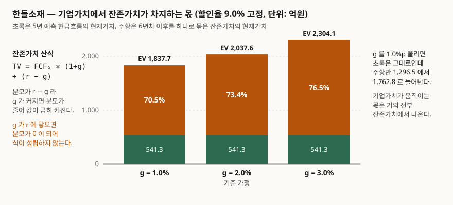

> 예제의 회사 `한들소재`와 모든 숫자는 계산 원리를 보이려고 만든 가상 값이다. 실제 기업과 관계가 없다. 예측 현금흐름·할인율·영구성장률은 전부 설명용 가정값이다.

## 들어가며

DCF 모델을 하나 받아 열어 보면 보통 1년차부터 5년차까지의 매출·영업이익·현금흐름이 행을 꽉 채우고 있다. 성장률도 연도별로 따로 두고, 운전자본 변동이나 설비투자도 해마다 다르게 잡혀 있다. 그 공을 들인 다섯 해가 기업가치에서 차지하는 몫이 26.6% 다.

나머지 73.4% 는 시트 구석의 한 칸, 영구성장률에서 나온다. 보통 "2.0%" 같은 값이 손으로 입력돼 있고 근거는 적혀 있지 않다. 다섯 해치 모델을 하루 들여 다듬는 동안 기업가치의 4분의 3을 정하는 칸은 아무도 건드리지 않는다. 이 글은 그 칸이 얼마나 무거운지를 직접 계산해 보는 것이다.

## 개념

잔존가치(Terminal Value, TV)는 **예측 기간이 끝난 뒤의 현금흐름 전부를 숫자 하나로 묶은 값**이다. 회사가 어느 날 문을 닫는 것이 아니므로, 5년차에서 모델을 끊어도 6년차 이후의 현금은 계속 생긴다. 그것을 해마다 추정하는 대신 일정한 비율 `g` 로 영원히 자란다고 보고 등비급수의 합으로 접는다.

```text
TV₅ = FCF₅ × (1 + g) ÷ (r − g)
```

`r` 은 할인율, `g` 는 영구성장률이다. 이 식은 5년차 **말 시점**의 값이므로, 기업가치에 넣으려면 다시 5년을 할인한다.

| 구성 | 산식 | 성격 |
|---|---|---|
| 예측 기간 현재가치 | Σ FCFₜ ÷ (1+r)ᵗ | 연도별로 따로 추정한 다섯 해 |
| 잔존가치 TV | FCF₅ × (1+g) ÷ (r−g) | 6년차 이후를 묶은 값, 5년차 말 시점 |
| 잔존가치의 현재가치 | TV ÷ (1+r)⁵ | 위 값을 오늘로 당긴 것 |
| 기업가치 EV | 둘의 합 | 주주와 채권자 몫을 합친 값 |

식에서 눈여겨볼 곳은 분모 `r − g` 다. 할인율 9%, 영구성장률 2% 면 분모가 0.07 이다. `g` 를 3% 로 올리면 분모가 0.06 이 되어 **잔존가치가 2,302.3 에서 2,712.3 으로 17.8% 커진다.** 분모가 작은 수라서, 거기서 빼는 `g` 의 작은 변화가 큰 비율 변화로 증폭된다.

`g` 에는 두 가지 제약이 있다. 하나는 **수학적 제약**으로 `g < r` 이어야 한다. 같으면 분모가 0 이고, 크면 값이 음수가 되어 뜻을 잃는다. 다른 하나는 **경제적 제약**이다. 어떤 회사가 경제 전체보다 영원히 빠르게 자란다면 언젠가 그 회사가 경제보다 커지므로, `g` 는 장기 경제성장률을 넘을 수 없다.

이 두 번째 제약은 회계기준에도 같은 형태로 들어 있다. K-IFRS 제1036호 자산손상은 사용가치를 구할 때 재무예산·예측에 기초한 추정 기간을 정당한 사유가 없으면 최장 5년으로 하고(문단 33 (2)), 그 기간이 지난 뒤의 성장률은 고정되거나 계속 하락한다고 가정하게 한다. 그리고 그 성장률은 기업의 제품, 속한 산업, 영업하는 국가, 자산이 사용되는 시장의 **장기 평균성장률을 초과할 수 없다**(문단 33 (3)). 후속 연도에 적용하는 성장률도 제품·산업 수명주기에 대한 객관적 정보에 부합하지 않으면 일정하거나 하락해야 한다(문단 36). 손상검사용 규정이지만, "예측 기간 뒤 성장률을 어디까지 둘 수 있는가"에 기준서가 둔 상한은 그대로 참고가 된다.

## 구조



> **출처**: [K-IFRS 제1036호 자산손상 — 문단 33 (2)·(3) 예측 기간과 이후 성장률 상한, 문단 36 후속 연도 성장률](https://accountingwiki.co.kr/standards/1036) (제3자 전재) · [Damodaran, Closure in Valuation: Estimating Terminal Value](https://pages.stern.nyu.edu/~adamodar/pdfiles/papers/termvalue.pdf) — 영구성장 잔존가치 산식과 성장률 상한 논의(2차 자료, NYU Stern 워킹페이퍼). 금액은 이 글의 [`code/output.txt`](code/output.txt) `[1]`·`[2]`에서 옮겼다.

막대 세 개의 초록 부분은 모두 541.3 으로 같다. 영구성장률을 바꿔도 1~5년차 현금흐름과 할인율은 그대로이기 때문이다. 움직이는 것은 주황 부분뿐이고, 그래서 기업가치가 흔들리는 몫은 거의 전부 잔존가치에서 나온다.

## 동작 원리

잔존가치가 왜 이렇게 무거워지는지는 할인계수에서 보인다. 할인율 9% 에서 5년차 할인계수는 0.6499 다. 5년을 당겨도 원래 값의 65% 가 남는다. 그런데 잔존가치는 6년차 이후 **무한히 많은 해**의 현금흐름을 모은 값이라 금액 자체가 크다. 65% 로 줄어도 다섯 해치 합을 크게 웃돈다.

여기에 분모 효과가 겹친다. `TV = FCF₅ × (1+g) ÷ (r−g)` 에서 `g` 가 2.0% 에서 2.5% 로 0.5%p 오르면 분자는 0.49% 커지는 데 그치지만 분모는 0.070 에서 0.065 로 7.1% 줄어든다. 분자의 작은 증가와 분모의 큰 감소가 곱해져 잔존가치가 2,302.3 에서 2,491.5 로 8.2% 늘어난다. **입력에서 0.5%p 를 더한 것이 출력에서는 8% 넘는 변화가 된다.**

반대쪽에서 같은 일을 보는 방법이 **출구배수(exit multiple)** 다. 영구성장 대신 "5년차 EBITDA 의 몇 배에 판다"로 잔존가치를 잡는 방식인데, 두 방법은 서로 환산된다. 출구배수로 TV 를 정해 놓고 `TV = FCF₅(1+g)/(r−g)` 를 `g` 에 대해 풀면 그 배수가 깔고 있는 영구성장률이 나온다.

```python
def implied_growth(exit_multiple: float) -> float:
    """출구배수로 잔존가치를 잡았을 때 거꾸로 깔려 있는 영구성장률."""
    tv = TERMINAL_EBITDA * exit_multiple
    return (tv * WACC - FCF[-1]) / (tv + FCF[-1])
```

## 실습 예제

가상 회사 한들소재의 5년 예측 현금흐름으로 계산했다. 할인율 9.0%, 영구성장률 2.0%, 5년차 FCF 158 이다.

전체 소스: [`code/`](code/)

```text
[1] 한들소재 — 기본 가정으로 구한 기업가치 (단위: 억원)
--------------------------------------------------------------------------
  할인율 9.0%   영구성장률 2.0%   예측 기간 5년

    연차       FCF        할인계수        현재가치
     1     120.0      0.9174       110.1
     2     132.0      0.8417       111.1
     3     143.0      0.7722       110.4
     4     151.0      0.7084       107.0
     5     158.0      0.6499       102.7
--------------------------------------------------------------------------
  예측 기간 현재가치 합             541.3
  잔존가치 (5년차 말 시점)        2,302.3   = 158.0 × 1.02 ÷ (0.090 - 0.020)
  잔존가치의 현재가치             1,496.3   = 2,302.3 ÷ 1.5386
--------------------------------------------------------------------------
  기업가치 EV                     2,037.6
  그중 잔존가치가 차지하는 몫       73.4%
  예측 기간이 차지하는 몫           26.6%
```

영구성장률만 움직여 보면 이렇다.

| 영구성장률 | 잔존가치 | TV 현재가치 | EV | TV 비중 | EV 변화 |
|---:|---:|---:|---:|---:|---:|
| 0.5% | 1,868.1 | 1,214.1 | 1,755.4 | 69.2% | −13.8% |
| 1.0% | 1,994.8 | 1,296.5 | 1,837.7 | 70.5% | −9.8% |
| 1.5% | 2,138.3 | 1,389.7 | 1,931.0 | 72.0% | −5.2% |
| **2.0%** | **2,302.3** | **1,496.3** | **2,037.6** | **73.4%** | **0.0%** |
| 2.5% | 2,491.5 | 1,619.3 | 2,160.6 | 74.9% | +6.0% |
| 3.0% | 2,712.3 | 1,762.8 | 2,304.1 | 76.5% | +13.1% |
| 3.5% | 2,973.3 | 1,932.4 | 2,473.7 | 78.1% | +21.4% |

성장률이 오를수록 잔존가치 비중 자체가 같이 오른다. 69.2% 에서 78.1% 로 간다. `g` 를 높게 잡을수록 **값의 더 많은 부분이 그 `g` 하나에 걸리는** 구조다. 0.5% 와 3.5% 는 둘 다 흔히 쓰이는 값인데 기업가치는 1,755.4 와 2,473.7 로 40.9% 차이가 난다.

할인율까지 같이 흔들면 범위가 더 벌어진다.

| 할인율 \ g | 1.0% | 1.5% | 2.0% | 2.5% | 3.0% |
|---|---:|---:|---:|---:|---:|
| 8.0% | 2,107.9 | 2,235.5 | 2,384.4 | 2,560.3 | 2,771.5 |
| 8.5% | 1,963.8 | 2,072.3 | 2,197.6 | 2,343.8 | 2,516.5 |
| 9.0% | 1,837.7 | 1,931.0 | **2,037.6** | 2,160.6 | 2,304.1 |
| 9.5% | 1,726.6 | 1,807.4 | 1,899.0 | 2,003.6 | 2,124.4 |
| 10.0% | 1,627.8 | 1,698.4 | 1,777.7 | 1,867.6 | 1,970.4 |

귀퉁이끼리 1,627.8 과 2,771.5 로 1.70배 차이다. 둘 다 "합리적 범위"라고 부를 만한 가정 조합이다.

출구배수로 바꿔 보면 가정의 무게가 더 또렷해진다.

```text
[4] 출구배수로 잔존가치를 잡으면 어떤 영구성장률을 가정한 셈인가
--------------------------------------------------------------------------
  영구성장 2.0% 로 구한 잔존가치 2,302.3 는 5년차 EBITDA 225.0 의 10.23배다

  출구배수          잔존가치          내재 영구성장률        EV
  6.0배          1,350.0           -2.42%   1,418.7
  8.0배          1,800.0            0.20%   1,711.2
  10.0배         2,250.0            1.85%   2,003.6
  12.0배         2,700.0            2.97%   2,296.1
  14.0배         3,150.0            3.79%   2,588.6
--------------------------------------------------------------------------
```

8배라는 배수는 보수적으로 들리지만, 환산하면 **이 회사가 영원히 연 0.20% 로만 자란다**는 가정이다. 물가상승률에도 못 미친다. 6배는 아예 영구히 −2.42% 로 줄어든다는 뜻이다. 보수적으로 잡으려고 배수를 낮추고 성장률도 같이 낮추면, 같은 보수성이 두 번 반영된다.

예측 기간을 늘리면 잔존가치 비중은 줄어든다. 다만 줄어든 만큼이 사라지는 것은 아니다.

```text
[5] 예측 기간을 10년으로 늘리면 — 6~10년차는 연 4% 성장으로 명시한다
--------------------------------------------------------------------------
  예측 기간          예측 PV       TV PV          EV     TV 비중
  5년                541.3     1,496.3     2,037.6     73.4%
  10년               988.2     1,183.0     2,171.2     54.5%
--------------------------------------------------------------------------
  TV 비중은 73.4% 에서 54.5% 로 내려간다
  다만 EV 자체가 2,037.6 에서 2,171.2 로 +6.6% 움직인다 — 6~10년차를 2% 영구성장이 아니라
  4% 성장으로 명시했기 때문이다. 가정을 앞으로 당긴 것이지 없앤 것이 아니다
```

6~10년차를 손으로 적어 넣으면 그 구간은 잔존가치에서 빠져나와 예측 기간으로 옮겨간다. 비중은 73.4% 에서 54.5% 로 내려가지만, 그 다섯 해의 성장률을 2% 가 아니라 4% 로 적었기 때문에 기업가치 자체가 6.6% 올라갔다. **가정을 눈에 보이는 자리로 옮긴 것이지 없앤 것이 아니다.** 제1036호가 예측 기간을 원칙적으로 5년으로 제한하는 이유도 여기에 가깝다. 길게 적는다고 추정이 더 정확해지지 않는다.

## 실무에서 주의할 점

- **`g` 는 근거를 적어 두는 칸이다.** 2.0% 라고 쓸 것이면 그것이 무엇의 장기 평균인지 — 물가상승률인지, 명목 경제성장률인지, 그 산업의 장기 성장률인지 — 를 같이 적는다. 제1036호 문단 33 (3)이 상한으로 드는 것도 "제품·산업·국가·시장의 장기 평균성장률"이지 임의의 숫자가 아니다.
- **출구배수와 영구성장률은 서로 확인용으로 쓴다.** 하나로 TV 를 잡았으면 다른 쪽으로 환산해 말이 되는지 본다. 영구성장 2.0% 가 EBITDA 10.23배로 환산된다면, 그 업종에서 10배가 납득되는 수준인지 보는 것이다. 어긋나면 둘 중 하나가 틀렸다.
- **5년차 현금흐름 하나를 특히 조심한다.** 잔존가치 산식의 분자가 `FCF₅` 뿐이라, 마지막 해에 일회성 항목이 섞여 있으면 그 금액이 영구히 반복된다고 가정한 셈이 된다. 설비투자가 유난히 적은 해를 마지막에 두면 기업가치 전체가 그만큼 부풀려진다.
- **결과는 숫자 하나가 아니라 표로 남긴다.** 2,037.6 이라는 값보다 "할인율 8~10%, 영구성장률 1~3% 에서 1,627.8 ~ 2,771.5" 가 실제로 아는 것에 가깝다. 소수점이 붙은 단일 값은 정밀해 보이지만 그 정밀도는 가정에 없다.
- **민감도는 비율보다 절대 금액으로도 본다.** `g` 를 0.5%p 올렸을 때 EV 가 +6.0% 라는 말은, 이 회사에서는 123.0 이 늘어난다는 뜻이다. 그 금액이 인수 협상에서 다투는 금액보다 큰지 작은지가 실무에서 쓰이는 판단이다.

## 정리

- 잔존가치는 예측 기간 뒤의 현금흐름을 `FCF₅ × (1+g) ÷ (r−g)` 하나로 접은 값이고, 예제에서 기업가치의 73.4% 를 차지했다.
- 분모가 `r − g` 라 `g` 의 작은 변화가 크게 증폭된다. 2.0% → 2.5% 는 입력으로 0.5%p 지만 잔존가치는 8.2% 커진다.
- `g` 에는 `g < r` 이라는 수학적 제약과 장기 평균성장률이라는 경제적 상한이 있다. 제1036호 문단 33 (3)이 후자를 명시한다.
- 출구배수는 영구성장률과 환산된다. 8배는 영구성장 0.20% 를, 6배는 −2.42% 를 가정한 것과 같다.
- 예측 기간을 10년으로 늘리면 잔존가치 비중은 54.5% 로 내려가지만 가정이 사라지는 것은 아니다. 눈에 보이는 자리로 옮겨갈 뿐이다.

## 참고 자료

- [한국회계기준원 — 시행 중인 K-IFRS 기준서 목록](https://www.kasb.or.kr/front/board/ingAccountingList.do) — 기업회계기준서 제1036호 자산손상 원문 발행처
- [K-IFRS 제1036호 자산손상 — 문단 33·35·36](https://accountingwiki.co.kr/standards/1036) (제3자 전재) — 예측 기간 5년 원칙, 이후 성장률의 고정·하락 가정과 장기 평균성장률 상한
- [IFRS Foundation — IAS 36 Impairment of Assets](https://www.ifrs.org/issued-standards/list-of-standards/ias-36-impairment-of-assets/) — 사용가치 산정 원문
- [Damodaran, Closure in Valuation: Estimating Terminal Value](https://pages.stern.nyu.edu/~adamodar/pdfiles/papers/termvalue.pdf) — 영구성장 잔존가치 산식, 성장률 상한과 출구배수 환산 논의(2차 자료, NYU Stern 워킹페이퍼)
