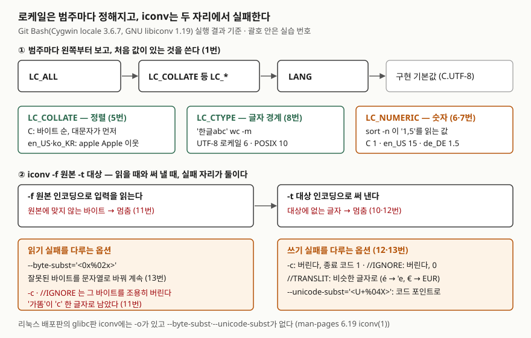

## 들어가며

옛 시스템에서 내려받은 CSV를 서버에서 열었더니 한글 자리에 `���`가 찍힌다. 같은 파일이 동료 PC에서는 멀쩡하다.
흔히 하는 대응은 편집기에서 인코딩을 하나씩 바꿔 열어 보다가 읽히는 것을 골라 "다른 이름으로 저장"하는 것이다.
파일이 30개면 30번, 매일 들어오면 매일 같은 일을 한다. 게다가 같은 날 `sort` 결과 순서가 개발 PC와 서버에서 다르다는
보고도 온다. 둘 다 원인은 **바이트를 어떤 규칙으로 읽는가**이고, 그 규칙을 정하는 것이 로케일과 인코딩이다.

## 개념

**로케일(locale)** 은 프로그램이 문자·정렬·숫자·날짜를 어떤 지역 규칙으로 다룰지 정한 묶음이다. POSIX는 이것을
**범주(category)** 로 나눈다. 이 글에서 다루는 범주는 셋이다.

| 범주 | 정하는 것 | 이 글에서 영향을 본 명령 |
|---|---|---|
| `LC_CTYPE` | 바이트를 글자로 묶는 규칙(문자 집합) | `wc -m`, `locale charmap` |
| `LC_COLLATE` | 문자열 비교 순서 | `sort` |
| `LC_NUMERIC` | 소수점·천 단위 구분 기호 | `sort -n`, `printf "%'d"` |

**인코딩(문자 집합)** 은 글자를 바이트로 적는 방법이다. `가`는 UTF-8로 `ea b0 80` 세 바이트, CP949로 `b0 a1` 두
바이트다(실습 9번). 로케일의 `LC_CTYPE`이 UTF-8인데 파일이 CP949면 글자가 깨진다. `iconv`는 파일의 바이트를 한
인코딩에서 다른 인코딩으로 옮겨 적는 명령이다.

**이 글의 환경**: Git Bash(Windows 11)다. `locale`은 **Cygwin 3.6.7판**이고 `iconv`는 **GNU libiconv 1.19**다.
리눅스 배포판이 보통 싣는 것은 glibc판 `locale`·`iconv`라 옵션이 다르다. 차이는 각 절에 적었고, glibc판의 동작은
이 환경에서 돌려 보지 못했으므로 매뉴얼에 적힌 것만 옮겼다. Cygwin 사용자 안내서는 언어와 지역에 맞는 로케일 정보를
**윈도우에서 가져온다**고 적는다. 정렬 순서 같은 결과가 glibc 리눅스와 같다는 보장은 없다.

## 구조



> **출처**: [POSIX.1-2024 XBD 8.2 Internationalization Variables](https://pubs.opengroup.org/onlinepubs/9799919799/basedefs/V1_chap08.html#tag_08_02)(변수 우선순위),
> [Cygwin User's Guide — Internationalization](https://cygwin.com/cygwin-ug-net/setup-locale.html)(기본 로케일 C.UTF-8),
> [libiconv iconv(1)](https://man.archlinux.org/man/libiconv.1)(`--byte-subst`는 입력 바이트, `--unicode-subst`는 대상에 없는 글자),
> [man-pages 6.19 iconv(1)](https://man7.org/linux/man-pages/man1/iconv.1.html)(glibc판 옵션). 괄호 안 번호는 실습 결과다.

## 동작 원리

### 로케일 정하기 — 범주마다 따로

POSIX 국제화 변수 절(8.2)이 정한 순서는 넷이다. 범주 하나를 정할 때 **`LC_ALL` → 그 범주의 `LC_*` → `LANG` →
구현 기본값** 순서로 보고, 비어 있지 않은 첫 값을 쓴다. 그래서 `LANG=ko_KR.UTF-8`에 `LC_COLLATE=C`를 더하면
정렬만 C가 되고, `LC_ALL`을 주면 둘 다 덮인다(1번). Cygwin은 아무것도 없을 때 기본값이 `C.UTF-8`이다.
POSIX는 인식할 수 없는 로케일 이름을 받았을 때의 동작을 정하지 않았다.

### iconv — 읽기와 쓰기

`iconv -f 원본 -t 대상`은 입력을 원본 인코딩으로 읽어 대상 인코딩으로 써 낸다. libiconv 매뉴얼은 대체 옵션을 둘로
나눈다. `--byte-subst`는 **원본 인코딩에 맞지 않는 입력 바이트**, `--unicode-subst`는 **대상 인코딩으로 나타낼 수 없는
글자**를 다룬다. 실패가 두 자리에서 난다는 뜻이다. 대상 이름 뒤 `//IGNORE`는 버리고, `//TRANSLIT`은 비슷한
글자로 바꾼다.

## 실습 예제

전체 소스: [`code/locale_iconv_demo.sh`](code/locale_iconv_demo.sh), 실행 기록: [`code/output.txt`](code/output.txt).

### locale 옵션 — 13개 (Cygwin 3.6.7)

| 갈래 | 옵션 | 하는 일 | 실습 | glibc판 |
|---|---|---|---|---|
| 목록 | `-a` `-v` | 쓸 수 있는 로케일 목록, `-v`는 자세히 | 0·4-1번: 766개 | 있음 |
| 목록 | `-m` | 문자 집합(charmap) 목록 | 4번: 54개 | 있음 |
| 값 보기 | `-k 키워드` | `키워드="값"` 꼴로 | 3번 | 있음 |
| 값 보기 | `-c 범주` | 범주 이름을 먼저 찍고 값 | 3번 | 있음 |
| 윈도우 기본값 | `-i` `-u` `-s` `-f` `-n` | 입력·사용자 UI·시스템 UI·지역 형식·비유니코드 기본 로케일 | 4-2번: 모두 `ko_KR` | 없음 |
| 윈도우 기본값 | `-U` | 위 결과에 `.UTF-8`을 붙인다 | 4-2번: `ko_KR.UTF-8` | 없음 |
| 기타 | `-h` `-V` | 도움말·버전 | 0번 | `-?`·`--usage`·`-V` |

```text
== 3. locale -k / -c — 범주의 값 보기
charmap="UTF-8"
charmap="ANSI_X3.4-1968"
LC_NUMERIC
decimal_point="."
thousands_sep=","
grouping=3
```

차례로 `LC_ALL=en_US.UTF-8`과 `LC_ALL=C`에서 `locale -k charmap`, `ko_KR.UTF-8`에서 `locale -c -k LC_NUMERIC`의
앞부분이다. `-c`가 범주 이름 `LC_NUMERIC`을 먼저 찍었다. 같은 질문을 de_DE.UTF-8에 하면 `decimal_point=","`,
`thousands_sep="."`로 반대였다. `-i`부터 `-U`까지는 출력 끝에 줄바꿈을 찍지 않아 스크립트에서 `echo`를 붙였다.

### 없는 로케일은 조용히 떨어진다

```text
== 2. 없는 로케일을 주면
ANSI_X3.4-1968
종료 코드 0
```

`LC_ALL=xx_YY.UTF-8`을 주자 경고도 에러도 없이 charmap이 ASCII(`ANSI_X3.4-1968`)가 됐다. 오타 하나로 한글 처리가
통째로 ASCII 규칙이 되는데 겉으로는 아무 일도 없다. 로케일을 설정했으면 `locale charmap`으로 결과를 확인해야 한다.

### 정렬과 숫자 — 같은 입력, 다른 순서

```text
-- LC_ALL=C
10 9 Apple Zebra _tmp apple banana eclair Éclair 가나 나비
-- LC_ALL=en_US.UTF-8
_tmp 10 9 apple Apple banana eclair Éclair Zebra 가나 나비
-- LC_ALL=C sort -n
1,5 1.2 2,25 10
-- LC_ALL=en_US.UTF-8 sort -n
1.2 10 1,5 2,25
-- LC_ALL=de_DE.UTF-8 sort -n
1,5 2,25 10 1.2
```

C는 바이트 값 순서라 대문자(0x41~)가 소문자(0x61~)보다 앞서고 `_`(0x5F)가 그 사이에 온다. en_US·ko_KR에서는
`apple`과 `Apple`이 이웃했고 둘의 결과가 같았다(5번). 한글은 세 로케일 모두 영문 뒤였다.

**예상과 달랐던 것은 `sort -n`이다.** 같은 네 줄이 로케일마다 다른 순서로 나왔다. en_US에서는 `,`가 천 단위 구분이라
`1,5`를 **15**, `2,25`를 **225**로 읽었다. de_DE에서는 `,`가 소수점이고 `.`이 천 단위 구분이라 `1,5`는 1.5,
`1.2`는 **12**다. C에서는 `,`를 숫자로 보지 않아 `1,5`를 1로 읽었다. 3번의 `decimal_point`·`thousands_sep` 값이
그대로 숫자 읽기에 쓰인 것이다. `printf "%'d" 1234567`도 C에서는 `1234567`, de_DE에서는 `1.234.567`이었다(7번).

### 글자 수 — LC_CTYPE

```text
C.UTF-8      wc -c=10  wc -m=6
POSIX        wc -c=10  wc -m=10
-- cut -c1-2 (UTF-8 로케일)
 ed 95 0a
```

`한글abc` 줄은 10바이트(한글 3바이트 × 2 + 3 + 줄바꿈)다. UTF-8 로케일의 `wc -m`은 6글자로 셌고 POSIX에서는 10으로
바이트와 같았다. `cut -c1-2`는 UTF-8 로케일에서도 **앞 2바이트**(`ed 95`)를 잘라 `한`의 세 바이트 중 둘만 남겼다.
coreutils 8.32의 `cut -c`는 글자가 아니라 바이트 단위로 동작했다.

### iconv 옵션 — libiconv 1.19의 12개와 glibc판의 -o

| 갈래 | 옵션 | 하는 일 | 실습 | glibc판 |
|---|---|---|---|---|
| 방향 | `-f` `-t` | 원본·대상 인코딩 | 9번 | 있음 |
| 목록 | `-l` | 지원 인코딩 목록 | 4-3번: 198줄 | 있음 |
| 쓰기 실패 | `-c` | 바꿀 수 없는 글자를 버린다 | 12번 | 있음 |
| 쓰기 실패 | `//IGNORE` | 대상 이름 뒤에 붙여 버린다 | 12번 | 있음 |
| 쓰기 실패 | `//TRANSLIT` | 비슷한 글자로 바꾼다 | 12번 | 있음 |
| 쓰기 실패 | `--unicode-subst=형식` | 코드 포인트를 형식 문자열로 | 13번 | 없음 |
| 읽기 실패 | `--byte-subst=형식` | 잘못된 바이트를 형식 문자열로 | 13번 | 없음 |
| 읽기 실패 | `--widechar-subst=형식` | 잘못된 와이드 문자를 형식 문자열로 | 돌리지 않음(파일 입력에는 해당 없음) | 없음 |
| 메시지 | `-s` | 변환 문제 에러 메시지를 숨긴다 | 12번 | 있으나 무시된다 |
| 기타 | `--help` `--version` | 도움말·버전 | 0번 | 있음 |
| 출력 | `-o 파일` | 결과를 파일로 | 이 판에 없다 → `>`로 저장(16번) | 있음 |

### 인코딩을 잘못 짚으면

```text
== 9. iconv -f / -t — UTF-8 을 CP949 로
 ea b0 80 eb 98 a0 0a
 b0 a1 8c 63 0a
== 10. 같은 글자를 EUC-KR 로
iconv: probe_work/utf8.txt:1:2: cannot convert
 b0 a1
종료 코드 1
== 11. 인코딩을 잘못 짚으면 — CP949 파일을 UTF-8 로 읽기
iconv: probe_work/cp949.txt:1:0: cannot convert
-- -c 를 붙여도
 63 00 0a 00
종료 코드 1
-- //IGNORE 를 붙여도
 63 00 0a 00
종료 코드 0
```

`가똠`은 CP949로 바뀌었지만 EUC-KR로는 `가`까지만 쓰고 멈췄다(10번). `똠`이 EUC-KR에 없는 글자라서다. 두 인코딩은
`가`처럼 겹치는 글자는 같은 바이트를 쓰므로 둘을 같은 것으로 여기기 쉽지만, CP949 파일을 EUC-KR로 읽으면 어느 글자에서
멈출 수 있다.

**가장 위험한 결과는 11번이다.** CP949 파일을 UTF-8로 잘못 짚으면 첫 바이트에서 멈춘다. 여기까지는 알아챌 수 있다.
그런데 `-c`나 `//IGNORE`를 붙이자 읽을 수 없는 바이트를 **버리고 계속했다.** `b0 a1 8c 63` 가운데 0x63은 ASCII `c`라
살아남아, `가똠`이 `c` 한 글자가 됐다. `//IGNORE`는 종료 코드까지 0이었다. glibc판 매뉴얼은 해독할 수 없는 바이트는
`//IGNORE`가 있어도 에러로 다룬다고 적는데, libiconv 1.19는 그렇게 동작하지 않았다. 원본 인코딩이 확실하지 않을 때
이 옵션을 붙이면 데이터가 조용히 사라진다.

### 버릴 것인가, 바꿀 것인가

```text
-- -c
Caf 5 
[종료 코드 1]
-- -t ASCII//IGNORE
Caf 5 
[종료 코드 0]
-- -t ASCII//TRANSLIT
Caf'e EUR5 
iconv: probe_work/latin.txt:1:8: cannot convert
[종료 코드 1]
== 13. 대체 문자열 — --unicode-subst / --byte-subst
Caf<U+00E9> <U+20AC>5 <U+B620>
<0xb0><0xa1><0x8c>c
```

`-c`와 `//IGNORE`는 같은 글자를 버렸지만 종료 코드가 1과 0으로 갈렸다. libiconv 매뉴얼은 `-c`를 "변환 에러 대신
버린다"고 적는데 종료 코드는 1이었다. 스크립트에서 종료 코드로 성공을 판단하면 둘의 결과가 다르게 처리된다.
`//TRANSLIT`은 `é`를 `'e`, `€`를 `EUR`로 바꿨지만 `똠`에서 멈췄다. glibc판 매뉴얼은 옮길 수 없는 글자를 `?`로 바꾼다고
적는다. `--unicode-subst`는 아무것도 버리지 않고 코드 포인트를 남겨 나중에 찾을 수 있다. `--byte-subst`는 CP949 파일의
바이트를 그대로 보여 줘, 원본 인코딩을 짐작하는 데 쓸 수 있다.

## 실무에서 주의할 점

- **로케일을 설정한 뒤 `locale charmap`으로 확인한다.** 없는 이름은 경고 없이 ASCII로 떨어졌다(2번). 서버에 로케일이
  설치돼 있는지는 `locale -a`로 본다.
- **스크립트의 정렬·숫자 처리는 로케일을 고정한다.** `sort -n`이 같은 입력을 로케일마다 다르게 읽었다(6번). 사람이 읽을
  출력이 아니라 기계가 다시 읽을 데이터면 `LC_ALL=C`로 고정하는 편이 환경 간 결과가 같다.
- **`//IGNORE`와 `-c`는 원본 인코딩이 확실할 때만 쓴다.** 잘못 짚은 인코딩에서도 바이트를 버리고 계속해 데이터가
  사라졌다(11번). 먼저 `iconv -f UTF-8 -t UTF-8 파일 > /dev/null`의 종료 코드로 UTF-8인지 검사한다(15번).
- **EUC-KR과 CP949를 구분한다.** EUC-KR에 없는 글자가 CP949 파일에 있으면 `-f EUC-KR`은 그 글자에서 멈춘다(10번).
  국내 윈도우에서 만든 파일은 `-f CP949`로 읽는 쪽이 넓다.
- **UTF-16은 BOM과 바이트 순서를 확인한다.** libiconv의 `-t UTF-16`은 `fe ff 00 41`로 BOM을 붙인 빅 엔디언,
  `UTF-16LE`·`UTF-16BE`는 BOM 없이 `41 00`·`00 41`이었다(14번). 받는 쪽이 BOM을 기대하는지 맞춘다.
- **`cut -c`로 한글을 자르지 않는다.** coreutils 8.32에서 바이트 단위로 잘려 글자가 깨졌다(8번).

## 정리

- 로케일은 범주마다 `LC_ALL` → `LC_*` → `LANG` → 기본값 순으로 정해진다. `LC_COLLATE`는 정렬, `LC_CTYPE`은 글자 경계,
  `LC_NUMERIC`은 소수점과 천 단위 구분을 바꾼다.
- 없는 로케일은 경고 없이 ASCII로 떨어졌고, `sort -n`은 en_US에서 `1,5`를 15로, de_DE에서 1.5로 읽었다.
- `iconv`는 원본으로 읽을 때와 대상으로 쓸 때 두 자리에서 실패한다. `//IGNORE`·`-c`는 잘못 짚은 원본의 바이트까지 버렸다.
- Git Bash의 `locale`(Cygwin 3.6.7)과 `iconv`(libiconv 1.19)는 리눅스의 glibc판과 옵션이 다르다. 리눅스에는 `-o`가 있고
  `--unicode-subst`·`--byte-subst`가 없다.

## 참고 자료

- [POSIX.1-2024 (IEEE Std 1003.1-2024), XBD 8.2 Internationalization Variables](https://pubs.opengroup.org/onlinepubs/9799919799/basedefs/V1_chap08.html#tag_08_02) — LC_ALL·LC_*·LANG 우선순위, 인식할 수 없는 로케일은 동작 미정
- [Cygwin User's Guide — Internationalization](https://cygwin.com/cygwin-ug-net/setup-locale.html) — 기본 로케일 C.UTF-8, 로케일 정보를 윈도우에서 가져옴
- [libiconv iconv(1) (Arch Linux libiconv 1.19-1)](https://man.archlinux.org/man/libiconv.1) — `-c`, `-s`, `--unicode-subst`, `--byte-subst`, `--widechar-subst`
- [Linux man-pages 6.19, iconv(1)](https://man7.org/linux/man-pages/man1/iconv.1.html) — glibc판 옵션(`-o`, `--verbose`), `//IGNORE`·`//TRANSLIT` 설명, `-s`는 무시됨
- [Linux man-pages 6.19, locale(1)](https://man7.org/linux/man-pages/man1/locale.1.html) — glibc판 `-a`·`-m`·`-c`·`-k`·`-v`
