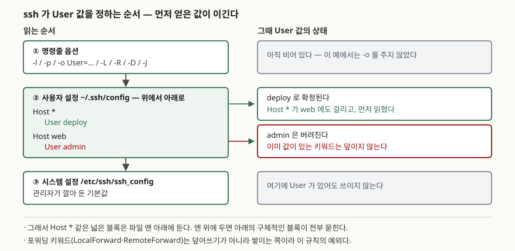

## 들어가며

서버 몇 대를 다루기 시작하면 접속 명령이 길어진다.
`ssh -i ~/.ssh/deploy_key -p 2222 admin@203.0.113.10` 같은 줄을 매번 치거나, 셸 히스토리에서 찾아 올린다.
여기에 사설망 서버가 끼면 `ssh bastion` 으로 한 번 들어가서 다시 `ssh db` 를 치는 2단 접속이 되고,
DB 클라이언트를 로컬에서 붙이려고 터널까지 열면 창을 하나 더 띄워 놓게 된다.

흔한 대응은 이걸 셸 별칭이나 접속 스크립트로 감싸는 것이다. 그런데 스크립트는
`scp`·`rsync`·`git`·IDE의 원격 접속에는 안 먹는다. 그 도구들이 전부 읽는 것은 셸 별칭이 아니라
`~/.ssh/config` 다. 여기에 한 번 적어 두면 `ssh db` 한 줄이 2단 접속과 터널까지 끌고 들어간다.

## ssh -G — 접속하지 않고 결과만 본다

설정 파일을 손보다 보면 "이 별칭이 지금 어떤 값으로 풀리고 있는가"가 궁금해진다.
접속해 보는 것 말고 확인할 방법이 있다. `ssh -G` 다.

> `-G` 는 설정을 평가해 최종 설정값을 찍고 **접속하지 않고 끝낸다.**

서버가 없어도, 네트워크가 막혀 있어도 돌아간다. 이 글의 확인은 전부 `ssh -G` 로 했다.
아래 예제에서 쓰는 IP는 문서용으로 예약된 대역(`203.0.113.0/24`, `198.51.100.0/24`)이고 도메인은 `example.com` 이라,
실재하는 호스트를 가리키지 않는다.

```text
==== 환경
OpenSSH_10.3p1, OpenSSL 3.5.6 7 Apr 2026
bash 5.3.9(1)-release
```

전체 스크립트는 [`code/ssh_config_demo.sh`](code/ssh_config_demo.sh)에, 돌린 기록은
[`code/output.txt`](code/output.txt)에 있다.

## 구조 — 값이 정해지는 순서

`ssh` 는 설정을 **명령줄 → 사용자 설정(`~/.ssh/config`) → 시스템 설정(`/etc/ssh/ssh_config`)** 순서로 읽고,
각 키워드마다 **먼저 얻은 값**을 쓴다. 나중에 같은 키워드가 또 나와도 덮지 않는다.



> **출처**: [OpenBSD ssh_config(5) — "Since the first obtained value for each parameter is used"](https://man.openbsd.org/ssh_config)

여기서 자주 틀린다. 다른 설정 파일 대부분은 **나중에 쓴 값이 이긴다.** `ssh_config` 는 반대다.

## 동작 원리 — 블록이 걸리는 방식

설정 파일은 `Host` 또는 `Match` 로 시작하는 블록으로 나뉘고, 그 아래 들여 쓴 줄이 그 블록의 키워드다.
`Host` 는 **명령줄에 적은 이름**과 패턴을 맞춘다. 패턴에는 `*`, `?`, 그리고 앞에 `!` 를 붙인 부정이 들어간다.
`Match` 는 조건이 더 많다. `host`(이름 치환 뒤의 호스트명), `originalhost`(명령줄에 적은 이름),
`user`, `exec` 같은 기준으로 건다.

자주 쓰는 키워드를 갈래로 묶으면 이렇다.

| 갈래 | 키워드 | 무엇을 정하나 |
|---|---|---|
| 대상 | `HostName` | 실제로 접속할 주소. 없으면 별칭이 그대로 호스트명이 된다 |
| 대상 | `Port` | 포트. 기본 22 |
| 신원 | `User` | 로그인 사용자 |
| 신원 | `IdentityFile` | 쓸 개인키 파일 |
| 신원 | `IdentitiesOnly` | 지정한 키만 쓸지. 에이전트에 키가 많을 때 필요하다 |
| 경유 | `ProxyJump` | 거쳐 갈 점프 호스트. `-J` 와 같다 |
| 포워딩 | `LocalForward` | 로컬 포트를 원격 쪽으로 넘긴다 (`-L`) |
| 포워딩 | `RemoteForward` | 원격 포트를 로컬 쪽으로 넘긴다 (`-R`) |
| 포워딩 | `DynamicForward` | 로컬 포트를 SOCKS 프록시로 연다 (`-D`) |
| 포워딩 | `ExitOnForwardFailure` | 포워딩이 실패하면 접속 자체를 끊을지 |
| 유지 | `ServerAliveInterval` | 응답 없을 때 패킷을 보낼 간격(초) |
| 유지 | `ServerAliveCountMax` | 몇 번까지 무응답을 견딜지 |
| 구성 | `Include` | 다른 설정 파일을 끼워 넣는다 |

## 실습 예제

### 별칭 하나가 여러 값으로 풀린다

```text
-- probe_work/alias.conf
   Host web
       HostName 203.0.113.10
       User admin
       Port 2222
       ServerAliveInterval 60
       ServerAliveCountMax 3
-- ssh -G -F alias.conf web
user admin
hostname 203.0.113.10
port 2222
serveralivecountmax 3
serveraliveinterval 60

-- HostName 을 안 적은 별칭은 별칭 자체가 호스트명이 된다
hostname nowhere
port 22
```

설정에 없는 이름을 줘도 에러가 아니다. 그 이름이 그대로 호스트명이 되고 포트는 기본값 22다.
오타 난 별칭이 조용히 "그 이름의 호스트로 접속 시도"가 되는 것도 같은 이유다.

### Host * 를 맨 위에 두면 아래가 전부 묻힌다

같은 두 블록을 순서만 바꿔 돌렸다.

```text
-- probe_work/order-top.conf
   Host *
       User deploy

   Host web
       User admin
-- ssh -G -F order-top.conf web
user deploy
-- probe_work/order-bottom.conf
   Host web
       User admin

   Host *
       User deploy
-- ssh -G -F order-bottom.conf web
user admin
```

`Host *` 가 위에 있으면 `web` 에도 걸리고, 먼저 읽혔으므로 `User admin` 이 버려진다.
**공통값 블록은 파일 맨 아래에 둔다.** 매뉴얼이 그렇게 쓰라고 명시하는 이유다.

### Match, 부정 패턴

```text
-- probe_work/match.conf
   Match host "*.example.com"
       Port 2022
       IdentitiesOnly yes

   Host short
       HostName 203.0.113.40

   Match originalhost short
       Port 2200

   Host !bastion *
       Port 2222
-- app.example.com
hostname app.example.com
port 2022
identitiesonly yes
-- short
hostname 203.0.113.40
port 2200
identitiesonly no
-- bastion
hostname bastion
port 22
identitiesonly no
```

`short` 는 `HostName` 이 IP로 바뀌었는데도 `Match originalhost short` 에 걸린다.
`originalhost` 가 보는 것은 치환 뒤 호스트명이 아니라 **명령줄에 적은 이름**이기 때문이다.
`Host !bastion *` 는 `bastion` 만 제외하므로, `bastion` 의 포트는 블록에 안 걸려 기본값 22로 남았다.

### 예상과 달랐던 것 — 상대경로 Include

`Include` 에 상대경로를 적고 그 경로에 파일을 둔 뒤 돌렸는데, 설정이 안 먹었다.

```text
-- probe_work/include-rel.conf
   Include probe_work/conf.d/*.conf

   Host *
       Port 2222
-- ssh -G -F include-rel.conf cache
hostname cache
port 2222

-- 같은 내용을 절대경로로 Include 하면
hostname 203.0.113.30
port 2222
```

상대경로 쪽은 `cache` 의 `HostName` 이 안 잡혀 별칭이 그대로 호스트명이 됐다.
절대경로로 바꾸자 `203.0.113.30` 이 나온다.
매뉴얼은 절대경로가 아닌 파일을 **사용자 설정에서는 `~/.ssh` 안에, 시스템 설정에서는 `/etc/ssh` 안에 있는 것으로 본다**고 적는다.
설정 파일이 놓인 디렉터리 기준이 아니다. 더 나쁜 점은 **없는 파일을 가리켜도 경고가 없다는 것**이다.
조용히 아무 일도 일어나지 않는다.

### 점프 호스트와 세 가지 포워딩

```text
-- probe_work/forward.conf
   Host bastion
       HostName 203.0.113.9
       User jump
       Port 2200

   Host db
       HostName 198.51.100.20
       User dbadmin
       ProxyJump bastion
       LocalForward 15432 127.0.0.1:5432
       RemoteForward 9000 127.0.0.1:9000
       DynamicForward 1080
       ExitOnForwardFailure yes
-- ssh -G -F forward.conf db
user dbadmin
hostname 198.51.100.20
port 22
exitonforwardfailure yes
dynamicforward 1080
localforward 15432 [127.0.0.1]:5432
remoteforward 9000 [127.0.0.1]:9000
proxyjump bastion
```

`ssh db` 한 줄이 `bastion` 을 거쳐 `198.51.100.20` 에 붙고, 로컬 15432를 원격의 5432로,
원격 9000을 로컬 9000으로 넘기고, 로컬 1080에 SOCKS 프록시를 연다.
`db` 의 포트가 22로 남은 것도 눈여겨볼 대목이다. **점프 호스트의 포트 2200은 `bastion` 쪽 값이고
`db` 에 옮겨지지 않는다.**

### 명령줄과 설정 파일의 관계

```text
-- -o User=override 를 붙이면
user override

-- -L 은 설정의 LocalForward 를 지우지 않고 더한다
localforward 18080 [127.0.0.1]:8080
localforward 15432 [127.0.0.1]:5432
```

명령줄이 먼저 읽히므로 `User` 는 명령줄 값이 이긴다.
반면 포워딩은 **덮는 것이 아니라 쌓인다.** 설정에 적어 둔 터널은 그대로 열린 채 명령줄 터널이 하나 더 붙는다.
"설정의 터널이 걸리적거려서 `-L` 로 바꿔 열겠다"는 시도가 통하지 않는 이유다.

## 실무에서 주의할 점

- **공통 블록은 맨 아래에 둔다.** `Host *` 를 위에 두면 아래 블록이 통째로 묻히는데,
  접속은 되기 때문에 한참 뒤에야 알아챈다. 의심되면 `ssh -G <별칭>` 으로 먼저 확인한다
- **`Include` 는 절대경로나 `~/.ssh` 기준으로 적는다.** 상대경로를 설정 파일 옆으로 해석하지 않고,
  파일이 없어도 아무 말을 하지 않는다. 끼워 넣은 블록이 안 먹으면 여기를 먼저 본다
- **포워딩은 쌓인다.** 명령줄 `-L` 이 설정의 `LocalForward` 를 대체하지 않는다.
  예상치 못한 포트가 열려 있다면 `ssh -G` 의 `localforward` 줄을 전부 센다
- **`ExitOnForwardFailure` 를 켜 둔다.** 기본값은 꺼짐이라, 포워딩이 실패해도 접속은 성공한다.
  터널이 없는 줄 모르고 로컬 포트에 붙다가 엉뚱한 곳을 보게 된다
- **오타 난 별칭은 에러가 아니다.** 설정에 없는 이름은 그 이름 자체를 호스트명으로 삼아 접속을 시도한다.
  `ssh -G` 로 `hostname` 이 별칭 그대로 찍히면 블록에 안 걸린 것이다

## 정리

- `ssh -G` 는 접속하지 않고 설정만 해석해 최종값을 찍는다. 설정을 고칠 때 제일 먼저 돌릴 명령이다
- 값은 **명령줄 → 사용자 설정 → 시스템 설정** 순으로 읽히고 **먼저 얻은 값이 이긴다**.
  그래서 `Host *` 는 맨 아래다
- `Match originalhost` 는 치환 뒤 호스트명이 아니라 명령줄에 적은 이름을 본다
- 상대경로 `Include` 는 설정 파일 옆이 아니라 `~/.ssh` 를 본다. 실패해도 조용하다
- 포워딩 키워드는 덮이지 않고 쌓인다. `ProxyJump` 가 가리킨 호스트의 포트는 대상 호스트로 옮겨지지 않는다

## 참고 자료

- [OpenBSD ssh_config(5)](https://man.openbsd.org/ssh_config) — 키워드 전체, 값 결정 순서, `Include` 경로 해석, `Match` 기준.
  이 글의 동작 확인은 OpenSSH 10.3p1에서 했고, 매뉴얼은 OpenBSD 최신판이라 키워드 목록에 차이가 있을 수 있다
- [OpenBSD ssh(1)](https://man.openbsd.org/ssh) — `-G`·`-F`·`-o`·`-L`·`-R`·`-D`·`-J` 옵션과 설정 파일을 읽는 순서
- [OpenSSH Release Notes](https://www.openssh.com/releasenotes.html) — 버전별 변경점. 키워드가 언제 들어왔는지 확인할 곳
- [RFC 5737 — IPv4 Address Blocks Reserved for Documentation](https://www.rfc-editor.org/rfc/rfc5737) — 예제에 쓴 IP 대역의 근거
