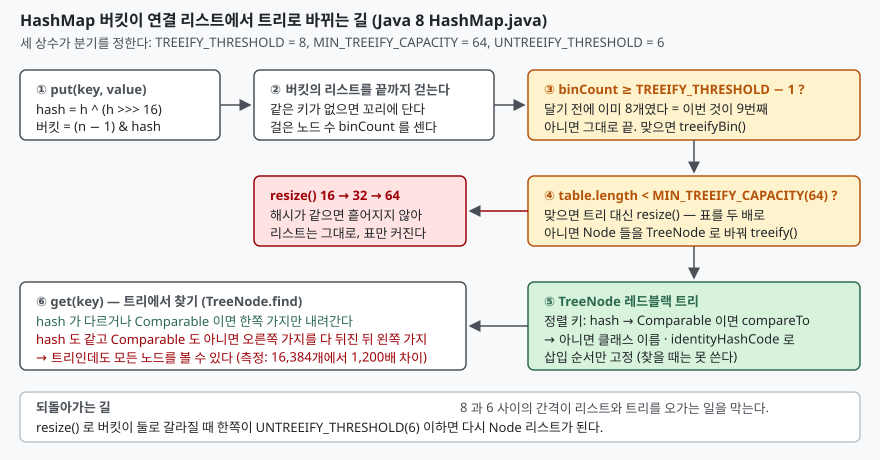

## 들어가며

외부에서 들어온 JSON 의 키를 그대로 `HashMap` 에 담는 API 가 있다. 어느 날 특정
요청만 응답이 수십 배 느리다는 보고가 들어온다. 요청 본문을 열어 보면 키가 수만 개인데
전부 다른 문자열이라 이상할 것이 없어 보인다. 그래서 대개는 GC 로그를 보거나 스레드
덤프를 뜨는데, 거기엔 `HashMap.get` 안에서 돌고 있다는 것 외에 아무것도 없다.

Java 7 까지의 `HashMap` 은 해시가 같은 키를 한 버킷에 연결 리스트로 이었다. 해시가
전부 같으면 조회 한 번에 리스트를 끝까지 걷고, 요청 하나가 O(n²) 이 된다. 이것을
노린 해시 충돌 공격이 알려지자 Java 8 은 **버킷이 길어지면 리스트를 레드블랙 트리로
바꾸는** 장치를 넣었다. 그래서 "Java 8 이상이면 괜찮다"고 믿는 사람이 많은데,
막아 주는 조건이 따로 있다. 언제 바뀌는지, 바뀌면 정말 빨라지는지를 직접 재 본다.

## 개념

`HashMap` 은 배열 `table` 의 각 칸(버킷)에 `Node` 를 연결 리스트로 단다. 키의
`hashCode()` 를 그대로 쓰지 않고 상위 16비트를 하위에 XOR 한 값(`h ^ (h >>> 16)`)을
쓰며, 버킷 번호는 `(n - 1) & hash` 다. 배열 길이 `n` 이 2의 거듭제곱이라 이 AND 가
나머지 연산과 같다.

소스의 구현 노트는 해시가 잘 퍼지면 버킷 길이가 **평균 0.5인 푸아송 분포**를
따른다고 적고, 길이별 확률을 표로 둔다. 길이 8은 0.00000006, 그 이상은 천만분의
1 미만이다. 그러니 리스트 길이가 8을 넘는 버킷은 **정상적인 해시에서는 사실상
나타나지 않고**, 나타났다면 해시가 나쁘거나 누가 일부러 충돌시킨 것이다. 트리화
임계값 8은 여기서 나왔다.

세 상수가 분기를 정한다.

| 상수 | 값 | 뜻 |
|---|---|---|
| `TREEIFY_THRESHOLD` | 8 | 이만큼 든 버킷에 하나 더 넣을 때 트리화를 시도한다 |
| `MIN_TREEIFY_CAPACITY` | 64 | 배열이 이보다 작으면 트리화 대신 배열을 키운다 |
| `UNTREEIFY_THRESHOLD` | 6 | 리사이즈로 갈라진 버킷이 이 이하면 리스트로 되돌린다 |

## 구조



> **출처**: [OpenJDK 8u `java/util/HashMap.java` — Implementation notes, `putVal()`, `treeifyBin()`, `TreeNode.find()`](https://github.com/openjdk/jdk8u/blob/master/jdk/src/share/classes/java/util/HashMap.java)

## 동작 원리

`putVal()` 은 버킷의 리스트를 끝까지 걸으며 같은 키가 있는지 보고, 없으면 꼬리에
새 노드를 단다. 걸은 노드 수 `binCount` 가 `TREEIFY_THRESHOLD - 1` 이상이면
`treeifyBin()` 을 부른다. 걷기 시작 전 노드 하나를 이미 봤으므로, **달기 전에 8개가
있었고 이번 것이 9번째**일 때다.

`treeifyBin()` 은 바로 트리를 만들지 않는다. `table.length` 가 64 미만이면
`resize()` 를 부른다. 작은 표에서 한 버킷이 길어진 것은 충돌 때문이 아니라 표가
작아서일 가능성이 크니, 표를 두 배로 키워 흩어지기를 기대하는 것이다. 트리 노드는
소스 주석대로 **보통 노드의 두 배 크기**라, 그 비용을 치를 만큼 버킷이 길 때만 쓴다.

실제로 해시가 전부 같은 키(`hashCode()` 가 항상 1)를 기본 용량 16의 맵에 하나씩
넣으며 버킷의 노드 클래스를 리플렉션으로 읽으면 이렇게 된다.

```text
  키  8개  Node (table.length=16)
  키  9개  Node (table.length=32)
  키 10개  Node (table.length=64)
  키 11개  TreeNode (table.length=64)
```

9번째 키에서 트리가 되는 것이 아니라 **리사이즈가 두 번 일어나고 11번째에서야
트리가 된다.** 해시가 전부 같으니 표를 키워도 흩어지지 않아, 9번째에 16→32,
10번째에 32→64로 커진 뒤에야 조건이 맞는다. 처음부터 용량 64로 만들면 9번째에서
바로 트리가 된다.

```text
  키  8개  Node (table.length=64)
  키  9개  TreeNode (table.length=64)
```

트리가 되면 `TreeNode` 는 `hash` 값으로 정렬하되, 같은 `hash` 끼리는 키가
`Comparable<자기 클래스>` 이면 `compareTo` 로 순서를 정한다. 그것도 안 되면
`tieBreakOrder()` 가 클래스 이름과 `System.identityHashCode()` 로 순서를 정하는데,
소스 주석은 이것이 **리밸런싱을 거쳐도 같은 순서를 유지하려는 삽입 규칙**이라고
적는다. 즉 찾을 때는 쓸 수 없는 순서다. `identityHashCode` 는 같은 내용의 다른
객체에 대해 다른 값을 주기 때문이다.

그래서 `TreeNode.find()` 는 해시가 같고 `Comparable` 도 아니면 **오른쪽 서브트리를
재귀로 다 뒤진 뒤 왼쪽으로 간다.** 트리 모양을 하고 있지만 하는 일은 전체 탐색이다.

## 실습 예제

전체 소스: [`code/`](code/) · 수행 기록: [`code/output.txt`](code/output.txt)

`hashCode()` 가 항상 1을 돌려주는 키를 두 종류 만든다. `PlainKey` 는 `Comparable`
이 아니고, `SortableKey` 는 `id` 로 `compareTo` 를 구현했다. 키 n 개를 넣고 전부
한 번씩 `get` 하는 시간을 10회 중 가장 빠른 값으로 잰다.

```java
static final class PlainKey {
    final int id;
    @Override public int hashCode() { return 1; }
    @Override public boolean equals(Object o) {
        return o instanceof PlainKey && ((PlainKey) o).id == id;
    }
}
static final class SortableKey implements Comparable<SortableKey> {
    // hashCode · equals 는 같고, compareTo 만 더한다
    @Override public int compareTo(SortableKey o) { return Integer.compare(id, o.id); }
}
```

```text
  키 수     PlainKey(비교 불가)   SortableKey(Comparable)   노드 종류
       8              1.6 µs                 1.6 µs   Node (table.length=16)
      64             37.9 µs                20.5 µs   TreeNode (table.length=128)
     512           1063.5 µs               313.6 µs   TreeNode (table.length=1024)
    4096          76746.6 µs               287.0 µs   TreeNode (table.length=8192)
   16384        2532246.9 µs              2113.4 µs   TreeNode (table.length=32768)
```

두 열 모두 `TreeNode` 다. 그런데 `PlainKey` 는 키가 4배 늘 때마다 시간이 약 16배
늘었다. 전체 조회 시간이 n² 에 비례하니 **조회 한 번이 n 에 비례**한다는 뜻이고,
트리가 되기 전 연결 리스트와 같은 차수다. 16,384개에서 조회 한 번에 약 155 µs 가
걸렸다. `SortableKey` 는 같은 16,384개를 2.1 ms 에 다 찾았다. 1,200배 차이다.

반대로 해시가 제대로 퍼지면 트리는 등장하지도 않는다. `Integer` 키 32,768개를
넣고 버킷을 전부 세어 보니 가장 긴 버킷이 5, `TreeNode` 버킷은 0이었다.

```text
  table.length=65536  가장 긴 버킷=5  TreeNode 버킷=0  조회 507.8 µs
```

푸아송 표가 말한 대로다. 트리화는 평소에 쓰이는 장치가 아니라 **해시가 무너졌을 때의
안전망**이고, 그 안전망은 키가 `Comparable` 일 때만 온전히 작동한다.

## 실무에서 주의할 점

**첫째, 트리화가 보호하는 것은 `Comparable` 키뿐이다.** `String`·`Integer`·`Long` 은
전부 `Comparable` 이라 외부 입력을 `String` 키로 담는 흔한 경우는 보호된다.
위험한 것은 **직접 만든 키 클래스**다. `hashCode`·`equals` 만 구현하고 `Comparable`
을 빼먹으면, 그 해시가 외부 입력에서 유도될 때 충돌 공격에 Java 7 과 똑같이 노출된다.
`compareTo` 를 더하는 것이 가장 싼 보험이다.

**둘째, `Comparable<C>` 의 `C` 가 자기 클래스여야 한다.** `comparableClassFor()` 는
`class C implements Comparable<C>` 형태만 인정한다. 부모 클래스의 `Comparable` 을
물려받거나 raw 타입으로 구현한 키는 비교 가능으로 취급되지 않아 전체 탐색으로
떨어진다.

**셋째, 트리화 자체도 공짜가 아니다.** 트리 노드는 보통 노드의 두 배 크기고, 변환
시점에 버킷의 노드를 전부 새로 만든다. 같은 해시 키를 반복해서 넣었다 뺐다 하면
`resize()` 에서 `UNTREEIFY_THRESHOLD`(6)와 `TREEIFY_THRESHOLD`(8) 사이를 오가며
변환이 반복될 수 있다. 두 값 사이에 간격을 둔 것이 이 진동을 줄이기 위해서다.

**넷째, 기본 용량에서는 9개가 아니라 11개째에 바뀐다.** 테스트 코드로 "9개 넣으면
트리가 된다"를 확인하려다 실패하는 자리다. `MIN_TREEIFY_CAPACITY` 때문에 표가
64가 될 때까지 리사이즈가 먼저 두 번 일어난다. 다만 이것은 해시가 전부 같을 때의
이야기고, 해시가 다르면 리사이즈로 흩어져서 트리가 안 될 수도 있다.

**다섯째, 리플렉션으로 `table` 을 여는 것은 Java 8 에서만 그냥 된다.** Java 9 이상은
모듈 시스템이 막으므로 `--add-opens java.base/java.util=ALL-UNNAMED` 가 필요하다.
세 상수의 값은 Java 8 부터 21 까지 같지만, 측정은 이 글의 환경(1.8.0_491)에서만 했다.

## 정리

- `HashMap` 은 버킷에 9번째 노드를 달 때 트리화를 시도하되, 표가 64 미만이면
  리사이즈를 먼저 한다. 해시가 전부 같으면 기본 용량에서 11번째 키에서 트리가 된다
- 임계값 8은 푸아송 분포에서 나왔다. 정상적인 해시에서 길이 8은 천만분의 1 아래다
- 트리는 `hash` 로 정렬하고, 같은 `hash` 는 `Comparable` 로만 가른다.
  `Comparable` 이 아니면 `find()` 가 양쪽 서브트리를 다 뒤져 조회가 n 에 비례한다
- 측정: 같은 해시 16,384개에서 `Comparable` 키는 2.1 ms, 아닌 키는 2.5 s
- 직접 만든 키 클래스가 외부 입력에서 나온다면 `Comparable<자기 클래스>` 를 구현한다

## 참고 자료

- [OpenJDK 8u — `java/util/HashMap.java`](https://github.com/openjdk/jdk8u/blob/master/jdk/src/share/classes/java/util/HashMap.java)
- [JEP 180: Handle Frequent HashMap Collisions with Balanced Trees](https://openjdk.org/jeps/180)
- [Java SE 8 API — `java.util.HashMap`](https://docs.oracle.com/javase/8/docs/api/java/util/HashMap.html)
- [Java SE 8 API — `java.lang.Comparable`](https://docs.oracle.com/javase/8/docs/api/java/lang/Comparable.html)
