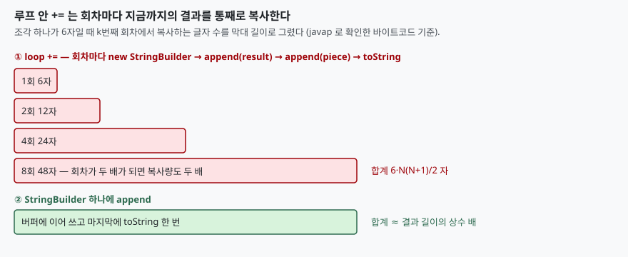

## 들어가며

로그 파일의 줄을 읽어 하나의 응답 문자열로 합치는 코드를 짠다고 하자. 줄 수가 많지 않으니 `result += line` 한 줄이면 충분해 보인다. 테스트 데이터는 100줄이라 빠르게 돌고 리뷰도 통과한다. 그런데 운영에서 줄이 3만 개 들어오는 날 요청 하나가 몇 초씩 걸린다. 이때 보통은 DB 쿼리나 네트워크부터 의심한다. 문자열 더하기에서 일어나는 일은 줄 수에 비례하지 않고 **줄 수의 제곱에 비례**하기 때문에 100줄에서는 보이지 않는다.

## 개념

자바의 `String` 은 변하지 않는다. `a + b` 는 `a` 도 `b` 도 고치지 않고 두 내용을 모두 담은 새 문자열을 만든다. 한 번이면 문제가 없다. 루프 안에서 `result += piece` 를 쓰면 회차마다 지금까지의 결과 전체를 새 문자열로 복사한다. 조각이 N개면 복사하는 글자 수가 1, 2, 3, ... N 조각 길이의 합이 되어 N 의 제곱에 비례한다.

비교 대상은 세 가지다. `StringBuilder` 는 내부 버퍼에 이어 쓰고 마지막에 한 번만 `String` 으로 바꾼다. `String.join` 은 JDK 8 에서 추가된 정적 메서드이고, `Stream` 의 `Collectors.joining()` 은 내부적으로 `StringBuilder` 에 모은다.

## 구조



> **출처**: [JLS 8 §15.18.1 String Concatenation Operator](https://docs.oracle.com/javase/specs/jls/se8/html/jls-15.html#jls-15.18.1) (구현이 `StringBuffer` 같은 기법을 쓸 수 있다고 허용), 막대 길이는 이 글의 `javap -c` 출력과 합계 공식(6·N(N+1)/2)으로 그렸다.

## 동작 원리

JLS 는 `+` 를 구현하는 방법을 컴파일러에 맡긴다. 이 환경의 `javac` 1.8 은 어떻게 하는지 `javap -c` 로 확인했다. 한 식 안의 `a + b + c` 는 `StringBuilder` 하나를 만들어 `append` 를 세 번 부르고 `toString` 한다. 컴파일 시점에 값이 정해지는 `"ab" + "cd" + "ef"` 는 아예 상수 `abcdef` 하나가 된다.

문제는 루프다. `loopPlus` 의 바이트코드를 보면 `new StringBuilder` 가 **루프 안**, `goto` 로 되돌아가기 전에 있다. 즉 컴파일러는 `+=` 를 "회차마다 새 `StringBuilder` 를 만들어 `append(result)`, `append(piece)`, `toString`" 으로 바꾼다. 컴파일러가 알아서 바꿔 주지만, 바꾼 결과가 루프 밖으로 올라가지는 않는다. 그래서 회차마다 `result` 전체가 복사된다.

JDK 9 이상의 `javac` 는 이 방식 대신 `invokedynamic` 으로 문자열 이어 붙이기를 처리한다(JEP 280). 이 환경에는 JDK 8 만 있어 직접 확인하지 못했다. 다만 루프 안 `+=` 가 회차마다 새 문자열을 만든다는 점은 `String` 이 불변이라는 사실에서 나오므로 버전과 무관하다고 본다(추론).

## 실습 예제

같은 조각(`item0,` 처럼 6자) N개를 네 방법으로 이어 붙이고, 가장 빠른 회차의 시간과 할당량을 쟀다. 할당량은 `ThreadMXBean.getThreadAllocatedBytes` 의 차이다. 전체 소스: [`code/`](code/), 수행 기록: [`code/output.txt`](code/output.txt)

```text
[조각 1,000개 -> 결과 6,000자]
  loop +=              1.80 ms          23,577 KB
  StringBuilder        0.02 ms              47 KB
  String.join          0.04 ms              48 KB
  stream joining       0.03 ms              48 KB

[조각 10,000개 -> 결과 60,000자]
  loop +=            242.57 ms       2,345,156 KB
  StringBuilder        0.12 ms             405 KB
  String.join          0.12 ms             405 KB
  stream joining       0.13 ms             405 KB

[조각 30,000개 -> 결과 180,000자]
  loop +=            781.44 ms       5,274,843 KB
  StringBuilder        0.67 ms           1,503 KB
  String.join          0.67 ms           1,503 KB
  stream joining       0.74 ms           1,504 KB
```

조각이 10배(1,000 → 10,000)가 되면 `+=` 의 할당량은 약 100배(23,577 KB → 2,345,156 KB)가 되고, 나머지 셋은 약 9배(47 → 405 KB)다. 제곱과 선형의 차이가 그대로 보인다. 조각 3만 개에서 `+=` 는 `StringBuilder` 의 약 3,500배를 할당했다. 나머지 세 방법은 할당량이 거의 같고(1,503~1,504 KB) 시간도 같은 자릿수다. 회차마다 순서가 달라져서 이 측정으로 셋 사이의 우열은 가릴 수 없다.

예상과 달랐던 점은 3만 개 구간이다. 10,000개까지는 조각 수가 늘수록 `+=` 의 할당량이 N² 에 맞게 늘었는데, 3만 개에서는 9배가 아니라 2.2배(2,345,156 → 5,274,843 KB)만 늘었다. 시간도 3.2배다. HotSpot 의 `StringBuilder` 연쇄 최적화(`OptimizeStringConcat`)가 개입했다고 보고, 이 옵션을 끄고 `+=` 만 다시 쟀다.

```text
== -XX:-OptimizeStringConcat
[조각 10,000개]  loop +=   221.59 ms     2,345,156 KB
[조각 30,000개]  loop +=  2561.41 ms    21,097,265 KB
```

옵션을 끄면 3만 개에서 할당량이 21,097,265 KB 로 약 4배, 시간은 약 3.3배 늘어 N² 에 맞는 값이 나온다. 10,000개에서는 켠 것과 끈 것이 같았다. 최적화가 3만 개 구간에서만 효과를 낸 이유는 이 글에서 확인하지 않았다. 확실한 것은 **켜져 있어도 `+=` 는 여전히 제곱**이라는 점이다. 최적화는 회차당 복사 횟수를 줄일 뿐 회차마다 결과 전체를 복사하는 구조는 못 바꾼다.

## 실무에서 주의할 점

- **작은 입력의 측정으로 판단하지 않는다.** 1,000개에서 `+=` 는 1.8 ms 이지만 할당량은 이미 500배다. 시간은 빨라 보여도 GC 압력이 쌓인다.
- **루프 안 `+=` 는 JIT 에 기대지 않는다.** 이 환경에서 JIT 최적화가 있어도 3만 개에서 `StringBuilder` 보다 1,000배 이상 느렸다(781.44 ms 대 0.67 ms).
- **한 식 안의 `+` 는 문제가 아니다.** `a + b + c` 는 `StringBuilder` 하나로 바뀐다. 루프나 조건문 안에서 같은 변수에 반복해 이어 붙일 때만 문제다.
- **구분자가 있으면 `String.join` 이 읽기 쉽다.** 시간과 할당량은 `StringBuilder` 와 같았다. 다만 `String.join` 은 JDK 8 이상, 마지막 구분자를 빼는 처리가 필요 없다는 점이 이점이다.
- **버전에 따라 바이트코드가 다르다.** 이 글의 `javap` 결과는 JDK 8 이다. JDK 9 이상은 다른 방식이므로 그 환경에서 같은 실험을 해 확인한다.

## 정리

- 루프 안 `+=` 는 회차마다 결과 전체를 복사하므로 조각 수의 제곱에 비례한다.
- 조각 3만 개(결과 18만 자)에서 `+=` 는 5,274,843 KB, `StringBuilder` 는 1,503 KB 를 할당했다.
- `StringBuilder`·`String.join`·`Stream joining` 은 할당량이 같고 시간도 비슷했다.
- HotSpot 의 연쇄 최적화를 끄면 `+=` 의 3만 개 할당량이 4배(21,097,265 KB)가 됐다. 켜도 구조는 제곱이다.
- 한 식 안의 `+` 는 컴파일러가 `StringBuilder` 하나로 바꾸므로 괜찮고, 문제는 루프 안 누적이다.

## 참고 자료

- [Java Language Specification, Java SE 8 — §15.18.1 String Concatenation Operator](https://docs.oracle.com/javase/specs/jls/se8/html/jls-15.html#jls-15.18.1)
- [JEP 280: Indify String Concatenation](https://openjdk.org/jeps/280)
- [Java SE 8 API — String.join](https://docs.oracle.com/javase/8/docs/api/java/lang/String.html#join-java.lang.CharSequence-java.lang.CharSequence...-)
- [Java SE 8 API — Collectors.joining](https://docs.oracle.com/javase/8/docs/api/java/util/stream/Collectors.html#joining--)
