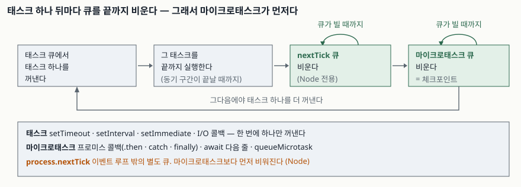

## 들어가며

프런트든 백엔드든 자바스크립트를 몇 달 쓰다 보면 순서가 이상한 로그를 한 번은 만난다. 저장
버튼을 누르면 `저장 완료` 가 찍힌 뒤에 `검증 시작` 이 찍히거나, 테스트에서 `setTimeout(0)` 으로
넣어 둔 정리 코드가 그 뒤에 등록한 `Promise.resolve().then()` 보다 늦게 돈다.

여기서 보통 하는 일은 `setTimeout` 의 지연을 0에서 10으로, 10에서 100으로 올려 보는 것이다.
그러면 당장은 순서가 맞는다. 하지만 숫자로 맞춘 순서는 기계가 느려지거나 그 사이에 할 일이
늘어나면 다시 어긋나고, 그때는 어디서 어긋났는지 찾을 단서조차 없다. 순서는 명세가 정해 둔
것이라 추측할 필요가 없다.

## 개념

이벤트 루프가 다루는 콜백은 두 종류다.

- **태스크(task)** — 보통 매크로태스크라고 부른다. `setTimeout`, `setInterval`,
  `setImmediate`, I/O 콜백, 브라우저의 이벤트 핸들러가 여기 들어간다.
- **마이크로태스크(microtask)** — 프로미스 콜백(`.then`·`.catch`·`.finally`), `await` 다음
  줄, `queueMicrotask`가 여기 들어간다.

흔한 설명은 "마이크로태스크가 우선순위가 높다"인데, 명세에는 우선순위라는 말이 없다. 있는 것은
**체크포인트**다. 이벤트 루프는 태스크 **하나**를 실행한 뒤 `Perform a microtask checkpoint`
단계를 거치고, 그 체크포인트는 **마이크로태스크 큐가 빌 때까지** 꺼내 실행한다
([HTML Standard §8.1.7.3 Processing model](https://html.spec.whatwg.org/multipage/webappapis.html#event-loop-processing-model)).

차이는 **하나냐 전부냐**다. 태스크는 한 바퀴에 하나, 마이크로태스크는 한 바퀴에 전부. 그래서
마이크로태스크가 "먼저" 돈다.

## 구조



> **출처**: [HTML Standard §8.1.7.3 Event loop processing model](https://html.spec.whatwg.org/multipage/webappapis.html#event-loop-processing-model), [Node.js — The Node.js Event Loop (phases, process.nextTick)](https://nodejs.org/en/learn/asynchronous-work/event-loop-timers-and-nexttick)

Node.js에는 큐가 하나 더 있다. `process.nextTick`의 큐는 이벤트 루프의 일부가 아니라 **현재
작업이 끝날 때마다** 비워지며, 프로미스 마이크로태스크보다 먼저 비워진다. Node 문서는 이
때문에 `process.nextTick`을 재귀로 걸면 I/O가 굶는다고 적는다.

## 동작 원리

체크포인트가 "빌 때까지" 비운다는 말에는 두 가지가 딸려 온다.

첫째, **마이크로태스크 안에서 등록한 마이크로태스크도 같은 체크포인트에서 돈다.** 다음 태스크로
넘어가지 않는다. 큐에 계속 넣으면 체크포인트가 끝나지 않는다.

둘째, **`await` 다음 줄은 마이크로태스크다.** `await expr`은 `expr`을 프로미스로 감싸 그
완료 시점에 이어서 실행하도록 등록하는 것이고, 그 "이어서"가 마이크로태스크 큐에 들어간다.
`async` 함수 안이라도 `await` 앞까지는 그냥 동기 코드다.

## 실습 예제

전체 소스는 [`code/event-loop-order.js`](code/event-loop-order.js), 돌린 기록은
[`code/output.txt`](code/output.txt)에 있다. Node.js v24.19.0에서 퀴즈 다섯 개를 돌렸다.

같은 틱에 넷을 등록하면 이렇게 나온다.

```text
[1] 같은 틱에 넷을 등록하면
  동기 코드 1
  동기 코드 2
  process.nextTick
  promise.then
  queueMicrotask
  setTimeout 0
```

동기 코드가 전부 끝나고, `nextTick` 큐가 먼저 비고, 그다음 마이크로태스크 큐가 비고, 마지막에
태스크가 돈다. `promise.then`과 `queueMicrotask`는 같은 큐에 **등록한 순서대로** 들어간다.

체크포인트가 큐를 끝까지 비운다는 것은 두 번째 퀴즈에서 드러난다.

```text
[2] 마이크로태스크가 마이크로태스크를 낳으면
  마이크로태스크 1
  마이크로태스크 2 — 1 안에서 추가됐다
  마이크로태스크 3 — 2 안에서 추가됐다
  setTimeout 0 — 여기서야 태스크가 돈다
```

`await`가 섞이면 어디까지가 동기인지가 보인다.

```text
[3] await 와 .then 을 섞으면
  스크립트 시작
  outer 시작
  inner 동기 구간
  프로미스 실행자(executor)는 동기다
  스크립트 끝
  outer — await 다음 줄
  .then 콜백
  setTimeout 0
```

`outer()`를 부른 순간 `outer 시작`과 `inner 동기 구간`까지는 그 자리에서 실행된다. `await`를
만나면 거기서 함수가 멈추고 제어가 호출한 쪽으로 돌아가 `스크립트 끝`이 찍힌다. `await` 다음
줄은 `.then` 콜백보다 **먼저** 등록됐으므로 먼저 돈다.

**예상과 달랐던 것은 네 번째다.** Node 문서는 `setTimeout(0)`과 `setImmediate`를 메인 모듈
최상위에서 함께 등록하면 순서가 비결정적이라고 적는다. 정말 반반으로 갈리는지 보려고 새
프로세스를 50번 띄워 한 번씩만 겨루게 했다.

```text
[4] setTimeout(0) 과 setImmediate 의 순서
  최상위에서 50회 (매번 새 프로세스): {"setImmediate":48,"setTimeout":2}
  I/O 콜백 안에서 50회: {"setImmediate":50}
  타이머 콜백 안에서 50회: {"setImmediate":50}
```

**반반이 아니라 48 대 2였다.** 비결정적이라는 말은 확률이 반반이라는 뜻이 아니라, 프로세스가
준비되는 데 걸린 시간이 1 ms를 넘겼는지에 결과가 달려 있다는 뜻이다. 이 기계에서는 거의 항상
1 ms 안에 첫 바퀴에 들어가 타이머가 아직 만기되지 않았고, 그래서 `setImmediate` 쪽이 이겼다.
**50번 중 2번이 반대로 나왔다는 것이 핵심이다** — 늘 같은 순서로 보이다가 부하가 걸린 날에만
어긋나는 버그가 이렇게 만들어진다. 같은 코드를 I/O 콜백 안에 넣으면 50번 모두 `setImmediate`가
이긴다. 이쪽은 문서가 보장하는 순서다.

마지막은 체크포인트가 끝나지 않을 때 무슨 일이 생기는지다.

```text
[5] 마이크로태스크가 끊이지 않으면
  마이크로태스크 1,000,000회를 도는 동안
    경과 22.8 ms · 0ms 타이머가 돌았는가: false
    태스크 한 박자 뒤 같은 타이머: true (직전 값은 false)
```

0 ms 타이머를 먼저 걸어 두고 프로미스를 백만 번 이어 붙였다. 22.8 ms가 지나도록 타이머는 돌지
않았다. 체크포인트가 끝나야 다음 태스크로 가는데, 큐에 계속 새것이 들어오니 끝나지 않는다.
(경과 시간은 환경에 따라 흔들린다. 타이머가 그동안 못 돈다는 것은 어디서 돌려도 같다.)

## 실무에서 주의할 점

- **순서를 `setTimeout`의 숫자로 맞추지 않는다.** 10 ms가 100 ms보다 먼저라는 것은 보장되지만,
  내 코드가 그 사이에 끝난다는 것은 보장되지 않는다. 순서가 중요하면 프로미스로 **의존 관계를**
  적는다.
- **렌더링을 마이크로태스크로 막을 수 있다.** 브라우저의 화면 갱신은 태스크 쪽에서 일어나므로,
  마이크로태스크를 길게 이으면 그동안 화면이 멈춘다. 쪼개야 하면 `queueMicrotask`가 아니라
  `setTimeout(0)`이나 `requestAnimationFrame`으로 **태스크 경계를 만든다.**
- **`process.nextTick`은 Node 전용이고 마이크로태스크보다 앞이다.** 라이브러리를 쓰면서
  브라우저와 같은 순서를 기대하면 어긋난다. 같은 순서가 필요하면 `queueMicrotask`를 쓴다.
- **테스트에서 "한 틱 기다리기"는 두 종류다.** `await Promise.resolve()`는 마이크로태스크
  경계까지만 가고, `await new Promise(r => setTimeout(r, 0))`은 태스크 경계를 넘는다. 타이머
  콜백이 돌기를 기다려야 하는데 앞쪽을 쓰면 테스트가 간헐적으로 실패한다.
- **`setTimeout`과 `setImmediate`를 섞어 순서를 만들지 않는다.** I/O 콜백 안이라는 조건이
  붙어야만 순서가 보장된다. 위 측정에서 최상위 50회 중 2회가 반대로 나왔다.

## 정리

- 마이크로태스크가 먼저인 것은 우선순위가 아니라 **체크포인트가 큐를 빌 때까지 비우기**
  때문이다. 태스크는 한 바퀴에 하나, 마이크로태스크는 한 바퀴에 전부다.
- 마이크로태스크 안에서 등록한 마이크로태스크도 같은 체크포인트에서 돈다. 끊지 않으면 타이머가
  밀린다 — 백만 번을 도는 22.8 ms 동안 0 ms 타이머가 돌지 못했다.
- `await` 앞까지는 동기이고, `await` 다음 줄이 마이크로태스크다.
- Node의 `process.nextTick` 큐는 이벤트 루프 밖에 있고 마이크로태스크보다 먼저 비워진다.
- `setTimeout(0)` 대 `setImmediate`는 최상위에서 50회 중 48 대 2로 갈렸다. I/O 콜백 안에서만
  순서가 보장된다.

## 참고 자료

- [HTML Standard — §8.1.7.3 Event loop processing model](https://html.spec.whatwg.org/multipage/webappapis.html#event-loop-processing-model)
- [HTML Standard — Perform a microtask checkpoint](https://html.spec.whatwg.org/multipage/webappapis.html#perform-a-microtask-checkpoint)
- [ECMAScript — HostEnqueuePromiseJob](https://tc39.es/ecma262/#sec-hostenqueuepromisejob)
- [Node.js — The Node.js Event Loop, Timers, and process.nextTick()](https://nodejs.org/en/learn/asynchronous-work/event-loop-timers-and-nexttick)
- [MDN — queueMicrotask()](https://developer.mozilla.org/en-US/docs/Web/API/Window/queueMicrotask)
