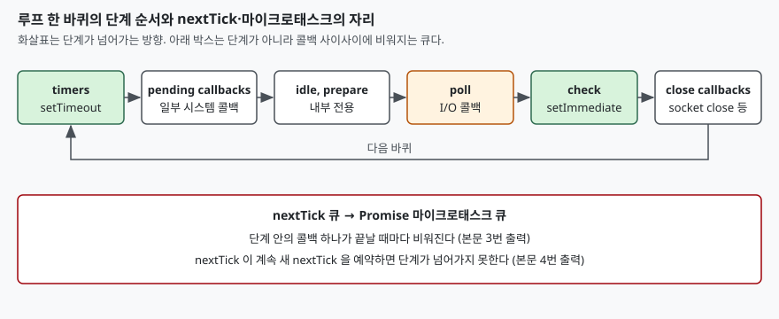

## 들어가며

로그에 찍힌 순서가 코드를 쓴 순서와 다르다는 제보가 들어온다. `setTimeout(fn, 0)` 을 먼저
걸고 `setImmediate` 를 나중에 걸었는데 반대로 돈다거나, 어떤 날은 순서가 바뀐다는 것이다.
대부분은 "비동기라서 순서를 모른다"고 정리하고 `await` 나 지연을 끼워 넣어 순서를 억지로
맞춘다. 그러면 원인은 남은 채 코드만 늘어난다. 순서는 무작위가 아니라 **이벤트 루프의
단계 순서**로 정해지고, 흔들리는 자리는 딱 한 군데다. 어느 자리인지를 아는 것이 먼저다.

## 개념

Node.js 의 이벤트 루프는 단계(phase)를 정해진 순서로 돌며 단계마다 콜백 큐를 비운다. 공식
문서의 단계 목록은 6개다.

| 순서 | 단계 | 실행되는 것 |
|---|---|---|
| 1 | timers | `setTimeout`·`setInterval` 콜백 |
| 2 | pending callbacks | 이전 바퀴에서 미뤄진 일부 시스템 콜백 |
| 3 | idle, prepare | 내부 전용 |
| 4 | poll | 새 I/O 이벤트를 받고 I/O 콜백 실행 |
| 5 | check | `setImmediate` 콜백 |
| 6 | close callbacks | `socket.on('close')` 등 |

`process.nextTick` 은 이 목록에 없다. 문서는 nextTick 이 이벤트 루프의 일부가 아니고,
현재 작업이 끝난 뒤 지금 어느 단계인지와 무관하게 처리된다고 설명한다. Promise 의
`.then` 이 들어가는 마이크로태스크 큐도 단계가 아니라 콜백 사이에서 비워진다.

## 구조



> **출처**: [Node.js 문서, The Node.js Event Loop — Phases Overview](https://nodejs.org/en/learn/asynchronous-work/event-loop-timers-and-nexttick#phases-overview), [같은 문서 — process.nextTick()](https://nodejs.org/en/learn/asynchronous-work/event-loop-timers-and-nexttick#processnexttick)

## 동작 원리

순서가 갈리는 자리를 두 가지로 나눠 보면 된다. 하나는 **단계 사이의 순서**다. 같은 바퀴에서
timers 는 check 보다 앞이므로, timers 단계에 와 있을 때 `setTimeout` 이 만기라면 먼저 돈다.
다른 하나는 **단계 바깥의 큐**다. nextTick 큐와 마이크로태스크 큐는 단계의 콜백이 하나 끝날
때마다 비워진다.

메인 모듈에서 `setTimeout(fn, 0)` 과 `setImmediate` 를 나란히 걸면, 루프가 처음 timers 단계에
들어설 때 타이머가 만기됐느냐에 따라 결과가 갈린다. 공식 문서도 이 경우의
순서가 **프로세스 성능에 달려 있어 정해지지 않는다**고 적는다. 반면 I/O 콜백 안은 poll 단계
다음이 곧 check 단계라서 `setImmediate` 가 항상 먼저다.

문서는 libuv 1.45.0(Node.js 20)부터 timers 가 poll 이후에 실행되도록 바뀌었다고도 적는다.
이 글의 실행 환경은 24.19.0 이다. 그 이전 버전에서의 동작은 돌려 보지 않았다.

## 실습 예제

전체 소스는 [`code/`](code/)에 있고 출력은 `code/output.txt` 에서 가져왔다. 모두
CommonJS 모듈로 돌렸다.

**1. 메인 모듈 직후.** 다섯 가지를 아래 순서로 예약했다.
`setTimeout 0` → `setImmediate` → `Promise.then` → `process.nextTick` → `queueMicrotask`.

```text
1. 동기 코드 끝
2. nextTick
3. promise.then
4. queueMicrotask
5. setImmediate
6. setTimeout 0
```

동기 코드가 끝나면 nextTick 이 먼저, 그다음 마이크로태스크가 예약한 순서대로 돌았다.
이 실행에서는 `setImmediate` 가 `setTimeout 0` 보다 앞에 왔다.

**2. fs.readFile 콜백 안.** 같은 두 개를 I/O 콜백 안에서 걸었다.

```text
1. setImmediate
2. setTimeout 0
```

**3. 같은 timers 단계의 두 콜백 사이.** `timer A` 안에서 Promise 와 nextTick 을 예약하고,
`timer B` 도 같은 시각에 걸었다.

```text
1. timer A
2. A 의 nextTick
3. A 의 promise
4. timer B
```

`timer B` 는 같은 timers 단계에 있었지만 `timer A` 가 예약한 두 큐가 먼저 비워진 뒤에
돌았다. 그리고 nextTick 이 Promise 보다 앞이었다.

**4. nextTick 이 자기 자신을 예약할 때.** `setImmediate` 를 걸고 nextTick 을 10만 번
연쇄 예약했다.

```text
setImmediate 가 실행됐을 때 nextTick 은 100000번 돈 뒤 (상한 100000)
```

연쇄가 끝나서야 `setImmediate` 가 돌았다. 문서가 재귀 nextTick 이 I/O 를 굶긴다고 경고하는
이유가 이 줄이다.

**5. 메인 모듈 순서는 고정이 아니다.** 같은 코드를 자식 프로세스 30개로 돌려 순서를 셌다.

```text
timeout,immediate : 4회
immediate,timeout : 26회
```

1번의 순서는 한 번의 결과일 뿐이다. 앞서 한 번 돌렸을 때는 3회와 27회가 나왔으므로
비율도 실행마다 달라진다. 측정값은 환경에 따라 흔들리지만 **두 순서가 모두 나온다는 구조는
같아야 한다.**

## 실무에서 주의할 점

1. **메인 모듈의 `setTimeout 0` 과 `setImmediate` 순서에 기대지 않는다.** 5번에서 두 순서가
   모두 나왔다. 순서가 필요하면 I/O 콜백 안에서 걸거나 한쪽을 다른 쪽의 콜백에서 건다.
2. **재귀 nextTick 은 루프를 멈춘다.** 4번처럼 연쇄가 끝나기 전에는 다른 단계가 오지
   않는다. 쪼개서 돌릴 작업은 `setImmediate` 로 예약해 단계마다 양보하게 한다.
3. **nextTick 이 Promise 보다 먼저라는 것은 이 환경에서 CommonJS 로 확인한 결과다.** ESM
   으로 돌렸을 때는 확인하지 않았으므로 두 큐의 순서에 의존하는 코드는 쓰지 않는다.

## 정리

- 루프 단계 6개 중 콜백 순서는 timers → poll → check 가 핵심이다
- nextTick 과 마이크로태스크는 단계가 아니라 콜백 사이에서 비워지고, 이 환경에서는 nextTick 이 먼저였다
- I/O 콜백 안에서는 `setImmediate` 가 항상 먼저, 메인 모듈에서는 30회 중 4회가 반대였다
- nextTick 연쇄는 `setImmediate` 를 10만 번 밀었다

## 참고 자료

- [Node.js 문서, The Node.js Event Loop](https://nodejs.org/en/learn/asynchronous-work/event-loop-timers-and-nexttick)
