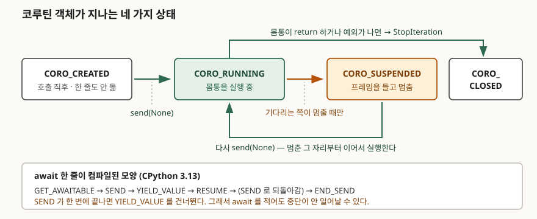

## 들어가며

외부 API 세 곳을 순서대로 호출하는 수집 스크립트가 있다. 한 번에 2초씩, 합쳐서 6초다.
동시에 보내면 2초로 줄어든다는 말을 듣고 함수에 `async`를 붙이고 호출 앞에 `await`를
붙인 뒤 `asyncio.gather`로 묶는다. 돌려 보면 여전히 6초다.

여기서 보통 두 갈래로 간다. "파이썬 비동기는 원래 이렇다"며 스레드풀로 옮기거나,
`gather`를 한 겹 더 씌워 본다. 둘 다 원인을 건드리지 않는다. **`await`를 적은 횟수와
실제로 중단이 일어난 횟수는 다른 숫자이고**, 동시성은 뒤쪽 숫자에서만 나온다.
코루틴을 이벤트 루프 없이 손으로 밀어 보면 그 차이가 그대로 보인다.

## 개념

`async def`로 정의한 함수를 호출하면 **함수 몸통이 돌지 않는다.** 코루틴 객체가
하나 만들어져 돌아올 뿐이다.

```python
async def side_effect():
    ran.append("몸통 실행됨")
    return 1

obj = side_effect()
```

```text
  호출 결과 : coroutine
  상태      : CORO_CREATED
  몸통이 돌았나: 아니오 — 한 줄도 돌지 않았다
```

이 객체는 **중간에 멈췄다 이어서 실행되는 실행 상태 덩어리**다. 프레임(지역 변수와
실행 위치)을 자기 안에 들고 있고, 누군가 `send()`로 밀어 줄 때만 한 구간씩 나아간다.
파이썬은 그 진행 단계를 네 가지 상태로 구분하고 `inspect.getcoroutinestate()`로
들여다볼 수 있게 열어 뒀다.

`await`는 "여기서 기다린다"가 아니라 **"여기서 멈출 수도 있다"** 는 표시다. 기다리는
대상이 즉시 값을 돌려주면 멈추지 않고 그대로 통과한다. 이 차이가 이 글의 전부다.

## 구조



> **출처**: [Python 표준 라이브러리 — inspect.getcoroutinestate()](https://docs.python.org/3/library/inspect.html#inspect.getcoroutinestate)

## 동작 원리

`await` 한 줄이 어떤 바이트코드가 되는지 보면 상태 머신이 드러난다.

```text
  18           LOAD_GLOBAL              1 (never_suspends + NULL)
               LOAD_FAST                0 (n)
               CALL                     1
               GET_AWAITABLE            0
               LOAD_CONST               0 (None)
       L2:     SEND                     3 (to L5)
       L3:     YIELD_VALUE              1
       L4:     RESUME                   3
               JUMP_BACKWARD_NO_INTERRUPT 5 (to L2)
       L5:     END_SEND
               STORE_FAST               1 (value)
```

읽는 순서는 이렇다.

1. `GET_AWAITABLE` — 대상에서 기다릴 수 있는 객체를 꺼낸다
2. `SEND` — 그 객체를 한 단계 민다. **끝났으면 `L5`로 점프해 `YIELD_VALUE`를 건너뛴다**
3. `YIELD_VALUE` — 안 끝났으면 바깥(이벤트 루프)으로 값을 넘기고 **여기서 멈춘다**
4. `RESUME` — 바깥이 다시 밀어 주면 이 자리부터 이어진다
5. `JUMP_BACKWARD_NO_INTERRUPT` — `SEND`로 되돌아가 2번부터 다시

함수 맨 앞에 `RETURN_GENERATOR`가 있다는 점도 같이 본다. 호출 즉시 객체를 만들어
돌려주는 명령이 몸통의 첫 줄보다 앞에 있으니, 호출만으로는 아무것도 실행되지 않는다.

**2번의 분기가 핵심이다.** `SEND`가 한 번에 끝나면 `YIELD_VALUE`는 실행되지 않고,
그러면 중단도 없고 이벤트 루프에 차례가 넘어가지도 않는다. `await`는 분기의
**입구**일 뿐이고, 어느 쪽으로 갈지는 기다리는 대상이 정한다.

## 실습 예제

이벤트 루프 없이 `send(None)`만으로 코루틴을 끝까지 밀어 본다.
전체 소스: [`code/`](code/) · 돌린 기록: [`code/output.txt`](code/output.txt)

```python
def drive(coro, label):
    """이벤트 루프 없이 send(None) 만으로 코루틴을 끝까지 민다."""
    sent = 0
    while True:
        try:
            yielded = coro.send(None)
        except StopIteration as stop:
            print(f"  {label}: send {sent + 1}회 만에 종료, 반환값 {stop.value!r}")
            return stop.value
        sent += 1
        print(f"  {label}: {sent}번째 중단 — 바깥으로 넘긴 값 {yielded!r}")
```

`await`가 둘인 코루틴에 걸어 본다. 기다리는 대상은 그냥 값을 돌려주는 코루틴이다.

```python
async def two_awaits(n):
    a = await never_suspends(n)
    b = await never_suspends(n + 1)
    return a + b
```

```text
  two_awaits: send 1회 만에 종료, 반환값 30
  → await 를 두 번 적었는데 중단은 0회다.
```

**`await`를 두 번 적었는데 중단은 한 번도 일어나지 않았다.** 이 코루틴을 백 개
만들어 `gather`로 묶어도 서로 끼어들 틈이 없다. 들어가며의 6초가 그대로인 이유가
여기다 — 호출하는 라이브러리가 동기 방식이면 `await`를 아무리 붙여도 통과만 한다.

진짜로 멈추는 대상을 기다리면 상태가 달라진다.

```python
async def really_suspends():
    first = "지역 변수는 중단 중에도 살아 있다"
    await asyncio.sleep(0)
    return first
```

```text
  생성 직후 : CORO_CREATED
  첫 send 후: CORO_SUSPENDED
  바깥으로 넘긴 값 : None
  무엇을 기다리는가: coroutine sleep
  멈춘 코드 : really_suspends / 줄 34
  살아 있는 지역 변수: {'first': '지역 변수는 중단 중에도 살아 있다'}
  두 번째 send 로 종료, 반환값: '지역 변수는 중단 중에도 살아 있다'
  최종 상태 : CORO_CLOSED
```

멈춘 줄 번호와 지역 변수가 그대로 남아 있다. `cr_frame`이 프레임을 붙들고 있기
때문이고, 이것이 `await`를 사이에 두고 `first`를 다시 쓸 수 있는 이유다.
`cr_await`는 지금 무엇을 기다리는지 가리킨다 — 멈춘 작업을 디버깅할 때 쓸 수 있다.

같은 구조를 제너레이터로 손으로 쓰면 `await` 자리에 `yield`가 그대로 들어간다.

```python
def hand_written(n):
    a = n * 10
    yield "여기서 멈춘다"      # await 지점
    return a + 1
```

```text
  첫 next   : 여기서 멈춘다
  두 번째 next 로 종료, 반환값: 11
```

중단과 재개, 반환값을 `StopIteration`에 실어 보내는 방식까지 같다. 코루틴은
제너레이터와 다른 타입이지만 **같은 기계 장치 위에 얹혀 있다.**

마지막으로 중단 지점의 유무가 동시성에 그대로 나타난다.

```python
async def busy(name, log):          # 중단점 없음
    for step in range(3):
        log.append(f"{name}{step}")

async def polite(name, log):        # 매 바퀴 차례를 넘김
    for step in range(3):
        log.append(f"{name}{step}")
        await asyncio.sleep(0)
```

```text
  await 없음 : ['A0', 'A1', 'A2', 'B0', 'B1', 'B2']
  await 있음 : ['A0', 'B0', 'A1', 'B1', 'A2', 'B2']
```

`gather`로 똑같이 묶었는데 위는 A가 다 끝나고 B가 시작한다. **`gather`가 동시성을
만드는 것이 아니라, 중단점이 있을 때 `gather`가 그 틈을 쓴다.**

## 실무에서 주의할 점

**1. `await`를 붙였다고 비동기가 되지 않는다.** 호출하는 라이브러리가 동기 방식이면
`run_in_executor`나 `asyncio.to_thread`로 스레드에 내보내야 중단점이 생긴다.
`async def`로 감싸기만 하면 `SEND`가 한 번에 끝나 그대로 통과한다. 의심스러우면
위의 `drive()`로 중단이 몇 번 일어나는지 세어 본다.

**2. CPU 작업은 중단점을 만들지 않는다.** 긴 반복문이나 큰 직렬화는 `await`가 없으니
루프 전체를 붙잡는다. 다른 태스크의 타임아웃이 엉뚱하게 터지는 증상이 여기서 온다.
쪼개서 중간에 `await asyncio.sleep(0)`를 넣거나 프로세스로 보낸다.

**3. 코루틴 객체는 만들어 두면 자원을 잡는다.** `CORO_CREATED`나 `CORO_SUSPENDED`로
남아 있는 객체는 프레임과 그 안의 지역 변수를 전부 붙들고 있다. 큰 바이트열을 지역
변수로 들고 중단된 태스크가 수천 개면 그만큼이 메모리에 남는다. 취소한 태스크를
`await`하거나 `close()`로 정리해 `CORO_CLOSED`까지 보내야 풀린다.

**4. 호출만 하고 `await`를 빠뜨리면 조용히 아무 일도 안 일어난다.** 몸통이 한 줄도
돌지 않으므로 로그조차 남지 않는다. `RuntimeWarning: coroutine ... was never awaited`가
유일한 단서이고, 경고를 끄는 설정이면 그것도 없다.

**5. 바이트코드는 판마다 바뀐다.** 위 출력은 CPython 3.13.5 기준이다.
`SEND`와 `END_SEND`는 3.11·3.12에서 들어온 명령이고 그 이전에는 다른 모양이었다.
**상태 네 가지와 `send`로 민다는 구조는 그대로지만 명령 이름을 그대로 외우지 않는다.**

## 정리

- `async def` 함수를 호출하면 몸통이 아니라 코루틴 객체가 나온다. 상태는
  `CORO_CREATED` → `RUNNING` → `SUSPENDED` → `CLOSED` 네 가지다.
- `await`는 중단점이 아니라 **중단점 후보**다. `SEND`가 한 번에 끝나면
  `YIELD_VALUE`를 건너뛰어 중단 없이 통과한다.
- 중단된 코루틴은 프레임을 들고 있으므로 지역 변수와 멈춘 줄이 그대로 남는다.
  `cr_frame`과 `cr_await`로 확인할 수 있다.
- 동시성은 `gather`가 아니라 **중단점**에서 나온다. 중단점 없는 코루틴을
  아무리 묶어도 순서대로 돈다.
- 코루틴은 제너레이터와 같은 기계 장치 위에 있다. `await`를 `yield`로 바꿔
  손으로 써 보면 구조가 그대로 겹친다.

## 참고 자료

- [PEP 492 — Coroutines with async and await syntax](https://peps.python.org/pep-0492/)
- [Python 표준 라이브러리 — inspect.getcoroutinestate()](https://docs.python.org/3/library/inspect.html#inspect.getcoroutinestate)
- [Python 표준 라이브러리 — dis: SEND](https://docs.python.org/3/library/dis.html#opcode-SEND)
- [Python 표준 라이브러리 — dis: GET_AWAITABLE](https://docs.python.org/3/library/dis.html#opcode-GET_AWAITABLE)
- [Python 언어 레퍼런스 — Coroutine objects](https://docs.python.org/3/reference/datamodel.html#coroutine-objects)
