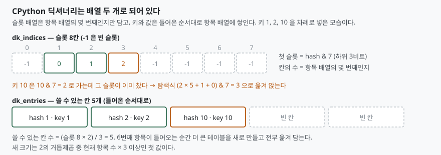

## 들어가며

로그를 집계하는 스크립트를 하나 돌린다. 사용자 ID를 키로, 누적 건수를 값으로
딕셔너리에 담는 평범한 코드다. 사용자가 100만 명이니 키 100만 개, 값은 작은
정수 100만 개. 머릿속으로 더해 보면 수십 메가 정도일 것 같다. 그런데 작업
관리자에 찍힌 숫자는 그 몇 배다.

이럴 때 흔히 하는 일이 `sys.getsizeof`를 불러 보는 것이다. 그런데 돌아온 값이
또 이상하다. 항목을 하나 넣었는데 64바이트에서 224바이트로 뛰고, 그 뒤로 네
개를 더 넣어도 224바이트에서 꿈쩍하지 않는다. 그러다 여섯 번째에서 갑자기
352바이트가 된다. 계산이 안 맞으니 "대충 항목당 100바이트쯤"으로 어림하고
넘어가게 되는데, 그 어림이 100만 개에서는 수십 메가씩 어긋난다.

이 숫자들은 아무렇게나 나오는 것이 아니다. **CPython이 문서에 적어 둔 규칙
두 줄이면 전부 계산된다.** 이 글은 그 규칙을 꺼내 실측과 맞춰 본다.

## 개념 — 배열이 하나가 아니라 둘이다

CPython의 딕셔너리는 해시 테이블 하나가 아니라 **배열 두 개**로 되어 있다.

- **슬롯 배열(`dk_indices`)** — 해시로 계산한 자리마다 "항목 배열의 몇 번째"인지
  숫자 하나만 담는다. 비어 있으면 `-1`이다
- **항목 배열(`dk_entries`)** — 해시·키·값 세 포인터를 묶어, **들어온 순서대로**
  차곡차곡 쌓는다

왜 이렇게 나눴는가. 해시 테이블은 빈 자리가 넉넉해야 충돌이 적은데, 빈 자리마다
24바이트짜리 항목 칸을 비워 두면 낭비가 크다. 슬롯 배열에는 작은 정수만 두고
실제 항목은 따로 모아 두면, **빈 자리의 값이 24바이트에서 1~2바이트로 준다.**
파이썬 3.7부터 딕셔너리가 삽입 순서를 기억하는 것도 이 구조의 부산물이다 —
항목 배열이 애초에 들어온 순서 그대로이기 때문이다.

## 구조



> **출처**: [CPython v3.13.5 — Objects/dictobject.c, 레이아웃과 탐색 주석](https://github.com/python/cpython/blob/v3.13.5/Objects/dictobject.c)

## 동작 원리 — 규칙은 두 줄이다

`dictobject.c`의 주석과 매크로에서 필요한 것은 둘이다.

첫째, **쓸 수 있는 칸 수**다. 소스는 `USABLE_FRACTION(n)`을 `((n) << 1)/3`,
즉 **슬롯 수의 3분의 2**로 정의하고 "사전의 최대 적재율"이라고 적는다. 슬롯이
8개면 항목은 5개까지만 담고, 6번째가 들어오는 순간 테이블을 새로 만든다.

둘째, **새 크기**다. `GROWTH_RATE(d)`는 `((d)->ma_used*3)`이고, 주석은 이것이
"삭제 없이 커질 때 사전이 두 배가 된다는 뜻"이라고 설명한다. 현재 항목 수의 세
배 이상인 2의 거듭제곱 중 첫 값이 새 슬롯 수가 된다.

여기에 슬롯 한 칸의 크기가 테이블 크기에 따라 바뀐다는 것(`dk_size <= 128`이면
1바이트, `2**15` 이하면 2바이트)을 더하면 바이트 수까지 나온다.

```text
바이트 = 48(사전 객체) + 48(키 테이블 머리) + 슬롯 수 × 슬롯 크기 + 쓸 수 있는 칸 × 24
```

앞의 두 48은 이 빌드에서 잰 값이고, 나머지는 소스에 적힌 그대로다. 맞는지
계산해서 실측과 대조해 봤다.

```text
  테이블 | 쓸 수 있는 칸 | 리사이즈 시작 | 계산 바이트 | 실측 바이트 | 일치
       8 |             5 |             6번째 |         224 |         224 | 예
      16 |            10 |            11번째 |         352 |         352 | 예
      32 |            21 |            22번째 |         632 |         632 | 예
      64 |            42 |            43번째 |        1168 |        1168 | 예
     128 |            85 |            86번째 |        2264 |        2264 | 예
     256 |           170 |           171번째 |        4688 |        4688 | 예
     512 |           341 |           342번째 |        9304 |        9304 | 예
    1024 |           682 |           683번째 |       18512 |       18512 | 예
    2048 |          1365 |          1366번째 |       36952 |       36952 | 예
```

아홉 줄이 전부 맞는다. 실제로 항목을 하나씩 넣으며 크기가 바뀐 지점만 찍어 보면
예측한 자리와 같다.

```text
  항목 수 | 바이트 | 직전 대비
        0 |     64 | (빈 사전)
        1 |    224 | +160
        6 |    352 | +128
       11 |    632 | +280
       22 |   1168 | +536
       43 |   2264 | +1096
       86 |   4688 | +2424
      171 |   9304 | +4616
```

재미있는 자리가 하나 있다. **86 → 171 구간의 증가폭(+2424)이 직전 구간의 두
배보다 크다.** 슬롯이 256개가 되면서 슬롯 한 칸이 1바이트에서 2바이트로 바뀌기
때문이다. 테이블은 두 배가 되는데 슬롯 배열은 네 배가 된다.

## 실습 예제

전체 소스는 [code/dict_growth.py](code/dict_growth.py)에, 돌린 기록은
[code/output.txt](code/output.txt)에 있다. 표준 라이브러리만 쓴다.

해시가 전부 같은 키를 넣으면 조회가 어떻게 되는지도 같이 쟀다. `__hash__`가
항상 `0`을 돌려주는 클래스와, 같은 클래스에 해시만 서로 다르게 한 클래스를
나란히 놓고 마지막에 넣은 키를 한 번 찾는 시간이다.

```text
  키 개수 | 해시 동일(µs) | 해시 상이(µs) | 배수
       10 |         0.573 |         0.107 |   5.4배
       50 |         2.518 |         0.098 |  25.6배
      100 |         4.718 |         0.101 |  46.9배
      200 |         9.350 |         0.101 |  93.0배
      400 |        19.030 |         0.104 | 182.7배
```

해시가 다를 때는 키가 40배로 늘어도 0.1µs에서 움직이지 않는다. 해시가 같으면
**키 개수에 정비례해 늘어난다.** 400개에서 이미 183배다. 딕셔너리의 "평균
O(1)"은 해시가 고르게 퍼진다는 전제 위에 서 있고, 그 전제가 깨지면 선형 탐색이
된다.

## 실무에서 주의할 점

**지워도 줄지 않는다.** 1000개를 담았다가 999개를 지워도 크기는 그대로다.

```text
  1000개 보유        :  36952바이트
  999개 삭제 후 1개  :  36952바이트
  항목 수            : 1개
  dict() 로 다시 만듦:    224바이트
```

축소는 삽입할 때만 일어나고, 삭제는 테이블을 건드리지 않는다. 피크 때 수십만
개가 들어왔다 빠지는 캐시라면 그 피크 크기를 계속 들고 있는 셈이다. 줄이려면
`dict(기존)`으로 새로 만들어 교체한다 — 위 출력의 마지막 줄이 그 결과다.

**만드는 방법은 크기를 바꾸지 않는다.** 이건 예상과 달랐다. 하나씩 삽입한
사전, `dict(제너레이터)`, `dict.fromkeys(range(n))`, `dict(복사)` 네 가지를
5·8·10·100·1000개로 재 봤는데 **전부 같은 바이트 수가 나왔다.** 길이를 아는
입력이면 미리 크게 잡아 리사이즈를 건너뛸 것이라 짐작했는데, 적어도 이 빌드의
이 경로에서는 그런 차이가 보이지 않는다. 크기를 정하는 것은 만드는 방법이
아니라 **거쳐 간 최대 항목 수**다.

**`sys.getsizeof`는 키와 값 객체를 세지 않는다.** 공식 문서는 "객체에 직접
귀속되는 메모리만 계산하고, 그 객체가 참조하는 객체의 메모리는 세지 않는다"고
적는다. 위 표의 항목 한 칸 24바이트는 **포인터 세 개**이지 문자열 키의 실제
바이트가 아니다. 100만 개짜리 사전의 실제 사용량을 보려면 키·값 객체를 따로
합쳐야 한다.

**정수 키의 간격이 2의 거듭제곱이어도 걱정만큼 느려지지 않는다.** 정수의 해시는
자기 자신이고 첫 슬롯은 해시의 하위 비트이므로, 간격이 4096인 키들은 첫 슬롯이
두 자리에 몰린다. 재 봤다.

```text
  간격   | 조회 1회(µs) | 사전 크기(바이트)
       1 |       0.0150 |            147544
       3 |       0.0150 |            147544
    1024 |       0.0200 |            147544
    4096 |       0.0251 |            147544
   65536 |       0.0213 |            147544
```

가장 나쁜 자리가 1.7배다. 앞의 해시 동일 사례가 183배였던 것과 비교하면 거의
평평하다. 탐색식 `i = (i*5 + perturb + 1) & mask`의 `perturb`가 해시의 상위
비트를 끌어와 섞기 때문이다. 첫 슬롯이 겹쳐도 그다음부터는 갈라진다.
**키를 고를 때 조심할 것은 슬롯이 겹치는 정수 패턴이 아니라, `__hash__`를
직접 구현하면서 해시를 뭉개는 쪽이다.**

**`hash(-1)`은 `-2`다.** 해시를 계산하는 C API가 `-1`을 오류 표시로 쓰기
때문에 `-1`이 될 값은 `-2`로 보낸다. `__hash__`를 직접 구현할 때 `-1`을
돌려줘도 파이썬이 `-2`로 바꿔 주므로 틀리지는 않지만, 해시 값으로 분기하는
코드를 쓴다면 알고 있어야 한다.

```text
  hash(   -1) = -2
  hash(   -2) = -2
  hash(2**61 - 1) = 0
```

마지막 줄도 같은 종류다. 64비트에서 정수 해시는 `2**61 - 1`을 법으로 계산하므로
그 값 자체는 `0`이 된다.

## 정리

- 딕셔너리는 슬롯 배열과 항목 배열 두 개다. 빈 자리의 값이 24바이트가 아니라
  1~2바이트라 적재율을 낮게 유지할 수 있다
- 리사이즈 지점은 슬롯 수의 3분의 2, 새 크기는 항목 수 × 3 이상인 첫 2의 거듭제곱.
  이 두 줄로 계산한 아홉 개 구간이 실측과 전부 맞았다
- 삭제는 테이블을 줄이지 않는다. 피크를 들고 있기 싫으면 `dict()`로 다시 만든다
- 해시가 뭉개지면 조회가 키 개수에 정비례한다. 400개에서 183배였다
- 정수 키의 슬롯 겹침은 탐색식의 섞기 때문에 1.7배에 그친다. 위험한 쪽은
  직접 구현한 `__hash__`다

## 참고 자료

- [CPython v3.13.5 — Objects/dictobject.c](https://github.com/python/cpython/blob/v3.13.5/Objects/dictobject.c)
- [Python 문서 — sys.getsizeof](https://docs.python.org/3/library/sys.html#sys.getsizeof)
- [Python 문서 — 수치형의 해시](https://docs.python.org/3/library/stdtypes.html#hashing-of-numeric-types)
- [Python/C API — PyObject_Hash](https://docs.python.org/3/c-api/object.html#c.PyObject_Hash)
- [Python 문서 — object.\_\_hash\_\_](https://docs.python.org/3/reference/datamodel.html#object.__hash__)
