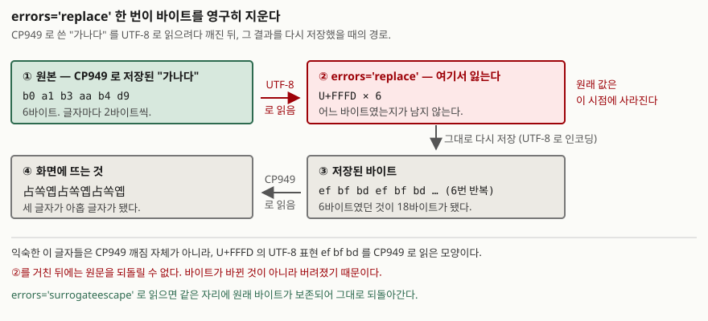

## 들어가며

레거시 시스템에서 받은 CSV를 파이썬으로 읽는데 `UnicodeDecodeError`가 뜬다.
검색해서 나온 대로 `encoding='utf-8', errors='replace'`를 붙이니 에러가 사라진다.
화면에는 `�` 가 몇 개 보이지만 나머지는 멀쩡해 보여서 그대로 적재한다.

며칠 뒤 고객이 이름 필드가 `占쏙옙` 으로 보인다고 알려 온다. 이제 와서 올바른 코덱으로
다시 디코딩해 보려 하지만 무엇을 해도 원래 글자가 돌아오지 않는다. 원본 파일은
임시 디렉터리에 있었고 이미 지워졌다.

여기서 흔히 택하는 방법은 깨진 글자를 보고 코덱 조합을 바꿔 가며 되돌리기를 시도하는
것이다. 그런데 되돌릴 수 있는 경우와 없는 경우는 처음부터 갈려 있다. 깨짐이 **바이트가
다르게 해석된 것**이면 되돌아가고, **바이트가 버려진 것**이면 무엇을 해도 안 돌아온다.
둘을 눈으로 구별할 수 없으니 바이트를 봐야 한다.

## 개념

인코딩은 문자열(코드포인트의 나열)을 바이트로 바꾸는 일이고, 디코딩은 그 반대다.
파이썬 3의 `str`은 코드포인트의 나열이고 `bytes`는 바이트의 나열이다. 파일·소켓·
표준 출력을 지나는 것은 언제나 `bytes`이므로, 경계를 지날 때마다 둘 중 하나가 일어난다.

같은 글자가 코덱에 따라 몇 바이트가 되는지부터 본다.

```text
  원문 '한글'  (코드포인트 2개)
    utf-8     6바이트  ed 95 9c ea b8 80
    cp949     4바이트  c7 d1 b1 db
    euc-kr    4바이트  c7 d1 b1 db
    utf-16    6바이트  ff fe 5c d5 00 ae
    utf-32   12바이트  ff fe 00 00 5c d5 00 00 00 ae 00 00
```

한글 한 글자가 UTF-8에서 3바이트, CP949에서 2바이트다. UTF-16은 글자당 2바이트인데
앞에 `ff fe` 두 바이트가 더 붙는다. 바이트 순서 표식(BOM)이다. `utf-16`으로 인코딩하면
파이썬이 BOM을 붙이고, `utf-16-le`처럼 바이트 순서를 명시하면 붙이지 않는다.

EUC-KR은 한 글자가 늘 2바이트가 아니다.

```text
  원문 '똠'  (코드포인트 1개)
    utf-8     3바이트  eb 98 a0
    cp949     2바이트  8c 63
    euc-kr    8바이트  a4 d4 a4 a8 a4 c7 a4 b1
```

`똠`은 EUC-KR 완성형 2,350자에 없다. 없는 글자는 조합형 표기로 떨어져 8바이트가 된다.
CP949는 완성형에 없는 한글을 위해 영역을 확장한 것이라 2바이트로 끝난다. **"EUC-KR과
CP949는 같다"는 말이 통하지 않는 자리가 여기다.** 위 `한글` 예에서는 두 코덱의 바이트가
완전히 같았으므로, 흔한 글자만 보고 테스트하면 이 차이가 드러나지 않는다.

## 구조

깨짐이 복구 불가능해지는 지점은 한 군데다.



> **출처**: [Python 3.13 문서 — `codecs`: Error Handlers](https://docs.python.org/3/library/codecs.html#error-handlers) 의 `replace` · `surrogateescape` 정의. 바이트 값은 Python 3.13.5에서 직접 뽑았다.

`replace`는 읽을 수 없는 바이트를 U+FFFD(`�`)로 바꾼다. **바꾼 뒤에 원래 바이트를
어디에도 남기지 않는다.** 그 문자열을 다시 UTF-8로 저장하면 U+FFFD가 `ef bf bd`
세 바이트로 기록되고, 그걸 CP949로 읽으면 `占쏙옙` 이 된다.

널리 보이는 그 글자들은 CP949 깨짐 자체가 아니라 **U+FFFD를 한 번 더 잘못 읽은 모양**이다.
그래서 `占쏙옙` 이 보이면 이미 두 단계를 지난 것이고, 그 중간에 원본 바이트가 버려졌다.

## 동작 원리

경로를 셋으로 가른다. 복구 가능 여부가 경로마다 다르다.

### 경로 1 — 디코더가 다르다

바이트는 그대로인데 끊어 읽는 경계와 매핑표가 다른 경우다. 결과는 두 갈래다.

```text
  '한글' utf-8              6바이트  ed 95 9c ea b8 80
    cp949    디코딩 실패 — illegal multibyte sequence (위치 0)
    latin-1  읽힌 글자 'í\x95\x9cê¸\x80'  코드포인트 6개  복구됨
```

`cp949`는 `ed 95`에 매핑이 없어 **예외를 던진다.** 이게 오히려 다행인 경우다.
읽히지 않았다는 사실이 즉시 드러나므로 원본이 살아 있다.

`latin-1`은 다르다. 0x00부터 0xFF까지 256개 바이트가 전부 코드포인트에 대응되므로
**어떤 바이트열도 거부하지 않는다.** 6바이트가 6개 코드포인트로 읽히고, 모양은
깨졌지만 정보는 하나도 잃지 않았다. 다시 `latin-1`로 인코딩하면 원래 6바이트가
그대로 나오고 UTF-8로 읽으면 `한글`이 돌아온다. 출력의 `복구됨`이 그 확인이다.

### 경로 2 — 에러를 삼켰다

CP949로 쓴 `가나다`를 UTF-8로 읽으면서 `errors`를 바꿔 가며 돌린 결과다.

```text
  '가나다' cp949             6바이트  b0 a1 b3 aa b4 d9
    strict           예외 — invalid start byte (위치 0)
    replace          '������'  6개  다름 '占쏙옙占쏙옙占쏙옙'
    ignore           ''  0개  다름 ''
    backslashreplace '\xb0\xa1\xb3\xaa\xb4\xd9'  24개  다름 '\xb0\xa1\xb3\xaa\xb4\xd9'
    surrogateescape  '\udcb0\udca1\udcb3\udcaa\udcb4\udcd9'  6개  복구됨
```

`ignore`가 가장 나쁘다. 여섯 바이트 전부가 사라져 **빈 문자열**이 된다. 길이가 0이니
`if text:` 같은 검사에 걸리지도 않고, 로그에는 아무것도 안 남는다.

`replace`는 자리는 남기지만 값을 남기지 않는다. 여섯 개의 U+FFFD가 되고, 그것을
되돌리려 하면 위 도식의 경로를 그대로 탄다.

`surrogateescape`만 복구된다. 읽을 수 없는 바이트 `0xb0`을 코드포인트 U+DCB0에
대응시켜 **값을 코드포인트 안에 숨겨 둔다.** `0xdc00 + 바이트값` 자리의 서로게이트
영역을 쓰는 방식이다. 같은 핸들러로 다시 인코딩하면 원래 바이트가 복원된다.
파이썬이 파일 이름을 다룰 때 쓰는 방식이기도 하다.

`backslashreplace`는 값은 보존하지만 **사람이 읽는 글자로** 바꿔 버린다. 6바이트가
24글자가 됐다. 로그에 남겨 눈으로 확인하는 용도이지 왕복용이 아니다.

### 경로 3 — 인코딩 단계에서 표현하지 못했다

읽을 때가 아니라 쓸 때 잃는 경우다.

```text
  원문 '원화 ₩ 표시'
    utf-8    17바이트  ec 9b 90 ed 99 94 20 e2 82 a9 20 ed 91 9c ec 8b 9c
    cp949    인코딩 불가 — illegal multibyte sequence
      errors='replace'   bf f8 c8 ad 20 3f 20 c7 a5 bd c3  -> '원화 ? 표시'
      errors='xmlcharrefreplace' -> '원화 &#8361; 표시'
```

한글은 CP949로 멀쩡히 들어가는데 원화 기호 U+20A9가 들어가지 않는다. `replace`를 쓰면
`3f`, 곧 물음표 한 글자가 된다. 글자가 깨진 게 아니라 **아예 다른 글자로 바뀌었고**,
물음표는 정상적인 문자라서 나중에 어디가 손상됐는지 찾을 수도 없다.

이모지와 음표 기호도 같다. 셋 다 CP949에 자리가 없다. `xmlcharrefreplace`는 코드포인트
번호를 문자 참조로 남기므로 적어도 **어떤 글자였는지는 기록에 남는다.** HTML로 내보낼
때만 쓸모가 있고, 일반 텍스트에 쓰면 `&#8361;` 라는 아홉 글자가 본문에 섞인다.

## 실습 예제

전체 소스: [`code/`](code/) · 실행 기록: [`code/output.txt`](code/output.txt)

예제는 위 세 경로를 순서대로 재현하고, 매 줄에 **복구 가능 여부**를 함께 찍는다.
판정은 추측이 아니라 실제로 되돌려 본 결과다.

```python
wrong = raw.decode(codec)
# 같은 코덱으로 다시 인코딩해 utf-8 로 읽으면 원문이 돌아오는가
restored = wrong.encode(codec).decode("utf-8")
verdict = "복구됨" if restored == text else f"다름 {restored!r}"
```

마지막 절은 깨진 글자를 받아 코덱을 되짚을 수 있는지 시험한다.

```text
  화면에 보이는 것  '�븳湲�'
    errors=strict    인코딩 불가 — illegal multibyte sequence
    errors=replace   3f 95 9c ea b8 3f  -> utf-8 로 읽으면 '?���?'
```

여기서 예상과 달랐던 것은 **첫 바이트와 마지막 바이트가 `3f`(물음표)로 바뀌었다**는
점이다. `replace`로 읽을 때 U+FFFD가 된 자리는 CP949로 되돌릴 때 또 한 번 물음표가
된다. 가운데 네 바이트는 살아남아 원래 값 그대로지만, 양끝이 없어 UTF-8 시퀀스로
완성되지 않는다. **일부만 살아남은 복구는 복구가 아니다.**

## 실무에서 주의할 점

**`errors='ignore'`를 쓰지 않는다.** 데이터가 소리 없이 사라지고 길이 검사에도
걸리지 않는다. 읽히지 않는 바이트가 있다는 것은 코덱을 잘못 짚었다는 신호이지
무시하고 넘어갈 잡음이 아니다. 끝까지 읽어야 한다면 `surrogateescape`를 쓴다.
값이 보존되므로 나중에 원래 코덱을 알아냈을 때 되돌릴 수 있다.

**원본 바이트를 지우기 전에 코덱을 확정한다.** 경로 2의 판정이 보여주듯 `replace`로
한 번 저장한 뒤에는 되돌릴 방법이 없다. 코덱이 확실하지 않으면 변환본이 아니라
**원본 바이트를 그대로 보관**해 두고 변환을 다시 돌린다.

**EUC-KR과 CP949를 같은 것으로 다루지 않는다.** 흔한 글자는 바이트가 동일해서
테스트를 통과하지만, 완성형에 없는 한글에서 갈린다. 들어오는 데이터에 `똠`·`쀍`
같은 글자가 섞일 수 있으면 `cp949`로 읽는 쪽이 안전하다.

**표준 출력도 인코딩 경계다.** 이 예제를 윈도우 터미널에서 직접 돌리면 `sys.stdout`의
인코딩이 `cp949`라서, CP949에 없는 글자를 출력하는 순간 `UnicodeEncodeError`로 죽는다.
파일로 받아야 할 출력을 콘솔로 내보내다 깨지는 일이 여기서 생긴다.

**UTF-16을 다룰 때 BOM을 센다.** 위 출력처럼 `utf-16`은 2바이트를 앞에 붙인다.
고정 길이 레코드를 가정하고 오프셋을 계산하면 두 바이트씩 밀린다. 바이트 순서를
스스로 정할 수 있으면 `utf-16-le`·`utf-16-be`로 명시한다.

## 정리

- 깨짐은 세 경로로 나뉜다. **디코더가 다른 경우**, **에러를 삼킨 경우**,
  **인코딩할 때 표현하지 못한 경우**
- 복구 가능 여부는 경로가 가른다. 바이트가 **다르게 해석된 것**이면 되돌아가고,
  **버려진 것**이면 되돌아가지 않는다
- `latin-1`은 어떤 바이트열도 거부하지 않으므로 손실이 없다. `ignore`와 `replace`는
  손실이 있다. `surrogateescape`만 값을 보존한 채 끝까지 읽는다
- `占쏙옙` 은 CP949 깨짐 자체가 아니라 U+FFFD를 한 번 더 잘못 읽은 모양이다.
  이 글자가 보이면 원본은 이미 한 단계 앞에서 버려졌다
- EUC-KR과 CP949는 완성형에 없는 한글에서 갈린다. 흔한 글자로만 테스트하면 모른다

## 참고 자료

- [Python 3.13 문서 — `codecs`: Error Handlers](https://docs.python.org/3/library/codecs.html#error-handlers) — `replace` · `ignore` · `surrogateescape` · `xmlcharrefreplace` 의 정의
- [Python 3.13 문서 — Unicode HOWTO](https://docs.python.org/3/howto/unicode.html) — `str` 과 `bytes` 의 경계, 파일 입출력에서의 인코딩
- [PEP 383 — Non-decodable Bytes in System Character Interfaces](https://peps.python.org/pep-0383/) — `surrogateescape` 가 바이트를 서로게이트 영역에 보존하는 방식
- [Unicode Standard — §3.9 Unicode Encoding Forms](https://www.unicode.org/versions/Unicode15.1.0/ch03.pdf) — U+FFFD 치환과 UTF-8 인코딩 형식의 정의
- [Python 3.13 문서 — Standard Encodings](https://docs.python.org/3/library/codecs.html#standard-encodings) — `cp949` · `euc_kr` · `latin_1` 의 별칭과 적용 언어
