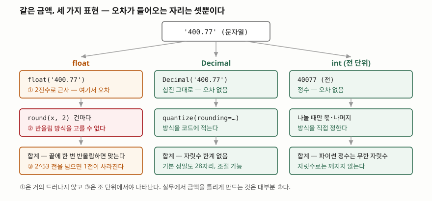

<!-- related:start -->
> **같은 기능을 다른 환경에서 다룬 글** (`numeric-types`)
> - [숫자 타입과 반올림 — 돈을 다룰 때](../../../Database/sql-basics/2026-10-01-sql-numeric-types-rounding-money/index.md) — SQLite 3.49.1, Python 3.13.5, Windows 11
<!-- related:end -->

## 들어가며

쇼핑몰 정산 배치를 만든다. 주문 10만 건의 금액을 더해 매출을 내고, 건마다
부가세 10%를 붙여 합계를 따로 낸다. 금액은 그냥 `float` 으로 다뤘다. 다음 날
회계 담당자가 엑셀로 검산한 값과 배치가 낸 값이 몇십 원 다르다고 알려 온다.

여기서 보통 하는 일은 `0.1 + 0.2 == 0.3` 이 `False` 라는 것을 떠올리고
"부동소수점 때문"이라고 결론 내린 뒤, 금액 컬럼을 전부 `Decimal` 로 바꾸는
것이다. 한나절이면 끝나는 일이 아니다. 직렬화, ORM 매핑, JSON 응답, 외부 API
연동까지 타입이 번져 있어서 며칠이 간다. 그렇게 고치고 나면 값은 맞는다.

그런데 **무엇이 몇 원을 틀리게 했는지는 끝내 모른 채로 남는다.** 재발을 막을
수도, 어디까지 고쳐야 충분한지 판단할 수도 없다. 그래서 숫자를 직접 재 봤다.

## 개념

`float` 은 IEEE 754 배정밀도(binary64)를 쓴다. 파이썬 공식 튜토리얼은 십진수
0.1 을 2진 분수로 정확히 표현할 수 없고, 대부분의 십진 소수가 그렇다고 적는다.
근삿값은 유효숫자 53비트로 잘린다.

```text
   0.1 + 0.2          = 0.30000000000000004
   0.1 + 0.2 == 0.3   -> False
   Decimal(0.1)       = 0.1000000000000000055511151231257827021181583404541015625
   Decimal('0.1')     = 0.1
```

세 번째 줄이 중요하다. `Decimal(0.1)` 은 **이미 오차가 섞인 float 을 받아** 그
오차를 십진으로 펼쳐 보여 준다. `Decimal` 로 바꾸는 것만으로는 안 되고,
**문자열이나 정수에서 출발해야** 한다.

여기까지는 널리 알려진 이야기다. 문제는 이 사실이 "그러니 금액 합산은 위험하다"로
곧장 이어진다는 데 있다. 실제로 얼마나 위험한지는 재 본 사람이 드물다.

## 구조



> **출처**: [Python Tutorial §15 Floating-Point Arithmetic: Issues and Limitations](https://docs.python.org/3/tutorial/floatingpoint.html) · [Python Library Reference — decimal §Rounding modes](https://docs.python.org/3/library/decimal.html#rounding-modes)

오차가 들어올 수 있는 자리는 셋이다. ① 십진 금액을 2진으로 바꾸는 순간,
② 건마다 반올림하는 순간, ③ 합계가 float 이 정수를 정확히 표현할 수 있는
한계를 넘는 순간. 셋 중 어느 것이 실제로 돈을 틀리게 하는지가 이 글의 질문이다.

## 동작 원리

### ① 변환 오차는 합산에서 거의 드러나지 않는다

소수점 둘째 자리까지의 금액 10만 건을 만들어(시드 고정) 세 방식으로 더했다.

```text
   정답(정수 전 단위)  = 4,999,512,787전 = 49,995,127.87원
   float          49995127.87000074       5.6 ms
   Decimal              49995127.87      16.7 ms
   int(전)                4999512787      13.5 ms

   float 과 정답의 차이 = 7.4E-7원
```

차이가 **0.00000074원**이다. 원 단위로 끊으면 정답과 똑같다.

```text
   round(float 합계, 2) = 49995127.87
   정답을 원 단위로      = 49995127.87
   두 값이 같은가        -> True
```

한 번 맞은 것이 우연일 수 있으니 건수와 시드를 바꿔 가며 세어 봤다.

```text
       10,000건 × 20회  어긋남  0회  전부 일치                  (  0.0초)
      100,000건 × 20회  어긋남  0회  전부 일치                  (  0.5초)
    1,000,000건 × 20회  어긋남  0회  전부 일치                  (  4.5초)
   10,000,000건 ×  3회  어긋남  0회  전부 일치                  (  6.8초)
```

**63회 전부 일치했다.** 예상과 달랐던 결과다. 오차가 양쪽으로 갈려 서로
상쇄되고, 남은 드리프트가 1전의 1만분의 1 수준이라 마지막 `round()` 가
전부 흡수한다. "10만 건을 더하면 틀어진다"는 흔한 설명은 적어도 이 조건
— 둘째 자리까지의 금액을 단순 누적하고 끝에 한 번 반올림 — 에서는 맞지 않는다.

### ③ 조 단위를 넘으면 그때는 깨진다

float 이 버티는 데에도 끝이 있다. 잔액을 10배씩 키우며 1전을 더해 봤다.

```text
   balance + 0.01 == balance 가 처음 성립하는 크기 = 1,000,000,000,000,000원
   그 크기에서 float 끼리의 간격 math.ulp = 0.125
   float   1,000,000,000,000,000 + 0.01 -> 1,000,000,000,000,000.00
   Decimal 1,000,000,000,000,000 + 0.01 -> 1000000000000000.01
   int(전) 100,000,000,000,000,000 + 1 -> 100,000,000,000,000,001
```

1,000조 원 자리에서는 이웃한 float 사이의 간격이 0.125원이라, 1전을 더해도
값이 움직이지 않는다. 일반적인 쇼핑몰 정산에서 닿을 자리가 아니다. 다만
**누적 잔액을 계속 들고 가는 원장(ledger)** 이나 소수 여러 자리를 쓰는
암호화폐 수량에서는 현실적인 한계다.

### ② 진짜 범인 — 건마다 하는 반올림

같은 10만 건에 부가세 10%를 **건마다** 붙이고 각각 전 단위로 반올림한 뒤
더했다. 반올림 방식만 바꿨다.

```text
   ROUND_HALF_UP   합계 = 4,999,562.90
   ROUND_HALF_EVEN 합계 = 4,999,512.45
   두 방식의 차이       = 50.45
   float+round() 합계   = 4999541.7800001
   float 이 HALF_UP 과 같은가 -> False
```

세 값이 전부 다르다. ①에서 본 오차가 0.00000074원이었는데, 여기서는
**50.45원**이다. 7천만 배다. 그리고 `float` + `round()` 는 둘 중 어느 쪽과도
맞지 않는 제3의 값을 낸다.

한 건만 떼어 보면 이유가 보인다.

```text
    0.125  HALF_UP=0.13  HALF_EVEN=0.12  round(float)=0.12
    0.135  HALF_UP=0.14  HALF_EVEN=0.14  round(float)=0.14
    2.675  HALF_UP=2.68  HALF_EVEN=2.68  round(float)=2.67
```

두 가지가 겹친다. 첫째, 파이썬 내장 `round()` 는 **동점일 때 짝수 쪽으로**
간다. 0.125 가 0.13 이 아니라 0.12 가 되는 이유다. 공식 문서가 그렇게 적고
있고, 우리가 학교에서 배운 "5면 올림"과 다르다. 둘째, 애초에 그 값이 동점인지
아닌지가 2진 근사에 달려 있다. 2.675 는 십진으로 보면 딱 중간이지만 float
으로는 2.675 보다 아주 약간 작아서 내림이 된다 — 공식 문서가 직접 드는 예다.

`Decimal` 을 쓰면 이 둘이 분리된다. 값은 십진 그대로 유지되고, 반올림 방식은
`quantize(..., rounding=ROUND_HALF_UP)` 처럼 **코드에 적힌다.** 기본값이
`ROUND_HALF_EVEN` 이라는 것도 문서에 있다.

### 비용

같은 10만 건, 3회 중 최저값이다.

```text
   float         5.6 ms
   Decimal      16.6 ms
   int(전)       13.5 ms
```

`Decimal` 은 float 의 약 3배다. 10만 건에 11ms 더 쓴다는 뜻이고, 정산 배치에서
이 차이가 문제가 되는 경우는 드물다. `int` 가 float 보다 2배 넘게 느린 것은
문자열을 `split` 해 정수 둘로 만드는 파싱 비용 때문이다. 세 방식 모두 같은
문자열에서 출발하므로 비교 조건은 같다.

## 실습 예제

전체 소스: [`code/`](code/) · 실행 기록: [`code/output.txt`](code/output.txt)

핵심은 세 방식이 **같은 원본 문자열에서 출발하게 만드는 것**이다. float 으로
먼저 만들어 두고 `Decimal` 로 바꾸면 그 시점에 이미 오차가 섞여 비교가 성립하지
않는다.

```python
def make_prices() -> list[str]:
    rng = random.Random(SEED)
    return [f"{rng.randrange(1, 1_000_00) / 100:.2f}" for _ in range(ITEM_COUNT)]


def sum_int_cents(prices: list[str]) -> int:
    total = 0
    for price in prices:
        won, cent = price.split(".")
        total += int(won) * 100 + int(cent)
    return total
```

건수를 바꿔 가며 어긋남을 세는 쪽은 리스트를 만들지 않고 그 자리에서 더한다.
1,000만 건을 문자열로 들고 있으면 메모리가 먼저 바닥나기 때문이다.

## 다른 환경에서는

SQLite 에서 같은 문제를 다룬 글이 있다. 저장 계층에서는 **타입 선언이 거의
도움이 되지 않는다**는 점이 파이썬과 다르다.

| | Python 3.13.5 | SQLite 3.49.1 |
|---|---|---|
| 십진 정확 타입 | `decimal.Decimal` — 표준 라이브러리 | 없다. `DECIMAL(10,2)` 로 선언해도 REAL 로 저장된다 |
| 기본 반올림 | `round()` 는 동점에서 짝수 쪽 | `round()` 는 동점에서 올림 쪽. `round(1.005, 2)` 는 2진 근사 탓에 1.0 |
| 권장 방식 | `Decimal` 또는 최소단위 정수 | 최소단위 정수 컬럼 (`INTEGER`) |
| 깨지는 자리 | 건별 반올림 | 저장·읽기·연산 전 구간 |

둘 다 **최소단위 정수**라는 답으로 수렴하지만 이유가 다르다. 파이썬에는 쓸 만한
십진 타입이 있는데도 정수를 쓰는 것은 직렬화와 외부 연동에서 타입이 번지는
것을 막기 위해서고, SQLite 에서는 애초에 대안이 없어서다.

## 실무에서 주의할 점

- **합산을 의심하기 전에 반올림을 센다.** 이 측정에서 누적 합산 오차는
  0.00000074원이었고 건별 반올림 차이는 50.45원이었다. 검산 값이 몇십 원
  어긋났다면 거의 확실히 반올림 쪽이다.
- **반올림 방식을 코드에 적는다.** `round()` 의 기본은 짝수 쪽이고, 회계
  관행이나 세법이 요구하는 것은 보통 올림 쪽이다. 어느 쪽을 쓰든
  `ROUND_HALF_UP` 처럼 이름으로 적어 두면 나중에 검산할 때 근거가 남는다.
- **`Decimal(0.1)` 을 쓰지 않는다.** 반드시 문자열이나 정수에서 만든다.
  float 을 거친 순간 오차가 이미 들어와 있고, `Decimal` 은 그것을 그대로 받는다.
- **중간 반올림 횟수를 줄인다.** 건마다 반올림하면 오차가 건수만큼 쌓인다.
  세액을 합계에 한 번만 적용해도 되는 계산이면 그렇게 한다. 다만 **세금계산서처럼
  건별 금액이 그 자체로 법적 의미를 갖는 경우**는 건별 반올림이 맞으므로,
  줄일 수 있는 자리인지 먼저 확인한다.
- **누적 잔액은 정수로 들고 간다.** 1,000조 원 자리에서 1전이 사라지는 것은
  일반 정산에서는 먼 이야기지만, 원장처럼 값을 계속 키워 가는 구조에서는
  언젠가 닿는다. 파이썬 정수는 자릿수 제한이 없다.
- **성능을 이유로 float 을 고르지 않는다.** 10만 건에 11ms 차이다. 이 정도로
  틀릴 위험을 사는 거래는 거의 없다.

## 정리

- 소수점 둘째 자리 금액을 float 으로 단순 누적하고 끝에 한 번 반올림하면,
  1,000만 건까지 63회를 돌려 **한 번도 틀리지 않았다.**
- 같은 데이터에서 **건별 반올림 방식**을 바꾸자 합계가 50.45원 갈렸고,
  `float` + `round()` 는 그 둘 중 어느 쪽과도 다른 세 번째 값을 냈다.
- 파이썬 `round()` 는 동점에서 짝수 쪽으로 간다. 2.675 가 2.67 이 되는 것은
  2진 근사 때문에 애초에 동점이 아니기 때문이다.
- `Decimal` 은 float 의 약 3배 비용이다. 10만 건에 11ms 더 든다.
- `Decimal(0.1)` 은 오차를 그대로 물려받는다. 문자열이나 정수에서 만든다.

## 참고 자료

- [Python Tutorial §15 Floating-Point Arithmetic: Issues and Limitations](https://docs.python.org/3/tutorial/floatingpoint.html)
- [Python Tutorial §15.1 Representation Error](https://docs.python.org/3/tutorial/floatingpoint.html#representation-error)
- [Python Library Reference — `round()`](https://docs.python.org/3/library/functions.html#round)
- [Python Library Reference — `decimal` 모듈](https://docs.python.org/3/library/decimal.html)
- [Python Library Reference — decimal §Rounding modes](https://docs.python.org/3/library/decimal.html#rounding-modes)
- [Python Library Reference — `math.ulp()`](https://docs.python.org/3/library/math.html#math.ulp)
