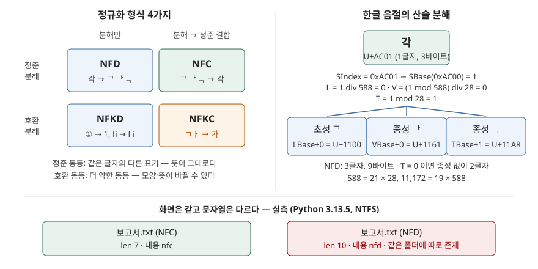

## 들어가며

업로드 기능을 운영하다 보면 "분명 `보고서.txt`를 올렸는데 검색에 안 나온다"거나 "같은 이름 파일이
두 개 보인다"는 문의를 받는다. 로그에 찍힌 이름도 화면에서는 똑같아서, 대부분 먼저 공백이나
확장자 대소문자를 의심하고 한 글자씩 눈으로 비교한다. 그런데 문자열 길이를 찍어 보면 하나는 7,
하나는 10이다. 눈으로는 수십 번을 봐도 차이를 찾을 수 없는 이유는, 다른 것이 글자가 아니라 **글자를
표현한 코드 포인트 열**이기 때문이다.

## 개념

유니코드는 한글 음절 `각`을 두 가지로 적을 수 있다. 완성형 음절 한 글자(U+AC01)로 적을 수도 있고,
초성 `ᄀ`(U+1100)·중성 `ᅡ`(U+1161)·종성 `ᆨ`(U+11A8) 세 자모를 이어 적을 수도 있다. 표준은 둘을
**정준 동등**(canonical equivalence, 같은 추상 문자를 나타내는 근본적인 동등)으로 본다. 화면에는 같게
그려지지만 문자열 비교는 코드 포인트를 보므로 다르다고 판정한다.

**정규화**(normalization)는 동등한 문자열들을 한 가지 표기로 맞추는 변환이다. UAX #15는 형식을
4가지로 정한다. 분해만 하는 NFD, 분해한 뒤 다시 정준 결합하는 NFC, 그리고 같은 일을 더 약한
**호환 동등**(compatibility equivalence)까지 넓혀 하는 NFKD·NFKC다. 비교·저장 전에 한쪽으로
맞춰 두지 않으면 위의 문의가 생긴다.

## 구조



> **출처**: [UAX #15 Unicode Normalization Forms §1.1 Canonical and Compatibility Equivalence](https://unicode.org/reports/tr15/#Canon_Compat_Equivalence), [§1.2 Normalization Forms](https://unicode.org/reports/tr15/#Norm_Forms), [The Unicode Standard 15.1 Chapter 3 §3.12 Conjoining Jamo Behavior (PDF)](https://www.unicode.org/versions/Unicode15.1.0/ch03.pdf). 아래 칸의 길이·내용은 예제 [3]의 출력

## 동작 원리

대부분의 문자는 유니코드 데이터 파일의 분해 표를 따라 분해한다. 한글 음절 11,172자는 표 대신
**산술**로 분해한다(§3.12). 음절 번호 `SIndex = 코드 − 0xAC00`을 구한 뒤 초성 번호는
`SIndex div 588`, 중성은 `(SIndex mod 588) div 28`, 종성은 `SIndex mod 28`이다. 588은 중성 21 ×
종성 칸 28이고, 28은 받침 27개에 '받침 없음' 한 칸을 더한 값이다. 종성 번호가 0이면 자모 2개로 끝난다.

예제 [2]에서 이 식을 그대로 코드로 옮겨 11,172자 전부를 `unicodedata.normalize("NFD")`와 대조했다.
분해 불일치 0, 다시 결합한 왕복 불일치 0이었고, 받침 있는 음절이 10,773자, 없는 음절이
399자(= 19 × 21)였다. 표준 문서의 예시 `퓛`(U+D4DB)도 U+1111 U+1171 U+11B6으로 같게 나왔다.

결과적으로 한글은 NFC와 NFD에서 길이와 바이트가 크게 다르다.

```text
  NFC  len=1  utf8=3B  U+AC01
  NFD  len=3  utf8=9B  U+1100 U+1161 U+11A8
  nfc == nfd: False   NFC(nfd) == nfc: True
```

받침 있는 음절은 UTF-8로 3바이트에서 9바이트가 된다. `VARCHAR(30)`처럼 글자 수나 바이트로 길이를
제한한 칸에 NFD 이름이 들어오면, 같은 이름인데 한쪽만 잘리거나 거부될 수 있다.

## 실습 예제

전체 소스: [`code/`](code/) · 실행 기록: [`code/output.txt`](code/output.txt)

**파일 시스템은 이름을 맞춰 주지 않았다.** [3]은 임시 폴더에 NFC 이름과 NFD 이름으로 `보고서.txt`를
하나씩 만들었다. NTFS는 둘을 다른 파일로 저장했다.

```text
  폴더 안 파일 수: 2
    len=10  내용=nfd  U+1107 ...
    len= 7  내용=nfc  U+BCF4 ...
  정규화 후 이름 수: 1
```

반대로 이름을 정규화해 저장하는 파일 시스템도 있다. Apple의 HFS Plus 기술 문서는 파일 이름을 완전히
분해한 형태로 저장하며, 완성형 한글 음절은 쓸 수 없어 자모 열로 바꿔야 한다고 적는다. 그런 곳에서
만든 이름이 정규화하지 않는 곳으로 옮겨 오면 위와 같은 쌍이 생긴다.

**검색이 거짓으로 맞는다.** 정규화를 아예 안 하면 검색이 빠지는 것은 예상할 수 있다. 예상 밖이었던 것은
양쪽을 NFD로 맞췄을 때다([4]).

```text
  NFC 안에서 NFC '가': False
  NFD 안에서 NFD '가': True   <- '각' 의 앞 두 자모와 맞는다
```

NFD에서 `각`은 `ᄀ ᅡ ᆨ`이고 `가`는 `ᄀ ᅡ`라서 부분 문자열이 된다. `각서`를 `가`로 찾았더니 맞은 것이다.
검색 키는 NFC로 맞추는 쪽이 음절 경계를 지킨다.

**정렬과 유일 키도 갈린다.** [5-1]에서 NFD로 적힌 `하늘`이 `가방`·`나무`보다 앞에 왔다. 첫 코드 포인트가
U+1112로 완성형 음절 영역(U+AC00부터)보다 작기 때문이다. [5-2]에서는 SQLite `UNIQUE` 열이 NFC·NFD
`보고서`를 둘 다 받았고 `length()`는 3과 6이었다.

**NFKC는 글자를 바꾼다.** [6]에서 NFKC는 `①`을 `1`로, `㈜`를 `(주)`로, 전각 `Ａ`를 `A`로 접었다. 여기까지는
검색 키를 만들 때 바라는 동작이다. 그런데 [6-1]에서 호환 자모 두 글자 `ㄱㅏ`(U+3131 U+314F)를 NFKC로
바꾸자 완성형 `가` 한 글자가 됐다.

```text
    NFC  U+3131 U+314F 'ㄱㅏ'
    NFKD U+1100 U+1161 '가'
    NFKC U+AC00        '가'
```

NFKC가 호환 자모를 결합용 자모로 바꾸고, 이어지는 정준 결합이 그것을 음절로 합친 것이다. 사용자가
일부러 낱자로 쓴 글을 저장 단계에서 NFKC로 바꾸면 원문이 사라진다.

## 실무에서 주의할 점

- **저장 직전 한 곳에서 NFC로 맞춘다.** 파일 이름, 사용자 이름, 유일 키처럼 비교에 쓰이는 값은 들어오는
  경계(API 입력, 업로드)에서 한 번 정규화한다. 비교하는 곳마다 맞추면 한 곳을 빠뜨린다.
- **NFKC는 검색 키에만 쓰고 원문에는 쓰지 않는다.** 전각·원문자를 접어 주는 대신 `ㄱㅏ`→`가`, `fi`→`fi`처럼
  글자를 바꾼다. 원문은 NFC로 두고 검색용 열을 따로 둔다.
- **길이 제한은 정규화한 뒤에 센다.** 받침 있는 음절은 NFD에서 글자 수 3배, 바이트 3배다. 검사와 저장이
  서로 다른 형식을 보면 통과한 값이 저장에서 잘린다.
- **DB의 `UNIQUE`는 정규화를 모른다.** SQLite는 코드 포인트가 다르면 다른 값으로 받았다. 중복을 막는 일은
  애플리케이션이 정규화해서 넣는 것으로 해결한다.
- **유니코드 판을 확인한다.** 이 글은 Python 3.13.5에 들어 있는 UCD 15.1.0으로 돌렸다. UAX #15는 정규화
  형식이 시간이 지나도 안정되어야 한다는 원칙(§3)을 두지만, 쓰는 런타임의 UCD 판은
  `unicodedata.unidata_version`으로 직접 찍어 남겨 둔다.

## 정리

- 한글 음절은 완성형 1글자와 자모 2~3글자로 적을 수 있고, 둘은 정준 동등이지만 문자열로는 다르다.
- 한글 분해는 표가 아니라 산술식이고, 직접 구현한 식이 11,172자 전부에서 `unicodedata`와 일치했다.
- 파일 시스템(NTFS)과 DB의 `UNIQUE`는 두 표기를 다른 값으로 저장했다. 비교 전에 NFC로 맞춘다.
- NFD끼리의 부분 검색은 음절 경계를 넘어 맞고, NFKC는 `ㄱㅏ`를 `가`로 합친다. 형식마다 쓸 자리가 다르다.

## 참고 자료

- [UAX #15 Unicode Normalization Forms (Revision 58, Unicode 18.0.0, 2026-08-12)](https://unicode.org/reports/tr15/) — 정준·호환 동등(§1.1), 정규화 형식 4가지(§1.2), 안정성(§3). 이 글의 실측은 UCD 15.1.0으로 했다
- [UAX #15 §1.2 Normalization Forms](https://unicode.org/reports/tr15/#Norm_Forms) — NFD·NFC·NFKD·NFKC 정의 표
- [The Unicode Standard Version 15.1, Chapter 3 Conformance (PDF)](https://www.unicode.org/versions/Unicode15.1.0/ch03.pdf) — §3.12 Conjoining Jamo Behavior의 상수와 한글 음절 분해·결합 식
- [Python 3.13 unicodedata](https://docs.python.org/3.13/library/unicodedata.html#unicodedata.normalize) — `normalize()`, `is_normalized()`(3.8 추가), `unidata_version`
- [Apple Technical Note TN1150 HFS Plus Volume Format — Canonical Decomposition (2004)](https://developer.apple.com/library/archive/technotes/tn/tn1150.html) — Unicode Subtleties 절의 Canonical Decomposition 항목. 파일 이름을 완전 분해형으로 저장, 완성형 한글 음절 금지
