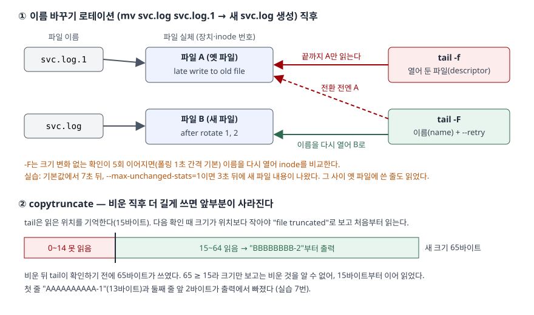

## 들어가며

서버에서 배포 직후 애플리케이션 로그를 띄워 두는 일은 흔하다. `tail -f app.log`를 걸어 두고 다른 일을 하다 다음 날 아침에 보면
화면이 자정 무렵에서 멈춰 있다. 서비스는 멀쩡히 돌고 로그 파일도 계속 커지는데, 터미널에는 아무것도 올라오지 않는다.
대개는 `Ctrl+C`로 끊고 다시 `tail -f`를 치는데, 그러면 멈춘 시각부터 다시 띄운 시각까지의 줄은 그 화면에서 영영 보지 못한다.
범인은 자정에 돈 로그 로테이션이고, `tail`에는 이것을 견디는 옵션이 따로 있다.

## 개념

`tail`은 파일의 **끝부분**을 찍는다. 기본은 마지막 10줄이고, `-f`를 붙이면 끝까지 찍은 뒤 끝나지 않고 파일이 늘어나는 만큼 이어서 찍는다.
이 환경의 `tail --help`가 보여 주는 옵션을 갈래로 묶으면 다음과 같다. 전부 아래 실습에서 돌렸다.

| 갈래 | 옵션 | 하는 일 |
|---|---|---|
| 얼마나 | `-n N` / `-n +N` | 마지막 N줄 / N번째 줄부터 끝까지 (기본 10줄) |
| | `-c N` / `-c +N` | 마지막 N바이트 / N번째 바이트부터 |
| | `-z` | 줄 구분자를 줄바꿈 대신 NUL로 본다 |
| 여러 파일 | (파일 2개 이상) | 파일마다 `==> 이름 <==` 머리말을 붙인다 |
| | `-q` / `-v` | 머리말을 절대 안 붙인다 / 파일이 하나여도 붙인다 |
| 따라가기 | `-f`, `--follow=descriptor` | 열어 둔 파일을 계속 읽는다 (`-f`의 기본) |
| | `--follow=name` | 같은 이름의 파일을 따라간다. 이름이 다른 파일로 바뀌면 다시 연다 |
| | `--retry` | 파일을 열 수 없어도 끝내지 않고 계속 시도한다 |
| | `-F` | `--follow=name --retry`와 같다 |
| | `-s N` | 확인 간격(초). 기본 1.0 |
| | `--max-unchanged-stats=N` | 이름으로 따라갈 때, 크기 변화 없는 확인이 N회 이어지면 이름을 다시 연다. 기본 5 |
| 끝내기 | `--pid=PID` | 그 프로세스가 끝나면 tail도 끝난다 |

`N`에는 `K`(1024)·`M`·`kB`(1000) 같은 배수 접미사를 붙일 수 있다. journalctl은 이 환경에 없어 다루지 않는다.

## 구조



> **출처**: descriptor와 name 따라가기의 차이는 이 환경의 `tail --help` 끝 문단(GNU coreutils 8.32),
> 이름을 다시 여는 조건과 "file truncated" 판정은 [coreutils v8.32 src/tail.c](https://github.com/coreutils/coreutils/blob/v8.32/src/tail.c)의
> `DEFAULT_MAX_N_UNCHANGED_STATS_BETWEEN_OPENS`·`recheck`·`file truncated` 부분,
> 로테이션 방식은 [logrotate(8) — create, copytruncate](https://github.com/logrotate/logrotate/blob/main/logrotate.8.in).
> 걸린 시간과 바이트 수는 실습 5~7번의 실행 결과다.

## 동작 원리

**파일 이름과 파일 실체는 따로 있다.** 이름은 디렉터리에 적힌 항목이고, 실체는 장치·inode 번호로 구분된다.
logrotate의 기본 방식은 `svc.log`의 이름을 `svc.log.1`로 바꾸고(`mv`), `create` 지시어가 있으면 같은 이름으로 빈 파일을 새로 만든다.
그러면 `svc.log`라는 이름은 새 실체를 가리키고, 옛 실체는 `svc.log.1`이라는 이름으로 남는다.

**`-f`는 처음 연 실체를 쥐고 놓지 않는다.** `--help`는 이 기본 동작을 "파일 이름이 바뀌어도 그 끝을 계속 따라간다"고 설명하고,
로그 로테이션처럼 이름을 따라가야 할 때는 `--follow=name`을 쓰라고 적는다. 그래서 자정 이후 화면이 멈춘다 — tail은 이제 아무도 쓰지 않는 `svc.log.1`을 보고 있다.

**`-F`는 이름을 다시 열어 실체가 바뀌었는지 본다.** 다만 매번 보지는 않는다. coreutils 8.32 소스는 이름으로 따라갈 때
"파일이 바뀌지 않은 확인이 연속으로 이 횟수만큼 이어지면" 이름을 다시 열어 장치·inode 쌍이 같은지 확인한다고 적고, 그 횟수 기본값이 5다.
inotify를 쓸 수 없으면 확인은 `-s` 간격(기본 1초)의 폴링이다. `--help`는 inotify가 있으면 이 옵션이 거의 필요 없다고 적는다.

**비운 파일은 크기로 알아챈다.** 소스는 일반 파일의 크기가 tail이 기억한 크기보다 작아지면 `file truncated`를 찍고 처음부터 다시 읽는다.
크기 비교이므로, 비운 뒤 tail이 다음에 확인하기 전에 원래 위치보다 길게 쓰이면 비운 사실을 알 길이 없다.

## 실습 예제

전체 소스: [`code/tail_follow.sh`](code/tail_follow.sh), 실행 기록: [`code/output.txt`](code/output.txt).
임시 폴더에 로그 파일을 만들고, 백그라운드로 띄운 tail의 출력(안내 문구 포함)을 파일로 받아 두었다가 찍는다.

### 줄 수, 바이트 수, 여러 파일

`app.log`는 `line 1`부터 `line 15`까지 15줄이다.

```text
$ tail -n +13 app.log
line 13
line 14
line 15
$ tail -c 8 app.log
line 15
$ tail -c +80 app.log
line 12
line 13
line 14
line 15
$ tail -n 1 a.log b.log
==> a.log <==
a-2

==> b.log <==
b-2
```

`-n +13`은 "마지막 13줄"이 아니라 "13번째 줄부터"다. `-c 8`은 `line 15`와 줄바꿈까지 8바이트다. `-c +80`이 `line 12`에서 시작한 것은
`line 1`~`line 9`가 7바이트씩 63바이트, `line 10`·`line 11`이 8바이트씩 16바이트로 79바이트를 채우기 때문이다.
`-q`를 주면 머리말 없이 `a-2`, `b-2`만, `-v`를 주면 파일이 하나여도 머리말이 붙었다. `-z`는 NUL로 끊긴 `one`·`two`·`three` 중 마지막 둘을 돌려줬다.

### -f 대 -F — 이름 바꾸기 로테이션

`svc.log`에 두 tail을 붙이고 `before rotate`를 쓴 뒤, `mv`로 이름을 바꾸고 빈 `svc.log`를 만들었다.
새 파일에 `after rotate 1`을, 옛 파일에는 아직 옛 파일을 쥔 프로세스를 흉내 내 `late write to old file`을 썼다.

```text
  로테이션 1초 뒤: -F 출력에 'after rotate 1' 안 보임
  로테이션 2초 뒤: -F 출력에 'after rotate 1' 안 보임
  로테이션 3초 뒤: -F 출력에 'after rotate 1' 안 보임
  로테이션 4초 뒤: -F 출력에 'after rotate 1' 안 보임
  로테이션 5초 뒤: -F 출력에 'after rotate 1' 안 보임
  로테이션 6초 뒤: -F 출력에 'after rotate 1' 안 보임
  로테이션 7초 뒤: -F 출력에 'after rotate 1' 보임
[tail -f 최종 출력]
before rotate
late write to old file
[tail -F 최종 출력]
before rotate
late write to old file
tail: 'svc.log' has been replaced;  following new file
after rotate 1
after rotate 2
```

`-f`는 로테이션 뒤 새 파일에 쓴 두 줄을 끝내 찍지 못했다. 대신 옛 파일에 쓴 줄은 찍었다 — 실체를 쥐고 있다는 뜻이다.

### 예상과 달랐던 결과 — -F는 바로 넘어가지 않는다

`-F`는 이름을 따라가니 로테이션 직후 새 파일로 넘어갈 것이라 예상했다. 실제로는 **7초가 걸렸고**, 그 사이 옛 파일에 쓴 줄까지 읽었다.
옛 파일에 `late write`가 붙어 크기가 바뀌었으므로 "변화 없는 확인 5회"를 처음부터 다시 셌고, 1초 폴링으로 그만큼 늦어졌다.

```text
== 6. --max-unchanged-stats=1 — 이름 확인을 더 자주 한다 ==
  로테이션 2초 뒤: 'after rotate 1' 안 보임
  로테이션 3초 뒤: 'after rotate 1' 보임
```

`--max-unchanged-stats=1`로 줄이자 3초로 당겨졌다. 이 환경에서는 교체 감지가 폴링 주기 단위로 늦게 일어났다.
그 사이 새 파일에 쓰인 줄은 사라지지 않고, 넘어간 뒤 처음부터 읽혀 나온다(`after rotate 1`이 빠지지 않았다).

### copytruncate — 비운 뒤 길게 쓰면 앞이 사라진다

```text
[비운 직후 더 길게 쓴 경우까지 포함한 최종 출력]
appended before truncate
tail: trunc.log: file truncated
after truncate
BBBBBBBB-2
CCCCCCCCCC-3
```

처음 비웠을 때는 `file truncated`를 찍고 새 줄을 읽었다. 두 번째에는 비우자마자 13바이트짜리 줄 5개(65바이트)를 썼다.
tail이 기억한 위치는 `after truncate` 줄 길이인 15바이트였고, 다음 확인 때 크기 65가 15보다 크므로 비운 것을 모른 채 15바이트부터 읽었다.
`AAAAAAAAAA-1` 한 줄과 다음 줄 앞 `BB`가 출력에서 빠졌고 안내 문구도 없었다.

### 없는 파일, --pid, -s, 파이프

```text
$ tail -f missing.log
tail: cannot open 'missing.log' for reading: No such file or directory
tail: no files remaining
(종료 코드 1)
[tail -F missing.log 출력]
tail: cannot open 'missing.log' for reading: No such file or directory
tail: 'missing.log' has appeared;  following new file
created later
```

`-f`는 파일이 없으면 종료 코드 1로 바로 끝났고, `-F`는 기다렸다가 파일이 생기자 따라갔다.
`--pid`로 `sleep 3`의 PID를 주자 tail도 약 3초 뒤 종료 코드 0으로 끝났다. `-s 4`로 띄운 tail은 쓴 지 1초 뒤에는 아무것도 안 찍었고 4초 뒤에 찍었다.

```text
[3초 시점 grep ERROR > 파일]                 0바이트
[3초 시점 grep --line-buffered ERROR > 파일] 16바이트: ERROR disk full
[tail 이 끝난 뒤 grep ERROR > 파일]          16바이트: ERROR disk full
```

`tail -f … | grep ERROR > 파일`은 3초가 지나도 파일이 비어 있었다. grep이 찾은 줄을 바로 쓰지 않고 출력 버퍼에 모아 두었다가, tail이 끝나 파이프가 닫힐 때에야 한꺼번에 썼다.
grep 매뉴얼이 줄 단위 출력 버퍼로 설명하는 `--line-buffered`를 주면 줄마다 바로 썼다.

## 실무에서 주의할 점

- **로테이션되는 로그에는 `-f` 대신 `-F`를 쓴다.** `-f`는 이름이 바뀐 옛 파일을 계속 읽어 새 줄을 하나도 못 찍었다(실습 5번).
  logrotate 기본 방식(`mv` 후 `create`)이든, 애플리케이션이 날짜별로 파일을 바꾸든 같다.
- **`-F`는 즉시 넘어가지 않는다.** 폴링 환경에서 7초가 걸렸고, 그 사이 옛 파일에 쓰인 줄도 섞여 나왔다(실습 5번).
  inotify를 못 쓰는 환경(소스상 원격 파일시스템, 심볼릭 링크로 연 파일 등)에서 빨리 넘어가야 하면 `--max-unchanged-stats`를 낮춘다.
- **copytruncate는 tail에서도 줄을 잃을 수 있다.** logrotate 문서도 복사와 비우기 사이의 짧은 틈에 로그가 사라질 수 있다고 적는데,
  tail 쪽에서는 비운 직후 원래 위치보다 길게 쓰이면 앞부분을 안내 없이 건너뛴다(실습 7번). 애플리케이션이 파일을 다시 열 수 있으면 `create` 방식이 낫다.
- **`tail -f | grep | …` 뒤에 파일이나 다른 명령이 오면 `--line-buffered`를 붙인다.** 없으면 tail이 끝날 때까지 아무것도 안 나온다(실습 11번).
- **스크립트에서 tail을 띄웠으면 `--pid`로 끝을 묶는다.** 로그를 쓰는 프로세스가 끝나면 tail도 끝나므로 남은 tail 프로세스를 따로 찾아 죽일 필요가 없다(실습 9번).
- **`-n +N`과 `-n N`을 헷갈리지 않는다.** 앞부분을 건너뛰고 보고 싶을 때 `+`를 빼면 반대로 끝부분만 나온다.

## 정리

- `tail`의 옵션은 얼마나(`-n`·`-c`·`-z`), 여러 파일(`-q`·`-v`), 따라가기(`-f`·`--follow=name`·`--retry`·`-F`·`-s`·`--max-unchanged-stats`), 끝내기(`--pid`) 네 갈래다.
- `-f`는 열어 둔 파일 실체를, `-F`는 이름을 따라간다. 로테이션 뒤 새 줄을 보려면 `-F`다.
- `-F`는 크기 변화 없는 확인이 5회 이어져야 이름을 다시 열므로 폴링 환경에서는 몇 초 늦게 넘어간다.
- 비운 파일은 크기 감소로만 알아채므로, copytruncate 직후 길게 쓰이면 앞부분을 건너뛴다.

## 참고 자료

- GNU coreutils 8.32 `tail --help` — 이 환경에서 찍은 옵션 목록과 descriptor·name 설명 ([`code/output.txt`](code/output.txt) 0번 절에 그대로 있다)
- [GNU coreutils — tail invocation](https://www.gnu.org/software/coreutils/manual/html_node/tail-invocation.html) — 온라인 매뉴얼은 최신판이라 8.32와 다를 수 있다
- [coreutils v8.32 src/tail.c](https://github.com/coreutils/coreutils/blob/v8.32/src/tail.c) — 이름 재확인 횟수 기본값 5, "file truncated" 판정, inotify를 끄는 조건, 기본 확인 간격 1.0초
- [logrotate(8)](https://github.com/logrotate/logrotate/blob/main/logrotate.8.in) — `create`, `copytruncate`와 데이터 유실 경고
- [GNU grep — Other Options: --line-buffered](https://www.gnu.org/software/grep/manual/grep.html#Other-Options) — 줄 단위 출력 버퍼
