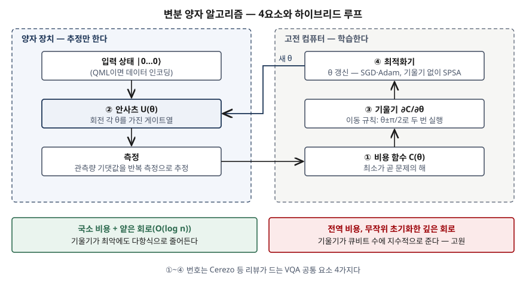

## 들어가며

양자 컴퓨팅 문제에서 양자머신러닝(QML)이 나오면 "양자 병렬성으로 학습이 빨라진다"로 쓰기 쉽다. 지금 장치에서 실제로 돌아가는
QML은 거의 전부 **변분 양자 알고리즘(VQA)** 의 틀 위에 있고, 그 틀은 양자 장치가 비용만 추정하고 학습은 고전 컴퓨터가 하는
분업이다. 점수가 갈리는 곳은 이 분업의 **4요소**를 쓰는가, 그리고 큐비트를 늘리면 학습이 멈추는 **기울기 소실 고원**을 쓰는가다.
실무에서는 양자 가속을 내세운 제안서를 받았을 때 어느 단계가 병목인지 짚는 데 쓴다.

> 정의와 구성은 원 논문과 리뷰에서 가져왔다. 동작은 양자 장치가 아니라 **고전 상태벡터 시뮬레이션**으로 계산했다.
> 기댓값을 정확히 계산했으므로 측정 잡음·하드웨어 잡음은 들어 있지 않다. 기록은 [code/output.txt](code/output.txt)에 있다.

## 정의

- **변분 양자 알고리즘**: 문제의 해를 담은 **비용 함수**를 정하고, **매개변수가 있는 양자 회로(안사츠)** 를 양자 장치로 돌려
  비용(또는 기울기)을 추정한 뒤, **고전 최적화기**로 매개변수를 갱신하는 하이브리드 양자-고전 알고리즘 (Cerezo 등, 2021).
- **양자머신러닝**: 고전 방식보다 계산상 이점을 주는 양자 소프트웨어를 머신러닝 과제에 맞게 설계·구현하는 분야 (Biamonte 등, 2017).

둘은 범위가 다르다. VQA는 바닥 상태 에너지 계산(VQE), 조합 최적화(QAOA) 등에도 쓰이는 **알고리즘 틀**이고, QML은 **응용 분야**다.
지금 장치(NISQ, 잡음이 있는 중규모 양자 장치)에서 돌리는 QML 분류기는 VQA 틀로 구현된다.

## 등장 배경

HHL 같은 양자 선형대수 알고리즘과 위상 추정은 오류 정정이 된 깊은 회로를 전제한다. Cerezo 등은 위상 추정 기반 바닥 상태
계산이 **NISQ 시대에 쓸 수 있는 회로 깊이를 넘는다**는 점을 들어, 그 대안으로 나온 첫 VQA가 VQE라고 정리한다. 큐비트가 적고
잡음이 크며 결맞음 시간이 짧은 장치에서는 회로를 얕게 두고 나머지를 고전 쪽으로 넘겨야 했다. 그 결과가 "양자는 짧은 회로로
추정만, 반복과 판단은 고전"이라는 분업이다.

## 구성요소 — 4가지

| 요소 | 하는 일 | 갖춰야 할 조건 |
|---|---|---|
| ① 비용 함수 C(θ) | 매개변수를 실수 하나로 사상. 최소값이 문제의 해 | 해와 일치(faithful), 효율적 추정, 학습 가능 |
| ② 안사츠 U(θ) | 매개변수 게이트와 고정 게이트를 층으로 쌓은 회로 | 문제 기반(UCC, QAOA) 또는 하드웨어 효율형 |
| ③ 기울기 | ∂C/∂θ를 같은 회로로 계산 | 매개변수 이동 규칙: 한 매개변수를 앞뒤로 옮겨 두 번 실행 |
| ④ 최적화기 | θ를 갱신하고 ②로 돌아간다 | 경사하강 계열(SGD, Adam), 기울기 없는 SPSA 등 |

QML이면 ② 앞에 **데이터 인코딩**이 붙는다. 기저·각도·진폭 **3방식**이 있고, 큐비트 수와 상태 준비 회로 깊이를 맞바꾼다.
리뷰는 VQA의 과제를 **3가지**로 나눈다: 학습 가능성(기울기 소실 고원), 효율(측정 횟수), 정확도(하드웨어 잡음).

## 도식

> **출처**: [M. Cerezo et al., Variational Quantum Algorithms, Nature Reviews Physics 3 (2021) — Fig. 1, §II Basic Concepts and Tools](https://arxiv.org/abs/2012.09265), 아래 두 칸은 [Cerezo et al., Cost function dependent barren plateaus, Nature Communications 12 (2021)](https://arxiv.org/abs/2001.00550)과 [McClean et al., Nature Communications 9 (2018)](https://arxiv.org/abs/1803.11173)

## 계산으로 확인한 것

전체 소스: [`code/vqa_sim.py`](code/vqa_sim.py). RY 회전과 CZ만 쓰는 하드웨어 효율형 안사츠를 실수 상태벡터로 계산했다.

**이동 규칙은 근사가 아니라 정확한 미분이다.** RY(θ)|0⟩에서 ⟨Z⟩ = cos θ다. θ를 ±π/2 옮겨 두 번 계산한 차의 절반이
해석적 미분 −sin θ와 출력 12자리까지 같았다. 같은 자리에서 유한 차분(h=10⁻³)은 소수 7번째 자리부터 어긋났다. 리뷰는 이동 규칙의
정확도가 옮기는 폭에 달린 계수로 정해진다고 적는다. 아주 작은 h로 나누는 유한 차분은 측정 잡음을 그만큼 키운다.

**하이브리드 루프는 회로를 많이 돌린다.** 2큐비트·2층 회로로 |11⟩을 목표로 학습했다. 비용이 0.85에서 40회 반복 뒤 0이 됐고
|11⟩ 확률은 0.999999였다. 그동안 회로를 **361번** 돌렸다. 매개변수 4개면 기울기 한 번에 회로 8번이다. 매개변수가 P개면
기울기 한 번에 2P번이고, 실제 장치에서는 그 하나하나가 다시 수천 번 측정한 평균이다.

**전역 비용은 큐비트가 늘면 기울기가 사라진다.** 무작위 매개변수 200세트에서 첫 매개변수의 기울기 분산을 쟀다.

| 큐비트 | 전역 비용(2층) | 국소 비용(2층) | 국소 비용(n층) |
|---|---|---|---|
| 2 | 4.271e-02 | 3.392e-02 | 3.365e-02 |
| 6 | 4.814e-04 | 3.020e-03 | 1.646e-03 |
| 10 | 1.749e-05 | 1.113e-03 | 4.953e-04 |

모든 큐비트가 0일 확률로 정의한 **전역 비용**은 2층짜리 얕은 회로인데도 분산이 약 2,400분의 1로 줄었다. 큐비트마다 0일 확률의
평균으로 정의한 **국소 비용**은 같은 회로에서 약 30분의 1에 그쳤다. Cerezo 등(2021)이 보인 것이 이 차이다. 전역 관측량으로 정의한
비용은 얕은 회로에서도 기울기가 지수적으로 사라지고, 국소 비용은 깊이가 O(log n)이면 최악에도 다항식으로 줄어든다. 층을 n개로
늘린 국소 비용은 2층보다 빨리 줄었다. 분산은 200표본 추정이라 자리마다 오차가 있다.

기울기 분산이 이만큼 작으면 실제 장치에서는 측정 평균의 오차보다 기울기가 작아져, 최적화기가 방향을 정하지 못한다.
McClean 등(2018)은 무작위로 초기화한 매개변수 회로에서 이 확률이 큐비트 수에 대해 지수적으로 작아진다는 것을 보였다.

## 비교

| 구분 | 변분 알고리즘(VQA·변분 분류기) | 양자 커널 | HHL 계열 |
|---|---|---|---|
| 필요한 장치 | NISQ | NISQ | 오류 정정된 장치 |
| 양자 쪽이 하는 일 | 비용·기울기 추정 | 두 입력 상태의 겹침(커널 값) 추정 | 선형 연립방정식 풀이 전체 |
| 학습 위치 | 고전 최적화기가 θ 갱신 | 고전 SVM | 학습 없음(해를 양자 상태로 출력) |
| 걸림돌 | 기울기 소실 고원, 측정 횟수, 잡음 | 커널 추정 측정 횟수 | 데이터 적재, 조건수, 출력 판독 |

| 구분 | 변분 양자 회로 | 고전 신경망 |
|---|---|---|
| 매개변수 | 게이트 회전 각 | 가중치 |
| 기울기 | 이동 규칙, 매개변수당 회로 2번 | 역전파, 순전파·역전파 각 1번으로 전부 |
| 출력 | 측정 기댓값의 표본 평균 | 결정적 실수 |

기울기를 매개변수마다 따로 구한다는 점이 고전 역전파와 가장 크게 다르다. 매개변수가 늘면 회로 실행 수가 그만큼 늘어난다.

## 적용 시 고려사항

- **비용 함수를 국소 관측량으로 정의할 수 있는지 본다.** 같은 문제라도 전역 비용을 쓰면 얕은 회로에서도 학습이 멈춘다.
  Cerezo 등(2021)은 전역 비용을 쓰는 기존 알고리즘 일부가 비용을 고쳐야 할 수 있다고 적는다.
- **초기화를 무작위로 두지 않는다.** McClean 등은 무작위 회로가 몇 큐비트를 넘으면 초기값으로 적합하지 않다고 결론짓는다.
  리뷰도 무작위로 초기화한 층형 하드웨어 효율형 안사츠에 학습 문제가 생길 수 있다고 적는다. 문제 구조를 반영한 안사츠(UCC, QAOA)를 먼저 검토한다.
- **측정 예산을 계산에 넣는다.** 기울기 한 번에 회로 2P번, 각각 반복 측정이다. 리뷰가 효율을 별도 과제로 드는 이유다.
  측정 횟수를 조절하는 최적화기나 기울기 없는 SPSA가 이 비용을 줄이려고 나왔다.
- **가속 주장은 전제와 비교 대상을 확인한다.** HHL 계열의 지수 가속에는 데이터 적재·희소성·조건수·출력 판독 단서 4가지가
  붙고(Aaronson, 2015), 고전 쪽에 같은 데이터 접근을 허용하면 격차가 줄어드는 사례가 있다(Tang, 2019).
  VQA 자체는 휴리스틱이라 일반적 가속 보장이 없다.

## 정리

- VQA = **4요소**: 비용 함수 · 안사츠 · 기울기 · 최적화기. 양자는 **추정**, 고전은 **학습**.
- 과제 **3가지**: 학습 가능성(고원) · 효율(측정 횟수) · 정확도(잡음).
- 기울기는 **이동 규칙**: θ±π/2 두 번 실행, 근사가 아닌 정확한 미분. 매개변수 P개면 회로 2P번.
- 고원: **전역 비용·무작위 깊은 회로 → 지수적 소실**, **국소 비용·얕은 회로 → 다항식**.
- QML 인코딩 **3방식**(기저·각도·진폭)은 큐비트 수와 회로 깊이를 맞바꾼다.

> 기출 답안: [기출문제 — 양자머신러닝(QML)](../../exam/2026-10-11-quantum-machine-learning/index.md)

## 참고 자료

- [M. Cerezo et al. — Variational Quantum Algorithms, Nature Reviews Physics 3, 625–644 (2021)](https://arxiv.org/abs/2012.09265) — Fig. 1, §II.A 비용 함수, §II.B 안사츠, §II.C 매개변수 이동 규칙, §II.D 최적화기, §III.A VQE 등장 배경
- [M. Cerezo, A. Sone, T. Volkoff, L. Cincio, P. J. Coles — Cost function dependent barren plateaus in shallow parametrized quantum circuits, Nature Communications 12, 1791 (2021)](https://arxiv.org/abs/2001.00550) — 전역·국소 비용, O(log n) 깊이 조건
- [J. R. McClean et al. — Barren plateaus in quantum neural network training landscapes, Nature Communications 9, 4812 (2018)](https://arxiv.org/abs/1803.11173) — 무작위 회로의 기울기 소실
- [M. Schuld, V. Bergholm, C. Gogolin, J. Izaac, N. Killoran — Evaluating analytic gradients on quantum hardware, Phys. Rev. A 99, 032331 (2019)](https://arxiv.org/abs/1811.11184) — 매개변수 이동 규칙
- [J. Biamonte et al. — Quantum Machine Learning, Nature 549, 195–202 (2017)](https://arxiv.org/abs/1611.09347) — QML 정의
- [S. Aaronson — Read the fine print, Nature Physics 11, 291–293 (2015)](https://www.scottaaronson.com/papers/qml.pdf) — HHL 가속의 단서 4가지
- [E. Tang — A quantum-inspired classical algorithm for recommendation systems (arXiv:1807.04271)](https://arxiv.org/abs/1807.04271) — 탈양자화
