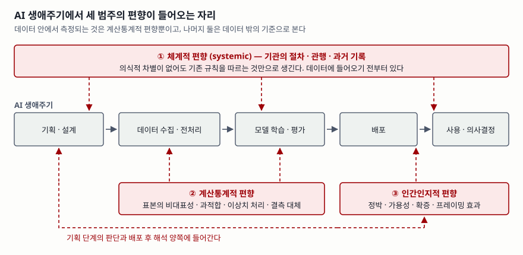

> 실행 검증 없음. 공개 표준 문서 근거만으로 정리했다. NIST SP 1270 원문(PDF)과
> AI RMF 1.0을 직접 읽고 범주 정의·절 번호·인용 문장을 확인했다. 범주를 AI RMF의
> 기능에 대응시킨 표는 두 문서를 잇는 해석이며, NIST가 그 형태로 표를 제시한 것은 아니다.

## 들어가며

AI 공정성 문제는 단답형에서는 "편향의 유형"으로, 논술형에서는 "AI 신뢰성 확보 방안"의
한 축으로 나온다. 답안 대부분이 학습 데이터가 치우쳐 있다는 이야기로 시작해 리샘플링과
공정성 지표로 끝나는데, 이건 세 범주 중 하나만 쓴 답안이다. 실무에서도 같은 일이 생긴다.
데이터 팀이 표본을 고르게 맞추고 공정성 지표를 통과시켰는데도 현장에서 특정 집단의 민원이
줄지 않는다. 데이터에 들어오기 전 제도에서 만들어진 치우침과, 모델 출력을 받아 든 사람이
더하는 치우침이 남아 있기 때문이다. NIST SP 1270은 이 세 자리를 갈라 놓은 문서다.

## 정의

**AI 편향은 AI 시스템이 특정 집단이나 결과를 유리하게 또는 불리하게 만드는 치우침이며,
의도와 무관하게 나타난다.** 미국 국립표준기술연구소(NIST)의 SP 1270은 이 편향을 발생
지점에 따라 **체계적·계산통계적·인간인지적 3가지 범주**로 나눈다.

범주 이름은 문서마다 조금 다르다. SP 1270 본문(§2.1.2)은 *systemic*, *statistical and
computational*, *human*으로 적고, AI RMF 1.0은 신뢰 가능한 특성 중 '공정·유해 편향 관리'를
설명하면서 같은 셋을 *systemic*, *computational and statistical*, *human-cognitive*로
부른다. 답안에서는 후자의 한국어 표기인 **체계적·계산통계적·인간인지적**을 쓰고, 괄호로
영문을 붙여 두는 쪽이 안전하다.

## 등장 배경

편향은 AI와 함께 생긴 문제가 아니고 AI에만 있는 문제도 아니다. 그런데도 별도 문서가 필요했던
이유를 SP 1270의 요약이 직접 적는다. **AI 편향의 해로운 결과에 대한 지금까지의 대응이
데이터셋의 대표성과 기계학습 알고리즘의 공정성 같은 연산 요소에 몰려 있었다**는 것이다.
그 대응이 쓸모없다는 뜻이 아니라, 거기서 멈추면 사람과 제도에서 들어오는 편향이 통째로
남는다는 뜻이다.

그래서 이 문서는 관점을 **사회기술적(socio-technical)** 으로 넓힌다. AI를 기계학습
파이프라인으로만 보지 않고, 그 기술이 만들어지는 사회와 그 기술이 영향을 주는 사회까지
범위에 넣는다. 같은 문서가 **AI 시스템에서 편향의 위험을 0으로 만드는 것은 불가능하다**고
못 박는 것도 이 관점에서 나온다. 목표는 제거가 아니라 식별·측정·관리다.

## 구성요소 — 범주 3가지와 과제 3영역

### 편향의 3가지 범주 (§2.1.2)

| # | 범주 | 어디서 생기는가 | 요지 |
|---|---|---|---|
| ① | **체계적** (systemic) | 기관의 절차와 관행, 과거 기록 | 특정 사회 집단이 유리해지고 다른 집단이 불리해지는 방식으로 작동하는 제도의 결과. 의식적 편견이나 차별이 없어도, 다수가 기존 규칙과 규범을 따르는 것만으로 생긴다. 제도적·역사적 편향이라고도 부른다 |
| ② | **계산통계적** (statistical and computational) | 데이터셋과 알고리즘 처리 | 표본이 모집단을 대표하지 못할 때 생기는 오차. 무작위 오차가 아니라 **계통 오차**이며, 편견·차별 의도가 없어도 발생한다. 한 종류의 데이터로 학습한 알고리즘이 그 범위 밖으로 외삽하지 못할 때 드러난다 |
| ③ | **인간인지적** (human) | 생애주기 전반의 사람 판단 | 제한된 휴리스틱에 기반한 인간 사고의 계통적 오류. 대개 암묵적이고, 개인·집단·기관의 의사결정과 배포 후 사용 과정에 함께 들어간다 |

②의 구체적 원인으로 문서가 드는 것은 **이질적인 데이터, 복잡한 데이터를 단순한 수학적
표현으로 옮기는 과정, 잘못된 데이터, 과적합과 과소적합, 이상치 처리, 데이터 정제와 결측
대체**다. 전처리 단계의 평범한 결정들이 그대로 편향의 원인 목록이 된다는 점이 답안에서
쓸모 있다.

③의 예로는 **정박 편향, 가용성 휴리스틱, 확증 편향, 프레이밍 효과**가 거론된다. 휴리스틱
자체는 판단과 선택의 복잡도를 줄여 주는 유용한 지름길이지만, 같은 작동이 인지 편향으로
이어진다. 문서는 이 편향들이 암묵적이어서 **편향을 인식하는 것만으로는 통제되지 않는다**고
적는다. 교육과 인식 제고를 대응 방안의 전부로 쓰면 이 문장에 걸린다.

### 완화 과제 — 3가지 영역 (§3)

문서는 편향 완화의 과제를 **데이터셋**, **시험·평가·검증·확인(TEVV)**, **인적 요인**
세 영역으로 묶고 각각에 일반 지침을 제시한다. 세 범주와 세 영역은 일대일로 맞물리지 않는다.
예를 들어 체계적 편향은 데이터셋 영역(과거 기록의 치우침)과 인적 요인 영역(조직 구조와
의사결정 권한) 양쪽에서 다뤄진다.

## 도식

> **출처**: [NIST SP 1270, Towards a Standard for Identifying and Managing Bias in Artificial Intelligence §2.1.2 Categories of AI bias, §3 (2022-03)](https://doi.org/10.6028/NIST.SP.1270) — 범주 3가지의 정의와 발생 지점, 완화 과제 3영역

## 비교

### 세 범주는 탐지 방법이 다르다

| 구분 | 체계적 | 계산통계적 | 인간인지적 |
|---|---|---|---|
| 발생 지점 | 제도·관행·과거 기록 | 데이터셋·알고리즘 | 사람의 판단 |
| 의도 | 불필요 | 불필요 | 대개 암묵적 |
| 드러나는 때 | 데이터에 이미 들어와 있다 | 학습·추론 단계 | 설계 결정과 출력 해석 시점 |
| 탐지 | 데이터 밖의 사회적 기준과 대조 | 통계 지표·성능 분해로 측정 | 직접 측정이 어렵다 |
| 주된 대응 | 제도와 절차의 변경 | 데이터·모델 수준 기법 | 참여적 설계, 다중 이해관계자, 사람 개입 |

네 번째 줄이 답안에서 점수가 갈리는 자리다. **계산통계적 편향만 데이터 안에서 측정된다.**
나머지 둘은 데이터 밖의 기준이나 과정 관찰이 있어야 보이고, 그래서 대응도 모델이 아니라
조직과 절차 쪽에 있다.

### AI RMF의 4가지 기능과의 대응

SP 1270은 AI RMF 문서군의 하나로 발행됐고, AI RMF 1.0은 신뢰 가능한 AI의 특성 중 하나로
유해 편향 관리를 두면서 이 3가지 범주를 인용한다. 두 문서를 이어 놓으면 범주별로 어느
기능에서 다뤄지는지가 정리된다.

| AI RMF 기능 | 주로 다루는 범주 | 하는 일 |
|---|---|---|
| **통제** (GOVERN) | 체계적 · 인간인지적 | 정책·역할·위험 허용수준을 정하고 편향을 다루는 조직 문화를 만든다 |
| **식별** (MAP) | 체계적 | 적용 맥락과 영향받는 집단을 세워 과거 기록의 치우침을 드러낸다 |
| **측정** (MEASURE) | 계산통계적 | TEVV 체계로 집단별 성능과 공정성 지표를 측정·감시한다 |
| **관리** (MANAGE) | 세 범주 모두 | 우선순위에 따라 자원을 배분하고 대응·복구·소통을 실행한다 |

> 이 대응표는 두 문서를 잇는 해석이다. NIST가 범주와 기능을 이런 표로 짝지어 제시한 것은 아니다.

> 기출 답안: [기출문제 — 데이터분석에서 이상치와 편향](../../exam/2026-10-16-outlier-and-bias-in-data-analysis/index.md)
> · [기출문제 — NIST AI RMF의 핵심구조 4가지와 신뢰 가능한 AI 특성 7가지](../../exam/2026-10-24-nist-ai-rmf-core-and-trustworthy-characteristics/index.md)

## 적용 시 고려사항

**첫째, 편향을 줄였다고 공정해지지 않는다.** SP 1270은 공정성 지표 대부분이 관측 가능한
확률 진술로 표현되는 **관측적 지표**이고, 무인지 공정성·개인 공정성·인구통계학적 동등성·
차별적 영향·차등 타당도·대리 차별·기회 균등처럼 여러 갈래로 나뉜다고 적는다. 그러면서
**보호 속성과 데이터의 관계에 따라 어떤 관측적 공정성 정의는 오히려 차별을 늘릴 수 있다**고
경고한다. 어느 지표를 통과했는지를 밝히지 않은 "공정성 확보"는 답안에서도 실무에서도
근거가 되지 못한다.

**둘째, 목표는 제거가 아니라 관리다.** 편향 위험을 0으로 만드는 것은 불가능하다는 것이
문서의 전제다. 투명성·데이터 관리·TEVV·참여적 설계·사람 개입 어느 것도 단독으로나 합쳐서나
만능이 아니며 각각 고유의 함정을 가진다고 적는다. 대응 방안을 나열하는 답안은 여기에
"잔여 편향을 어떻게 감시할 것인가"를 한 줄 붙여야 완결된다.

**셋째, 법적 기준과 어긋나지 않아야 한다.** 고용이나 소비자 금융처럼 규제·소송 환경에서
편향을 검정해 온 영역은 이미 수십 년의 절차를 갖고 있고, 문서는 **신뢰할 만한 편향 완화는
인정된 법적 기준과의 정렬을 유지해야 한다**고 적는다. 새 지표를 만들어 자체 기준으로
통과시키는 방식은 규제 영역에서 받아들여지지 않는다.

**넷째, 인적 요인은 교육만으로 다뤄지지 않는다.** 인간 편향은 암묵적이라 인식을 높이는
것만으로 통제되지 않는다. 설계 단계의 참여적 기법, 다중 이해관계자 검토, 사람 개입 구조처럼
**절차로 강제되는 장치**가 있어야 한다.

## 정리

- AI 편향은 **의도와 무관하게** 생기며, NIST SP 1270은 발생 지점에 따라 **3가지 범주**로 나눈다
- **체·계·인** — 체계적(제도·과거 기록), 계산통계적(데이터·알고리즘), 인간인지적(사람 판단)
- 완화 과제도 **3영역** — 데이터셋, 시험·평가·검증·확인(TEVV), 인적 요인
- 숫자로 묶으면 **3-3-4** — 범주 3가지, 과제 3영역, AI RMF 기능 4가지
- 데이터 안에서 측정되는 것은 **계산통계적 편향뿐**이다. 나머지 둘은 데이터 밖의 기준이 있어야 보인다
- **편향 완화는 공정성을 보장하지 않는다.** 관측적 공정성 정의는 조건에 따라 차별을 늘릴 수 있고, 편향 위험을 0으로 만드는 것은 불가능하다

## 참고 자료

- [NIST SP 1270, Towards a Standard for Identifying and Managing Bias in Artificial Intelligence (2022-03-15 발행, 2022-03-24 갱신)](https://doi.org/10.6028/NIST.SP.1270) — §2.1.2 범주 3가지, §2.2 편향이 피해로 이어지는 경로, §3 완화 과제 3영역, 공정성 지표의 한계
- [NIST AI 100-1, Artificial Intelligence Risk Management Framework (AI RMF 1.0) (2023-01)](https://doi.org/10.6028/NIST.AI.100-1) — §3.6 공정·유해 편향 관리 특성, §5 핵심구조 4가지 기능
- [NIST, AI Risk Management Framework 자료 모음](https://www.nist.gov/itl/ai-risk-management-framework) — SP 1270이 속한 문서군의 범위와 자발적 성격
