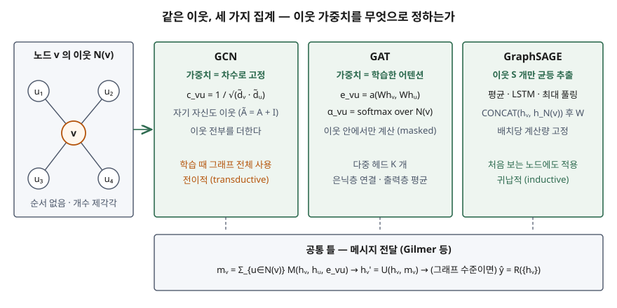

## 들어가며

추천 시스템의 사용자-상품 관계, 분자의 원자-결합, 결제 계좌 사이의 이체 관계는 행과 열로 펴면 정보가 사라진다. 어떤 계좌가 의심스러운지는 그 계좌의 속성보다 **누구와 연결돼 있는가**에서 더 잘 드러나기 때문이다. GNN은 이 연결 자체를 학습 입력으로 쓰는 신경망이고, 정보관리기술사 시험에는 AI 과목의 신경망 유형으로 나온다. 모델 이름을 늘어놓는 답안과, 모든 GNN이 공유하는 **메시지 전달 틀 하나**로 GCN·GAT·GraphSAGE의 차이를 설명하는 답안은 점수가 다르다.

> 실행 검증 없음. 개념 정리이므로 각 모델의 원 논문(arXiv 판) 본문만 근거로 썼다. 절·식 번호는 표기한 판 기준이다.

---

## 정의

**GNN(Graph Neural Network, 그래프 신경망)은 각 노드가 이웃 노드에서 받은 메시지를 모아 자기 표현을 갱신하는 과정을 여러 번 반복해, 노드·엣지·그래프 전체의 표현을 학습하는 신경망이다.**

이 정의의 뼈대는 Gilmer 등이 제안한 **메시지 전달 신경망(MPNN)** 틀이다(§2). 이들은 이 틀이 기존 그래프 모델 **적어도 8가지**를 함께 설명한다고 보이며, 그중에 Kipf & Welling의 GCN도 들어 있다. 그래서 GCN·GAT·GraphSAGE를 각각 외우기보다 이 틀에 대입해 보는 편이 차이가 더 분명하게 보인다.

## 등장 배경

합성곱 신경망(CNN)은 이미지의 격자 구조를 전제로 한다. 픽셀마다 이웃이 **위·아래·좌·우로 순서가 정해져 있고 개수가 같으므로** 같은 필터를 모든 자리에 그대로 적용할 수 있다. 그래프의 노드는 이웃에 **순서가 없고 개수가 제각각**이다. GraphSAGE 논문의 집계 함수 절(§3.3)은 이 차이 때문에 집계 함수가 **입력 순서를 바꿔도 결과가 같은 대칭 함수**여야 한다고 적는다.

초기 해법은 두 갈래였다. 순환형 GNN(Scarselli 등, 2009)은 같은 파라미터를 노드 상태가 안정될 때까지 반복 적용했고, 스펙트럼 기반 방법은 그래프 라플라시안의 고유값 분해 위에서 합성곱을 정의했다. GCN은 후자를 1차 근사로 단순화해 **이웃의 가중 합 한 번**으로 줄였고, GAT와 GraphSAGE는 그 가중치를 정하는 방식과 이웃을 고르는 방식을 바꿨다.

## 구성요소 — 메시지 전달 틀의 3개 함수와 2단계

Gilmer 등(§2, 식 1~3)은 순전파를 **메시지 전달 단계**와 **판독 단계**의 2단계로 나누고, 3개의 학습 가능한 함수로 기술한다.

| 함수 | 식 | 하는 일 | 조건 |
|---|---|---|---|
| ① 메시지 M | mᵥᵗ⁺¹ = Σ_{w∈N(v)} Mₜ(hᵥᵗ, h_wᵗ, e_vw) | 이웃 w마다 메시지를 만들어 더한다 | 합이므로 이웃 순서와 무관 |
| ② 갱신 U | hᵥᵗ⁺¹ = Uₜ(hᵥᵗ, mᵥᵗ⁺¹) | 모은 메시지로 자기 표현을 바꾼다 | 층마다 다른 함수일 수 있다 |
| ③ 판독 R | ŷ = R({hᵥᵀ}) | 노드 표현 전체를 그래프 하나의 값으로 요약 | **노드 순서를 바꿔도 결과가 같아야 한다** |

①·②를 T번 반복하는 것이 메시지 전달 단계이고, 한 번 반복할 때마다 한 홉 더 떨어진 노드의 정보가 들어온다. ③은 그래프 분류처럼 그래프 수준의 답이 필요할 때만 쓴다.

## 도식

> **출처**: [Gilmer et al. §2 Message Passing Neural Networks](https://arxiv.org/abs/1704.01212), [Kipf & Welling §2 식 (2)](https://arxiv.org/abs/1609.02907), [Veličković et al. §2.1 Graph Attentional Layer](https://arxiv.org/abs/1710.10903), [Hamilton et al. §3.1 Algorithm 1, §3.3 Aggregator Architectures](https://arxiv.org/abs/1706.02216)

세 모델은 모두 "이웃 표현에 가중치를 곱해 더하고, 선형 변환과 비선형 함수를 거친다"는 같은 모양이다. 갈리는 지점은 **가중치를 누가 정하는가**와 **이웃을 전부 쓰는가**다.

**GCN**은 층 하나를 H⁽ˡ⁺¹⁾ = σ(D̃^−½ Ã D̃^−½ H⁽ˡ⁾ W⁽ˡ⁾)로 둔다(Kipf & Welling §2, 식 2). Ã는 인접 행렬에 자기 연결을 더한 것이고 D̃는 그 차수 행렬이다. 이웃 u의 가중치는 두 노드 차수의 기하평균의 역수로 **그래프 구조만 보고 고정**된다. Gilmer 등은 이를 메시지 M = c_vw·h_w, 갱신 U = ReLU(W·m)으로 대입한다. 자기 연결을 더하고 양쪽 차수로 나누는 이 처리를 Kipf & Welling은 **재정규화(renormalization)** 라고 부르는데, 정규화 전 연산자의 고유값이 0~2 범위여서 층을 거듭 적용하면 수치가 불안정해지고 기울기가 폭주·소실할 수 있기 때문이다(§2.2).

**GAT**는 가중치를 학습한다. 두 노드를 같은 행렬 W로 변환한 뒤 공유된 어텐션 함수 a로 점수 e_vu = a(Whᵥ, Whᵤ)를 매기고, **이웃 안에서만** softmax로 정규화해 계수 α_vu를 얻는다(§2.1, 식 1~2). 이웃 밖은 계산하지 않는다는 뜻에서 masked attention이라 부르고, 실험에서는 a를 기울기 0.2의 LeakyReLU를 쓰는 단층 신경망으로 두었다. 어텐션을 K개 병렬로 돌리는 다중 헤드는 은닉층에서는 결과를 **이어 붙이고**, 마지막 예측층에서는 **평균**을 낸다(식 5, 6).

**GraphSAGE**는 이웃 전부를 쓰지 않는다. 층마다 이웃을 **고정 개수 S만큼 균등 추출**하고, 집계 결과를 자기 표현과 이어 붙여 W를 곱한다(Algorithm 1). 집계 함수는 평균·LSTM·풀링 3가지를 실험했다(§3.3). LSTM은 입력 순서에 민감해 대칭 함수가 아니므로 **이웃을 무작위 순열로 섞어** 넣었고, 풀링은 이웃 벡터마다 완전연결층을 거친 뒤 원소별 최댓값을 취한다.

## 동작 원리 — 층 수가 성능을 좌우하는 이유

**과평활화(over-smoothing).** Li 등은 GCN의 그래프 합성곱이 **라플라시안 평활화의 특수한 형태**임을 보였다(Analysis 절). 노드 표현을 이웃 표현의 가중 평균 쪽으로 끌어당기는 연산이라 같은 군집의 노드가 비슷해져 분류가 쉬워진다. 그런데 이것을 계속 반복하면 서로 다른 군집의 표현까지 섞여 **구분할 수 없게 된다.** 연결 성분 안에서는 표현이 같은 값으로 수렴한다는 것이 이들이 제시한 정리다. Kipf & Welling의 깊이 실험(부록 B)도 Cora·Citeseer·Pubmed 3종에서 **2~3층이 가장 좋았고**, 7층을 넘으면 잔차 연결 없이는 학습이 어려워질 수 있다고 보고한다.

**이웃 폭증.** 층이 하나 늘면 반영되는 이웃은 한 홉씩 넓어지고, 홉마다 이웃 수가 곱으로 불어난다. GCN 원 논문은 매 반복마다 **전체 데이터로 배치 경사 하강**을 했고(§3.1), 미니배치 학습은 후속 과제로 남겼다(§7.2). GraphSAGE는 표본 추출이 없으면 배치 하나의 메모리와 시간이 예측 불가능하고 최악에는 노드 수 |V|에 비례한다고 지적하고, 추출 크기를 고정하면 배치당 비용이 O(∏Sᵢ)로 **고정**된다고 적는다(§3.1). 실험에서는 K=2층, S₁·S₂ ≤ 500으로 충분한 성능을 얻었다.

**전이적 대 귀납적.** GCN의 실험은 학습 때 모든 노드가 그래프 안에 있는 **전이적(transductive)** 노드 분류다(§4.2). GraphSAGE는 노드마다 고유 임베딩을 외우지 않고 **이웃 특징에서 표현을 만들어 내는 함수**를 학습하므로, 학습 때 없던 노드나 새 그래프에도 적용되는 **귀납적(inductive)** 방식이다. GAT도 초록에서 그래프 구조를 미리 알 필요가 없어 두 문제 모두에 적용된다고 밝힌다.

## 비교

| 구분 | GCN | GAT | GraphSAGE |
|---|---|---|---|
| 이웃 가중치 | 차수로 고정 (1/√(d̃ᵥd̃ᵤ)) | 학습한 어텐션 계수 | 집계 함수가 정함 (평균이면 균등) |
| 쓰는 이웃 | 전부 + 자기 자신 | 1차 이웃 전부 + 자기 자신 | 층마다 S개 균등 추출 |
| 자기 표현 결합 | 이웃 합에 포함 | 이웃 합에 포함 | 집계 결과와 **이어 붙임** |
| 학습 방식 | 전이적 (원 논문 실험) | 전이적·귀납적 | 귀납적 |
| 비용이 몰리는 곳 | 전체 그래프 행렬곱 | 엣지마다 어텐션 계산 | 표본 추출, 배치당 고정 |
| 근거 | Kipf & Welling §2 | Veličković 등 §2.1 | Hamilton 등 §3.1, §3.3 |

GraphSAGE 논문(§3.3)은 평균 집계가 GCN의 전파 규칙과 거의 같다고 적고, 자기 표현을 이어 붙이는 것을 층 사이의 **스킵 연결**의 단순한 형태로 보며 이것이 성능을 크게 올렸다고 보고한다. 세 모델의 관계를 한 줄로 쓰면 "GCN의 고정 가중치를 학습으로 바꾸면 GAT, 이웃 전부를 표본으로 바꾸고 자기 표현을 이어 붙이면 GraphSAGE"다.

## 적용 시 고려사항

① **층 수는 필요한 홉 수로 정한다** — 판단에 3홉 밖 관계가 필요한지부터 따진다. 층을 늘려야 하면 잔차 연결을 함께 넣고, 검증 성능이 2~3층보다 나아지는지 확인한 뒤 채택한다.

② **그래프가 계속 바뀌면 귀납적 모델을 고른다** — 신규 가입자·신규 상품이 매일 들어오는 서비스에서 전이적 모델은 새 노드마다 재학습이 필요하다. 표본 추출 기반 모델은 학습된 함수에 새 노드의 이웃만 넣으면 된다.

③ **대규모 그래프는 메모리부터 산정한다** — 이웃 전부를 쓰는 방식은 차수가 큰 허브 노드에서 메모리가 먼저 찬다. 층별 추출 크기의 곱이 배치당 처리 노드 수이므로 이 값으로 GPU 메모리를 계산한다.

④ **그래프 구축이 곧 데이터 설계다** — 무엇을 노드와 엣지로 둘지, 엣지 속성에 무엇을 담을지가 성능을 정한다. 관계형 DB의 조인 결과나 그래프 DB에서 그래프를 뽑는 파이프라인과 **갱신 주기**를 모델과 함께 설계한다.

⑤ **설명 가능성을 확보한다** — 이상 거래 탐지처럼 판단 근거를 요구받는 업무라면, 어떤 이웃이 판단에 기여했는지를 GAT의 어텐션 계수처럼 모델 안에서 꺼낼 수 있는 구조인지 검토한다.

## 정리

- **정의** — 이웃에서 받은 메시지를 모아 자기 표현을 갱신하는 일을 반복해 노드·엣지·그래프 표현을 학습하는 신경망.
- **메시지 전달 틀** — 함수 3개(메시지 M · 갱신 U · 판독 R), 단계 2개(메시지 전달 T회 → 판독).
- **대표 모델 3개의 차이** — GCN은 **차수**, GAT는 **어텐션**, GraphSAGE는 **표본 + 이어 붙이기**.
- **한계 2가지** — 깊게 쌓으면 표현이 한 값으로 수렴(과평활화), 홉마다 이웃이 곱으로 증가(표본 추출로 대응).
- **암기 단서** — "**고정·학습·추출**" — 이웃 가중치를 고정하면 GCN, 학습하면 GAT, 이웃을 추출하면 GraphSAGE.

> 기출 답안: [기출문제 — GNN(그래프 신경망): 메시지 전달·4가지 유형·과평활화](../../exam/2026-11-08-graph-neural-network-message-passing/index.md)

## 참고 자료

- [J. Gilmer et al., Neural Message Passing for Quantum Chemistry, ICML 2017, arXiv:1704.01212](https://arxiv.org/abs/1704.01212) — §2 MPNN 틀
- [T. N. Kipf, M. Welling, Semi-Supervised Classification with Graph Convolutional Networks, ICLR 2017, arXiv:1609.02907](https://arxiv.org/abs/1609.02907) — §2 식 (2), §2.2 재정규화, §3.1, §4.2, 부록 B 깊이 실험
- [P. Veličković et al., Graph Attention Networks, ICLR 2018, arXiv:1710.10903](https://arxiv.org/abs/1710.10903) — §2.1 식 (1)~(6)
- [W. L. Hamilton, R. Ying, J. Leskovec, Inductive Representation Learning on Large Graphs, NeurIPS 2017, arXiv:1706.02216](https://arxiv.org/abs/1706.02216) — §3.1 Algorithm 1·표본 추출, §3.3 집계 함수
- [Q. Li, Z. Han, X.-M. Wu, Deeper Insights into Graph Convolutional Networks for Semi-Supervised Learning, AAAI 2018, arXiv:1801.07606](https://arxiv.org/abs/1801.07606) — 라플라시안 평활화와 과평활화
- [F. Scarselli et al., The Graph Neural Network Model, IEEE Transactions on Neural Networks 20(1), pp. 61–80 (2009)](https://doi.org/10.1109/TNN.2008.2005605)
