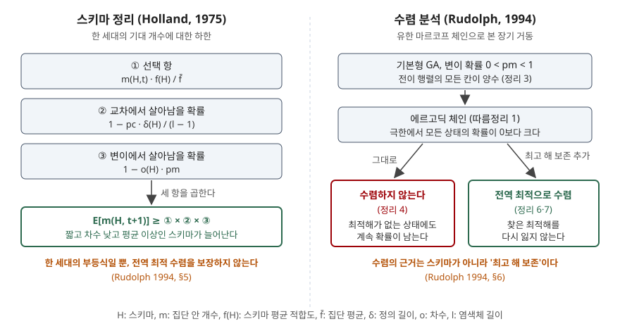

## 들어가며

유전 알고리즘 문항에서 절차 7단계는 누구나 쓴다. 점수가 갈리는 것은 "왜 이 방법이 좋은 해를 찾는가"와 "언제 최적해에 도달한다고 말할 수 있는가"라는 두 질문에 답하는 대목이다. 첫 질문의 고전적 답이 **스키마 정리**이고, 둘째 질문의 답이 **Rudolph(1994)의 수렴 분석**이다. 둘을 섞어 "스키마 정리에 따라 최적해로 수렴한다"고 쓰면 틀린 문장이 된다. 이 글은 두 결과가 각각 무엇을 보장하고 무엇을 보장하지 않는지를 작은 예로 직접 계산해 구분한다.

아래 수치는 전부 [`code/ga_schema.py`](code/ga_schema.py)로 계산했다. 수행 기록은 [`code/output.txt`](code/output.txt)에 있다.

---

## 정의

**스키마 정리(Schema Theorem)는 길이가 짧고 차수가 낮으며 평균보다 적합도가 높은 스키마의 개수가 다음 세대에서 기대값 기준으로 늘어난다는, 한 세대에 대한 하한 부등식이다.** Holland(1975)가 제시했고, Goldberg(1989) 2장의 형태로 널리 알려졌다.

**엘리트 보존의 수렴 조건은, 변이 확률이 0과 1 사이인 기본형 유전 알고리즘은 전역 최적해로 수렴하지 않으며 지금까지 찾은 최고 해를 선택 전이나 후에 항상 보존해야 수렴한다는 결과다**(Rudolph, 1994, 정리 4·6·7).

여기서 쓰는 용어는 3가지다.

| 용어 | 뜻 | `1***0`의 값 |
|---|---|---|
| 스키마 H | 일부 자리만 고정하고 나머지는 `*`(0이든 1이든)로 둔 패턴. 염색체 집합의 부분집합이다 | 1로 시작하고 0으로 끝나는 길이 5 염색체 8개 |
| 차수 o(H) | 고정된 자리의 개수 | 2 |
| 정의 길이 δ(H) | 처음 고정 자리와 마지막 고정 자리 사이 거리 | 4 |

수렴의 정의는 Rudolph의 정의 2를 따른다. 세대 t의 집단 최고 적합도를 Zₜ라 할 때 **P{Zₜ = f\*}가 t→∞에서 1로 가면** 전역 최적해로 수렴한다고 한다. "언젠가 한 번 찾는다"가 아니라 "찾은 상태에 머무를 확률이 1로 간다"는 뜻이다.

## 등장 배경

Holland가 유전 알고리즘을 정식화한 목적은 정적 최적화가 아니었다. Rudolph의 결론 절(§6)은 Holland의 관심이 불확실한 환경에서 시행을 최적으로 배분해 기대 손실을 줄이는 전략에 있었다고 적는다. 스키마 정리는 그 관점에서 "좋은 패턴에 시행이 더 많이 배분된다"는 설명이었다. Goldberg(1989)는 여기에 짧고 적합도 높은 스키마(빌딩 블록)가 교차로 조합된다는 **빌딩 블록 가설**을 더했다.

문제는 이후 유전 알고리즘이 주로 **정적 최적화 도구**로 쓰였다는 점이다. 최적화 도구라면 "최적해에 도달하는가"를 물어야 하는데, 스키마 정리는 그 질문에 답하도록 만들어진 식이 아니다. Rudolph는 이 공백을 유한 마르코프 체인 분석으로 메웠다.

## 구성요소 — 스키마 정리의 3개 항과 수렴 분석의 4단계

### 스키마 정리의 3개 항

Rudolph(§5)가 옮겨 적은 형태로 쓰면 다음과 같다.

```text
E[m(H,t+1)] ≥ m(H,t) · f(H)/f̄ · (1 − pc·δ(H)/(l−1)) · (1 − o(H)·pm)
               └─ ① 선택 ─┘   └──── ② 교차 생존 ────┘   └─ ③ 변이 생존 ─┘
```

| 항 | 뜻 | 왜 이 모양인가 |
|---|---|---|
| ① 선택 | 적합도 비례 선택에서 H 소속 개체가 뽑히는 기대 개수 | f(H)가 집단 평균 f̄보다 크면 1배 넘게 늘어난다 |
| ② 교차 생존 | 1점 교차의 자르는 자리가 고정 자리 사이에 떨어지지 않을 확률의 하한 | 자를 수 있는 자리 l−1곳 중 δ(H)곳이 위험하다 |
| ③ 변이 생존 | 고정 자리 o(H)개가 모두 그대로일 확률의 근사 하한 | (1−pm)^o ≥ 1−o·pm |

Goldberg(1989)는 ②·③을 곱하지 않고 `1 − pc·δ/(l−1) − o·pm`으로 더해 쓴다. 두 항의 곱을 무시한 근사라 값이 조금 더 작을 뿐, 뜻은 같다.

### 수렴 분석의 4단계

Rudolph의 논증은 4단계로 이어진다.

1. **상태 정의**: 집단 n개, 길이 l인 기본형 GA의 상태는 집단 전체이고 상태 수는 2^(n·l)로 유한하다
2. **전이 행렬이 양수(정리 3)**: 변이 확률이 0 < pm < 1이면 어떤 집단이든 한 세대 만에 다른 어떤 집단으로도 갈 확률이 0보다 크다. 교차 확률은 [0, 1] 어디든 상관없다
3. **에르고딕(따름정리 1)**: 그래서 극한 분포가 유일하고, 그 분포에서 **모든 상태의 확률이 0보다 크다.** 최적해가 하나도 없는 집단도 포함된다
4. **비수렴(정리 4)과 보존 시 수렴(정리 6·7)**: 3단계 때문에 P{Zₜ = f\*}는 1에 못 미친 채 머문다. 반면 진화에 참여하지 않는 칸에 지금까지의 최고 해를 기억시키면, 최적해를 한 번 찾은 뒤 잃지 않으므로 그 확률이 1로 간다

## 도식



> **출처**: [Rudolph (1994) Convergence Analysis of Canonical Genetic Algorithms §4 정리 3·4·6·7, §5 스키마 정리 논의, §6 결론](https://ls11-www.cs.tu-dortmund.de/people/rudolph/publications/papers/TNN5.1.pdf), Holland (1975), Goldberg (1989) Ch.2

답안에는 왼쪽 세 칸을 곱셈 기호로 잇고, 오른쪽은 "pm∈(0,1) → 에르고딕 → 비수렴 / +최고 해 보존 → 수렴"의 갈림길 하나로 그리면 된다.

## 검산 1 — 스키마 정리의 하한은 느슨하다

길이 5 염색체 6개, 적합도는 이진수 값 그대로, pc 0.6, pm 0.01로 두고 `1***0`의 하한을 계산했다.

```text
  no  chromosome  fitness  in 1***0
   0       10110       22  yes
   1       11000       24  yes
   2       10100       20  yes
   3       01110       14  no
   4       00011        3  no
   5       11010       26  yes
  m(H,t) = 4, f(H) = 23.0000, f_avg = 18.1667
  o(H) = 2, delta(H) = 4, l = 5, pc = 0.6, pm = 0.01
  selection term  m*f(H)/f_avg            = 5.0642
  crossover term  1 - pc*delta/(l-1)       = 0.4000
  mutation term   1 - o*pm                 = 0.9800
  lower bound E[m(H,t+1)] >=               1.9852
  simulated mean m(H,t+1) over 200000 runs = 4.8889
```

손으로 따라가면 f(H) = (22+24+20+26)/4 = 23, f̄ = 109/6 ≈ 18.17이다. 선택만 보면 4개가 5.06개로 늘지만, δ(H)=4라서 자르는 자리 4곳이 전부 위험하고 교차 생존 항이 0.4로 떨어진다. 하한은 1.99개다.

실제로 한 세대를 20만 번 돌린 평균은 4.89개로 하한의 두 배를 넘는다. **H에 속한 부모 둘끼리 교차하면 자식도 H에 속하는데**, 식 ②는 이런 경우까지 전부 파괴로 센다. 파괴됐다가 다른 조합으로 다시 생기는 경우도 세지 않는다. 그래서 스키마 정리는 "적어도 이만큼"을 말할 뿐 실제 동역학을 예측하지 못한다.

## 검산 2 — 기본형은 수렴하지 않고, 최고 해 보존은 수렴한다

길이 2, 집단 2로 줄이면 상태가 4² = 16개라 전이 행렬을 정확히 계산할 수 있다. 적합도는 `00`=1, `01`=2, `10`=2, `11`=4로 두어 최적해를 `11` 하나로 했다. 교차는 정리 3이 확률과 무관하다고 하므로 0으로 뺐다.

```text
  P{best fitness in population = f*} at step t
  pm    variant           t=1      t=5     t=10     t=50    t=200   t=1000
  0.05  canonical      0.4047   0.4512   0.5040   0.5810   0.5822   0.5822
  0.05  keep-best      0.4704   0.5939   0.7102   0.9808   1.0000   1.0000
        transition matrix all entries > 0: True
  0.2   canonical      0.4047   0.4804   0.4920   0.4930   0.4930   0.4930
  0.2   keep-best      0.5543   0.8317   0.9505   1.0000   1.0000   1.0000
        transition matrix all entries > 0: True
```

세 가지가 보인다.

- **전이 행렬의 모든 칸이 양수다.** 정리 3의 조건이 그대로 확인된다
- **기본형은 0.58, 0.49에서 멈춘다.** t=200과 t=1000이 같으므로 극한 분포에 도달한 것이다. 극한에서도 집단에 최적해가 없을 확률이 42%, 51% 남는다. pm을 키우면 오히려 낮아진다. 변이가 찾은 `11`을 다시 깨뜨리는 확률도 함께 커지기 때문으로 읽힌다
- **최고 해 보존은 1로 간다.** 소수 넷째 자리까지 1.0000이 된다. pm이 클수록 빨리 가는 것은 새 해를 더 자주 만들어 보기 때문이다. 기본형과 정반대 방향이다

t=1의 기본형 값이 pm과 무관하게 0.4047인 것은 초기 분포를 16개 상태에 균등하게 두었기 때문이다. 균등 분포는 비트 반전 변이를 거쳐도 균등하게 남는다.

## 비교

### 스키마 정리와 수렴 분석

| 구분 | 스키마 정리 | Rudolph 수렴 분석 |
|---|---|---|
| 다루는 시간 | 한 세대(t → t+1) | 무한 세대(t → ∞) |
| 대상 | 스키마(염색체 부분집합)의 기대 개수 | 집단 최고 적합도의 확률 분포 |
| 형태 | 기대값 하한 부등식 | 마르코프 체인 극한 정리 |
| 보장하는 것 | 평균 이상 짧은 스키마의 기대 증가 | 최고 해 보존 시 전역 최적 수렴 |
| 보장하지 않는 것 | 수렴. 하한이 n보다 작아 최적해로 채워진다는 결론이 안 나온다(§5) | 수렴 속도. 몇 세대에 도달하는지는 말하지 않는다 |

### 최고 해를 지키는 두 가지 방식

| 구분 | 최고 해 별도 보존 | 엘리트 선택 |
|---|---|---|
| 방식 | 진화에 참여하지 않는 칸에 최고 해를 기억만 한다 | 최고 개체를 다음 세대 집단에 그대로 넣어 부모로도 쓴다 |
| 근거 | Rudolph 정리 6(선택 뒤 보존), 정리 7(선택 전 보존) | Rudolph가 서론에서 인용한 선행 연구가 수렴을 보였다 |
| 탐색 동역학 | 기본형과 같다 | 최고 해가 자식을 만들어 달라진다 |

Rudolph는 정리 6·7이 엘리트 선택을 **포함하지 않는다고** 명시하고, 엘리트 선택은 전이 행렬이 달라 경우에 따라 더 낫거나 더 나쁠 수 있다고 적는다. 답안에서 "엘리트 보존이면 수렴한다"고 쓸 때 이 구분을 한 줄 덧붙이면 정확해진다.

## 적용 시 고려사항

- **수렴 보장은 속도 보장이 아니다.** 최고 해 보존 변형도 "무한 세대에서 확률 1"을 말할 뿐이다. 검산 2에서 pm 0.05일 때 t=10에 0.71에 그쳤다. 실무에서는 평가 예산과 종료 조건을 따로 정해야 한다
- **최고 해 보존은 기본으로 넣는다.** 구현 비용이 개체 하나 복사뿐인데, 빠지면 찾은 최적해를 잃는 일이 실제로 생긴다. 검산 2의 기본형은 극한에서도 절반 가까이 최적해를 갖고 있지 않았다
- **변이를 0으로 두지 않는다.** 정리 3의 조건 0 < pm이 깨지면 전이 행렬이 양수가 아니게 되어, 최고 해를 보존해도 도달하지 못하는 해가 생길 수 있다. 교차만으로는 집단에 없는 유전자 값을 만들지 못한다
- **스키마 정리로 부호화를 설계할 때는 정의 길이를 본다.** 함께 움직여야 하는 유전자를 염색체에서 가까이 두면 δ(H)가 줄어 교차 생존 항이 커진다. 검산 1에서 δ=4는 생존 항을 0.4로 낮췄다

## 정리

- **스키마 정리 = 선택 × 교차 생존 × 변이 생존의 3항 곱.** 한 세대의 기대값 하한이며, 수렴을 말하지 않는다
- **Rudolph 4단계**: 상태 유한 → 전이 행렬 양수(정리 3) → 에르고딕(따름정리 1) → 기본형 비수렴(정리 4)
- **수렴 조건 2개**: 0 < pm < 1, 그리고 최고 해 보존(선택 뒤 정리 6, 선택 전 정리 7)
- 암기 단서: **"스키마는 한 세대, 수렴은 보존에서"**

> 기출 답안: [기출문제 — 유전 알고리즘의 절차와 최적화 방법](../../exam/2026-11-18-genetic-algorithm-procedure-optimization/index.md)

## 참고 자료

- Holland, J. H. *Adaptation in Natural and Artificial Systems*. University of Michigan Press, 1975. MIT Press 재판, 1992. [doi:10.7551/mitpress/1090.001.0001](https://doi.org/10.7551/mitpress/1090.001.0001)
- Goldberg, D. E. *Genetic Algorithms in Search, Optimization, and Machine Learning*. Addison-Wesley, 1989. Ch.2 Genetic Algorithms Revisited: Mathematical Foundations
- [Rudolph, G. "Convergence Analysis of Canonical Genetic Algorithms." *IEEE Transactions on Neural Networks* 5(1):96–101, 1994](https://ls11-www.cs.tu-dortmund.de/people/rudolph/publications/papers/TNN5.1.pdf) — 정의 2(수렴), 정리 3·4·6·7, 따름정리 1, §5 스키마 정리 논의, §6 결론
