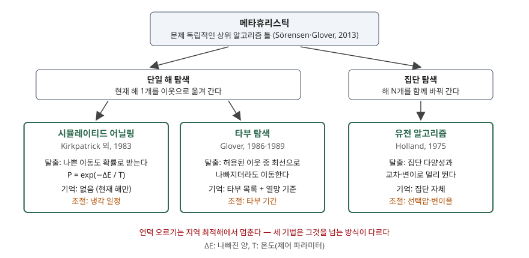

## 들어가며

조인 순서, 작업 스케줄, 서버 배치처럼 후보가 계승이나 2의 거듭제곱으로 늘어나는 문제는 전수 탐색이 끝나지 않는다. 이때 쓰는 것이 메타휴리스틱이고, 시험에서는 시뮬레이티드 어닐링(SA)·타부 탐색(TS)·유전 알고리즘(GA)을 나란히 놓고 비교하라는 형태로 자주 나온다. 세 기법을 각각 설명하는 답안보다, **셋이 같은 문제(지역 최적해에서 멈춤)를 서로 다른 방식으로 넘는다**는 한 축으로 묶는 답안이 구조가 선다. 그리고 "어느 것이 가장 좋은가"에는 **공짜 점심 없음 정리** 때문에 일반적인 답이 없다는 것까지 써야 한다.

아래 실험 수치는 [`code/compare.py`](code/compare.py)로 계산했다. 수행 기록은 [`code/output.txt`](code/output.txt)에 있다.

---

## 정의

**메타휴리스틱(metaheuristic)은 휴리스틱 최적화 알고리즘을 만들기 위한 지침과 전략을 제공하는, 문제에 독립적인 상위 수준의 알고리즘 틀이다.** Sörensen·Glover(2013)의 정의이며, 이 정의는 같은 용어가 그 틀을 특정 문제에 맞춰 구현한 알고리즘을 가리키기도 한다고 덧붙인다. 용어 자체는 Glover(1986)가 타부 탐색을 처음 제안한 논문에서 만들었다(Sörensen·Sevaux·Glover, 2017).

세 기법의 정의는 다음과 같다.

| 기법 | 정의 | 원 논문 |
|---|---|---|
| 시뮬레이티드 어닐링 | 이웃 해로 옮길 때 좋아지면 받고, 나빠지면 exp(−ΔE/T)의 확률로 받으며, 온도 T를 단계적으로 낮추는 단일 해 탐색 | Kirkpatrick 외(1983) |
| 타부 탐색 | 최근 이동을 금지 목록에 기억해 되돌아가지 못하게 하고, 허용된 이웃 중 가장 좋은 것으로 나빠지더라도 이동하는 단일 해 탐색 | Glover(1986, 1989) |
| 유전 알고리즘 | 후보 해 집단에 적합도 기반 선택과 교차·변이를 세대마다 반복하는 집단 탐색 | Holland(1975) |

## 등장 배경

출발점은 **언덕 오르기(hill climbing)**다. 현재 해의 이웃 중 더 좋은 것이 있으면 옮기고, 없으면 멈춘다. Glover(1989, §2)는 이 방식의 가장 큰 한계를 **개선 이동이 없을 때 멈춘 지역 최적해가 전역 최적해가 아닐 수 있다는 점**으로 꼽는다.

이 한계를 넘는 방법이 1970~80년대에 갈래별로 나왔다. Holland(1975)는 자연 선택을 본떠 여러 해를 함께 굴렸다. Kirkpatrick 외(1983)는 금속을 녹였다가 천천히 식혀 결정을 얻는 담금질 과정을 본떠, 통계역학의 Metropolis 절차를 최적화에 옮겼다. Glover(1986)는 은유 대신 **탐색 이력을 기억하는 구조**로 같은 문제를 풀었다. Sörensen 외(2017)는 이 시기의 흐름을 정리하면서, SA의 단순 변형인 threshold accepting이 은유 없이도 범용 최적화 틀을 만들 수 있음을 보였다고 적는다.

## 구성요소 — 지역 최적해를 넘는 3가지 방식



> **출처**: [Kirkpatrick·Gelatt·Vecchi (1983) Optimization by Simulated Annealing](https://doi.org/10.1126/science.220.4598.671), [Glover (1989) Tabu Search—Part I §2 A Simple Form of Tabu Search, §8 Intermediate and Long-Term Memory Functions](https://leeds-faculty.colorado.edu/glover/Publications/TS%20-%20Part%20I-ORSA-aw.pdf), Holland (1975), [Sörensen·Sevaux·Glover (2017) A History of Metaheuristics](https://arxiv.org/abs/1704.00853)

### ① 확률적 수용 — 시뮬레이티드 어닐링

Kirkpatrick 외(1983)는 Metropolis 절차를 그대로 쓴다. 에너지 변화 ΔE가 0 이하이면 받고, 0보다 크면 **P(ΔE) = exp(−ΔE/k_B·T)** 의 확률로 받는다. 최적화에서는 에너지 자리에 비용 함수를, k_B·T 자리에 같은 단위의 제어 파라미터 T를 둔다. 처음에 높은 온도로 "녹였다가" 각 온도에서 충분히 돌린 뒤 천천히 낮추는데, **온도의 순서와 각 온도에서의 시도 횟수를 냉각 일정(annealing schedule)** 이라 부른다.

```text
=== Metropolis acceptance probability exp(-delta/T) ===
  delta       T=50      T=10       T=2     T=0.5
      1    0.98020   0.90484   0.60653   0.13534
      5    0.90484   0.60653   0.08208   0.00005
     20    0.67032   0.13534   0.00005   0.00000
```

같은 정도 나빠지는 이동(Δ=5)도 T=50에서는 90%, T=2에서는 8% 확률로 받아들인다. **초반에는 넓게 돌아다니고 후반에는 사실상 언덕 오르기가 된다**는 것이 이 표 한 장에 들어 있다.

### ② 기억에 의한 금지 — 타부 탐색

Glover(1989, §2)는 단순형 타부 탐색의 두 핵심을 **이동 일부를 금지(tabu)로 분류해 탐색을 제약하는 것**과 **단기 기억으로 "전략적 망각"을 하는 것**으로 든다. 구성요소는 4가지다.

| 구성요소 | 하는 일 | 근거 |
|---|---|---|
| 타부 목록(단기 기억) | 최근 이동의 속성을 일정 기간 금지해 방금 떠난 지역 최적해로 돌아가지 못하게 한다 | §2 |
| 최선 이동 선택 | 개선 여부와 무관하게 허용된 이웃 중 가장 좋은 것으로 간다. 개선이 없으면 가장 덜 나빠지는 것으로 간다 | §2 |
| 열망 기준 | 금지된 이동이라도 정한 조건을 만족하면 허용한다. 이 글의 코드는 지금까지의 최고 해 이상이면 허용했다 | §3·§4 |
| 중장기 기억 | 좋은 해들의 공통 특성으로 지역 집중(intensification)을, 장기 이력으로 전역 분산(diversification)을 한다 | §8 |

Glover는 SA와의 차이를 직접 적는다(§2, §9). SA는 개선 이동을 모두 같은 지위로 받고 나쁜 이동을 점점 덜 받는 반면, 타부 탐색은 **매 단계 최선 이동을 고르는 공격적인 방향**을 택한다.

### ③ 집단 다양성 — 유전 알고리즘

GA는 해 하나를 옮기지 않고 집단 전체를 바꾼다. 선택이 좋은 해 주변을 파고드는 동안 **교차가 서로 다른 해의 부분을 합쳐 이웃 한 칸으로는 닿지 않는 곳으로 건너뛰고**, 변이가 집단에 없는 값을 만든다. 기억은 따로 없고 **집단 자체가 지금까지의 탐색 결과를 담는다.**

## 비교

### 세 기법의 대비

| 구분 | 시뮬레이티드 어닐링 | 타부 탐색 | 유전 알고리즘 |
|---|---|---|---|
| 탐색 단위 | 해 1개 | 해 1개 | 해 N개 |
| 한 단계에 보는 이웃 | 무작위 1개 | 전부 또는 표본 | 자식 N개 |
| 지역 최적 탈출 | 나쁜 이동을 확률로 수용 | 금지 목록으로 되돌아감 차단 + 최선 이동 | 교차·변이와 집단 다양성 |
| 기억 | 없음 | 타부 목록, 중장기 기억 | 집단 |
| 결정성 | 확률적 | 결정적 가능(동률 처리 제외) | 확률적 |
| 핵심 파라미터 | 시작 온도, 냉각률 | 타부 기간, 열망 기준 | 집단 크기, 선택압, pc, pm |
| 원 논문의 출처 | 통계역학(담금질) | 인간의 문제 해결(기억) | 자연 선택 |

### 같은 평가 예산에서 — 검산

물건 20개, 용량 150인 0/1 배낭 문제를 동적 계획법으로 풀면 최적값은 595다. 네 방법 모두 **적합도 평가 2,000회**로 예산을 맞추고 시드 30개씩 돌렸다.

```text
=== same budget: 2000 evaluations, 30 seeds ===
  method              hit opt   mean best   worst   mean gap
  hill climb+restart     1/30      552.77     516      7.10%
  simulated annealing    6/30      585.93     545      1.52%
  tabu search           30/30      595.00     595      0.00%
  genetic algorithm     18/30      592.53     584      0.41%
```

- **언덕 오르기는 재시작을 붙여도 1/30이다.** 지역 최적해에 닿으면 처음부터 다시 시작하는 것 말고는 수단이 없다
- **이 문제, 이 설정에서는 타부 탐색이 30/30이다.** 비트 하나 뒤집기 이웃이 20개뿐이라 매 단계 전부 보고 최선으로 가는 방식이 잘 맞는다
- **이 결과로 "타부 탐색이 가장 좋다"고 쓰면 안 된다.** 파라미터를 조정하지 않았고, 문제 하나다. 다음 절이 그 이유다

예산을 세대 수나 반복 수로 맞추지 않은 것도 이유가 있다. 타부 탐색은 한 반복에 20번, SA는 1번 평가하므로 반복 수로 맞추면 타부 탐색에 20배 예산을 주게 된다.

### 공짜 점심 없음 정리

Wolpert·Macready(1997)는 **유한한 탐색 공간과 유한한 비용 값**을 전제로(§Ⅱ), 가능한 모든 비용 함수에 대해 평균하면 어떤 두 알고리즘의 성능 분포도 같다는 정리 1을 증명했다. 초록은 이를 "한 문제군에서 얻은 우위는 다른 문제군에서의 열세로 상쇄된다"고 요약한다. 같은 논문은 알고리즘이 같은 점을 다시 평가하는 경우를 피하려고 **서로 다른 점의 평가 횟수**로 비교한다. 위 실험은 재방문까지 세었으므로 이 정리의 조건과 정확히 같지는 않다.

답안에서의 의미는 분명하다. 메타휴리스틱 선택은 순위표가 아니라 **문제 구조와 기법의 탐색 방식이 맞는지**의 판단이다.

## 적용 시 고려사항

- **비교는 평가 횟수로 한다.** 적합도 평가가 시뮬레이션이나 실측처럼 비싸면 비용은 평가 횟수로 정해진다. 반복 수나 세대 수로 비교하면 위 실험처럼 한 기법에 몇 배 예산을 주게 된다
- **이웃 구조가 작고 평가가 싸면 타부 탐색, 이웃이 크면 SA나 표본 추출을 고려한다.** 타부 탐색은 매 단계 이웃 전부를 보는 것이 기본이라 이웃 수가 비용에 곱해진다. Glover(1989, §2)도 이웃이 크면 표본 추출 전략을 쓰라고 적는다
- **부분 해를 조합하는 것이 의미 있으면 GA를 고려한다.** 교차는 해의 일부가 독립적으로 좋을 때 효과가 있다. 순열 문제처럼 교차 후 무효 해가 나오기 쉬우면 전용 교차 연산자가 필요하다
- **파라미터 조정 비용을 계산에 넣는다.** SA는 냉각 일정, 타부 탐색은 타부 기간, GA는 4개 이상의 파라미터를 정해야 한다. 조정에 쓴 실행도 예산이다
- **혼합을 먼저 검토한다.** Sörensen 외(2017)는 2000년 전후로 여러 틀의 아이디어를 섞는 것이 일반화됐다고 적는다. GA에 지역 탐색을 붙인 메메틱 알고리즘이 대표적이다

## 정리

- **메타휴리스틱 = 문제 독립적인 상위 알고리즘 틀.** 용어는 Glover(1986)
- **분류 2가지**: 단일 해 탐색(SA, TS), 집단 탐색(GA)
- **탈출 방식 3가지**: SA는 **확률**(exp(−ΔE/T)), TS는 **기억**(타부 목록 + 열망 기준), GA는 **다양성**(교차·변이)
- **선택 기준**: 공짜 점심 없음 정리에 따라 절대 순위는 없다. 이웃 크기·평가 비용·부분 해 조합 가능성으로 고른다
- 암기 단서: **"확률·기억·집단"**

> 기출 답안: [기출문제 — 유전 알고리즘의 절차와 최적화 방법](../../exam/2026-11-18-genetic-algorithm-procedure-optimization/index.md)
>
> 관련 개념: [유전 알고리즘 — 스키마 정리와 엘리트 보존의 수렴 조건](../2026-11-19-ga-schema-theorem-elitist-convergence/index.md)

## 참고 자료

- Kirkpatrick, S., Gelatt, C. D., Vecchi, M. P. "Optimization by Simulated Annealing." *Science* 220(4598):671–680, 1983. [doi:10.1126/science.220.4598.671](https://doi.org/10.1126/science.220.4598.671)
- Glover, F. "Future Paths for Integer Programming and Links to Artificial Intelligence." *Computers & Operations Research* 13(5):533–549, 1986. [doi:10.1016/0305-0548(86)90048-1](https://doi.org/10.1016/0305-0548%2886%2990048-1)
- [Glover, F. "Tabu Search—Part I." *ORSA Journal on Computing* 1(3):190–206, 1989](https://leeds-faculty.colorado.edu/glover/Publications/TS%20-%20Part%20I-ORSA-aw.pdf) — §2 A Simple Form of Tabu Search, §3 Uses of Aspiration Levels, §4 Integrated Tabu Restrictions and Aspiration Criteria, §8 Intermediate and Long-Term Memory Functions, §9 Probabilistic Tabu Search (저자 페이지 사본)
- Holland, J. H. *Adaptation in Natural and Artificial Systems*. University of Michigan Press, 1975. MIT Press 재판, 1992.
- [Wolpert, D. H., Macready, W. G. "No Free Lunch Theorems for Optimization." *IEEE Transactions on Evolutionary Computation* 1(1):67–82, 1997](https://doi.org/10.1109/4235.585893) — §Ⅱ Preliminaries, §Ⅲ 정리 1
- [Sörensen, K., Sevaux, M., Glover, F. "A History of Metaheuristics." arXiv:1704.00853 v1, 2017](https://arxiv.org/abs/1704.00853) — Martí·Pardalos·Resende 편 *Handbook of Heuristics*(Springer) 수록 예정본. 메타휴리스틱 정의(Sörensen·Glover, 2013 인용), 용어의 기원
