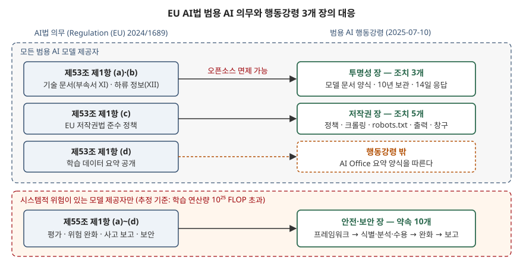

## 들어가며

EU AI법은 범용 AI(General-Purpose AI, GPAI) 모델 제공자에게 문서화·저작권·위험관리 의무를 지우지만, 법조문은 "무엇을 해야 하는가"까지만 적는다. "어떻게 하면 했다고 인정받는가"를 채우는 것이 2025-07-10 공개된 **범용 AI 행동강령(Code of Practice)** 이다. 시험에서는 이 행동강령의 장 구성을 묻거나, 범용 AI 위험관리를 물으면서 안전·보안 장을 근거로 쓰게 한다. 장마다 대상 제공자와 근거 조문이 다르므로, **조문과 장을 짝지어** 외워야 답안이 흔들리지 않는다.

> 실행 검증 없음 — 법령과 유럽연합 집행위원회(이하 집행위) 공개 자료를 근거로 정리한 개념 글이다.
> 행동강령의 장·조치 제목은 공식 PDF를 옮겨 놓은 열람 사이트(code-of-practice.ai)에서 확인했다. 그 사이트는 공식 PDF가 우선한다고 밝힌다.

---

## 정의

**EU 범용 AI 행동강령은 범용 AI 모델 제공자가 AI법 제53조와 제55조의 의무를 이행하는 방법을 투명성·저작권·안전보안 3개 장으로 구체화한 자율 서명 문서이며, 집행위와 AI 위원회가 적정하다고 평가한 뒤로는 제공자가 의무 준수를 입증하는 수단으로 쓰인다.**

- **법적 성격**: 집행위는 행동강령을 **자율적인 도구**라고 부른다. 서명은 서명서를 AI Office에 내는 것으로 한다
- **효력의 한계**: 집행위 Q&A는 행동강령 준수가 의무 준수를 **입증하는 수단**이 되지만 **적합성 추정은 주지 않는다**고 적는다. 서명하지 않은 제공자는 다른 적절한 수단으로 준수를 설명해야 하고, 행동강령과의 차이 분석이 그 예로 제시된다
- **장 단위 서명**: 장을 골라 서명할 수 있다. 집행위 서명 목록에는 안전·보안 장에만 서명한 제공자가 있고, 그 제공자는 투명성·저작권 의무를 다른 수단으로 입증해야 한다

## 등장 배경

AI법은 위험 기반 규제다. 고위험 AI **시스템**은 용도로 분류해 규제하지만, 범용 AI **모델**은 용도를 정하지 않고 만들어져 수많은 하위 시스템에 통합된다. 그래서 법은 모델 제공자에게 따로 의무를 지웠다(제5장).

문제는 조문이 추상적이라는 점이다. "기술 문서를 작성·유지한다", "저작권법을 준수하는 정책을 둔다", "시스템적 위험을 평가·완화한다"만으로는 무엇을 어느 수준까지 하면 되는지 알 수 없다. 조화 표준(harmonised standard)이 나오면 그것이 기준이 되지만 아직 없다. 제55조 제2항은 조화 표준이 공표될 때까지 **행동강령에 의존해** 준수를 입증할 수 있게 열어 두었고, 제56조가 그 행동강령을 만드는 절차를 정했다. 의무는 2025-08-02부터 적용되므로(제113조 (b)) 그 직전에 행동강령이 나온 것이다.

## 구성요소 — 3개 장

> **출처**: [Regulation (EU) 2024/1689 Art. 53 Obligations for providers of general-purpose AI models, Art. 55 Obligations for providers of general-purpose AI models with systemic risk](https://eur-lex.europa.eu/eli/reg/2024/1689/oj), [European Commission, The General-Purpose AI Code of Practice](https://digital-strategy.ec.europa.eu/en/policies/contents-code-gpai), [General-Purpose AI Code of Practice 최종본 (2025-07-10) Transparency·Copyright·Safety and Security 장](https://code-of-practice.ai/)

### 가. 근거 조문 — 제53조 4가지, 제55조 4가지

| 조문 | 의무 | 대상 | 행동강령 |
|---|---|---|---|
| 제53조 제1항 (a) | 기술 문서 작성·유지, 요청 시 AI Office·국가 감독기관에 제공 (부속서 XI) | 모든 제공자 | 투명성 장 |
| 제53조 제1항 (b) | 모델을 통합하는 하류 제공자에게 역량·한계 정보 제공 (부속서 XII) | 모든 제공자 | 투명성 장 |
| 제53조 제1항 (c) | EU 저작권법 준수 정책, 권리 유보(opt-out) 존중 | 모든 제공자 | 저작권 장 |
| 제53조 제1항 (d) | 학습 데이터 요약 공개 | 모든 제공자 | 행동강령 밖. AI Office 양식 |
| 제55조 제1항 (a)~(d) | 모델 평가(적대적 시험 포함), 시스템적 위험 평가·완화, 중대사고 보고, 사이버보안 | 시스템적 위험 모델 제공자 | 안전·보안 장 |

**오픈소스 면제**(제53조 제2항)는 (a)·(b) 두 가지만 덜어 준다. 가중치·구조·사용 정보를 공개한 자유·오픈소스 모델이 대상이고, (c) 저작권과 (d) 학습 데이터 요약은 그대로 남는다. 시스템적 위험이 있는 모델에는 면제가 없다.

### 나. 투명성 장 — 조치 3개

| 조치 | 내용 |
|---|---|
| 1.1 모델 문서 작성·갱신 | 최소한 **모델 문서 양식**에 있는 정보를 문서화한다. 이전 판은 모델 출시 후 **10년**까지 보관한다 |
| 1.2 관련 정보 제공 | 하류 제공자의 추가 요청에는 예외 사정이 없으면 **14일** 안에 답한다. AI Office·국가 감독기관에는 요청이 있을 때 필요한 항목만 낸다 |
| 1.3 정보의 품질·무결성·보안 | 문서가 정확하고 변조되지 않게 관리한다 |

**모델 문서 양식**은 항목마다 받는 쪽을 **3가지**(하류 제공자, AI Office, 국가 감독기관)로 표시한다. 한 번 작성한 문서에서 받는 쪽별로 잘라 주는 구조다. 담을 내용의 뼈대는 부속서 XI·XII다.

| 부속서 XI 제1절 (당국용, 11항목) | 부속서 XII (하류 제공자용, 11항목) |
|---|---|
| 일반 설명 6항목: 의도한 과업, 허용 사용 정책, 출시일·배포 방법, 구조·파라미터 수, 입출력 양식, 라이선스 | 일반 설명 8항목: 왼쪽 6항목 + 외부 하드웨어·소프트웨어와의 상호작용, 관련 소프트웨어 버전 |
| 상세 설명 5항목: 통합에 필요한 기술 수단, 설계·학습 방법, 학습·시험·검증 데이터, 학습 연산량·시간, 에너지 소비 | 상세 설명 3항목: 통합 기술 수단, 입출력 최대 크기(컨텍스트 길이), 학습 데이터의 유형·출처·정제 |

당국용에만 있는 것은 **설계 판단·연산량·에너지**이고, 하류용에만 있는 것은 **외부 연동과 입력 최대 크기**다. 하류 제공자는 자기 시스템에 붙이는 데 필요한 정보를, 당국은 위험을 판단하는 데 필요한 정보를 받는다. 양식의 칸별 제목은 이번에 원문을 확인하지 못해 싣지 않는다.

### 다. 저작권 장 — 조치 5개

| 조치 | 내용 |
|---|---|
| 1.1 저작권 정책 | 정책을 작성·갱신·이행한다 |
| 1.2 적법한 접근 | 웹 크롤링 시 적법하게 접근할 수 있는 콘텐츠만 복제·추출한다. 기술적 보호조치를 우회하지 않고, 상습 침해 사이트로 인정된 곳은 제외한다 |
| 1.3 권리 유보 준수 | 크롤러가 robots.txt(RFC 9309)와 그 밖의 기계 판독 가능한 opt-out 규약을 따른다 |
| 1.4 침해 출력 완화 | 침해 복제를 막는 기술적 장치를 두고, 허용 사용 정책에 침해 용도를 금지한다 |
| 1.5 연락 창구·신고 | 권리자가 연락하고 이의를 낼 창구를 둔다 |

### 라. 안전·보안 장 — 약속 10개, 지정 위험 4종

| 번호 | 약속 | 번호 | 약속 |
|---|---|---|---|
| 1 | 안전·보안 프레임워크 | 6 | 보안 완화 |
| 2 | 시스템적 위험 식별 | 7 | 안전·보안 모델 보고서 |
| 3 | 시스템적 위험 분석 | 8 | 위험 책임 배분 |
| 4 | 시스템적 위험 수용 판정 | 9 | 중대사고 보고 |
| 5 | 안전 완화 | 10 | 추가 문서화 |

2→3→4가 반복 고리이고, 4에서 수용 불가로 판정되면 5·6을 거쳐 다시 분석한다. 수용 판정 결과에 따라 **개발·출시를 계속할지**를 정하는 것이 약속 4의 두 번째 조치다. 모든 서명자가 반드시 다루는 **지정된 시스템적 위험은 4종**이다. 화학·생물·방사능·핵(CBRN), 통제 상실, 사이버 공격, 유해한 조작. 공개적으로 내려받을 수 있는 모델보다 역량이 낮은 모델은 보안 완화(약속 6)를 면제받는다.

## 비교 — 세 장의 차이

| 구분 | 투명성 장 | 저작권 장 | 안전·보안 장 |
|---|---|---|---|
| 근거 조문 | 제53조 제1항 (a)·(b) | 제53조 제1항 (c) | 제55조 |
| 대상 | 모든 범용 AI 제공자 (오픈소스 면제 가능) | 모든 범용 AI 제공자 | 시스템적 위험 모델 제공자 |
| 단위 | 조치 3개 | 조치 5개 | 약속 10개 |
| 핵심 산출물 | 모델 문서 양식 | 저작권 정책 | 프레임워크, 모델 보고서 |
| 받는 쪽 | 하류 제공자·AI Office·국가 감독기관 | 권리자 (창구), 공개 | AI Office |
| 시점 | 출시 전 작성, 계속 갱신 | 학습 데이터 수집 단계부터 | 개발 전 주기, 출시 후 감시 |

투명성·저작권 장은 **모든 제공자의 최소 의무**이고, 안전·보안 장은 극소수 최첨단 모델에만 해당한다. 집행위도 안전·보안 장이 가장 발전된 모델의 소수 제공자에게만 관련된다고 적는다.

### 적용 일정 — 4개 날짜

| 날짜 | 내용 | 근거 |
|---|---|---|
| 2025-07-10 | 행동강령 최종본 공개 | 집행위 |
| 2025-08-02 | 범용 AI 모델 의무 적용 시작 | 제113조 (b) |
| 2026-08-02 | 범용 AI 제공자 과징금(최대 전 세계 매출 3% 또는 1,500만 유로 중 큰 쪽) 적용 | 제101조, 제113조 |
| 2027-08-02 | 2025-08-02 이전에 출시된 모델의 준수 기한 | 제111조 제3항 |

과징금 날짜는 조문을 읽은 결과다. 제113조 (b)가 제5장 등을 2025-08-02부터 적용하면서 제101조만 빼 두었으므로, 제101조는 법의 일반 적용일인 2026-08-02를 따른다. 제101조는 과징금을 정할 때 행동강령에서 한 약속을 고려하도록 적는다.

## 적용 시 고려사항

- **모델 문서는 버전 관리 대상이다.** 10년 보관 의무와 14일 응답 기한을 맞추려면 모델 버전별 문서를 저장소에서 관리하고, 항목마다 받는 쪽 표시를 데이터로 들고 있어야 한다. 요청이 올 때 문서를 새로 쓰면 기한을 못 맞춘다
- **크롤러는 opt-out을 기록으로 남긴다.** robots.txt를 따랐다는 사실은 수집 시점의 robots.txt 내용과 크롤링 기록이 있어야 입증된다. 학습 데이터 요약(제53조 제1항 (d))도 같은 수집 기록에서 나온다
- **연산량을 집계한다.** 부속서 XI가 학습 연산량을 요구하고, 10²⁵ FLOP 추정 기준(제51조 제2항)이 안전·보안 장 적용 여부를 가른다. 학습 작업별 연산량을 남기지 않으면 어느 장까지 해당하는지부터 판단할 수 없다
- **하류 통합 기업도 영향을 받는다.** 범용 AI를 사서 쓰는 기업은 부속서 XII 정보를 받을 권리가 있고, 그 정보가 자기 시스템의 고위험 여부 판단과 문서화의 입력이 된다. 계약에 정보 제공 범위와 응답 기한을 넣는다
- **서명이 면책은 아니다.** 행동강령 준수는 입증 수단일 뿐 적합성 추정이 아니므로, 서명 뒤에도 AI Office의 감시와 정보 요청에 대비해야 한다

## 정리

- **정의**: AI법 제53조·제55조 의무의 이행 방법을 구체화한 자율 서명 문서. 입증 수단이지 적합성 추정은 아니다
- **3개 장과 조문**: 투명성 = 제53조 (a)·(b) / 저작권 = 제53조 (c) / 안전·보안 = 제55조. 제53조 (d) 학습 데이터 요약은 행동강령 밖
- **숫자로 외운다**: 투명성 조치 **3** · 저작권 조치 **5** · 안전·보안 약속 **10** · 지정 위험 **4** · 문서 수신자 **3** · 보관 **10년** · 응답 **14일**
- **오픈소스 면제**는 (a)·(b)만, 시스템적 위험 모델은 면제 없음
- 암기 단서: **"투·저·안 = 3·5·10"**

> 기출 답안: [기출문제 — 범용 AI 위험관리 프레임워크](../../exam/2026-11-19-gpai-risk-management-framework/index.md)
>
> 관련 개념: [인공지능 기본법과 EU AI법 — 위험 기반 규제 구조 비교](../../it-management/2026-10-05-korea-ai-basic-act-vs-eu-ai-act/index.md)
>
> 관련 개념: [프런티어 AI 안전 프레임워크](../../security/2026-10-01-frontier-ai-safety-frameworks/index.md)

## 참고 자료

- [Regulation (EU) 2024/1689 (Artificial Intelligence Act)](https://eur-lex.europa.eu/eli/reg/2024/1689/oj) — 제51조 시스템적 위험 분류, 제53조 범용 AI 모델 제공자 의무, 제55조 시스템적 위험 모델 제공자 의무, 제56조 행동강령, 제101조 과징금, 제111조 제3항 경과 규정, 제113조 적용일, 부속서 XI·XII
- [Artificial Intelligence Act 조문 열람 (artificialintelligenceact.eu)](https://artificialintelligenceact.eu/article/53/) — 제53조·제55조·제101조·제111조·제113조, 부속서 XI·XII 조문 확인용 (비공식 열람 사이트)
- [European Commission, The General-Purpose AI Code of Practice (2026-10-07 갱신)](https://digital-strategy.ec.europa.eu/en/policies/contents-code-gpai) — 공개일, 장 구성, 서명 절차, 서명 목록
- [European Commission, General-Purpose AI Models in the AI Act – Questions & Answers (2025-09-09 갱신)](https://digital-strategy.ec.europa.eu/en/faqs/general-purpose-ai-models-ai-act-questions-answers) — 의무 적용일, 행동강령의 법적 효력, 미서명 제공자의 입증 방법
- [General-Purpose AI Code of Practice 최종본 (2025-07-10)](https://code-of-practice.ai/) — Transparency 장 Measure 1.1~1.3, Copyright 장 Measure 1.1~1.5, Safety and Security 장 Commitment 1~10·부록 1.4 (공식 PDF를 옮긴 열람 사이트)
- [IETF RFC 9309, Robots Exclusion Protocol (2022-09)](https://www.rfc-editor.org/rfc/rfc9309)
