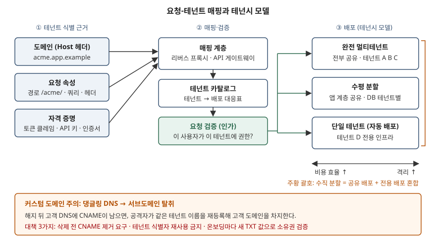

## 들어가며

SaaS를 묻는 기출은 "멀티테넌시의 장단점"에서 끝나지 않는다. 화이트 레이블 SaaS처럼 한 플랫폼이 여러 고객 브랜드로 보이는 문제가 나오면, 답안은 결국 **무엇을 공유하고 무엇을 떼어 놓는가**(테넌시 모델)와 **들어온 요청이 누구의 것인가**(요청-테넌트 매핑) 두 가지로 갈린다. 실무에서도 같다. 비용 때문에 자원을 공유하면 한 테넌트의 데이터가 다른 테넌트에게 보이지 않게 막는 책임이 인프라에서 코드로 넘어오고, 매핑을 잘못하면 그 코드가 엉뚱한 테넌트의 데이터를 집는다. 이 글은 두 축을 클라우드 공급자의 공식 아키텍처 문서 기준으로 정리한다.

> 실행 검증 없음 — 공식 아키텍처 문서를 근거로 정리한 개념 글이다. 테넌시 모델을 정한 국제 표준은 찾지 못했으므로, 분류는 Microsoft와 AWS의 공식 문서를 나란히 적는다.

---

## 정의

**멀티테넌트 SaaS의 테넌트 격리 모델은 하나의 SaaS 솔루션이 여러 테넌트를 서비스할 때 어떤 구성요소를 테넌트 사이에 공유하고 어떤 구성요소를 테넌트 전용으로 둘지를 정하는 배치 방식이고, 요청-테넌트 매핑은 들어오는 요청마다 그 요청이 속한 테넌트를 식별해 해당 테넌트의 배포와 데이터 범위로 보내는 계층이다.**

- **테넌트**: Microsoft 문서는 테넌트를 먼저 정의하라고 한다. B2B에서는 보통 고객 조직 하나가 테넌트이고, 한 고객이 부서·지역·개발/운영 환경별로 여러 테넌트를 가질 수도 있다. B2C에서는 개인이 테넌트일 수도 있지만 가족 계정처럼 데이터를 함께 쓰는 단위가 있어 관계가 더 복잡하다
- **테넌트와 배포는 다르다**: 테넌트는 논리 단위이고, 배포(deployment)는 인프라 한 벌이다. 한 배포가 여러 테넌트를 담을 수도, 한 테넌트만 담을 수도 있다. 배포를 스탬프(stamp)라고도 부른다
- **격리는 스펙트럼이다**: Microsoft 문서는 격리를 "아무것도 공유하지 않음"부터 "전부 공유함"까지 이어지는 연속선으로 본다. 아래 4가지 모델은 그 위의 대표 지점이다

## 등장 배경

클라우드 이전의 호스팅은 고객마다 서버와 DB를 따로 세우는 방식이 기본이었다. 격리는 확실하지만 Microsoft 문서의 표현대로 테넌트 100곳이면 비용이 대략 한 곳의 100배가 되고, 설정·패치를 100벌에 반복해야 한다.

NIST SP 800-145는 클라우드의 필수 특성 5가지 중 하나로 **자원 풀링**을 들고, 제공자의 자원을 멀티테넌트 모델로 여러 소비자에게 나눠 준다고 정의한다. 자원을 풀로 묶으면 비용과 운영이 한 벌로 줄지만 두 문제가 생긴다. 첫째, 테넌트 경계를 인프라가 아니라 **애플리케이션 코드와 테넌트 식별자**가 지켜야 한다. 둘째, 한 테넌트의 부하가 다른 테넌트의 성능을 떨어뜨리는 **노이지 네이버(noisy neighbor)** 가 생긴다. AWS 백서는 격리를 이 두 관점(보안, 노이지 네이버)으로 함께 다룬다.

그래서 "전부 따로"와 "전부 공유" 사이에서 구성요소별로 공유 수준을 고르는 모델 분류가 나왔고, 공유된 환경에서 요청마다 테넌트를 정확히 가려내는 매핑 계층이 필수 구성요소가 됐다.

## 구성요소

### 가. 테넌시 모델 4가지 (Microsoft)

| 모델 | 무엇을 공유하는가 | 이점 | 위험 |
|---|---|---|---|
| ① 단일 테넌트 자동 배포 | 없음. 테넌트마다 인프라 한 벌을 코드로 자동 생성 | 데이터 격리, 노이지 네이버 거의 없음, 점진 배포 가능 | 비용 효율 낮음, 유지보수 반복, 테넌트 전체 분석이 어렵다 |
| ② 완전 멀티테넌트 | 전부. 인프라 한 벌을 모든 테넌트가 쓴다 | 가장 싸다, 테넌트 간 데이터 이동이 식별자 변경으로 끝날 수 있다 | 데이터 분리를 코드가 책임, 노이지 네이버, 변경이 전 고객에 영향, 단일 배포의 규모 한계 |
| ③ 수직 분할 | 테넌트별로 다르다. 대부분은 공유 배포, 일부는 전용 배포 | 공유 비용 이점 유지, 전용 배포는 높은 요금제로 판매 | 코드가 두 방식을 모두 지원해야 한다, 배포 간 테넌트 이전 계획, 어느 테넌트가 어디 있는지 추적 |
| ④ 수평 분할 | 구성요소별로 다르다. 예: 앱 계층은 공유, DB는 테넌트별 | 부하가 몰리는 구성요소만 떼어 노이지 네이버 완화 | 테넌트별 구성요소의 자동 배포·관리 부담 |

수직 분할은 **테넌트 단위로** 공유/전용을 나누고, 수평 분할은 **구성요소 단위로** 나눈다. 시험에서 둘을 혼동하기 쉬운 지점이다.

### 나. AWS 용어와의 대응 — 3가지

AWS 백서(2020-08)는 같은 대상을 사일로·풀·브리지 **3가지**로 부른다.

| AWS 용어 | 뜻 | Microsoft 모델 |
|---|---|---|
| 사일로(silo) | 테넌트마다 자원 스택 전체를 따로 둔다. 신원·온보딩·계량·운영을 공유하면 여전히 SaaS로 본다 | ① 단일 테넌트 자동 배포 |
| 풀(pool) | 테넌트가 인프라를 공유하고, 실제 부하에 비례해 확장한다 | ② 완전 멀티테넌트 |
| 브리지(bridge) | 사일로와 풀을 섞는다. 예: 웹 계층은 풀, 업무 로직·저장소는 사일로 | ④ 수평 분할 (서비스별로 섞으면 ③도 포함) |

AWS 백서는 여기에 **계층 기반 격리**(요금 등급마다 격리 수준을 달리함)를 덧붙인다. Microsoft의 수직 분할과 같은 발상이다.

### 다. 요청-테넌트 매핑 방법 5가지

> **출처**: [Microsoft Azure Architecture Center, Map requests to tenants — Approaches to identify tenants, Request validation](https://learn.microsoft.com/en-us/azure/architecture/guide/multitenant/considerations/map-requests), [Tenancy models for a multitenant solution — Common tenancy models](https://learn.microsoft.com/en-us/azure/architecture/guide/multitenant/considerations/tenancy-models), [Domain name considerations — Dangling DNS and subdomain takeover attacks](https://learn.microsoft.com/en-us/azure/architecture/guide/multitenant/considerations/domain-names)

| 방법 | 테넌트를 어디서 읽는가 | 문서가 지적하는 점 |
|---|---|---|
| ① 도메인 이름 | `Host` 헤더(프록시 뒤에서는 `X-Forwarded-Host`)의 테넌트별 도메인·서브도메인 | 브랜드 노출에 맞다. 모든 웹 계층이 테넌트 도메인을 받아들여야 한다 |
| ② HTTP 요청 속성 | URL 경로(`/acme/`), 쿼리 문자열, 사용자 정의 헤더 | 별도 도메인이 필요 없다. 사용자 정의 헤더는 브라우저 GET 요청에 못 쓰고 일부 프록시가 지운다 |
| ③ 토큰 클레임 | OAuth 2.0·SAML 토큰의 테넌트 ID 클레임, 또는 이메일 클레임으로 대응표 조회 | 한 사용자가 여러 테넌트에 속할 때의 처리를 정해야 한다 |
| ④ API 키 | 키 → 테넌트 대응표, 또는 테넌트 ID를 넣고 HMAC으로 서명한 키 | 오래 살고 재사용되며 클레임이 없어 보안 수준이 높지 않다. 짧게 사는 토큰을 권한다 |
| ⑤ 클라이언트 인증서 | mTLS 인증서의 주체 속성 | 발급·갱신이 복잡하고, 잘못 다루면 오히려 보안을 떨어뜨린다 |

②는 경로·쿼리·헤더 3가지를 묶은 것이다. 매핑은 보통 리버스 프록시나 API 게이트웨이가 맡아, 뒤쪽 서비스가 테넌트 판정을 저마다 구현하지 않게 한다.

### 라. 커스텀 도메인 검증과 서브도메인 탈취 방지

화이트 레이블 SaaS의 고객은 `app.customer.example` 같은 자기 도메인을 CNAME으로 제공사의 테넌트 주소에 연결한다. 등록 전에 **도메인 소유권 검증**을 거친다. 고객에게 CNAME을 먼저 만들게 하거나, 무작위 문자열을 TXT 레코드에 넣게 한다. 검증 없이 받으면 오타 하나로 남의 도메인이 선점될 수 있다.

위험은 **해지할 때** 생긴다. 고객이 서비스에서 도메인을 뺐는데 DNS의 CNAME을 그대로 두면(댕글링 DNS), 공격자가 같은 테넌트 이름으로 새로 가입해 CNAME 검증까지 통과하고 고객 도메인으로 자기 페이지를 띄운다. Microsoft 문서가 드는 대책은 **3가지**다.

1. 도메인 제거를 허용하기 전에 CNAME 삭제를 요구한다
2. 테넌트 식별자의 재사용을 금지한다
3. TXT 검증 값을 온보딩 시도마다 새로 만든다

## 비교 — 매핑과 인가, 사일로와 풀

| 구분 | 요청-테넌트 매핑 | 인가(authorization) |
|---|---|---|
| 묻는 것 | 이 요청은 **어느 테넌트**의 것인가 | 이 사용자가 **그 테넌트에 접근해도 되는가** |
| 근거 | 도메인·경로·클레임·키·인증서 | 인증된 신원과 권한 |
| 실패 시 | 엉뚱한 배포·데이터로 보낸다 | 다른 테넌트의 데이터를 읽는다 |

Microsoft 문서는 도메인이나 식별자가 있다고 접근 권한이 생기는 것은 아니며, 요청마다 인가를 검사하고 OAuth 2.0이면 `audience`·`scope` 클레임까지 확인하라고 적는다. AWS 백서도 **인증·인가가 곧 격리는 아니라고** 못 박는다. 로그인 화면이나 API 입구를 통과했다고 격리가 이뤄진 것이 아니라는 뜻이다.

| 구분 | 사일로 | 풀 |
|---|---|---|
| 격리를 지키는 주체 | 인프라 경계(계정·VPC·DB) | 런타임 정책과 테넌트 컨텍스트 |
| 테넌트별 비용 산정 | 쉽다 | 계측을 따로 설계해야 한다 |
| 장애 영향 범위 | 한 테넌트 | 전 테넌트 |
| 온보딩 | 인프라 생성이 따라와 무겁다 | 설정 추가로 끝난다 |
| 규제 산업 | 테넌트별 DB를 요구받을 때 맞다 | 공유 자체를 거부하는 고객이 있다 |

## 적용 시 고려사항

- **격리 적용을 서비스 개발자에게 맡기지 않는다.** AWS 백서는 개발자가 의도치 않게 테넌트 경계를 넘을 수 있으므로, 자원 접근 범위를 개발자 코드 밖의 공통 장치가 정해야 한다고 적는다. 인증 시 테넌트 컨텍스트를 받아 하위 계층까지 흘려 보내고, 그 컨텍스트로 DB·스토리지 접근 범위를 좁히는 방식이다
- **격리를 자원 분리와 같은 말로 쓰지 않는다.** 풀 모델에서도 런타임 정책으로 논리적 격리를 할 수 있다. 반대로 규제가 테넌트별 DB를 요구하는 분야라면 정책 기반 격리로는 부족하다. 모델 선택은 도메인 요구에서 출발한다
- **매핑 비용을 계산에 넣는다.** 매핑은 요청마다 돈다. 대응표 조회나 토큰 복호화가 부하 아래서 병목이 될 수 있으므로, Microsoft 문서는 세션의 첫 요청에서 매핑을 계산해 세션 쿠키로 들고 다니는 방법을 든다
- **테넌트 이전을 설계에 넣는다.** 수직 분할에서 무료 체험 테넌트를 전용 배포로 옮기면 접속 지점이 바뀐다. 도메인 기반 매핑은 DNS 변경과 TTL 전파 시간이 따라오므로 이전 중 안내 페이지를 준비한다
- **커스텀 도메인의 TLS 인증서 책임을 정한다.** 제공사가 대신 발급하면 고객 측 CAA 레코드가 허용해야 하고, 고객이 직접 주면 제공사가 개인 키를 안전하게 보관해야 한다
- **격리를 시험한다.** Microsoft 문서는 격리 모델을 별도로 시험하라는 절을 둔다. 다른 테넌트 식별자를 넣은 요청이 거부되는지를 회귀 시험에 넣는다

## 정리

- **정의**: 무엇을 공유하고 무엇을 떼는가(격리 모델) + 요청이 누구의 것인가(매핑)
- **테넌시 모델 4가지**: 단일 테넌트 자동 배포 · 완전 멀티테넌트 · 수직 분할(테넌트 단위 혼합) · 수평 분할(구성요소 단위 혼합). AWS는 **사일로·풀·브리지 3가지**
- **매핑 5가지**: 도메인 · 요청 속성(경로·쿼리·헤더) · 토큰 클레임 · API 키 · 클라이언트 인증서. 암기 단서 **"도·속·토·키·인"**
- **매핑 ≠ 인가 ≠ 격리**: 테넌트를 찾은 뒤에도 요청마다 권한을 검사한다
- **서브도메인 탈취 대책 3가지**: CNAME 삭제 요구 · 식별자 재사용 금지 · 매번 새 TXT 값

> 기출 답안: [기출문제 — 화이트 레이블 마케팅](../../exam/2026-11-19-white-label-marketing/index.md)

## 참고 자료

- [Microsoft Azure Architecture Center, Tenancy models for a multitenant solution (ms.date 2025-06-11)](https://learn.microsoft.com/en-us/azure/architecture/guide/multitenant/considerations/tenancy-models) — Define a tenant, Tenants and deployments, Tenant isolation, Common tenancy models
- [Microsoft Azure Architecture Center, Map requests to tenants in a multitenant solution (ms.date 2024-11-24)](https://learn.microsoft.com/en-us/azure/architecture/guide/multitenant/considerations/map-requests) — Approaches to identify tenants, Request validation, Performance, Tenant migration
- [Microsoft Azure Architecture Center, Domain name considerations in multitenant solutions (ms.date 2025-06-13)](https://learn.microsoft.com/en-us/azure/architecture/guide/multitenant/considerations/domain-names) — Custom domain names, Domain validation, Dangling DNS and subdomain takeover attacks, TLS certificates
- [AWS Whitepaper, SaaS Tenant Isolation Strategies: Isolating Resources in a Multi-Tenant Environment (2020-08)](https://d1.awsstatic.com/whitepapers/saas-tenant-isolation-strategies.pdf) — The Isolation Mindset, Silo Isolation, Pool Isolation, The Bridge Model, Tier-Based Isolation, Identity and Isolation
- [NIST SP 800-145, The NIST Definition of Cloud Computing (2011-09)](https://doi.org/10.6028/NIST.SP.800-145) — Essential Characteristics, Resource pooling
