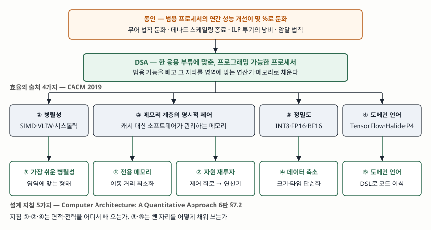

> 실행 검증 없음. 정의·분류·수치는 Hennessy와 Patterson의 튜링상 강연 논문(CACM 2019)과
> 같은 저자의 교과서 6판 7장에 적힌 것만 옮겼다. 교과서 본문은 직접 열지 못해 설계
> 지침 5가지의 문구는 그 장을 옮긴 대학 강의 자료로 확인했다.

## 들어가며

CPU 성능이 해마다 50% 가까이 오르던 시기에는 느린 프로그램을 다음 세대 하드웨어가
해결해 줬다. 그 전제가 2000년대 중반에 성립하지 않게 됐고, 신경망·영상 처리·네트워크
패킷 처리처럼 연산량이 큰 영역은 범용 프로세서 위에서 전력 예산을 먼저 다 쓴다.
그래서 "무엇이 올지 모르는 코드"를 위해 넣어 둔 기능을 빼고, 그 자리를 한 영역에 맞는
연산기와 메모리로 채우는 설계가 돌아왔다. 시험에서는 GPU·TPU·NPU를 묶는 상위
개념으로, 또 무어 법칙·데나드 스케일링 종료의 귀결로 묻는다. 답안의 축은 **무엇을
빼고 무엇을 얻었으며, 그 대가로 무엇에 묶이는가**다.

## 정의

**도메인 특화 아키텍처(DSA)란, 특정 문제 영역에 맞춰 설계하여 그 영역에서 큰
성능·에너지 효율 이득을 내는 프로세서 부류로, 프로그래밍이 가능하고 대개 튜링
완전하지만 특정 응용 부류에 맞춰져 있는 구조**다.

Hennessy와 Patterson이 2018년 튜링상 강연을 정리한 논문의 DSA 절에서 이렇게
정의한다. 같은 자리에서 ASIC과 선을 긋는다. ASIC은 코드가 거의 바뀌지 않는
**단일 기능**에 쓰이고, DSA는 응용의 일부를 범용 CPU보다 빠르게 처리하므로
**가속기**라고도 부른다. 예로 GPU, 심층학습용 신경망 프로세서, 소프트웨어 정의
네트워크(SDN)용 프로세서를 든다.

## 등장 배경

범용 프로세서가 성능을 올리던 세 가지 방법이 차례로 한계에 이르렀다. 같은 논문의
"무어 법칙과 데나드 스케일링의 종료" 절이 근거다.

① **공정 개선이 느려졌다.** 무어 법칙은 2000년 무렵부터 둔화해 2018년에는 예측과
실제 사이에 약 15배 격차가 났다. 트랜지스터 밀도가 오르면 트랜지스터당 전력이
내려가 면적당 전력이 일정하게 유지된다는 데나드 스케일링은 2007년부터 크게 둔화해
2012년에 거의 사라졌다. 이제 코어를 늘리면 전력도 같은 비율로 는다.

② **명령어 수준 병렬성(ILP)의 투기가 에너지를 버린다.** 15단 파이프라인에 4명령
발행이면 파이프라인 안에 명령 60개, 분기 15개가 들어 있다. 낭비를 10% 아래로
두려면 분기 하나하나를 99.3% 맞혀야 한다. 측정하면 Core i7에서 SPEC 정수 벤치마크
평균 19%의 명령이 잘못된 투기로 버려진다.

③ **멀티코어는 암달 법칙에 걸린다.** 순차 구간이 1%만 있어도 64코어의 속도 향상은
약 35배에 그치고, 전력은 64코어분이 그대로 들어 약 45%의 에너지가 낭비된다.
패키지가 뺄 수 있는 열(TDP)에 걸려 코어를 끄는 다크 실리콘 시대가 됐다.

세 가지가 겹친 결과 범용 프로세서의 연간 성능 개선은 몇 퍼센트로 내려앉았다. 논문은
이것을 풀어야 할 문제가 아니라 받아들여야 할 사실로 보고, 남은 방법을 **범용성을
포기한 설계**에서 찾는다.

## 효율의 출처 — 4가지

논문은 DSA가 범용 CPU보다 성능과 에너지 효율이 높은 이유를 네 가지로 든다.

| # | 출처 | 내용 |
|---|---|---|
| ① | **영역에 맞는 병렬성** | SIMD는 명령 스트림 하나만 인출하고 처리 유닛이 같은 박자로 움직이므로 MIMD보다 효율이 높다. VLIW는 범용 코드에는 맞지 않지만 제한된 영역에서는 비순차 투기보다 제어가 단순하다 |
| ② | **메모리 계층의 명시적 제어** | 32KB 캐시 블록 접근은 32비트 정수 덧셈보다 약 200배 에너지를 쓴다. 다단 캐시는 프로세서 에너지의 약 절반을 쓰고, 칩 밖 DRAM 접근은 마지막 단 캐시의 약 10배다. 접근 패턴이 컴파일 시점에 드러나는 영역에서는 소프트웨어가 이동을 지정하는 메모리가 캐시보다 적은 에너지를 쓴다 |
| ③ | **필요한 만큼의 정밀도** | 범용 CPU는 32·64비트 정수·부동소수점을 지원한다. 신경망 추론은 4·8·16비트 정수를 정규적으로 쓰고, 학습도 32비트면 충분하며 16비트가 통하는 경우가 많다 |
| ④ | **도메인 특화 언어(DSL)** | 병렬성을 더 드러내고 메모리 접근 구조를 개선해 응용을 프로세서에 효율적으로 매핑하게 한다 |

캐시의 단점을 논문은 두 가지로 짚는다. 데이터 집합이 크고 지역성이 낮으면 캐시가
작동하지 않고, 반대로 캐시가 잘 작동한다는 것은 지역성이 높다는 뜻이므로 캐시
대부분이 대부분의 시간 동안 놀고 있다는 것이다. 어느 쪽이든 그 면적과 에너지가
연산에 쓰이지 않는다.

## 설계 지침 — 5가지

교과서 6판 7장은 위 네 가지 출처를 설계자가 따를 지침 다섯 가지로 옮겨 적는다.

| # | 지침 | 무엇을 빼고 무엇을 넣는가 |
|---|---|---|
| ① | 전용 메모리를 두어 데이터가 이동하는 거리를 최소화한다 | 하드웨어 관리 캐시 → 소프트웨어가 적재 시점을 지정하는 스크래치패드 |
| ② | 고급 마이크로아키텍처 최적화를 버려 아낀 자원을 연산기와 메모리에 투자한다 | 비순차 실행·분기 예측·레지스터 재명명 → 곱셈-누산기 배열, 더 큰 온칩 버퍼 |
| ③ | 영역에 맞는 가장 쉬운 형태의 병렬성을 쓴다 | 스레드 스케줄링 → SIMD·VLIW·시스톨릭 배열 |
| ④ | 데이터 크기와 타입을 영역이 요구하는 가장 단순한 것으로 줄인다 | FP64·FP32 → INT8·FP16·BF16 |
| ⑤ | 도메인 특화 언어로 코드를 DSA에 이식한다 | 범용 언어 컴파일러 → TensorFlow·Halide·P4와 그 컴파일러 |

지침 ①·②·④는 면적과 전력을 **어디서 빼 오는가**이고, ③·⑤는 뺀 자리를 **어떻게
채워 쓰는가**다. 다섯이 한 묶음인 이유가 여기 있다. 제어 회로를 빼서 얻은 면적은
연산기로 채워야 뜻이 있고, 늘어난 연산기는 쉬운 병렬성과 DSL이 있어야 일을 받는다.

## 도식

> **출처**: [Hennessy & Patterson, "A New Golden Age for Computer Architecture", CACM 62(2), 2019 — End of Moore's Law and Dennard Scaling · Domain-specific architectures · Domain-Specific Languages 절](https://cacm.acm.org/research/a-new-golden-age-for-computer-architecture/), Hennessy & Patterson, *Computer Architecture: A Quantitative Approach*, 6th ed., 2019, §7.2 Guidelines for DSAs

사례로 논문이 드는 TPU v1은 이 도식을 그대로 구현한 것이다. 256×256 곱셈-누산기
시스톨릭 배열(지침 ②·③), 8비트 정밀도(④), 캐시 대신 24MB 지역 메모리와 사용자
제어 고대역 채널(①), XLA가 TensorFlow를 변환해 올리는 실행 경로(⑤)다. 목표는
추론의 성능·에너지 효율 10배였고, 구글 데이터센터의 추론 문제 여섯 가지 가중
평균으로 범용 CPU 대비 29배 빠르고 전력은 절반 이하라 에너지 효율이 80배 이상이었다고
논문은 적는다. 배열 안에서 값이 어떻게 이동하는지는
[시스톨릭 어레이](../2026-11-03-systolic-array/index.md)에서, 연산기와 메모리 대역 중
어느 쪽이 병목인지 가르는 법은 [루프라인 모델](../2026-11-03-roofline-model/index.md)에서
다뤘다.

## 비교

| 비교 축 | 범용 CPU | DSA | ASIC |
|---|---|---|---|
| 대상 | 무엇이 올지 모르는 코드 전부 | 한 영역의 응용 부류 | 단일 기능 |
| 프로그래밍 | 범용 언어, 튜링 완전 | DSL, 대개 튜링 완전 | 코드가 거의 바뀌지 않음 |
| 제어 로직 | 비순차·투기·분기 예측에 큰 면적 | 단순. 스케줄은 컴파일러가 맡는다 | 고정 배선 |
| 온칩 메모리 | 하드웨어 관리 캐시 | 소프트웨어 관리 전용 메모리 | 기능에 맞춘 고정 버퍼 |
| 정밀도 | 32·64비트 고정 | 영역이 요구하는 최소 | 설계 시 고정 |
| 영역 안에서 알고리즘이 바뀌면 | 그대로 실행 | DSL 안에서 재컴파일 | 재설계 |
| 예 | x86·ARM·RISC-V 코어 | GPU·TPU·SDN 프로세서 | 특정 코덱 전용 칩 |

DSA와 ASIC의 차이는 가운데 줄 두 개에 있다. DSA는 프로그래밍이 가능하므로 같은 영역
안에서 모델이나 알고리즘이 바뀌어도 칩을 다시 만들지 않는다. 그 대신 어떤 DSL과
컴파일러가 그 칩을 지원하느냐에 수명이 걸린다.

RISC-V가 사용자 정의 가속기용 명령 코드 공간을 넓게 비워 둔다는 사실도 같은 논문에
있다. 범용 코어 옆에 DSA를 붙이는 구성이 전제되어 있다는 뜻이다.

## 적용 시 고려사항 — 5가지

**① 영역이 충분히 크고 오래 가는가.** 설계 투자를 회수하려면 그 영역의 작업량이
데이터센터 규모로 반복되어야 한다. 논문은 2019년 시점에 신경망 가속기 설계가 수십 개
경쟁 중이며 어느 방향이 이길지, 이기는 것이 있을지조차 예측하기 어렵다고 적는다.
영역의 수명이 칩의 수명보다 짧으면 ASIC과 같은 위험을 진다.

**② DSL과 컴파일러에 묶인다.** DSA는 고수준 연산을 하드웨어에 대응시켜야 하는데,
Python·Java·C 같은 범용 언어에서 그 구조를 뽑아내는 것은 너무 어렵다. DSL이 없으면
DSA를 효율적으로 프로그래밍할 수 없고, 이식성과 효율 사이의 균형은 논문이 미해결
연구 과제로 둔 항목이다. 도구 체계의 지원이 중단되면 그 칩은 쓸 수 없게 된다.

**③ 범용 코드가 섞이면 전제가 성립하지 않는다.** VLIW가 Itanium에서 실패한 이유는
분기와 캐시 미스가 예측되지 않는 정수 코드였다. 같은 구조가 신호 처리처럼 좁은
영역에서는 아직 쓰인다. 작업에 동적 형상·잦은 분기·커스텀 연산이 섞여 들면 DSA 쪽
전제가 깨지고 범용 쪽이 맞게 된다.

**④ 메모리 접근 패턴이 컴파일 시점에 드러나야 한다.** 소프트웨어 제어 메모리가
캐시보다 적은 에너지를 쓰는 조건은 접근 패턴이 미리 알려져 있다는 것이다. 패턴이
데이터에 따라 달라지는 작업이면 캐시를 뺀 것이 그대로 손실이 된다.

**⑤ 수직 통합 팀이 필요하다.** 논문은 응용, DSL과 컴파일러, 아키텍처, 구현 기술을
함께 아는 팀이 있어야 이런 이득을 얻는다고 적는다. 산업이 수평으로 나뉘기 전의 초기
컴퓨팅이 그랬고, 이 시대에는 수직 통합이 다시 중요해진다. 하드웨어만 사 오는 조직은
지침 ⑤를 이행할 수 없다.

## 정리

암기 단서는 **"3이 한계, 4가 출처, 5가 지침"**이다.

- **한계에 이른 방법 3가지**: 무어 법칙 둔화 · 데나드 스케일링 종료 · ILP 투기와 멀티코어(암달)의 한계
- **효율의 출처 4가지**: 병렬성 · 메모리 · 정밀도 · 언어
- **설계 지침 5가지**: 전용 메모리 · 자원 재투자 · 쉬운 병렬성 · 데이터 축소 · 도메인 언어
- **고려사항 5가지**: 영역 수명 · DSL 의존 · 범용 코드 혼입 · 접근 패턴 · 수직 통합
- 정의 한 줄: **프로그래밍 가능하고 대개 튜링 완전하지만 한 응용 부류에 맞춘 프로세서 부류**

> 기출 답안: [기출문제 — GPU와 TPU의 개념·비교, TPU 선택 이유와 효율성](../../exam/2026-10-29-gpu-tpu-architecture-and-efficiency/index.md)

## 참고 자료

- [J. L. Hennessy, D. A. Patterson, "A New Golden Age for Computer Architecture", *Communications of the ACM* 62(2): 48–60, 2019-02. DOI 10.1145/3282307](https://cacm.acm.org/research/a-new-golden-age-for-computer-architecture/)
- J. L. Hennessy, D. A. Patterson, *Computer Architecture: A Quantitative Approach*, 6th ed., Morgan Kaufmann, 2019 — Chapter 7 Domain-Specific Architectures, §7.2 Guidelines for DSAs
- [N. P. Jouppi, C. Young, N. Patil, D. Patterson, "A Domain-Specific Architecture for Deep Neural Networks", *Communications of the ACM* 61(9): 50–59, 2018-09](https://doi.org/10.1145/3154484)
- [N. P. Jouppi et al., "In-Datacenter Performance Analysis of a Tensor Processing Unit", ISCA 2017 (arXiv:1704.04760)](https://arxiv.org/abs/1704.04760)
- [M. Horowitz, "Computing's energy problem (and what we can do about it)", ISSCC 2014](https://doi.org/10.1109/ISSCC.2014.6757323)
