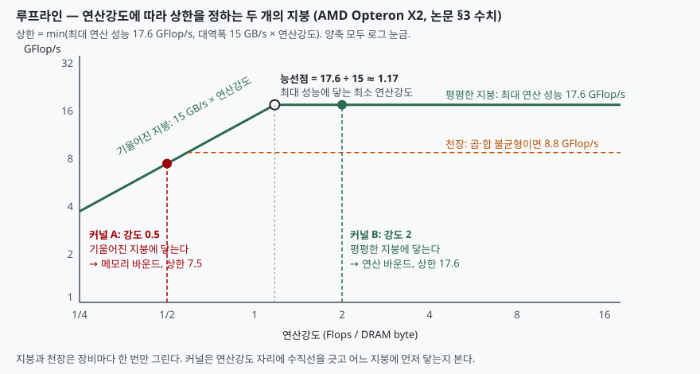

## 들어가며

코어를 두 배로 늘렸는데 처리량이 그대로인 장비가 있다. 프로파일러를 돌리면 연산
함수에 시간이 몰려 있다고 나오지만, 그 함수를 SIMD 로 다시 써도 속도는 꿈쩍하지
않는다. 연산기가 바쁜 것이 아니라 **메모리에서 값이 오기를 기다리는 시간**이
연산 함수 안에 잡혀 있었기 때문이다. 이것을 측정 전에 판단할 수 있게 해 주는 것이
루프라인 모델이다.

시험에서는 컴퓨터 구조의 성능 분석 모델로 묻는다. 암달의 법칙이 "병렬화가 얼마나
도움이 되는가"를 묻는다면, 루프라인은 **"이 코드의 병목이 메모리인가 연산기인가,
그러면 어떤 최적화를 먼저 할 것인가"**를 그림 하나로 답한다. GPU·NPU 에서 어떤
연산이 하드웨어를 다 쓰는지 설명할 때도 같은 그림이 쓰인다.

## 정의

**루프라인 모델이란, 커널의 연산강도(DRAM 트래픽 1바이트당 연산 횟수)를 가로축에,
달성 가능한 성능을 세로축에 두고, 최대 연산 성능(수평 지붕)과 메모리 대역폭 × 연산강도
(기울어진 지붕) 중 낮은 쪽을 성능의 상한으로 제시하는 한계·병목 분석 모델**이다.

Williams · Waterman · Patterson 이 2008년 UC 버클리 기술 보고서(UCB/EECS-2008-134)로
내고 2009년 *Communications of the ACM* 에 실은 논문이 원 출처다. 상한을 정하는
식은 논문 3절에 한 줄로 적혀 있다.

> 달성 가능 GFlop/s = min(최대 부동소수점 성능, 최대 메모리 대역폭 × 연산강도)

논문이 "산술강도" 대신 **연산강도(operational intensity)** 라는 말을 고른 이유도
정의의 일부다. 트래픽을 프로세서와 캐시 사이가 아니라 **캐시와 DRAM 사이**에서
잰다. 그래야 캐시 최적화의 효과가 모델 안에 들어온다.

## 등장 배경

이전 방식의 문제는 세 가지였다.

① **확률 모델·통계 모델은 예측은 하지만 통찰을 주지 않는다.** 논문 2절이 그렇게
적는다. 성능 숫자를 맞춰도 "그래서 무엇을 고쳐야 하는가"가 나오지 않고, 비전문가가
쓰기도 어렵다.

② **암달의 법칙은 직렬 구간만 본다.** 병렬 코어를 늘릴 때의 한계는 보여 주지만,
코어가 충분한데도 느린 이유, 곧 메모리 대역폭은 다루지 않는다.

③ **멀티코어 설계가 다양해져 공통의 직관이 사라졌다.** 캐시 대신 지역 메모리를
쓰는 칩, 스레드 수백 개로 지연을 숨기는 칩이 섞여 있어 장비마다 최적화 순서가
달랐다.

루프라인은 캐시의 3C 모델처럼 **완벽하지 않아도 통찰을 주는 모델**을 목표로 한다.
장비당 한 번 그려 두면 어떤 커널에도 다시 쓸 수 있다는 것이 핵심 성질이다.

## 구성요소 — 4가지

| 구성요소 | 무엇 | 어디서 얻는가 |
|---|---|---|
| **연산강도** | DRAM 1바이트당 연산 횟수 (Flops/byte). 커널의 속성 | 연산 횟수 ÷ DRAM 트래픽. 캐시 뒤에서 잰다 |
| **수평 지붕** | 최대 연산 성능 (GFlop/s). 장비의 속성 | 사양표 또는 마이크로벤치마크 |
| **기울어진 지붕** | 최대 대역폭 × 연산강도. 장비의 속성 | STREAM 류 벤치마크로 잰 지속 대역폭 |
| **능선점** | 두 지붕이 만나는 연산강도 = 최대 연산 성능 ÷ 최대 대역폭 | 계산 |

능선점은 **최대 성능에 닿는 데 필요한 최소 연산강도**다. 논문은 능선점이 오른쪽에
있을수록 연산강도가 매우 높은 커널만 최대 성능을 내고, 왼쪽에 있을수록 거의 모든
커널이 최대 성능에 닿을 수 있다고 적는다.

## 도식



> **출처**: [Williams, Waterman, Patterson, "Roofline: An Insightful Visual Performance Model for Floating-Point Programs and Multicore Architectures", UCB/EECS-2008-134, §3 The Roofline Model (Figure 1a, AMD Opteron X2 수치) · §4 Adding Ceilings to the Model](https://www2.eecs.berkeley.edu/Pubs/TechRpts/2008/EECS-2008-134.html)

도식의 수치는 논문 3절이 든 AMD Opteron X2 의 값(최대 17.6 GFlop/s, 대역폭 15 GB/s)
이다. 이 값으로 능선점을 계산해 보면 다음과 같다.
전체 소스: [`code/`](code/) · 수행 기록: [`code/output.txt`](code/output.txt)

```text
== 1. 능선점 — 두 지붕이 만나는 연산강도
  최대 연산 성능 17.6 GFlop/s ÷ 최대 대역폭 15.0 GB/s = 1.17 Flops/byte
  검산: 15.0 × 1.1733 = 17.60 GFlop/s (= 최대 연산 성능)

== 3. 연산강도 1 과 2 — 논문 §3 이 든 두 경우
  연산강도 1: 대역폭 쪽 15.0 GFlop/s, 연산 쪽 17.6 GFlop/s → 상한 15.0 (메모리 바운드)
  연산강도 2: 대역폭 쪽 30.0 GFlop/s, 연산 쪽 17.6 GFlop/s → 상한 17.6 (연산 바운드)
```

논문이 "연산강도 2는 연산 바운드, 1은 메모리 바운드"라고 적은 것과 계산이 맞는다.
논문의 커널 네 개(표 2)의 연산강도를 같은 식에 넣으면 이렇다.

```text
  커널      연산강도   상한(GFlop/s)   판정
  SpMV     전  0.17       2.55        메모리 바운드
  SpMV     후  0.25       3.75        메모리 바운드
  Stencil  후  0.50       7.50        메모리 바운드
  LBMHD    후  1.07      16.05        메모리 바운드
  3-D FFT  후  1.64      17.60        연산 바운드
```

메모리 바운드 구역에서는 상한이 연산강도에 정비례한다. SpMV 가 레지스터 블로킹으로
강도를 0.17에서 0.25로 올리면 상한도 꼭 그만큼(1.47배) 오른다. 논문 5절이
"다른 최적화보다 연산강도를 올리는 것을 먼저 권한다"고 적는 근거가 이 비례 관계다.

## 병목 판별 절차 — 4단계

1. **장비의 지붕을 한 번 그린다.** 최대 연산 성능과 지속 대역폭을 재서 능선점을 구한다
2. **커널의 연산강도를 구한다.** 연산 횟수를 DRAM 트래픽으로 나눈다. 캐시 뒤에서 잰다
3. **연산강도 자리에 수직선을 긋는다.** 기울어진 지붕에 먼저 닿으면 메모리 바운드,
   수평 지붕에 닿으면 연산 바운드다
4. **천장을 보고 최적화 순서를 정한다.** 실제 성능이 어느 천장 사이에 있는지 본다

4단계의 **천장(ceiling)** 이 논문 4절의 기여다. 지붕 아래에 "이 최적화를 하지 않으면
여기까지"인 선을 겹쳐 그린다. 연산 천장은 2개, 메모리 천장은 3개를 든다.

| 구분 | 천장 (아래부터) | 깨는 최적화 |
|---|---|---|
| 연산 | ILP·SIMD 없음 → 곱·합 불균형 → 최대 | ① 명령어 수준 병렬성·SIMD ② 곱셈·덧셈 균형 |
| 메모리 | 단위 보폭만 → 메모리 친화 없음 → SW 프리페치 없음 → 최대 | ③ 단위 보폭 접근 ④ 메모리 친화(NUMA) ⑤ 소프트웨어 프리페치 |

아래 천장을 깨지 않고는 위 천장에 못 간다. 그래서 천장의 순서가 곧 최적화 순서고,
**천장 사이의 높이가 그 최적화로 얻을 수 있는 보상**이다. Opteron X2 의 천장 값으로
Stencil(연산강도 0.33)이 어느 구역에 있는지 계산하면 이렇다.

```text
  수직선이 아래부터 만나는 천장:
     0.89 GFlop/s  메모리  단위 보폭만
     1.58 GFlop/s  메모리  메모리 친화 없음
     2.20 GFlop/s  연산   ILP·SIMD 없음
     3.63 GFlop/s  메모리  SW 프리페치 없음
     4.95 GFlop/s  메모리  최대 대역폭
```

수직선이 만나는 천장에 두 종류가 섞여 있다. 논문 4절의 그림 2c 로 말하면 두 구역이
겹치는 가운데 평행사변형이고, **둘 다 손봐야 하되 가장 낮은 두 천장이 메모리 쪽이라
메모리부터 간다.** 단위 보폭과 메모리 친화를 해결해야 1.58 을 넘고, 그다음에야
ILP·SIMD 의 천장 2.2 가 의미를 갖는다. 곱·합 균형 천장(8.8)은 지붕(4.95) 위에
있어 이 커널에서는 아예 보상이 없다.

## 비교 — 유사 개념과의 대비

| | 루프라인 모델 | 암달의 법칙 | 3C 캐시 모델 |
|---|---|---|---|
| 묻는 것 | 병목이 메모리인가 연산기인가 | 코어를 늘리면 얼마나 빨라지는가 | 미스가 왜 나는가 |
| 변수 | 연산강도, 대역폭, 최대 성능 | 직렬 비율, 코어 수 | 필수·용량·충돌 |
| 결과 | 성능의 상한과 최적화 순서 | 속도 향상의 상한 | 미스의 분류 |
| 관계 | 3C 를 끌어다 쓴다 — 필수 미스가 연산강도의 상한을 정한다 | 독립 | 루프라인 5절이 연결 |
| 장비 의존 | 장비당 한 번 그린다 | 장비와 무관 | 캐시 구성에 따름 |

두 바운드도 자주 대비해 묻는다.

| | 메모리 바운드 | 연산 바운드 |
|---|---|---|
| 위치 | 능선점 왼쪽, 기울어진 지붕 아래 | 능선점 오른쪽, 수평 지붕 아래 |
| 상한 | 대역폭 × 연산강도 (강도에 비례) | 최대 연산 성능 (강도와 무관) |
| 먼저 할 일 | 연산강도 올리기, 단위 보폭, NUMA 친화, 프리페치 | ILP·SIMD, 곱·합 균형, 스레드 병렬성 |
| 논문의 예 | SpMV(0.17~0.25), Stencil(0.33) | 3-D FFT(1.64, Opteron X2 기준) |

같은 커널도 **장비가 바뀌면 판정이 바뀐다.** 논문이 적은 네 장비의 능선점으로
판정하면 이렇게 갈린다.

```text
  Intel Xeon           능선점 6.70  SpMV 메모리 · Stencil 메모리 · LBMHD 메모리 · 3-D FFT 메모리
  AMD Opteron X4       능선점 4.40  SpMV 메모리 · Stencil 메모리 · LBMHD 메모리 · 3-D FFT 메모리
  Sun UltraSPARC T2+   능선점 0.33  SpMV 메모리 · Stencil 연산  · LBMHD 연산  · 3-D FFT 연산
  IBM Cell             능선점 0.65  SpMV 메모리 · Stencil 메모리 · LBMHD 연산  · 3-D FFT 연산
```

능선점이 6.7인 Xeon 에서는 네 커널 모두 메모리 바운드고, 0.33인 T2+ 에서는 SpMV 만
남는다. 논문 6.3.5절은 능선점이 낮은 장비가 프로그래밍하기 쉬웠다고 적는다. 컴파일러가
뽑아 주는 코드에 스레드만 많이 쓰면 됐기 때문이다.

## 적용 시 고려사항 — 4가지

**① 연산강도는 캐시 뒤에서 잰다.** 프로세서와 캐시 사이 트래픽으로 재면 캐시
최적화의 효과가 사라진다. 논문 5절은 **필수 미스가 트래픽의 하한**, 곧 연산강도의
상한을 정하고, 용량·충돌 미스가 강도를 끌어내린다고 적는다. 배열 패딩으로 충돌
미스를 줄이거나 쓰기 시 캐시 할당을 피하는 명령으로 트래픽을 줄이면 커널이
오른쪽으로 옮겨 가 다른 최적화 구역에 들어간다.

**② 연산강도는 고정값이 아니다.** 밀집 행렬 곱이나 FFT 는 문제 크기에 따라 강도가
오른다. 논문의 3-D FFT 는 128³ 에서 1.09, 512³ 에서 1.41이고, 한 평면이 캐시에
들어가는 장비에서는 1.64까지 올랐다. 작은 문제로 잰 강도로 큰 문제를 판정하면
틀린다.

**③ 지붕은 사양표 값이 아니라 지속 가능한 값으로 그린다.** 논문이 쓴 대역폭은
DRAM 핀 대역폭이 아니라 프리페치·정렬까지 넣은 마이크로벤치마크의 정상 상태 값이다.
Xeon 의 경우 사양상 대역폭이 가장 높았지만 프런트 사이드 버스가 일관성 트래픽까지
실어 지속 대역폭은 넷 중 가장 낮았고, 그래서 능선점이 6.7까지 올라갔다.

**④ 부동소수점이 아닌 작업에도 쓸 수 있지만 지표를 바꿔야 한다.** 논문 7절은
모델이 특정 프로그램이 아니라 **성능 지표와 장비의 조합**에 대해 한 번 계산된다고
적는다. 정수 연산, 메모리 밖 I/O 로 축을 바꾸면 DB 의 스캔 처리량이나 추론 엔진의
토큰 처리량에도 같은 그림을 그릴 수 있다. 다만 천장의 순서는 커널의 성질에 따라
바뀔 수 있다. 곱·합 균형이 자연스럽게 맞는 SpMV 에서는 그 천장을 맨 아래로 내린다.

## 정리

암기 단서는 **"강도 → 지붕 둘 → 능선점 → 천장"** 네 마디다.

- **정의**: 연산강도를 가로축에 두고 min(최대 연산 성능, 대역폭 × 강도)를 상한으로 보이는 모델
- **구성요소 4가지**: 연산강도 · 수평 지붕(연산) · 기울어진 지붕(대역폭) · 능선점
- **판별 절차 4단계**: 지붕 그리기 → 강도 구하기 → 수직선 긋기 → 천장으로 순서 정하기
- **천장 5가지**: 연산 2(ILP·SIMD, 곱·합 균형) + 메모리 3(단위 보폭, 메모리 친화, SW 프리페치)
- **고려사항 4가지**: 캐시 뒤에서 재기 · 강도는 문제 크기에 따라 변함 · 지속 대역폭으로 그리기 · 지표를 바꿔 확장
- 핵심 문장 하나로 줄이면, **능선점보다 왼쪽이면 메모리부터, 오른쪽이면 연산기부터 고친다**

## 참고 자료

- [S. Williams, A. Waterman, D. Patterson, "Roofline: An Insightful Visual Performance Model for Floating-Point Programs and Multicore Architectures", Technical Report UCB/EECS-2008-134, UC Berkeley, 2008](https://www2.eecs.berkeley.edu/Pubs/TechRpts/2008/EECS-2008-134.html)
- S. Williams, A. Waterman, D. Patterson, "Roofline: An Insightful Visual Performance Model for Multicore Architectures", *Communications of the ACM* 52(4): 65–76, 2009. [DOI 10.1145/1498765.1498785](https://doi.org/10.1145/1498765.1498785)
- [J. D. McCalpin, STREAM: Sustainable Memory Bandwidth in High Performance Computers](https://www.cs.virginia.edu/stream/) — 논문이 대역폭 측정의 기준으로 든 벤치마크
