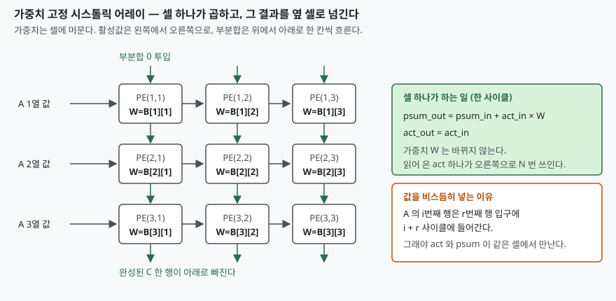

## 들어가며

행렬 곱이 느린 이유는 곱셈기가 모자라서가 아니다. 삼중 루프로 적으면 곱셈
한 번마다 피연산자 두 개를 다시 읽는다. `A[i][k]` 하나를 N번 읽고, `B[k][j]`
하나를 M번 읽는다. 곱셈기를 아무리 늘려도 그 값을 가져다 줄 메모리 대역이
따라가지 못하면 연산기는 놀고 있게 된다.

시험에서 이 개념이 나오는 자리는 둘이다. 컴퓨터 구조에서는 폰 노이만 병목을
우회하는 특수 목적 구조의 사례로, 인공지능 인프라에서는 TPU·NPU 의 핵심
연산기로 묻는다. 어느 쪽이든 답안의 축은 같다. **한 번 읽은 값을 배열 안에서
여러 번 쓰게 만들어 메모리 접근 횟수 자체를 줄인다**는 것이다.

## 정의

**시스톨릭 어레이란, 동일한 처리 셀(PE)을 규칙적인 배열로 두고 이웃 셀끼리만
직접 연결하여, 서로 다른 방향에서 일정한 간격으로 도착한 데이터를 각 셀이
결합하면서 배열 전체로 전달해 나가는 특수 목적 병렬 연산 구조**다.

이 구조의 이름과 설계 원리는 H. T. Kung 과 C. E. Leiserson 의 1980년 글
"Algorithms for VLSI processor arrays"에서 제시됐고, Kung 이 1982년 IEEE
Computer 에 실은 "Why Systolic Architectures?"(15권 1호, 37–46쪽)가 그 이유를
정리한 글로 널리 인용된다.

동작의 핵심은 구글 TPU 논문이 설명을 붙인 대목에 그대로 나온다. 큰 SRAM 을
읽는 것이 산술 연산보다 전력을 훨씬 많이 쓰기 때문에, 행렬 연산 유닛은
통합 버퍼의 읽기·쓰기를 줄이려고 시스톨릭 방식으로 실행한다는 것이다.
그리고 그 실행은 **서로 다른 방향에서 일정한 간격으로 셀에 도착한 데이터가
그 자리에서 결합되는 것에 기대고 있다**고 적는다.

## 등장 배경

이전 방식의 문제는 세 가지였다.

① **메모리 대역이 연산기 수를 따라가지 못한다.** 연산기를 n개로 늘리면
메모리에서 읽어야 할 값도 n배로 늘어난다. 폰 노이만 구조에서는 이 통로가
하나다.

② **값을 다시 읽는 비용이 계산 비용보다 크다.** 큰 SRAM 한 번 읽기가
곱셈 한 번보다 에너지를 많이 쓴다. 캐시로 줄일 수는 있지만, 캐시 역시
읽기·쓰기이므로 접근 자체를 없애지는 못한다.

③ **범용 구조는 제어 오버헤드가 크다.** 명령어 인출·해독·분기 예측이
계산마다 따라붙는다. 연산 패턴이 고정된 작업에서는 이것이 전부 낭비다.

시스톨릭 어레이는 세 가지를 한꺼번에 비켜 간다. 배열 가장자리에서만 메모리와
주고받고, 내부에서는 이웃 셀끼리 값을 넘기므로 한 번 읽은 값이 배열을 가로지르며
여러 번 쓰인다. 모든 셀이 같은 일을 같은 클록에 하므로 제어도 거의 필요 없다.

## 구성요소 — 4가지

| 구성요소 | 역할 |
|---|---|
| **처리 셀(PE)** | 곱셈기 1개 + 누산기 1개 + 레지스터. 모든 셀이 동일하다 |
| **셀 간 전용 배선** | 이웃하고만 연결된다. 전역 버스가 없어 배선 길이가 셀 간격으로 고정된다 |
| **가장자리 버퍼** | 배열과 메모리가 만나는 유일한 지점. 입력을 비스듬히 밀어 넣고 결과를 받는다 |
| **공통 클록** | 전 셀이 같은 박자로 한 칸씩 움직인다. 셀마다 다른 제어 신호가 없다 |

## 동작 절차 — 5단계

가중치 고정 방식으로 `C = A × B` 를 K×N 배열에 올리는 절차다.

1. **가중치 선적재** — `B[r][c]` 를 PE(r, c)에 올려 두고 연산이 끝날 때까지 두지 않는다
2. **입력 스큐** — A 의 r번째 열 값을 r번째 행 입구에 `i + r` 사이클에 넣는다
3. **파면 전파** — 활성값은 오른쪽으로, 부분합은 아래로 한 칸씩 간다
4. **부분합 누적** — PE(r, c)는 `psum_out = psum_in + act_in × W` 를 계산한다
5. **결과 유출** — 열 맨 아래로 떨어진 부분합이 `C` 의 한 원소다

2번의 스큐가 이 구조에서 가장 자주 틀리는 자리다. 비스듬히 넣지 않으면 활성값과
부분합이 같은 셀에서 만나지 못한다. `A[i][r]` 과 `C[i][c]` 의 부분합은 둘 다
`i + r + c` 사이클에 PE(r, c)에 도착해야 하고, 그래서 입구 투입 시각이 행마다
한 사이클씩 밀린다.

## 도식



> **출처**: [Jouppi et al., "In-Datacenter Performance Analysis of a Tensor Processing Unit", ISCA 2017, §3 (Figure 4 — Systolic data flow of the Matrix Multiply Unit)](https://arxiv.org/abs/1704.04760)

위 구조를 사이클 단위로 모사해 결과가 직접 계산한 행렬 곱과 같은지 확인했다.
전체 소스: [`code/`](code/) · 수행 기록: [`code/output.txt`](code/output.txt)

4×3 행렬과 3×3 행렬을 3×3 배열에 올리면 일하는 셀이 대각선으로 지나간다.

```text
  사이클  1  ■·· ··· ···
  사이클  2  ■■· ■·· ···
  사이클  3  ■■■ ■■· ■··
  사이클  4  ■■■ ■■■ ■■·
  사이클  5  ·■■ ■■■ ■■■
  사이클  6  ··■ ·■■ ■■■
  사이클  7  ··· ··■ ·■■
  사이클  8  ··· ··· ··■
```

전체 사이클은 8이고 `M + K + N − 2` 와 일치한다. 메모리에서 읽은 원소 수는
삼중 루프가 72회, 시스톨릭이 21회로 3.4배 차이가 났다.

## 비교 — 데이터플로 4가지

무엇을 셀에 고정하느냐로 갈린다. Sze 등의 분류를 따른다.

| 데이터플로 | 셀에 고정되는 것 | 움직이는 것 | 줄이는 접근 |
|---|---|---|---|
| **가중치 고정(WS)** | 가중치 1개 | 활성값은 전파, 부분합은 누적 | 가중치 읽기 |
| **출력 고정(OS)** | 한 출력의 부분합 | 활성값·가중치가 들어온다 | 부분합 읽기·쓰기 |
| **지역 재사용 없음(NLR)** | 없다 | 전부 전역 버퍼에서 온다 | (셀 면적을 버퍼에 몰아준다) |
| **행 고정(RS)** | 가중치 한 행 | 활성값이 행을 따라 흐른다 | 세 종류를 함께 |

이 분류를 든 논문은 WS 의 예로 nn-X·neuFlow 를, OS 의 예로 ShiDianNao 를,
RS 의 예로 Eyeriss 를 든다. TPU 는 가중치 행렬 타일을 쥐고 나머지 입력과
부분합을 흘려보낸다고 논문 스스로 적으므로 가중치 고정 쪽에 해당한다.

유사 개념과의 대비도 자주 묻는다.

| | 시스톨릭 어레이 | SIMD / 벡터 | GPU(SIMT) |
|---|---|---|---|
| 데이터 공급 | 이웃 셀에서 받는다 | 메모리·레지스터에서 매번 읽는다 | 메모리·공유 메모리에서 읽는다 |
| 연산기 간 통신 | 이웃 직결 | 없다(독립 레인) | 공유 메모리 경유 |
| 제어 | 전 셀 동일, 거의 없다 | 명령 하나로 전 레인 | 워프 단위 스케줄링 |
| 유연성 | 고정된 연산 패턴만 | 범용 | 범용 |
| 적합 작업 | 행렬 곱, 합성곱, FIR | 요소별 연산 | 폭넓은 병렬 작업 |

## 적용 시 고려사항 — 4가지

**① 배열이 커질수록 처리량은 오르지만 지연은 길어진다.** 첫 결과가 나오려면
배열 깊이 K 만큼 기다려야 한다. 모사기로 재면 K가 2·4·8·16일 때 첫 결과가
각각 2·4·8·16 사이클에 나왔다. 응답 시간 제한이 빡빡한 추론 작업에서는
이 지연이 그대로 비용이다.

**② 입력이 적으면 배열이 논다.** 8×8 배열에 행 수만 바꿔 넣어 보면 PE 활용률이
이렇게 움직인다.

```text
   M행   사이클   유효MAC    PE활용률   읽기 절감
      1       15        64        6.7%        1.8배
      8       22       512       36.4%        8.0배
     64       78      4096       82.1%       14.2배
    512      526     32768       97.3%       15.8배
```

배열을 채우고 비우는 `K + N − 2` 사이클이 고정 비용이라, 행 수 M 이 그보다
작으면 대부분의 셀이 쉰다. 배치 크기를 키우거나 작은 배열 여러 개로 쪼개는
선택이 여기서 갈린다.

**③ 행렬 크기가 배열 크기와 맞지 않으면 타일로 쪼개야 한다.** 배열보다 큰
행렬은 여러 번에 나눠 올리고 부분합을 모아야 하고, 배열보다 작은 행렬은
남는 셀이 그대로 낭비된다. 고정 크기 하드웨어의 숙명이고, 컴파일러가 푸는
문제이기도 하다.

**④ 가중치를 바꾸는 비용을 따져야 한다.** 가중치 고정 방식은 가중치가 오래
머물수록 이득이 크다. 계층마다 가중치를 갈아 끼워야 하면 선적재 시간이
계산 시간과 경쟁한다. TPU 논문이 가중치를 미리 읽어 두는 명령을 따로 두고,
주소만 보내고 끝낼 수 있게 설계한 이유다.

## 정리

암기 단서는 **"고정 1 · 이동 2"**로 묶는다. 가중치 하나가 고정되고, 활성값과
부분합 둘이 서로 다른 방향으로 움직인다.

- **구성요소 4가지**: 처리 셀 · 이웃 직결 배선 · 가장자리 버퍼 · 공통 클록
- **절차 5단계**: 가중치 선적재 → 입력 스큐 → 파면 전파 → 부분합 누적 → 결과 유출
- **데이터플로 4가지**: 가중치 고정 · 출력 고정 · 지역 재사용 없음 · 행 고정
- **고려사항 4가지**: 지연 · 활용률 · 타일링 · 가중치 교체 비용
- 핵심 문장 하나로 줄이면, **메모리를 덜 읽으려고 연산기 사이에 값을 넘긴다**

## 참고 자료

- H. T. Kung, "Why Systolic Architectures?", *Computer* 15(1): 37–46, 1982. [DOI 10.1109/MC.1982.1653825](https://doi.org/10.1109/MC.1982.1653825)
- H. T. Kung and C. E. Leiserson, "Algorithms for VLSI processor arrays", in *Introduction to VLSI Systems*, 1980
- [N. P. Jouppi et al., "In-Datacenter Performance Analysis of a Tensor Processing Unit", ISCA 2017 (arXiv:1704.04760)](https://arxiv.org/abs/1704.04760)
- [V. Sze, Y.-H. Chen, T.-J. Yang, J. S. Emer, "Efficient Processing of Deep Neural Networks: A Tutorial and Survey", *Proc. IEEE* 105(12): 2295–2329, 2017 (arXiv:1703.09039)](https://arxiv.org/abs/1703.09039)
