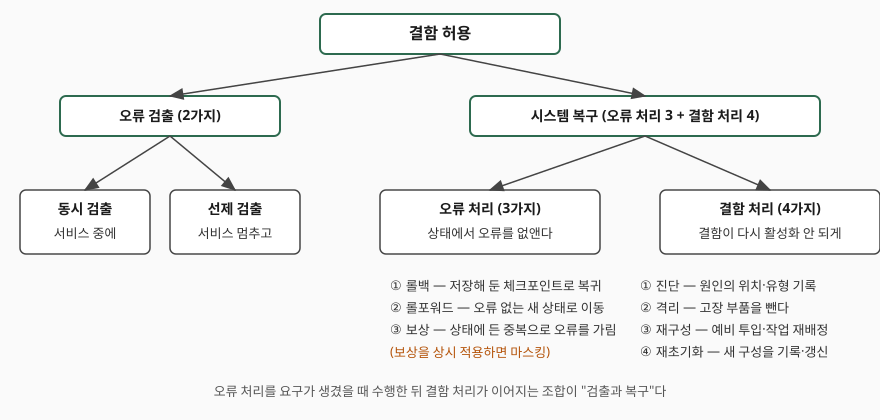
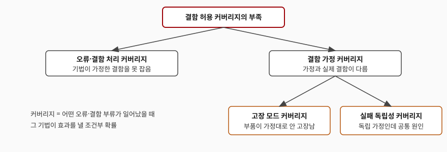

> 실행 검증 없음. 신뢰성 분류 논문(IEEE TDSC 2004, 5.2.1절 그림 5.1과 그림 5.3)에 적힌 정의와 분류만 옮겼고, 측정값이나 실행 출력은 싣지 않았다.

## 들어가며

결함 허용을 묻는 문제는 대개 "어떤 기법이 있는가"를 나열하라고 요구한다. 그런데 롤백, 이중화, 마스킹, 예비 투입을 한 줄로 늘어놓으면 서로 어떤 관계인지가 사라진다. 실무에서도 같은 문제가 생긴다. 메모리 오류를 정정 부호로 가리는 장치와 장애 노드를 빼고 예비를 올리는 절차는 **개입하는 시점과 하는 일이 다르다.** 논문의 분류는 이 둘을 한 틀 안에 놓는다. 이 글은 그 분류의 항목을 개수까지 정리하고, 분류가 어디서 한계에 닿는지까지 적는다.

## 정의

**결함 허용(fault tolerance)은 서비스 실패를 피하려는 것으로, 오류 검출(error detection)과 시스템 복구(system recovery)로 이뤄진다.** 이것이 Avizienis 등의 논문 5.2.1절의 첫 문장이다. 오류 검출은 "오류가 있다는 것을 알아내는 일"이고, 복구는 "오류가 든 상태를, 검출된 오류가 없고 다시 활성화될 결함도 없는 상태로 바꾸는 일"이다.

## 등장 배경

결함(fault)이 활성화되면 오류(error)가 되고, 오류가 서비스 경계에 닿으면 실패(failure)가 된다. 결함을 만들지 않는 결함 예방과 있는 결함을 찾아 없애는 결함 제거만으로는 한계가 있다. 설계와 제작이 사람의 일이라 완벽하지 않기 때문이다. 논문도 네 수단을 함께 써야 한다는 논지를 편다. 결함 허용은 **결함이 남아 있어도 서비스가 실패로 번지지 않게** 하려고 오류 단계에 개입하는 수단이다.

## 구성요소와 절차

분류는 **세 층**이다. 먼저 큰 갈래는 오류 검출과 복구 둘이다.

**오류 검출 2가지**

- **동시 검출(concurrent)** — 정상 서비스를 제공하는 중에 이뤄진다
- **선제 검출(preemptive)** — 서비스를 멈춘 채 잠복 오류와 휴면 결함을 점검한다. 전원 투입 때 수행하는 점검이 흔한 경우이고, 운영 중에는 예비 부품 점검, 메모리 스크러빙, 감사 프로그램, 소프트웨어 재활성화(rejuvenation) 같은 형태로 나타난다

**복구는 오류 처리와 결함 처리**로 나뉜다. 오류 처리는 상태에서 오류를 없애고, 결함 처리는 결함이 다시 활성화되지 않게 한다.

**오류 처리 3가지**

- **롤백(rollback)** — 오류가 생기기 전에 저장해 둔 상태(체크포인트)로 돌아간다
- **롤포워드(rollforward)** — 오류 없는 상태가 **새로운 상태**다
- **보상(compensation)** — 오류가 든 상태에 마스킹이 가능할 만큼의 중복이 들어 있다

**결함 처리 4가지**

- **진단(diagnosis)** — 오류 원인의 위치와 유형을 알아내 기록한다
- **격리(isolation)** — 고장 난 부품을 서비스에서 물리적·논리적으로 제외한다. 결함을 휴면 상태로 만드는 것이다
- **재구성(reconfiguration)** — 예비 부품을 투입하거나 정상 부품 사이에 작업을 재배정한다
- **재초기화(reinitialization)** — 새 구성을 점검·갱신하고 시스템 표와 기록을 고친다

## 도식

> **출처**: [Avizienis, Laprie, Randell, Landwehr, Basic Concepts and Taxonomy of Dependable and Secure Computing, IEEE TDSC 1(1), 2004, 5.2.1절 그림 5.1](https://drum.lib.umd.edu/handle/1903/6459)

## 동작 원리 — 언제 무엇이 돌아가는가

세 오류 처리 기법은 **시점이 다르다.** 롤백과 롤포워드는 오류를 검출한 뒤 요구가 생겼을 때(on demand) 호출된다. 보상은 요구가 있을 때 쓸 수도 있고, **정해진 시각이나 사건마다 오류의 유무와 관계없이 상시** 적용할 수도 있다. 보상을 상시 적용한 결과가 **결함 마스킹(masking)** 이다.

논문은 이어서 전략의 이름을 두 가지로 붙인다. **오류 처리를 요구가 생겼을 때 수행한 뒤 결함 처리를 잇는 조합이 시스템 복구이고, 이를 "검출과 복구"라 부른다.** 마스킹은 보호용 중복이 서서히 줄어 끝내 치명적으로 소실되는 것을 숨길 수 있으므로, 실제 구현에는 대개 오류 검출과 결함 처리가 함께 들어가 "마스킹과 복구"가 된다.

기법 사이의 관계는 논문이 세 가지로 짚는다. 첫째, **롤백과 롤포워드는 배타적이지 않다.** 먼저 롤백을 시도하고 오류가 남으면 롤포워드를 시도할 수 있다. 둘째, 간헐 결함은 격리나 재구성이 필요 없다. 간헐 결함인지는 오류가 되풀이되는지(오류 처리) 또는 롤포워드를 쓸 때 진단으로 가린다. 셋째, 결함 처리는 오류 처리를 거치지 않고 검출 바로 뒤에 올 수도 있다.

## 비교

| 구분 | 롤백 | 롤포워드 | 보상(마스킹) |
|---|---|---|---|
| 오류 상태를 어떻게 없애는가 | 저장해 둔 이전 상태로 복귀 | 오류 없는 새 상태로 이동 | 상태에 든 중복으로 오류를 가림 |
| 전제 | 체크포인트가 있어야 한다 | 새 상태를 만들 방법이 있어야 한다 | 상태에 충분한 중복이 들어 있어야 한다 |
| 호출 시점 | 검출 뒤 요구 시 | 검출 뒤 요구 시 | 요구 시 또는 상시 |
| 지연 | 복귀와 재수행 시간이 든다 | 새 상태 구성 시간이 든다 | 오류가 서비스에 드러나지 않는다 |
| 주된 위험 | 체크포인트에 오류가 이미 있을 수 있다 | 새 상태가 의도와 어긋날 수 있다 | 중복 소실이 숨겨진다 |

표의 지연과 위험 행은 정의에서 도출한 일반 해석이고, 논문이 수치로 비교한 것은 아니다. 정정 부호로 오류를 고치는 메모리가 보상의 전형적인 예다.

## 적용 시 고려사항

1. **커버리지가 한계를 정한다.** 논문은 결함 허용 기법의 효과를 **커버리지(coverage)** 라 부르고, 그 부족이 신뢰도 향상의 심각한 한계라고 적는다. 오류·결함 처리 커버리지는 특정 부류의 오류가 일어났을 때 기법이 효과를 낼 조건부 확률이다. 기법을 하나 더해도 가정한 결함 밖의 오류에는 듣지 않는다
2. **결함 가정 커버리지는 둘로 갈린다.** 부품이 가정한 방식으로 고장 나지 않으면 **고장 모드 커버리지**가 부족하고, 독립 고장을 가정했는데 공통 원인 고장이 일어나면 **실패 독립성 커버리지**가 부족하다
3. **보수적인 가정이 대가를 부른다.** 임의 동작을 하는 비잔틴 결함처럼 보수적으로 가정하면 고장 모드 커버리지는 오르지만 더 많은 중복과 복잡한 장치가 필요하고, 그 복잡성이 전체 신뢰도를 도리어 낮출 수 있다고 논문은 적는다
4. **마스킹만 쓰지 않는다.** 중복이 줄어드는 것이 가려지므로 검출과 결함 처리를 함께 둬 고장 난 부품을 교체하는 경로를 만든다
5. **결함 허용 장치 자체도 보호한다.** 논문은 결함 허용이 재귀적 개념이라고 적는다. 투표기 복제, 자기 검사 검사기, 복구용 프로그램과 데이터를 담는 안정 메모리가 그 예다
6. **결함 처리 뒤에는 보수가 이어진다.** 격리된 결함을 제거하는 보수에는 외부 행위자가 참여해야 하고, 이것이 결함 허용과 보수를 가르는 기준이다

> 기출 답안: [기출문제 — 가용성 보장: 결함 허용 시스템(FTS)과 고가용성(HA)의 구현 방법과 비교](../../exam/2026-11-03-fault-tolerant-system-vs-high-availability/index.md)

> **출처**: [Avizienis, Laprie, Randell, Landwehr, Basic Concepts and Taxonomy of Dependable and Secure Computing, IEEE TDSC 1(1), 2004, 5.2.1절 그림 5.3](https://drum.lib.umd.edu/handle/1903/6459)

## 정리

- 결함 허용은 **오류 검출과 시스템 복구**이고, 검출은 **2가지**(동시·선제)다
- 오류 처리는 **3가지**(롤백·롤포워드·보상), 결함 처리는 **4가지**(진단·격리·재구성·재초기화)다
- 암기 단서는 "검(2)-처(3)-결(4)"이다
- 보상을 상시 적용하면 마스킹이고, 마스킹은 중복 소실을 숨긴다
- 한계는 커버리지이며 결함 가정 커버리지는 고장 모드와 실패 독립성 **2가지**로 갈린다

## 참고 자료

- [A. Avizienis, J.-C. Laprie, B. Randell, C. Landwehr, "Basic Concepts and Taxonomy of Dependable and Secure Computing", IEEE Transactions on Dependable and Secure Computing 1(1), 2004](https://drum.lib.umd.edu/handle/1903/6459) — 5.2.1절 결함 허용 기법, 그림 5.1과 5.3
