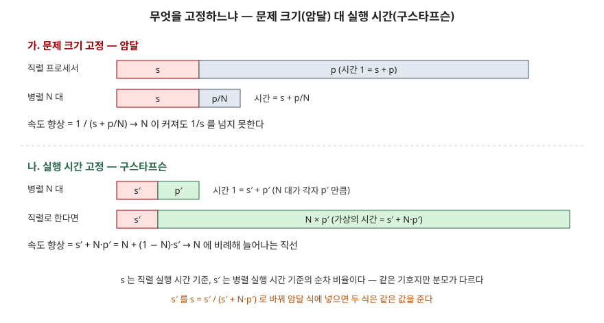

## 들어가며

코어를 두 배로 늘렸는데 처리 시간이 절반이 되지 않는 일은 흔하다. 병렬 처리 문제에서 이 차이를 설명하는 첫 도구가 **암달의 법칙**이고, 그 법칙이 지나치게 비관적이라는 반론이 **구스타프슨의 법칙**이다. 시험에서는 두 식을 쓰고 차이를 비교하라는 형태나, 순차 비율과 프로세서 수를 주고 속도 향상을 계산하라는 형태로 나온다. 이 글은 원 논문 두 편을 읽고, 논문에 나온 수치를 파이썬으로 다시 계산해 검산했다.

## 정의

**암달의 법칙**(Amdahl's law): 문제 크기를 고정했을 때, 순차로만 처리되는 부분의 비율 s 가 병렬 프로세서 N 대로 얻는 속도 향상의 상한을 정한다는 법칙이다.

$$\text{Speedup}_{\text{Amdahl}} = \frac{1}{s + \dfrac{p}{N}}, \quad s + p = 1, \quad \lim_{N\to\infty} = \frac{1}{s}$$

s 와 p 는 **직렬 프로세서**로 돌렸을 때 순차 부분과 병렬 가능 부분이 차지하는 시간이다. 이 식 모양은 구스타프슨 1988 논문이 "암달의 법칙"으로 정리해 적은 것이다. 1967 년 암달의 원 논문에는 식이 하나도 없고 그림 하나만 있다는 점을 재수록본 편집자 주가 밝힌다.

**구스타프슨의 법칙**(Gustafson's law, 확장 속도 향상 scaled speedup): 실행 시간을 고정하고 프로세서 수에 맞춰 문제 크기를 키울 때, 속도 향상이 N 에 비례해 직선으로 늘어난다는 법칙이다.

$$\text{Scaled speedup} = s' + p' \times N = N + (1 - N)\, s'$$

s′ 와 p′ 는 **병렬 시스템**에서 실제로 걸린 순차·병렬 시간이다(s′ + p′ = 1). 구스타프슨은 이 식을 같은 연구소의 E. Barsis 가 제안했다고 적는다.

> 실행 검증: 두 식은 계산 문제라 `code/` 에서 직접 계산해 논문 수치와 맞췄다(`executed`). 성능 수치는 모두 논문이 밝힌 값이거나 식으로 계산한 값이다.

## 등장 배경

1960 년대 중반에는 컴퓨터 여러 대를 엮어 협동시키는 방식이 단일 프로세서의 한계를 넘는 길이라는 주장이 많았다. 암달은 1967 년 AFIPS 발표에서 이에 반론을 냈다. 근거는 실제 작업의 통계였다. 생산 작업에서 **데이터 관리 부가 작업**(housekeeping)이 실행 명령의 40% 를 차지하고 이 비율이 10 년 가까이 거의 일정했으며, 그 성격이 순차적이라 병렬화가 어렵다는 것이다. 전용 환경에서 절반까지는 줄일 수 있어도 1/3 로 줄이기는 매우 어렵다고 보았고, 그래서 처리량의 상한을 순차 처리 속도의 5~7 배로 잡았다. 결론은 병렬 처리 속도를 높이는 노력은 순차 처리 속도도 비슷하게 높이지 않으면 낭비라는 것이었다.

20 년 뒤 샌디아 국립연구소의 구스타프슨은 1024 프로세서 하이퍼큐브에서 순차 비율 0.4~0.8% 인 응용 세 개로 1016~1021 배의 속도 향상을 얻었다. 암달의 식대로라면 N = 1024 에서 순차 비율 1% 만 있어도 91 배에 그친다. 구스타프슨은 이 차이의 원인을 식의 숨은 가정, 즉 **p 가 N 과 무관하다는 가정**에서 찾았다. 실제로는 더 큰 기계를 받으면 격자 해상도나 시간 단계 수를 늘려 문제를 키우고, 정해진 시간 안에 돌도록 맞춘다. 그래서 고정할 것은 문제 크기가 아니라 **실행 시간**이라고 주장했다.

## 구성요소 / 절차

### 두 법칙의 변수 3가지

| 변수 | 암달 | 구스타프슨 |
|---|---|---|
| 순차 비율 | s — 직렬 실행 시간 기준 | s′ — 병렬 실행 시간 기준 |
| 병렬 가능 비율 | p = 1 − s, N 과 무관 | p′ = 1 − s′, 직렬로 하면 N·p′ |
| 프로세서 수 | N | N |

### 속도 향상을 계산하는 절차 4단계

1. 무엇을 고정하는지 정한다 — 같은 문제를 빨리 끝내는가(크기 고정), 같은 시간에 더 큰 문제를 푸는가(시간 고정)
2. 순차 비율을 그 기준에 맞는 분모로 잰다 — 직렬 실행 시간 기준이면 s, 병렬 실행 시간 기준이면 s′
3. 해당 식에 넣는다 — 크기 고정이면 1/(s + p/N), 시간 고정이면 N + (1 − N)s′
4. 효율 E = 속도 향상 / N 을 함께 적는다 — 프로세서 한 대가 얼마나 일했는지를 보여 준다

## 도식



> **출처**: [Gustafson, Reevaluating Amdahl's Law, CACM 31(5) 1988, Figure 2a Fixed-Size Model · Figure 2b Scaled-Size Model](https://users.cs.utah.edu/~hari/teaching/paralg/Gustafson88.pdf)

답안지에는 막대 두 쌍만 그리면 된다. 위쪽은 직렬 막대(s + p)를 기준으로 병렬 막대가 줄어들고, 아래쪽은 병렬 막대(s′ + p′)를 기준으로 가상의 직렬 막대가 늘어난다. **어느 막대를 1 로 두느냐**가 두 법칙의 차이 전부다.

## 계산과 검산

전체 소스: [`code/`](code/) · 수행 기록: [`code/output.txt`](code/output.txt)

**① 암달 1967 의 숫자는 1/s 로 맞아떨어진다.** 논문에는 식이 없지만, 본문의 수치는 상한 1/s 와 같다.

```text
  논문 관찰값 40%     |  0.4000 |   2.50
  절반으로 줄이면       |  0.2000 |   5.00
  1/3 로 줄이면      |  0.1333 |   7.50
```

40% 그대로면 상한은 2.5 배다. 논문이 적은 "5~7 배"는 부가 작업을 절반에서 1/3 사이로 줄였을 때의 1/s 와 같은 범위다.

**② 구스타프슨 그림 1 재현.** N = 1024 에서 암달 식으로 계산한 속도 향상이다.

```text
  s      | 속도 향상 | 효율 S/N
   0.25% |     287.8 |    0.281
   0.50% |     167.5 |    0.164
   1.00% |      91.2 |    0.089
   2.00% |      47.7 |    0.047
   3.00% |      32.3 |    0.032
   4.00% |      24.4 |    0.024
```

그림 1 의 라벨 288x·167x·91x·63x·48x·24x 는 계산값을 반올림한 것과 같다. 3% 자리만 그림은 31x, 계산은 32.3 으로 1 정도 어긋났다. 순차 비율이 0.25% 만 돼도 효율이 28% 로 떨어진다. 논문이 "s = 0 근처에서 기울기가 약 −N²"이라고 적은 가파름이 이것이다.

**③ 같은 5% 로 두 법칙을 나란히 놓으면** 차이는 N 이 클수록 벌어진다.

```text
  N      | 암달(크기 고정) | 구스타프슨(시간 고정)
      16 |            9.14 |                 15.25
     256 |           18.62 |                243.25
   1,024 |           19.64 |                972.85
  N → ∞ 에서 암달의 극한 1/s = 20
```

**④ 샌디아 사례.** 논문이 밝힌 순차 비율 0.4~0.8% 를 구스타프슨 식에 넣으면 1015.8~1019.9 로, 측정값 1016~1021 과 같은 범위다. 같은 숫자를 암달 식의 s 로 넣으면 111.5~201.1 이 나온다.

**⑤ 두 법칙은 모순이 아니다.** 이 글을 쓰며 가장 확인하고 싶었던 자리다. s′ 는 병렬 실행 시간이 분모이고 s 는 직렬 실행 시간이 분모다. 구스타프슨의 그림 2b 대로 가상의 직렬 시간은 s′ + N·p′ 이므로 s = s′ / (s′ + N·p′) 로 바꿀 수 있다. 이 s 를 암달 식에 넣고 `Fraction` 으로 정확히 계산했다.

```text
  s'     | s = s'/(s'+p'N) | 암달(s)  | 구스타프슨(s')
    0.4% |       0.0000039 |  1019.91 |        1019.91 | 같은가 True
    5.0% |       0.0000514 |   972.85 |         972.85 | 같은가 True
```

병렬 시스템에서 5% 로 보인 순차 시간이 직렬 기준으로는 0.005% 남짓이다. 문제를 키우면 병렬 부분만 늘어나 직렬 기준 순차 비율이 줄어든다. 구스타프슨이 이긴 것은 식이 아니라 **가정**이고, 두 식은 같은 현상을 다른 분모로 잰 것이다.

## 비교

**암달 대 구스타프슨**

| 구분 | 암달의 법칙 | 구스타프슨의 법칙 |
|---|---|---|
| 고정하는 것 | 문제 크기 | 실행 시간 |
| 순차 비율의 분모 | 직렬 실행 시간 | 병렬 실행 시간 |
| 식 | 1 / (s + p/N) | N + (1 − N)s′ |
| N → ∞ | 1/s 로 수렴 | N 에 비례해 계속 증가 |
| 확장성 용어 | 강한 확장(strong scaling) | 약한 확장(weak scaling) |
| 맞는 질문 | 이 작업을 몇 배 빨리 끝내는가 | 같은 시간에 몇 배 큰 문제를 푸는가 |
| 원 근거 | 생산 작업의 부가 작업 40% (1967) | 1024 프로세서 측정 1016~1021 배 (1988) |

강한 확장·약한 확장 용어는 LLNL 병렬 컴퓨팅 입문서의 확장성 절이 쓰는 분류이고, 약한 확장에 구스타프슨을 붙여 적는다.

## 적용 시 고려사항

1. **질문이 무엇을 고정하는지 먼저 정한다.** 배치 작업을 빨리 끝내야 하면 문제 크기가 고정이므로 암달의 상한이 그대로 걸린다. 시뮬레이션 해상도처럼 키울 수 있는 문제라면 구스타프슨의 관점이 맞다. 같은 시스템이라도 업무 요구에 따라 맞는 법칙이 다르다.
2. **순차 비율을 어느 기준으로 쟀는지 밝힌다.** 병렬 실행 프로파일에서 잰 순차 비율(s′)을 암달 식에 그대로 넣으면 ④처럼 1019.9 가 201.1 로 바뀐다. 측정값을 인용할 때는 분모를 함께 적는다.
3. **순차 비율은 작아도 효율을 크게 깎는다.** N = 1024 에서 0.25% 만으로 효율이 28% 다. 코어 수를 늘리기 전에 락 구간, 초기화, 결과 취합 같은 순차 구간을 줄이는 편이 이득일 수 있다. 암달이 순차 처리 속도도 함께 올려야 한다고 결론 낸 이유다.
4. **두 법칙 모두 통신·동기화 비용을 따로 두지 않는다.** 두 식은 순차와 병렬 두 덩어리만 본다. 암달 논문도 문제의 불규칙성(경계, 비균질 내부, 전파 속도 차이)이 성능을 반에서 한 자릿수까지 깎는다고 따로 적었다. 실제 예측에는 이 비용을 순차 쪽에 넣거나 별도 항으로 더한다.

## 정리

- **정의 2개**: 암달 = 크기 고정, 상한 1/s · 구스타프슨 = 시간 고정, N 에 비례
- **식 2개**: 1/(s + p/N) · N + (1 − N)s′
- **변수 3개**: 순차 비율, 병렬 비율, 프로세서 수 — 순차 비율의 분모가 다르다
- **비교 7항목**: 고정 대상 · 분모 · 식 · 극한 · 확장성 용어 · 맞는 질문 · 원 근거
- 암기 단서: "**크기 고정은 1/s 에 막히고, 시간 고정은 N 을 따라간다 — 분모만 바꾸면 같은 식**"

> 관련 개념 글: [루프라인 모델](../2026-11-03-roofline-model/index.md) — 병렬 한계를 메모리 대역폭 쪽에서 본다

## 참고 자료

- [Amdahl, G. M., Validity of the Single Processor Approach to Achieving Large Scale Computing Capabilities, AFIPS Conference Proceedings vol. 30, 1967, pp. 483–485 (IEEE SSCS News Summer 2007 재수록본)](https://www3.cs.stonybrook.edu/~rezaul/Spring-2012/CSE613/reading/Amdahl-1967.pdf) — 부가 작업 40%, 상한 5~7 배, 편집자 주(식 없음)
- [Gustafson, J. L., Reevaluating Amdahl's Law, Communications of the ACM 31(5), 1988, pp. 532–533](https://users.cs.utah.edu/~hari/teaching/paralg/Gustafson88.pdf) — 암달 식 정리, 그림 1, 샌디아 1024 프로세서 결과, 확장 속도 향상 식, 그림 2a·2b
- [Lawrence Livermore National Laboratory, Introduction to Parallel Computing Tutorial — Potential Benefits, Limits and Costs of Parallel Programming](https://hpc.llnl.gov/documentation/tutorials/introduction-parallel-computing-tutorial#LimitsCosts) — 암달 식과 예시 표, 강한 확장·약한 확장
