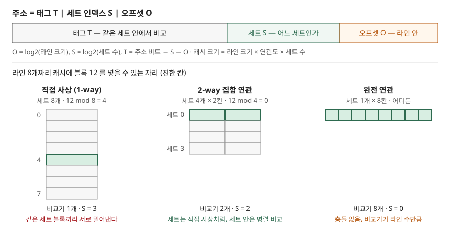

## 들어가며

캐시는 주기억장치보다 훨씬 작다. Drepper 는 워크스테이션의 캐시 크기가 주기억장치의 약 1/1000 이었다고 적는다. 그러니 메모리의 어느 블록을 캐시의 어느 자리에 둘지 정하는 규칙이 필요하고, 이 규칙이 **사상 방식**(mapping)이다. 시험에서는 "캐시 크기·라인 크기·연관도를 주고 태그·인덱스·오프셋 비트 수를 구하라", "접근열을 주고 적중률을 구하라"는 계산형으로 자주 나온다. 이 글은 비트 수를 직접 계산하고, 같은 접근열을 세 방식으로 시뮬레이션해 검산했다.

## 정의

**캐시 사상 방식**: 주기억장치의 블록이 캐시의 **어느 라인(또는 라인 집합)에 놓일 수 있는지를 정하는 규칙**으로, 주소를 **태그(T)·세트 인덱스(S)·오프셋(O)** 세 부분으로 나눠 구현한다.

Drepper 의 캐시 동작 절(§3.2)은 주소를 이 세 부분으로 나누는 그림을 싣고, 연관도 절(§3.3.1)은 세 비트 수의 관계를 이렇게 적는다.

```text
캐시 크기 = 라인 크기 × 연관도 × 세트 수
O = log2(라인 크기)
S = log2(세트 수)
T = 주소 비트 수 − S − O
```

**연관도**(associativity, way 수)는 한 세트 안의 라인 수, 곧 한 블록이 놓일 수 있는 후보 자리 수다. 연관도가 1 이면 직접 사상, 전체 라인 수와 같으면 완전 연관, 그 사이면 집합 연관이다.

## 등장 배경

블록을 아무 자리에나 둘 수 있으면 자리가 남는 한 서로 밀어낼 일이 없다. 대신 찾을 때 **모든 라인의 태그를 동시에 비교**해야 한다. Drepper 는 4MB·64B 라인 캐시라면 라인이 65,536개이고, 몇 사이클 안에 그만큼을 비교하는 회로는 구현 비용이 막대하다고 설명한다. 그래서 완전 연관은 TLB 처럼 항목이 수십 개 수준인 작은 캐시에만 쓴다.

반대 극단이 직접 사상이다. 주소 비트 일부로 자리를 하나로 정하므로 비교기가 1개면 된다. 빠르고 단순하지만, 프로그램의 주소가 인덱스 비트에 대해 고르게 퍼지지 않으면 일부 라인만 반복해서 교체되고 나머지는 비게 된다. Drepper 는 실제로는 이쪽이 흔하다고 적는다.

집합 연관은 둘을 섞는다. 세트는 직접 사상처럼 주소로 고르고, 세트 안의 몇 개 라인만 완전 연관처럼 병렬 비교한다. 비교기 수는 연관도만큼만 늘어나므로 캐시가 커져도 비교 회로가 함께 커지지 않는다.

## 구성요소 / 절차

### 주소의 3요소

| 요소 | 비트 수 | 역할 |
|---|---|---|
| 오프셋 O | log2(라인 크기) | 라인 안에서 몇 번째 바이트인가 |
| 세트 인덱스 S | log2(세트 수) | 어느 세트를 볼 것인가 |
| 태그 T | 나머지 상위 비트 | 세트 안의 라인이 찾는 블록인지 비교 |

### 조회 절차 4단계

1. 주소에서 S 비트로 세트를 고른다 (완전 연관은 S = 0 이라 세트가 하나뿐)
2. 그 세트의 라인들의 태그를 T 비트와 **병렬로** 비교한다
3. 일치하고 유효 비트가 켜져 있으면 적중 — O 비트로 라인 안의 데이터를 꺼낸다
4. 실패면 주기억장치에서 라인 전체를 가져오고, 세트가 차 있으면 교체 정책(대개 LRU)으로 한 라인을 내보낸다

### 실패의 3가지 원인 (3C)

| 분류 | 뜻 | 줄이는 방법 |
|---|---|---|
| 최초(compulsory) | 그 블록을 처음 쓸 때 | 프리페치, 큰 라인 |
| 용량(capacity) | 작업 집합이 캐시 전체보다 커서 | 캐시를 키운다 |
| 충돌(conflict) | 캐시에 자리가 있는데 같은 세트에 몰려서 | 연관도를 높이거나 배치를 바꾼다 |

Drepper 는 최초·용량 실패를 메모리 전송 절(§3.5.2)에서, 충돌 실패를 L1d 최적화 절(§6.2.1)에서 다룬다. 이 글의 코드는 "처음 보는 블록이면 최초, 같은 크기의 완전 연관 LRU 캐시도 놓쳤으면 용량, 그 밖은 충돌"로 셌다.

## 도식



> **출처**: [Drepper, What Every Programmer Should Know About Memory v1.0 — §3.2 Cache Operation at High Level(주소 분할 그림), §3.3.1 Associativity(Figure 3.5~3.7, 크기·비트 관계식)](https://www.akkadia.org/drepper/cpumemory.pdf)

답안지에는 주소 막대 하나(T|S|O)와 그 아래 세 방식의 라인 칸을 그리고, 블록 하나가 들어갈 수 있는 칸을 칠하면 된다. 칸 위치는 "블록 번호 mod 세트 수"로 정해진다.

## 계산과 검산

전체 소스: [`code/`](code/) · 수행 기록: [`code/output.txt`](code/output.txt)

**① 비트 분할.** 32비트 주소, 64B 라인 기준이다.

```text
  구성                         세트 수   O   S   T   태그 비교기
  4MB / 64B / 직접 사상            65536   6  16  10        1
  4MB / 64B / 8-way             8192   6  13  13        8
  4MB / 64B / 완전 연관                1   6   0  26    65536
  32KB / 64B / 8-way              64   6   6  20        8
```

손으로 풀면 4MB / 64B = 2^22 / 2^6 = 2^16 라인이다. 직접 사상은 세트도 2^16 이라 S = 16, T = 32 − 16 − 6 = 10 이다. 8-way 는 세트가 2^16 / 2^3 = 2^13 이라 S = 13, T = 13 이다. Drepper 가 같은 4MB·8-way 예에서 세트 8,192개, 인덱스 13비트로 적은 값과 일치한다. **연관도를 2배로 올릴 때마다 S 가 1 줄고 T 가 1 는다.**

주소 하나를 실제로 나눠 보면 0x12345678 은 32KB·64B·8-way 에서 오프셋 = 하위 6비트 0x38 = 56, 세트 = 그다음 6비트 = 25, 태그 = 나머지 상위 20비트 = 0x12345 다.

**② 접근열 하나를 세 방식으로.** 라인 4개짜리 캐시, 블록 번호 `0, 8, 0, 6, 8` 이다.

```text
  직접 사상  실패 5회 | 0->세트0:실패  8->세트0:실패  0->세트0:실패  6->세트2:실패  8->세트0:실패
  2-way  실패 4회 | 0->세트0:실패  8->세트0:실패  0->세트0:적중  6->세트0:실패  8->세트0:실패
  완전 연관  실패 3회 | 0->세트0:실패  8->세트0:실패  0->세트0:적중  6->세트0:실패  8->세트0:적중
```

직접 사상에서는 0 과 8 이 둘 다 `mod 4 = 0` 이라 같은 라인을 두고 서로 밀어낸다. 2-way 는 세트가 2개라 0·8·6 이 전부 세트 0 에 몰리고, 6 이 들어올 때 LRU 인 8 이 나간다. 3C 로 나누면 세 방식 모두 최초 실패 3회는 같고, **충돌 실패만 2 → 1 → 0 으로 줄었다.** 연관도가 줄이는 것은 충돌 실패뿐이라는 뜻이다.

**③ 연관도가 높은데 더 나쁜 경우.** Drepper §6.2.1 은 원소 간격이 4096 바이트의 배수이고 원소가 8개를 넘으면 L1d 접근 비용이 크게 뛰는 실험을 싣고, 그 CPU 의 L1d 를 32KB·8-way 로 추정한다. 같은 조건을 모형으로 돌렸다.

```text
  원소 수 | 직접 사상 | 8-way    | 완전 연관 | 8-way 3C
       8 |    99.0% |    99.0% |    99.0% | {'최초': 8, '용량': 0, '충돌': 0}
       9 |    77.0% |     0.0% |    99.0% | {'최초': 9, '용량': 0, '충돌': 891}
      16 |     0.0% |     0.0% |    99.0% | {'최초': 16, '용량': 0, '충돌': 1584}
  간격을 4096+64 로 바꾸고 16개, 8-way: 적중률 99.0%
```

8-way 는 세트가 64개라 S 비트가 주소 6~11번이다. 4096 = 2^12 간격이면 이 비트가 모두 같아 **원소 전부가 한 세트에 몰린다.** 9개를 순환하면 LRU 가 내보낸 원소가 바로 다음에 필요해져 매번 실패한다. 예상과 달랐던 것은 **직접 사상이 77% 로 더 나았다**는 점이다. 직접 사상은 라인 512개라 인덱스가 6~14번 비트이고, 4096 간격이어도 12~14번 비트가 바뀌어 8곳으로 흩어진다. 9개 중 0번과 8번만 부딪쳐 바퀴마다 2번 실패한다(손 계산: 실패 9 + 99×2 = 207, 적중 693/900 = 77%). 연관도의 이득은 같은 S 비트를 가진 블록 수가 연관도 이하일 때만 생긴다.

**④ 캐시 크기만큼 떨어진 두 배열.** 8바이트 원소 배열 a, b 를 `a[i], b[i]` 순으로 읽을 때다.

```text
  b 시작 = 32KB (캐시 크기)        | 직접  0.00% | 2-way 87.50% | 8-way 87.50%
  b 시작 = 32KB + 64B          | 직접 87.50% | 2-way 87.50% | 8-way 87.50%
```

직접 사상에서 a[i] 와 b[i] 는 같은 라인을 다퉈 매번 실패한다. 2-way 이상이면 두 라인이 한 세트에 공존해 64B 라인당 8회 중 첫 1회만 실패하므로 7/8 = 87.5% 다. 직접 사상이라도 b 를 64B 만 밀면 같은 87.5% 가 나왔다.

## 비교

| 구분 | 직접 사상 | 집합 연관 (n-way) | 완전 연관 |
|---|---|---|---|
| 블록이 놓일 자리 | 1곳 | 세트 안 n곳 | 아무 곳 |
| 세트 인덱스 S | log2(라인 수) | log2(라인 수 / n) | 0 |
| 태그 비교기 | 1개 | n개 | 라인 수만큼 |
| 교체 정책 | 필요 없음 (자리가 하나) | 세트 안에서 (대개 LRU) | 전체에서 |
| 충돌 실패 | 많다 | n 이 클수록 준다 | 없다 |
| Drepper 가 든 쓰임 | — | L1(8-way 수준), L2(24-way 이상까지) | 일부 TLB (수십 항목) |

## 적용 시 고려사항

1. **연관도를 올리는 이득은 빨리 줄어든다.** Drepper 의 gcc 시뮬레이션 표에서 8MB 캐시는 직접 사상에서 2-way 로 바꿀 때 실패가 약 44% 줄었지만, 그 이상은 이득이 훨씬 작았고, 단일 스레드에서는 8-way 를 넘기면 효과가 거의 없다고 적는다. 반면 비교기와 LRU 관리 비용은 연관도에 비례해 는다.
2. **공유 캐시는 연관도가 사실상 나뉜다.** 하이퍼스레드나 여러 코어가 한 캐시를 쓰면 두 프로그램이 같은 세트를 나눠 쓰므로, Drepper 는 체감 연관도가 절반(쿼드코어면 1/4)이 된다고 설명한다. 코어 수가 늘수록 공유 캐시의 연관도도 커져야 하는 이유다.
3. **2의 거듭제곱 간격 배치는 충돌을 부른다.** 위 ③·④처럼 4KB 페이지 경계나 캐시 크기 배수로 정렬된 데이터는 같은 세트에 몰린다. 행렬의 행 길이나 구조체 배열을 라인 크기만큼 덧대면(padding) 세트가 흩어진다.
4. **답안에 가정을 적는다.** 계산형 문제는 주소 비트 수, 바이트 단위 주소인지 워드 단위인지, 교체 정책(LRU·FIFO), 처음에 캐시가 비어 있는지에 따라 답이 달라진다. 문제에 없으면 가정을 먼저 밝히고 푼다.

## 정리

- **정의**: 블록이 놓일 캐시 위치를 정하는 규칙 — 주소를 T | S | O 로 나눈다
- **관계식 1개**: 캐시 크기 = 라인 크기 × 연관도 × 세트 수, O = log2(라인), S = log2(세트)
- **3가지 방식**: 직접(자리 1, 비교기 1) · 집합 연관(자리 n, 비교기 n) · 완전 연관(자리 전부, 비교기 전부)
- **3C**: 최초 · 용량 · 충돌 — 연관도가 줄이는 것은 충돌뿐
- 암기 단서: "**way 를 2배로 하면 S 는 1 빠지고 T 가 1 붙는다**"

> 관련 개념: [메모리 계층과 캐시 일관성 — MESI](../../system/2026-10-13-memory-hierarchy-cache-coherence-mesi/index.md) · [TLB와 유효 메모리 접근 시간](../../system/2026-11-07-tlb-effective-access-time/index.md)

## 참고 자료

- [Ulrich Drepper, What Every Programmer Should Know About Memory, Version 1.0 (2007-11-21)](https://www.akkadia.org/drepper/cpumemory.pdf) — §3.2 주소 분할, §3.3.1 연관도(Figure 3.5~3.8, Table 3.1), §3.3.5 교체 정책, §3.5.2 최초·용량 실패, §6.2.1 4096 바이트 간격의 충돌 실험(Figure 6.5). 2007년 문서라 연관도·캐시 크기 수치는 그 시점 하드웨어 기준이다
