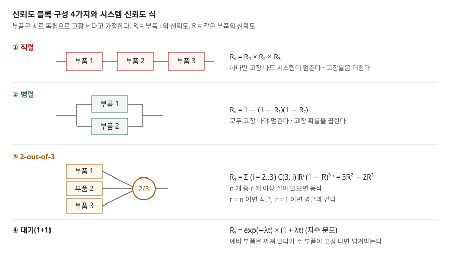

## 들어가며

"가용성 99.99% 를 보장하라"는 요구는 제안요청서와 SLA(서비스 수준 협약)에 빠지지 않는다. 그런데 이 숫자를 설계로 옮기려면 신뢰도와 가용도를 구분하고, 부품 수치를 시스템 수치로 합치는 식을 알아야 한다. 시험에서는 MTBF·MTTR 을 주고 가용도를 계산하게 하거나, 직렬·병렬 구성의 신뢰도를 구하게 하는 형태로 나온다. 이 글은 공식 정의를 정리하고, 식을 파이썬으로 계산한 뒤 난수 시뮬레이션으로 다시 맞춰 보았다.

## 정의

**신뢰도**(reliability): 아이템이 정해진 조건에서 정해진 시간 동안 요구 기능을 수행할 확률이다(ITU-T E.800 3.1.1.5.5). 시간의 함수 R(t) 로 쓴다.

**가용도**(availability): 아이템이 어느 한 순간, 또는 정해진 구간의 임의의 순간에 요구 기능을 수행할 수 있는 상태에 있는 정도다(ITU-T E.800 3.1.1.5.4). 수리할 수 있는 시스템에서 장시간 평균으로 보면 다음과 같다.

$$A = \frac{\text{MTBF}}{\text{MTBF} + \text{MTTR}}$$

E.800 은 MTBF 를 고장과 고장 사이 시간의 기댓값(3.3.16.3), MTTR 을 고장이 보고된 시점부터 서비스가 복구될 때까지 걸린 시간의 기댓값(3.3.11)으로 정의한다. 위 식은 E.800 에 식으로 적혀 있지 않다. 구글 SRE 책은 서비스 가용도를 **가동 시간의 비율**로 계산한다고 적는데, 가동 구간의 평균이 MTBF 이고 정지 구간의 평균이 MTTR 이면 그 비율이 위 식이 된다. 아래 ④에서 시뮬레이션으로 맞춰 보았다.

> 실행 검증: 신뢰도·가용도는 계산 문제라 `code/` 에서 직접 계산하고 고정 시드 시뮬레이션으로 검산했다(`executed`). 글의 수치는 전부 식으로 계산한 값이다.

## 등장 배경

부품 하나의 수명만 보던 시절에는 "얼마나 오래 버티는가"(신뢰도)로 충분했다. 그러나 정보시스템은 고장이 나도 **고쳐서 다시 쓴다.** 수리할 수 있는 시스템에서 사용자가 체감하는 것은 고장 횟수가 아니라 "지금 쓸 수 있는가"다. 고장이 잦아도 금방 복구되면 서비스는 거의 늘 쓸 수 있고, 고장이 드물어도 복구에 며칠이 걸리면 그렇지 않다. 그래서 고장 간격(MTBF)과 복구 시간(MTTR)을 함께 담는 가용도가 따로 필요해졌다.

또 하나는 **구성**이다. 시스템은 부품 여럿을 잇거나 겹쳐서 만든다. 부품 수치로 시스템 수치를 계산할 수 있어야 이중화에 돈을 쓸 곳을 정할 수 있다. NIST 핸드북은 이 계산을 부품 고장에서 시스템 고장률로 올라가는 "아래에서 위로"(bottom-up) 평가라 부르고 구성 모델을 정리했다.

## 구성요소 / 절차

### 신뢰성 지표 5가지

| 지표 | 뜻 | 지수 분포일 때 |
|---|---|---|
| R(t) 신뢰도 | 시간 t 까지 고장 없이 동작할 확률 | e^(−λt) |
| λ 고장률 | 살아 있는 아이템이 단위 시간에 고장 나는 비율 | 상수 λ |
| MTTF | 수리하지 않는 아이템의 고장까지 평균 시간 | 1/λ |
| MTBF | 수리하는 아이템의 고장 간 평균 시간 | 1/λ |
| MTTR | 고장 보고부터 복구까지 평균 시간 | — |

NIST 핸드북은 지수 분포의 평균을 MTTF = 1/λ 로 적고, 지수 분포가 고장률이 일정한 유일한 분포라고 밝힌다. MTTF·MTBF·MTTR 은 E.800 이 각각 별도 항목으로 정의한다.

### 구성 모델 4가지

NIST 핸드북 8.1.8 절이 다루는 모델이다. 모두 **부품이 서로 독립으로 고장 나고 수리하지 않는다**는 가정이다.

1. **직렬** — 하나라도 고장 나면 시스템이 멈춘다. 신뢰도는 곱하고 고장률은 더한다
2. **병렬(중복)** — 하나라도 살아 있으면 동작한다. 고장 확률을 곱한다
3. **r-out-of-n** — n 개 중 r 개 이상 살아 있으면 동작한다. r = n 이면 직렬, r = 1 이면 병렬이다
4. **대기(standby)** — 예비 부품이 꺼져 있다가 주 부품이 고장 나면 넘겨받는다

### 가용도를 계산하는 절차 4단계

1. 부품마다 MTBF·MTTR 로 A = MTBF/(MTBF + MTTR) 를 구한다
2. 신뢰도 블록 그림을 그려 직렬·병렬 관계를 정한다
3. 같은 식(직렬은 곱, 병렬은 1 − Π(1 − A))으로 합친다. 부품마다 수리가 독립이라는 가정이 붙는다
4. 1 − A 에 기간을 곱해 정지 시간으로 바꾼다

## 도식



> **출처**: [NIST/SEMATECH e-Handbook §8.1.8.2 Series model](https://www.itl.nist.gov/div898/handbook/apr/section1/apr182.htm) · [§8.1.8.3 Parallel or redundant model](https://www.itl.nist.gov/div898/handbook/apr/section1/apr183.htm) · [§8.1.8.4 R out of N model](https://www.itl.nist.gov/div898/handbook/apr/section1/apr184.htm) · [§8.1.8.5 Standby model](https://www.itl.nist.gov/div898/handbook/apr/section1/apr185.htm)

답안지에는 블록 세 줄(직렬 3개, 병렬 2개, 2/3 투표기)과 식만 옮기면 된다.

## 계산과 검산

전체 소스: [`code/`](code/) · 수행 기록: [`code/output.txt`](code/output.txt)

**① MTTF 시점에 살아 있는 비율은 절반이 아니다.** MTTF 10,000 시간인 부품이다.

```text
  t =  8,760 h   R(t) = exp(-t/MTTF) = 0.4164
  t = 10,000 h   R(t) = exp(-t/MTTF) = 0.3679
  중앙값(절반이 고장 나는 시각) = ln2 * MTTF = 6,931 h
```

평균 수명에 이르면 36.8% 만 남는다. 절반이 고장 나는 시각은 MTTF 의 69.3% 다. "MTTF 1만 시간이면 1년(8,760 시간)은 버틴다"고 읽으면 틀린다. 1년 뒤 살아 있을 확률은 41.6% 다.

**② 구성 모델 4가지.** 같은 부품(λ = 1/10,000 시간)으로 1년(8,760 시간) 임무를 계산하고, 부품 수명을 20만 번 뽑아 시뮬레이션했다.

```text
  구성          | 식으로 계산 | 시뮬레이션(200,000회)
  단일 부품       |      0.4164 | 0.4154
  직렬 3개       |      0.0722 | 0.0724
  병렬 2개       |      0.6595 | 0.6586
  병렬 3개       |      0.8013 | 0.8008
  2-out-of-3  |      0.3758 | 0.3742
  대기 1+1      |      0.7813 | 0.7812
```

식과 시뮬레이션이 소수 셋째 자리까지 맞는다. NIST 가 대기 모델 예로 든 "MTTF 30개월, 임무 24개월"도 다시 계산해 단일 0.45, 대기 0.81 로 같았다.

**이번 계산에서 가장 예상과 달랐던 자리는 2-out-of-3 이다.** 부품 셋 중 둘이 맞으면 통과시키는 다수결 구성인데, 1년 임무에서는 단일 부품(0.4164)보다 **낮았다**(0.3758). 임무 시간을 바꿔 보면 순서가 뒤집힌다.

```text
    t =    1,000 h  단일 0.9048  2oo3 0.9746  2oo3 가 높다
    t =    6,931 h  단일 0.5000  2oo3 0.5000  같다
    t =    8,760 h  단일 0.4164  2oo3 0.3758  단일이 높다
```

3R² − 2R³ = R 을 풀면 R = 0.5 에서 같아진다. R 이 0.5 아래로 내려가면 부품 둘이 동시에 살아 있을 확률이 빠르게 줄어, 둘을 요구하는 구성이 하나만 요구하는 단일 부품보다 불리해진다. 다수결 구성은 **짧은 임무**나 **고장 난 부품을 곧바로 바꾸는 운영**을 전제로 할 때 이득이다.

**③ 구성별 MTTF.** R(t) 를 0 부터 적분하면 평균 수명이 나온다.

```text
  구성          | 적분값      | 닫힌 식            | 닫힌 식 값
  단일 부품       |     10,000 | 1/λ                |     10,000
  직렬 3개       |      3,333 | 1/(3λ)             |      3,333
  병렬 2개       |     15,000 | 1/λ + 1/(2λ)       |     15,000
  2-out-of-3  |      8,333 | 1/(3λ) + 1/(2λ)    |      8,333
  대기 1+1      |     20,000 | 2/λ                |     20,000
```

부품을 하나 더 붙인 병렬 2개는 MTTF 가 1.5 배에 그치고, 같은 부품을 꺼 둔 대기는 2 배다. 병렬은 두 부품이 같이 늙고, 대기는 예비 부품이 꺼져 있는 동안 늙지 않는다고 가정하기 때문이다. 2-out-of-3 은 부품이 셋인데도 MTTF 가 단일보다 짧다.

**④ 가용도.** 고장까지 시간(평균 MTBF)과 수리 시간(평균 MTTR)을 번갈아 뽑아 1,000 년치를 시뮬레이션했다.

```text
   MTBF(h) | MTTR(h) | 식     A | 시뮬레이션 A | 고장 횟수
     1,000 |       1 | 0.999001 | 0.999004     | 8,706
     1,000 |      10 | 0.990099 | 0.990262     | 8,682
    10,000 |      10 | 0.999001 | 0.999039     | 867
     2,000 |       2 | 0.999001 | 0.998982     | 4,414
```

MTBF 와 MTTR 의 비율이 같으면 가용도가 같았다. 고장 횟수는 8,706 번과 867 번으로 10 배 차이가 나는데도 그렇다. 가용도 하나만으로는 사용자가 겪는 중단 **횟수**를 알 수 없다는 뜻이다. 가용도를 연간 정지 시간으로 바꾸면 99.99% 가 52.56 분이고, 이는 SRE 책이 든 예와 같다.

**⑤ 3계층 서비스.** 웹 0.999, WAS 0.999, DB 0.9995 를 직렬로 이었다.

```text
  각 1대 (직렬)                          A = 0.997502  정지   1312.9 분/년
  웹·WAS 2대씩, DB 1대                   A = 0.999498  정지    263.9 분/년
  웹·WAS·DB 모두 2대씩                    A = 0.999998  정지      1.2 분/년
```

웹·WAS 를 이중화해도 정지 시간이 263.9 분에서 더 줄지 않는 것은 DB 한 대가 0.9995(연 262.8 분)로 전체를 붙잡고 있기 때문이다. 직렬에서는 **가장 약한 고리**가 전체 가용도를 정한다. 이 계산은 부품마다 수리가 독립이고 장애 전환이 완벽하다고 가정한 값이다.

## 비교

**신뢰도 대 가용도**

| 구분 | 신뢰도 R(t) | 가용도 A |
|---|---|---|
| 묻는 것 | t 까지 한 번도 고장 나지 않을 확률 | 임의의 순간에 동작 중일 확률 |
| 수리 | 고려하지 않는다 | MTTR 로 반영한다 |
| 시간 | t 에 따라 줄어드는 함수 | 장시간 평균이면 상수 |
| 높이는 방법 | 고장률 낮추기, 중복 구성 | 고장률 낮추기 + 복구 시간 줄이기 |
| 대표 지표 | MTTF, MTBF | MTBF/(MTBF + MTTR), 연간 정지 시간 |

**구성 모델 4가지** (λ = 1/10,000 시간, 위 계산 기준)

| 구성 | 동작 조건 | 1년 신뢰도 | MTTF |
|---|---|---|---|
| 직렬 3개 | 3개 모두 | 0.0722 | 3,333 h |
| 병렬 2개 | 1개 이상 | 0.6595 | 15,000 h |
| 2-out-of-3 | 2개 이상 | 0.3758 | 8,333 h |
| 대기 1+1 | 주 또는 예비 | 0.7813 | 20,000 h |

## 적용 시 고려사항

1. **독립 고장 가정이 깨지면 병렬 식은 과대평가된다.** 같은 전원, 같은 랙, 같은 소프트웨어 버그를 공유하는 이중화는 함께 고장 난다. NIST 모델 전부가 독립 고장을 가정하므로, 공통 원인을 지우는 설계(전원·위치·버전 분산)가 식보다 먼저다.
2. **대기 구성의 이득은 전환이 성공한다는 가정 위에 있다.** 대기 1+1 의 MTTF 2 배는 전환 장치가 실패하지 않고 예비가 꺼져 있는 동안 늙지 않는다는 전제다. 실제 장애 전환은 감지 지연과 전환 실패가 있으므로, 전환 시험을 주기적으로 돌려 그 가정을 확인한다.
3. **가용도 목표는 MTTR 쪽에서도 채울 수 있다.** ④처럼 MTBF 를 10 배로 올리는 것과 MTTR 을 1/10 로 줄이는 것은 가용도가 같다. 부품 교체보다 감지·자동 복구·롤백을 빠르게 하는 편이 비용이 적은 경우가 많다. 다만 중단 횟수는 줄지 않으므로 SLA 에 횟수 조건이 있으면 따로 본다.
4. **직렬 구성에서는 가장 약한 계층부터 이중화한다.** ⑤에서 DB 하나가 남으면 나머지 이중화의 효과가 가려졌다. 요청 경로에 있는 DNS·로드 밸런서·인증 서버도 직렬 고리라는 점을 빠뜨리지 않는다.
5. **다수결(2-out-of-3)은 신뢰도를 높이는 구성이 아니라 틀린 출력을 걸러내는 구성이다.** 긴 임무에서는 ②처럼 신뢰도가 오히려 떨어진다. 고장 부품을 빨리 바꾸는 운영이 함께 있어야 한다.

## 정리

- **정의 2개**: 신뢰도 = 정해진 시간 동안 고장 없이 동작할 확률 · 가용도 = 임의의 순간에 동작 중일 확률
- **지표 5개**: R(t) · λ · MTTF · MTBF · MTTR — 지수 분포면 MTTF = 1/λ, R(MTTF) = 36.8%
- **구성 4가지**: 직렬(곱) · 병렬(1 − 고장 확률의 곱) · r-out-of-n(이항 합) · 대기(지수면 e^(−λt)(1 + λt))
- **가용도 식 1개**: MTBF / (MTBF + MTTR) — 비율이 같으면 같은 값, 횟수는 따로 본다
- 암기 단서: "**직곱병보, 다수결은 반 넘어야 이득, 사슬은 약한 고리가 정한다**"

> 기출 답안: [기출문제 — 가용성 보장: 결함 허용 시스템(FTS)과 고가용성(HA)의 구현 방법과 비교](../../exam/2026-11-03-fault-tolerant-system-vs-high-availability/index.md)
>
> 관련 개념 글: [결함 허용 기법의 분류](../2026-11-05-fault-tolerance-error-detection-recovery-taxonomy/index.md) — 중복 구성이 오류를 숨기고 복구하는 방법

## 참고 자료

- [ITU-T Recommendation E.800 (09/2008), Definitions of terms related to quality of service](https://www.itu.int/rec/T-REC-E.800-200809-I) — 3.1.1.5.4 Availability, 3.1.1.5.5 Reliability, 3.3.11 MTTR, 3.3.16.2 MTTF, 3.3.16.3 MTBF
- [NIST/SEMATECH e-Handbook of Statistical Methods §8.1.6.1 Exponential](https://www.itl.nist.gov/div898/handbook/apr/section1/apr161.htm) — R(t) = e^(−λt), MTTF = 1/λ, 고장률이 일정한 유일한 분포
- [NIST/SEMATECH e-Handbook §8.1.2.3 Failure (or hazard) rate](https://www.itl.nist.gov/div898/handbook/apr/section1/apr123.htm) — 고장률 정의
- [NIST/SEMATECH e-Handbook §8.1.8 Bottom-up reliability evaluation](https://www.itl.nist.gov/div898/handbook/apr/section1/apr18.htm) — 구성 모델 목록, 비수리 가정
- [NIST/SEMATECH e-Handbook §8.1.8.2 Series model](https://www.itl.nist.gov/div898/handbook/apr/section1/apr182.htm) · [§8.1.8.3 Parallel](https://www.itl.nist.gov/div898/handbook/apr/section1/apr183.htm) · [§8.1.8.4 R out of N](https://www.itl.nist.gov/div898/handbook/apr/section1/apr184.htm) · [§8.1.8.5 Standby](https://www.itl.nist.gov/div898/handbook/apr/section1/apr185.htm)
- [Google, Site Reliability Engineering, Chapter 3 Embracing Risk — Measuring Service Risk](https://sre.google/sre-book/embracing-risk/) — 시간 기반 가용도, 99.99% 와 연 52.56 분
