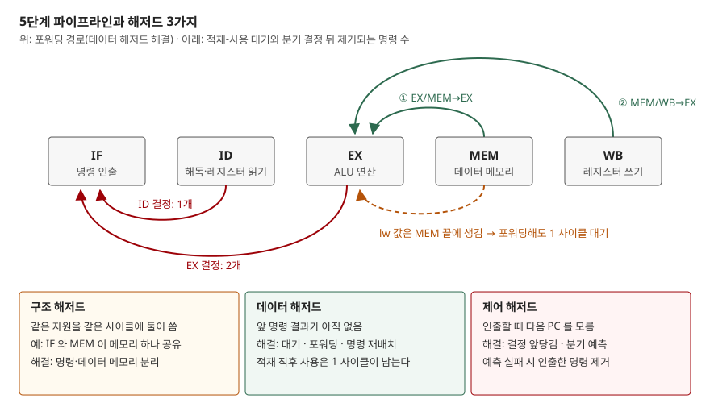

## 들어가며

파이프라인은 명령 하나를 여러 단계로 쪼개 겹쳐 실행해서 이상적으로는 한 사이클에 명령 하나를 끝낸다. 그런데 앞 명령의 결과를 뒤 명령이 바로 쓰거나, 분기 결과를 모른 채 다음 명령을 가져오면 그 이상이 깨진다. 시험에서는 해저드 3가지를 정의하고 해결책을 쓰게 하거나, 명령열을 주고 사이클 표를 그려 총 사이클을 묻는다. 이 글은 공개 강의 자료로 정의와 규칙을 확인하고, 그 규칙대로 사이클을 세는 계산기를 짜서 조건별 결과를 직접 냈다.

## 정의

**파이프라인 해저드**(pipeline hazard)는 겹쳐 실행되는 명령 사이의 의존 때문에, 다음 명령을 정해진 사이클에 진행시키면 실행 순서가 어긋나 틀린 결과가 나올 수 있는 상황이다. 구조·데이터·제어의 3가지로 나눈다.

Cornell CS3410 강의는 해저드를 "의존이 있고 명령 순서가 어긋날 가능성이 있는 것"으로 정의하고, 의존 자체는 나쁜 것이 아니며 해저드가 문제라고 구분한다(슬라이드 45). 의존은 프로그램의 성질이고 해저드는 그 의존을 파이프라인이 지키지 못할 수 있는 구현의 성질이라는 뜻이다.

> 실행 검증: 해저드의 사이클 수는 계산 문제라 `code/` 의 계산기로 직접 세었다(`executed`). 계산기의 규칙(값이 생기는 단계, 필요한 단계, 분기 결정 단계)은 아래 출처의 5단계 RISC-V 파이프라인을 따랐다.

## 등장 배경

단일 사이클 프로세서는 명령 하나가 끝나야 다음 명령을 시작하므로 앞뒤 명령의 순서가 저절로 지켜진다. 파이프라인은 명령을 IF(인출)·ID(해독·레지스터 읽기)·EX(연산)·MEM(메모리 접근)·WB(레지스터 쓰기) 5단계로 나눠 동시에 다섯 명령을 처리한다. MIT 6.004 강의는 이것으로 명령 처리량이 사이클당 1개가 된다고 적는다(L15 슬라이드 4).

문제는 겹쳐 실행하는 순간 "앞 명령이 먼저 끝난다"는 보장이 사라진다는 점이다. Cornell 강의는 레지스터 파일을 2단계(ID)에서 읽고 5단계(WB)에서 쓰므로, 뒤 명령이 아직 쓰이지 않은 값을 읽을 수 있다고 짚는다(슬라이드 47). 이를 감지하고 처리하는 하드웨어가 해저드 대책이다.

## 구성요소 / 절차

### 해저드 3가지

| 종류 | 원인 | 대표 예 | 해결 |
|---|---|---|---|
| 구조 | 같은 자원을 같은 사이클에 두 명령이 씀 | 명령 인출과 데이터 접근이 메모리 하나를 공유 | 자원 분리(명령·데이터 메모리) |
| 데이터 | 앞 명령의 결과가 아직 준비되지 않음 | `add x3,...` 직후 `sub x5,x3,...` | 대기·포워딩·명령 재배치 |
| 제어 | 인출할 때 다음 PC 를 모름 | 분기·점프 | 결정 앞당김·분기 예측 |

정의는 Cornell 강의 슬라이드 44 를 따랐다. MIT 강의는 데이터·제어 해저드 2가지를 먼저 다룬다(L15 슬라이드 6).

### 데이터 해저드 대응 3가지

Cornell 강의가 드는 대응은 세 가지다(슬라이드 53).

1. **아무것도 하지 않음** — ISA 를 구현에 맞추고 컴파일러가 해저드 있는 코드를 만들지 않게 한다
2. **스톨(stall)** — 뒤 명령을 ID 에 붙잡고, 그 자리에 아무 일도 하지 않는 명령(버블)을 흘려보낸다. PC 갱신과 IF/ID 레지스터 갱신을 막는다(슬라이드 54)
3. **포워딩(forwarding, 우회)** — 값이 레지스터에 쓰이기 전에 파이프라인 레지스터에서 바로 꺼내 쓴다. 이미 값이 만들어졌을 때만 된다

### 포워딩 경로 3가지

Cornell 강의는 포워딩을 세 갈래로 나눈다(슬라이드 64).

1. EX/MEM 레지스터 → EX — 바로 앞 명령의 ALU 결과
2. MEM/WB 레지스터 → EX — 두 명령 앞의 결과
3. 레지스터 파일 우회 — WB 에서 쓰는 값을 같은 사이클의 ID 가 읽는다(슬라이드 72)

### 사이클 계산 절차 4단계

계산기가 따르는 규칙이자, 답안에서 사이클 표를 그리는 순서다.

1. 명령마다 값이 **생기는 단계**를 정한다 — ALU 결과는 EX 끝, 적재(`lw`) 결과는 MEM 끝(슬라이드 75)
2. 값이 **필요한 단계**를 정한다 — 포워딩이 있으면 EX 시작, 없으면 ID 의 레지스터 읽기
3. 필요한 시점이 생기는 시점보다 앞이면 그 차이만큼 ID 에서 기다린다. 뒤 명령은 IF 에서 같이 기다린다
4. 분기는 결정 단계 끝까지 다음 PC 를 모른다. '안 감'으로 예측하고 틀리면 그 사이 인출한 명령을 지운다

## 도식



> **출처**: [Cornell CS3410 Spring 2019, Lecture 7 Pipelined RISC-V — 슬라이드 44 Hazards, 64 Forwarding, 75–79 Load-Use, 86–92 Control Hazards](https://www.cs.cornell.edu/courses/cs3410/2019sp/schedule/slides/07-pipeline-pre.pdf) · [MIT 6.004 Spring 2017, L15 Pipelining the Beta — 슬라이드 6](https://ocw.mit.edu/courses/6-004-computation-structures-spring-2017/pages/c15/c15s1/)

답안지에는 단계 상자 5개, 위로 포워딩 화살표 2개, 아래로 적재-사용 1개와 분기 결정 2개만 옮기면 된다.

## 계산과 검산

전체 소스: [`code/pipeline_sim.py`](code/pipeline_sim.py) · 수행 기록: [`code/output.txt`](code/output.txt)

표의 `id` 는 ID 에서 기다린 사이클, `if` 는 IF 에서 기다린 사이클이다. 분기 예측이 틀려 지워진 명령은 표에 없고 빈 사이클로 나타난다. 저장 명령(`sw`)의 저장할 값도 EX 시작에 필요하다고 단순화했다.

**① 해저드가 없으면 k + n − 1.** 단계 k = 5, 명령 n = 5 개다.

```text
                   1   2   3   4   5   6   7   8   9
add x1,x10,x11    IF  ID  EX  ME  WB                
add x2,x10,x11        IF  ID  EX  ME  WB            
add x3,x10,x11            IF  ID  EX  ME  WB        
add x4,x10,x11                IF  ID  EX  ME  WB    
add x5,x10,x11                    IF  ID  EX  ME  WB
    명령 5개 · 총 9 사이클 · 이상적 k+n-1 = 9 · 추가 0 사이클 (ID 대기 0) · CPI 1.00
```

첫 명령이 k 사이클 걸려 나오고, 그 뒤로 사이클마다 하나씩 나온다. 그래서 k + (n − 1) 이다. CPI 는 시작 비용 k − 1 을 뺀 (총 사이클 − k + 1) / n 으로 셌다.

**② ALU 결과를 바로 쓰는 경우 — 조건별 대기 사이클.**

```text
--- add → sub → or [포워딩·RF 우회 없음]
                 1   2   3   4   5   6   7   8   9  10  11  12  13
add x3,x1,x2    IF  ID  EX  ME  WB                                
sub x5,x3,x4        IF  ID  id  id  id  EX  ME  WB                
or x6,x3,x5             IF  if  if  if  ID  id  id  id  EX  ME  WB
    명령 3개 · 총 13 사이클 · 이상적 k+n-1 = 7 · 추가 6 사이클 (ID 대기 6) · CPI 3.00

--- add → sub → or [포워딩 없음, RF 우회 있음]
                 1   2   3   4   5   6   7   8   9  10  11
add x3,x1,x2    IF  ID  EX  ME  WB                        
sub x5,x3,x4        IF  ID  id  id  EX  ME  WB            
or x6,x3,x5             IF  if  if  ID  id  id  EX  ME  WB
    명령 3개 · 총 11 사이클 · 이상적 k+n-1 = 7 · 추가 4 사이클 (ID 대기 4) · CPI 2.33

--- add → sub → or [포워딩 있음]
                 1   2   3   4   5   6   7
add x3,x1,x2    IF  ID  EX  ME  WB        
sub x5,x3,x4        IF  ID  EX  ME  WB    
or x6,x3,x5             IF  ID  EX  ME  WB
    명령 3개 · 총 7 사이클 · 이상적 k+n-1 = 7 · 추가 0 사이클 (ID 대기 0) · CPI 1.00
```

의존하는 명령 하나당 대기가 3 → 2 → 0 사이클로 줄었다. 레지스터 파일 우회 하나로 1 사이클, EX/MEM → EX 포워딩으로 나머지 2 사이클이 사라진다.

**③ 적재-사용 해저드 — 포워딩으로도 1 사이클이 남는다.**

```text
--- lw → 바로 사용 [포워딩 있음]
                 1   2   3   4   5   6   7   8
lw x4,20(x8)    IF  ID  EX  ME  WB            
or x6,x4,x1         IF  ID  id  EX  ME  WB    
add x7,x2,x3            IF  if  ID  EX  ME  WB
    명령 3개 · 총 8 사이클 · 이상적 k+n-1 = 7 · 추가 1 사이클 (ID 대기 1) · CPI 1.33

--- lw → 독립 → 사용 [포워딩 있음]
                 1   2   3   4   5   6   7
lw x4,20(x8)    IF  ID  EX  ME  WB        
add x7,x2,x3        IF  ID  EX  ME  WB    
or x6,x4,x1             IF  ID  EX  ME  WB
    명령 3개 · 총 7 사이클 · 이상적 k+n-1 = 7 · 추가 0 사이클 (ID 대기 0) · CPI 1.00
```

적재 값은 MEM 끝에야 생기는데 바로 다음 명령은 그 사이클에 EX 를 시작하려 한다. 아직 없는 값은 포워딩할 수 없으므로 1 사이클을 기다린다. Cornell 강의도 메모리에서 나오는 값은 포워딩으로 풀 수 없어 대기를 넣어야 한다고 적는다(슬라이드 79). 독립 명령 하나를 사이에 끼우면 대기가 0 이 됐다.

**④ 제어 해저드 — 분기 결정 위치.** 비교할 `x5` 를 두 명령 앞에서 만든 경우다.

| 조건 | 분기 안 감 | 분기 감 |
|---|---|---|
| EX 에서 결정 | 8 사이클 (추가 0) | 10 사이클 (추가 2) |
| ID 에서 결정 | 8 사이클 (추가 0) | 9 사이클 (추가 1) |

'안 감'으로 예측하므로 분기가 가지 않으면 손실이 없다. 가면 EX 결정은 2개, ID 결정은 1개를 지운다. Cornell 강의가 적은 "2 nops to 1 nop" 과 같다(슬라이드 92).

**이번 계산에서 가장 예상과 달랐던 자리다.** 비교 값을 **바로 앞 명령**이 만들면 ID 결정의 이득이 사라졌다.

```text
--- add → beq(감) [분기 결정 EX]
                      1   2   3   4   5   6   7   8   9
add x5,x6,x7         IF  ID  EX  ME  WB                
beq x5,x0 (taken)        IF  ID  EX  ME  WB            
add x2,x2,x9                         IF  ID  EX  ME  WB
    명령 3개 · 총 9 사이클 · 이상적 k+n-1 = 7 · 추가 2 사이클 (ID 대기 0) · CPI 1.67

--- add → beq(감) [분기 결정 ID]
                      1   2   3   4   5   6   7   8   9
add x5,x6,x7         IF  ID  EX  ME  WB                
beq x5,x0 (taken)        IF  ID  id  EX  ME  WB        
add x2,x2,x9                         IF  ID  EX  ME  WB
    명령 3개 · 총 9 사이클 · 이상적 k+n-1 = 7 · 추가 2 사이클 (ID 대기 1) · CPI 1.67
```

ID 에서 비교하려면 값이 ID 안에 있어야 하는데, `add` 의 결과는 EX 끝에 생긴다. 계산기는 분기가 ID 에서 1 사이클 기다리게 했고, 지우는 명령 1개와 합쳐 결국 EX 결정과 같은 2 사이클이 됐다. 결정 단계를 앞당기면 **값이 필요한 시점도 함께 앞당겨진다.** 이 1 사이클 대기는 강의 자료에 적힌 수가 아니라 위 절차 1~3 을 그대로 적용해 계산기가 낸 값이다.

**⑤ 구조 해저드 — 메모리를 하나로 쓰면.**

```text
--- lw 와 sw 가 섞인 6개 [포워딩 있음, 메모리 1개]
                   1   2   3   4   5   6   7   8   9  10  11
lw x1,0(x10)      IF  ID  EX  ME  WB                        
add x2,x11,x12        IF  ID  EX  ME  WB                    
add x3,x11,x13            IF  ID  EX  ME  WB                
add x4,x11,x14                    IF  ID  EX  ME  WB        
sw x2,8(x10)                          IF  ID  EX  ME  WB    
add x5,x11,x15                            IF  ID  EX  ME  WB
    명령 6개 · 총 11 사이클 · 이상적 k+n-1 = 10 · 추가 1 사이클 (ID 대기 0) · CPI 1.17
```

4 사이클에 `lw` 가 MEM 에서 메모리를 쓰고 있어 네 번째 명령의 인출이 5 사이클로 밀렸다. 메모리를 명령용과 데이터용으로 나누면 같은 명령열이 10 사이클로 끝났다. Cornell 강의의 데이터 경로 그림도 메모리를 인출용과 데이터용 둘로 그린다(슬라이드 20).

**⑥ 반복문 100회.** 본문은 `lw → add(적재 값 사용) → sw → addi x10 → addi x9 → beq x9` 6개이고 마지막 회차만 분기가 가지 않는다.

| 조건 | 총 사이클 | CPI |
|---|---|---|
| 포워딩·RF 우회 없음 | 1,702 | 2.83 |
| 포워딩 없음, RF 우회 있음 | 1,402 | 2.33 |
| 포워딩 있음, 분기 EX 결정 | 902 | 1.50 |
| 포워딩 있음, 분기 ID 결정 | 903 | 1.50 |
| 재배치 + 분기 EX 결정 | 802 | 1.33 |
| 재배치 + 분기 ID 결정 | 703 | 1.17 |

재배치는 `addi x9` 를 `lw` 바로 뒤로 올린 것이다. 적재-사용 대기 1 사이클이 사라지고, 분기와 `addi x9` 사이가 벌어져 ID 결정의 이득이 살아났다. 하드웨어를 바꾸지 않은 재배치가 902 → 802, 하드웨어 변경(ID 결정)과 합치면 703 이다. 재배치 없이 ID 결정만 하면 오히려 1 사이클 늘었다(마지막 회차의 분기는 지울 명령이 없는데 대기는 남는다).

## 비교

**해저드 해결 기법 비교**

| 기법 | 대상 | 하드웨어 비용 | 남는 손실 |
|---|---|---|---|
| 스톨 | 데이터·구조·제어 전부 | 감지 회로만 | 의존마다 최대 2~3 사이클 |
| 포워딩 | 데이터 | 우회 경로·선택기 | 적재-사용 1 사이클 |
| 명령 재배치 | 데이터·제어 | 없음(컴파일러) | 독립 명령이 없으면 못 함 |
| 자원 분리 | 구조 | 메모리·포트 추가 | 없음 |
| 분기 결정 앞당김 | 제어 | ID 에 비교기·포워딩 | 비교 값 대기가 새로 생김 |
| 분기 예측 | 제어 | 예측기 | 예측 실패 시 지운 명령 수 |

**데이터 해저드 대 제어 해저드**

| 구분 | 데이터 해저드 | 제어 해저드 |
|---|---|---|
| 무엇을 모르나 | 피연산자 값 | 다음에 인출할 PC |
| 감지 위치 | ID (레지스터 번호 비교) | 분기 결정 단계 |
| 손실이 나는 곳 | ID 대기 | 지운 명령 |
| 소프트웨어 대응 | 명령 재배치 | 분기 지연 슬롯, 재배치 |

## 적용 시 고려사항

1. **해저드 손실은 외울 숫자가 아니라 단계 위치에서 나온다.** 같은 "의존 직후 명령"이라도 우회 유무에 따라 3·2·0 사이클로 갈렸다. 문항이 주는 가정(레지스터 파일 쓰기·읽기 시점, 포워딩 경로, 분기 결정 단계)을 먼저 표에 적고 계산한다.
2. **하드웨어 대책은 다른 곳에 비용을 옮긴다.** 분기를 ID 로 앞당기면 ID 에 비교기와 포워딩 경로가 더 필요하고, ④처럼 비교 값을 기다리는 대기가 새로 생긴다. 단계마다 일을 더 넣으면 그 단계가 길어져 클럭 주기가 늘 수 있다. Cornell 강의도 균형 잡힌 파이프라인이 중요하고 가장 느린 단계가 클럭을 정한다고 적는다(슬라이드 15).
3. **컴파일러 명령 재배치가 하드웨어만큼 효과가 있다.** ⑥에서 재배치만으로 100 사이클을 줄였다. 다만 독립 명령이 있어야 하므로, 반복문 펼치기처럼 독립 명령을 늘리는 최적화와 함께 쓴다.
4. **분기 예측은 맞는 비율이 손실을 정한다.** '안 감' 예측은 반복문 뒤로 가는 분기를 매번 틀린다. ⑥의 분기 손실 198 사이클(99회 × 2)이 전부 그것이다. Cornell 강의도 쓸 만한 프로세서는 모두 분기 예측을 한다고 적는다(슬라이드 88).
5. **파이프라인이 깊어지면 같은 해저드의 손실이 커진다.** 값이 생기는 단계와 필요한 단계 사이가 멀어지기 때문이다. 단계 수를 늘려 클럭을 올리는 설계는 해저드 대책과 함께 평가한다.

## 정리

- **정의**: 겹쳐 실행되는 명령 사이의 의존 때문에 정해진 사이클에 진행하면 결과가 틀릴 수 있는 상황
- **3가지**: 구조(자원 충돌) · 데이터(값 미준비) · 제어(다음 PC 모름)
- **데이터 대응 3가지**: 아무것도 안 함(컴파일러) · 스톨 · 포워딩 — 포워딩 경로 3갈래(EX/MEM→EX, MEM/WB→EX, RF 우회)
- **외울 수 3개**: 이상 사이클 k + n − 1 · 적재-사용 1 사이클 · 분기 EX 결정 2개, ID 결정 1개
- 암기 단서: "**구데제, 스포재, 적재는 하나 남고 분기는 둘에서 하나**"

## 참고 자료

- [Cornell CS3410 Spring 2019, Lecture 7 Pipelined RISC-V (슬라이드 PDF)](https://www.cs.cornell.edu/courses/cs3410/2019sp/schedule/slides/07-pipeline-pre.pdf) — 15 균형, 20 데이터 경로, 44–45 해저드 정의, 47 레지스터 읽기·쓰기 단계, 53–54 대응과 스톨, 64–72 포워딩, 75–79 적재-사용, 86–92 제어 해저드
- [Cornell CS3410 Spring 2019 강의 일정](https://www.cs.cornell.edu/courses/cs3410/2019sp/schedule/) — 위 슬라이드의 강의 목록
- [MIT 6.004 Computation Structures, Spring 2017 — L15 Pipelining the Beta, Annotated Slides](https://ocw.mit.edu/courses/6-004-computation-structures-spring-2017/pages/c15/c15s1/) — 슬라이드 4 처리량, 6 데이터·제어 해저드
