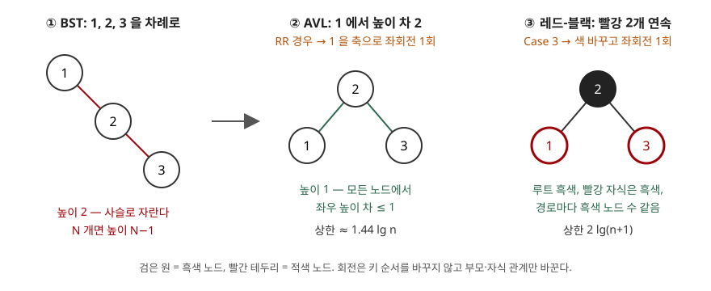

## 들어가며

이진 탐색 트리(BST)는 탐색·삽입·삭제가 트리 높이에 비례하므로, 키가 정렬된 채 들어오면 높이가 N−1인 사슬이 되어 순차 탐색으로 떨어진다. 자동 증가 번호나 타임스탬프처럼 정렬된 키는 실무에서 흔하다. 시험에서는 이 약점을 짚은 뒤 AVL 트리와 레드-블랙 트리의 균형 조건·높이 상한·회전을 비교하게 한다. 이 글은 공개 강의 자료로 정의와 상한을 확인하고, 두 트리를 직접 구현해 같은 키를 넣었을 때의 높이와 회전 횟수를 쟀다.

> 실행 검증: 높이·회전 횟수·최소 노드 수는 `code/` 의 구현으로 직접 계산했다(`executed`). AVL 은 MIT 6.006 노트의 정의를, 레드-블랙은 Stanford CS161 슬라이드의 RB-Insert-Fixup 의사코드를 그대로 옮겼다.

## 정의

**균형 이진 탐색 트리**(balanced binary search tree)는 삽입·삭제 뒤에 회전으로 구조를 고쳐 높이를 항상 O(log n)으로 유지하는 이진 탐색 트리다. MIT 6.006 노트는 균형 BST를 "h = O(lg n)을 유지해 모든 연산이 O(lg n)"인 트리로 정리한다.

- **AVL 트리**: 모든 노드에서 왼쪽·오른쪽 서브트리의 높이 차가 1 이하인 이진 탐색 트리다. NIST 알고리즘 사전의 정의이고, 이름은 1962년 논문을 쓴 Adelson-Velskii와 Landis에서 왔다.
- **레드-블랙 트리**: 노드마다 색 1비트를 더 두고 색 규칙 5가지를 지켜, 루트에서 잎까지의 어떤 경로도 다른 경로의 2배를 넘지 않게 하는 이진 탐색 트리다. NIST 사전은 "노드당 1비트를 더 써서 균형을 유지하는 거의 균형 잡힌 트리"로 정의하고, 원형은 Bayer(1972)의 대칭 이진 B-트리, 색 이름은 Guibas·Sedgewick(1978)이 붙였다고 적는다.

## 등장 배경

BST의 연산 비용은 O(h)이고 h는 lg n에서 n 사이에 놓인다(MIT 노트 2쪽). 무작위 순서로 넣으면 기대 높이가 O(lg n)이지만, Stanford 슬라이드가 짚듯 최악은 n−1이다. 입력 순서를 통제할 수 없으므로 **삽입·삭제가 끝날 때마다 높이를 되돌려 놓는 장치**가 필요했다. 그 장치가 회전이다. 회전은 포인터 몇 개만 바꾸는 O(1) 연산이고 이진 탐색 트리의 키 순서를 깨지 않는다(Stanford 슬라이드 34·36쪽). 두 트리의 차이는 **언제 회전하는가를 정하는 규칙**에 있다.

## 구성요소 / 절차

### 공통 연산 — 회전 2가지

| 회전 | 동작 |
|---|---|
| 좌회전 Left-Rotate(x) | x 의 오른쪽 자식 y 가 x 자리로 올라가고, y 의 왼쪽 서브트리가 x 의 오른쪽으로 간다 |
| 우회전 Right-Rotate(y) | 좌회전의 대칭. 두 회전은 서로의 역연산이다 |

### AVL — 불균형 4가지 경우

삽입 뒤 위로 올라가며 높이를 갱신하다가, 높이 차가 2가 된 가장 낮은 노드 x 에서 고친다(MIT 노트 4쪽).

| 경우 | 불균형 위치 | 처리 | 회전 수 |
|---|---|---|---|
| LL | 왼쪽 자식의 왼쪽 | x 를 우회전 | 1 |
| RR | 오른쪽 자식의 오른쪽 | x 를 좌회전 | 1 |
| LR | 왼쪽 자식의 오른쪽 | 왼쪽 자식을 좌회전 후 x 를 우회전 | 2 |
| RL | 오른쪽 자식의 왼쪽 | 오른쪽 자식을 우회전 후 x 를 좌회전 | 2 |

### 레드-블랙 — 색 규칙 5가지

Stanford 슬라이드 23쪽의 목록이다.

1. 모든 노드는 빨강 또는 검정이다
2. 루트는 검정이다
3. 모든 잎(NIL)은 검정이다
4. 빨간 노드의 두 자식은 검정이다 — 경로에 빨강이 연속하지 않는다
5. 각 노드에서 그 자손 잎까지의 모든 경로는 같은 수의 검은 노드를 지난다

새 노드는 빨강으로 넣고, 성질 4가 깨지면 RB-Insert-Fixup 이 **3가지 경우**로 고친다(슬라이드 42·47·48쪽). Case 1 은 삼촌이 빨강일 때 색만 바꾸고 두 단계 위로 올라간다. Case 2 는 안쪽 자식일 때 한 번 돌려 Case 3 으로 만든다. Case 3 은 색을 바꾸고 조부모를 한 번 돌린 뒤 끝난다. 그래서 삽입 한 번의 회전은 **최대 2회**다(슬라이드 51쪽).

## 도식



> **출처**: [MIT 6.006 Fall 2011, Lecture 6 Balanced Binary Search Trees — 3쪽 AVL 정의, 4쪽 Insert, Fig. 5·6](https://ocw.mit.edu/courses/6-006-introduction-to-algorithms-fall-2011/resources/mit6_006f11_lec06/) · [Stanford CS161 Winter 2018, Red-Black Trees 슬라이드 23 Properties, 33–36 Rotations, 47–48 RB-Insert-Fixup](https://graphics.stanford.edu/courses/cs161-18-winter/LectureSlides/18cs161-02-12_v2.pdf)

답안지에는 사슬 하나, 회전 화살표 하나, 회전 뒤 트리 두 개만 옮기면 된다. 같은 입력에서 AVL 은 높이 차로, 레드-블랙은 연속된 빨강으로 문제를 알아채지만 고치는 동작은 같은 좌회전이다.

## 계산과 검산

전체 소스: [`code/balanced_bst.py`](code/balanced_bst.py) · 수행 기록: [`code/output.txt`](code/output.txt)

**① AVL 높이 상한은 피보나치에서 나온다.** 높이 h 인 AVL 트리의 최소 노드 수는 루트 하나에 높이 h−1, h−2 인 최소 트리를 붙인 것이다. MIT 노트가 이 점화식에서 h ≈ log_φ n ≈ 1.440 lg n 을 끌어낸다(3쪽).

```text
 h  N(h)  F(h+3)-1  같은가
 0     1         1  True
 5    20        20  True
10   232       232  True
```

h = 0~10 전부에서 N(h) = F(h+3) − 1 이었다(F 는 F(1)=F(2)=1 인 피보나치 수). 노드가 피보나치 수처럼 φ ≈ 1.618 배씩 늘어나므로 높이는 log_φ n 이다. 레드-블랙의 2 lg(n+1)은 다른 길로 나온다. 성질 4 때문에 경로의 절반 이상이 검정이고, 성질 5 때문에 검은 높이 b 인 트리는 노드가 2^b − 1 개 이상이다(슬라이드 31쪽).

**② 정렬된 키 1~7 을 넣는 과정.** 괄호 표기는 `키(왼쪽,오른쪽)`, 레드-블랙의 B·R 은 색이다.

```text
키  AVL 보정        AVL 모양                          RB 보정(경우)  RB 모양
 3  RR@1          2(1,3)                            3              2B(1R,3R)
 4  -             2(1,3(.,4))                       1              2B(1B,3B(.,4R))
 5  RR@3          2(1,4(3,5))                       3              2B(1B,4B(3R,5R))
 6  RR@2          4(2(1,3),5(.,6))                  1              2B(1B,4R(3B,5B(.,6R)))
 7  RR@5          4(2(1,3),6(5,7))                  3              2B(1B,4R(3B,6B(5R,7R)))
누적 회전: AVL 4회, RB 3회
높이: AVL 2, RB 3 (BST 였다면 6)
```

AVL 은 일곱 개로 완전 이진 트리(높이 2)를 만들었고, 레드-블랙은 한 단계 높은 3에서 멈췄다. 키 4·6 에서 레드-블랙은 **회전 없이 색만 바꿨다**(Case 1). AVL 은 같은 자리에서 6 을 넣을 때 루트까지 바꾸는 회전을 했다.

**③ 큰 입력에서 높이와 회전.**

```text
입력     N        BST     AVL   RB   1.44 lg N  2 lg(N+1)  회전/삽입 AVL  RB    삽입당 최대 회전 AVL RB
정렬     1,000      999     9   16      14.35      19.93          0.990 0.983                    1  1
정렬   100,000       생략    16   30      23.92      33.22          1.000 1.000                    1  1
무작위    1,000       23    11   12      14.35      19.93          0.688 0.557                    2  2
무작위  100,000       40    19   19      23.92      33.22          0.699 0.585                    2  2
```

정렬 입력 10만 개의 BST 는 삽입마다 끝까지 내려가 O(N²)이 들어 돌리지 않았다. 높이는 정의상 99,999 다. 네 경우 모두 두 트리가 상한 안에 있었고, 모든 노드에서 AVL 조건과 레드-블랙 성질 2·4·5 를 검사해 통과했다.

**가장 눈에 띈 것은 정렬 입력이다.** AVL 은 1,000개에서 높이 9 로 완전 균형(⌈lg 1001⌉ − 1 = 9)에 도달했지만, 레드-블랙은 16 으로 상한 19.93 에 가까웠다. 정렬된 키는 늘 오른쪽 끝에 붙어 오른쪽 경로만 길어진다. 레드-블랙의 규칙은 경로 길이 차를 2배까지 허용하므로 그 범위 안에서는 회전하지 않고 색만 바꾸며, 그 결과 높이가 AVL 보다 크게 남는다. 무작위 입력에서는 둘의 높이가 거의 같았고, 회전은 레드-블랙이 삽입당 0.585회로 AVL 의 0.699회보다 적었다. 삽입당 최대 회전은 둘 다 2회였다(AVL 의 LR·RL, 레드-블랙의 Case 2→3).

## 비교

**AVL 대 레드-블랙**

| 구분 | AVL 트리 | 레드-블랙 트리 |
|---|---|---|
| 균형 조건 | 노드마다 높이 차 ≤ 1 | 색 규칙 5가지 |
| 노드당 추가 정보 | 높이(또는 높이 차) | 색 1비트 |
| 높이 상한 | ≈ 1.44 lg n | 2 lg(n+1) |
| 균형 정도 | 더 엄격. NIST: "AVL 트리는 최소한 레드-블랙만큼 균형 잡혀 있다" | 느슨함. 정렬 입력에서 높이 16(측정) |
| 삽입 보정 | 4가지 경우, 회전 최대 2회 | 3가지 경우, 회전 최대 2회, 나머지는 색 바꾸기 |
| 유리한 작업 | 탐색이 많은 경우 | 삽입·삭제가 섞인 경우 |
| 쓰이는 곳 | 조회 위주 메모리 색인 | Java `TreeMap` 등 표준 라이브러리 정렬 맵 |

**균형 BST 대 B-트리**

| 구분 | AVL·레드-블랙 | B-트리 |
|---|---|---|
| 노드당 키 | 1개 | 여러 개(디스크 블록 크기) |
| 높이를 낮추는 방법 | 회전 | 노드 분할·병합 |
| 맞는 저장 매체 | 메모리 | 디스크·SSD |

레드-블랙은 2-3(또는 2-3-4) 트리를 이진 트리로 옮긴 것이라 B-트리와 뿌리가 같다. Sedgewick 교재는 3-노드를 "왼쪽으로 기운 빨간 링크로 이은 2-노드 두 개"로 표현해 이 대응을 보인다.

## 적용 시 고려사항

1. **조회 비율로 고른다.** AVL 은 높이가 낮아 탐색 경로가 짧고, 레드-블랙은 색 바꾸기로 끝나는 삽입이 많아 회전이 적다. 위 측정에서 무작위 입력의 높이는 같았고 회전은 레드-블랙이 약 16% 적었다. 쓰기와 읽기의 비율을 먼저 본다.
2. **정렬된 키가 들어오면 레드-블랙의 높이가 상한 쪽으로 간다.** 정렬 1,000개에서 AVL 9, 레드-블랙 16 이었다. 둘 다 O(log n)이지만 상수는 다르다. 자동 증가 키를 메모리 트리에 쌓는 구조라면 이 차이를 고려한다.
3. **노드당 추가 정보와 갱신 범위가 다르다.** AVL 은 높이를 저장하고 삽입 경로 전체에서 갱신한다. 레드-블랙은 1비트로 충분하다. 노드 수가 많은 메모리 색인에서는 이 차이가 메모리 사용량으로 나타난다.
4. **디스크 색인에는 쓰지 않는다.** 노드 하나가 블록 하나면 비교 한 번마다 I/O 가 한 번이다. 그래서 DBMS 인덱스는 노드에 키를 여러 개 넣은 B-트리 계열을 쓴다.
5. **동시성 제어가 어렵다.** 회전은 부모·조부모 포인터를 바꾸므로 여러 스레드가 고치려면 경로에 잠금이 필요하다. 동시 접근이 많은 곳에서는 스킵 리스트 같은 대안을 함께 검토한다.

## 정리

- **정의**: 회전으로 높이를 O(log n)에 묶는 이진 탐색 트리
- **AVL**: 높이 차 ≤ 1 · 불균형 4가지(LL·RR·LR·RL) · 상한 ≈ 1.44 lg n (피보나치)
- **레드-블랙**: 색 규칙 5가지 · 삽입 보정 3가지 경우 · 상한 2 lg(n+1) · 회전 최대 2회
- **회전 2가지**: 좌회전·우회전, O(1), 키 순서를 깨지 않는다
- 암기 단서: "**AVL 은 1차이 4경우 1.44, 레드-블랙은 5규칙 3경우 2배**"

> 기출 답안: [기출문제 — 이진 탐색 트리](../../exam/2026-11-10-binary-search-tree/index.md)

## 참고 자료

- [MIT 6.006 Introduction to Algorithms, Fall 2011 — Lecture 6: AVL trees, AVL sort (PDF)](https://ocw.mit.edu/courses/6-006-introduction-to-algorithms-fall-2011/resources/mit6_006f11_lec06/) — 2쪽 높이와 연산 비용, 3쪽 AVL 정의와 N(h) 점화식·1.440 lg n, 4쪽 삽입 보정, 6쪽 균형 트리 목록
- [Stanford CS161 Winter 2018, Balanced BSTs: Red-Black Trees (슬라이드 PDF)](https://graphics.stanford.edu/courses/cs161-18-winter/LectureSlides/18cs161-02-12_v2.pdf) — 23 성질 5가지, 25·31 높이 상한 증명, 33–36 회전, 39–51 삽입과 보정
- [NIST Dictionary of Algorithms and Data Structures, "AVL tree"](https://xlinux.nist.gov/dads/HTML/avltree.html) — 정의, 원 논문(Adelson-Velskii·Landis 1962)
- [NIST Dictionary of Algorithms and Data Structures, "red-black tree"](https://xlinux.nist.gov/dads/HTML/redblack.html) — 정의, 높이 상한, Bayer 1972·Guibas·Sedgewick 1978
- [Sedgewick·Wayne, *Algorithms* 4th ed. §3.3 Balanced Search Trees](https://algs4.cs.princeton.edu/33balanced/) — 2-3 트리와 레드-블랙 BST 의 대응
- [Oracle, Java SE 21 API, `java.util.TreeMap`](https://docs.oracle.com/en/java/javase/21/docs/api/java.base/java/util/TreeMap.html) — 레드-블랙 트리 기반 구현이라는 클래스 설명
