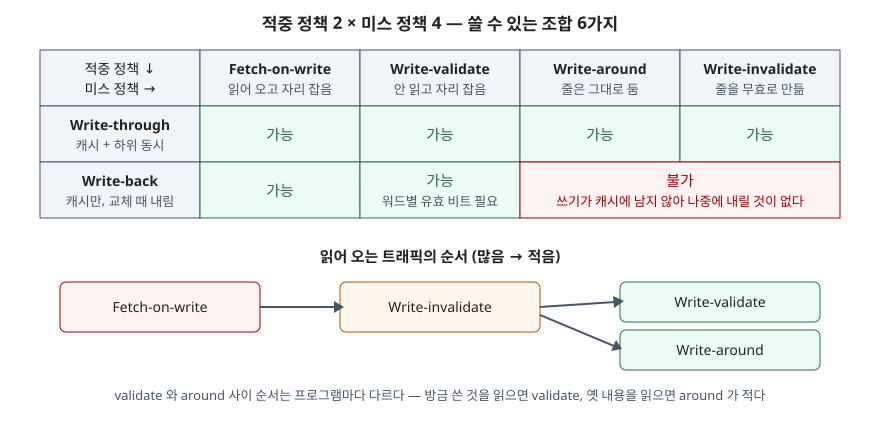

## 들어가며

읽기는 캐시에 사본이 있으면 끝나지만, 쓰기는 사본을 고치는 순간 캐시와 하위 메모리의 값이 달라진다. 그 차이를 언제 없애는지, 그리고 쓰려는 줄이 캐시에 없을 때 무엇을 할지가 쓰기 정책이다. 시험에서는 "write-through 와 write-back 을 비교하라"로 자주 나오지만, 미스 쪽까지 물으면 write-allocate·no-write-allocate 둘로만 쓰는 답안이 많아 점수가 갈린다. 이 글은 Jouppi 의 분류로 항목 수를 정하고, 작은 시뮬레이터로 패턴별 트래픽을 직접 세어 검산했다.

## 정의

**캐시 쓰기 정책**: 쓰기가 **적중했을 때 하위 메모리에 언제 반영할지**(적중 정책)와, **미스가 났을 때 줄을 읽어 오고 자리를 잡을지**(미스 정책)를 정하는 규칙이다.

Jouppi 보고서의 적중 정책 절(§3)은 두 가지를 이렇게 정의한다. 데이터를 캐시와 하위 계층에 함께 쓰면 **write-through**, 1차 캐시에만 쓰고 **고친 줄(dirty line)이 교체될 때만** 하위로 옮기면 **write-back** 이다. 같은 절은 write-back 이 쓰기의 참조 지역성을 이용해 하위로 가는 쓰기 트래픽을 줄인다고 적는다.

## 등장 배경

적중 쪽은 오래전부터 두 가지로 정리돼 있었지만, 미스 쪽은 그렇지 않았다. Jouppi 는 쓰기 미스 처리가 문헌에서 적중보다도 더 소홀히 다뤄지고 혼동돼 왔다고 적는다. 그 혼동의 핵심은 **fetch-on-write 가 곧 write-allocate 를 뜻하는 말로 쓰여 온 것**이다. 줄을 읽어 와 놓고 캐시에 두지 않는 조합은 쓸모가 없으니 둘이 붙어 다녔고, 그 결과 "줄을 읽지 않고 자리만 잡는" 선택지가 이름 없이 빠져 있었다.

또 하나는 쓰기 미스가 드물지 않다는 점이다. 같은 보고서의 측정에서 쓰기 미스는 평균적으로 전체 미스의 약 3분의 1이었다. 적재(load)가 저장(store)보다 2.4배쯤 많았으므로 저장 한 번이 미스를 낼 가능성은 적재 한 번과 비슷하다는 뜻이다.

## 구성요소 / 절차

### 적중 정책 — 2가지

| 정책 | 적중 시 쓰는 곳 | 하위로 나가는 때 | 줄마다 필요한 것 | 보조 장치 (Jouppi 표 3) |
|---|---|---|---|---|
| Write-through | 캐시 + 하위 | 쓰기마다 | 없음 | 쓰기 버퍼, 쓰기 캐시 |
| Write-back | 캐시만 | dirty 줄이 교체될 때 | dirty 비트 | dirty victim 레지스터 |

### 미스 정책 — 질문 3개, 쓸모 있는 조합 4가지

Jouppi 의 쓰기 미스 절(§4)은 질문 세 개로 정책을 나눈다. **줄을 먼저 읽어 오는가**(fetch-on-write), **캐시에 자리를 잡는가**(write-allocate), **그 줄을 무효로 만드는가**(write-invalidate). 읽어 놓고 버리는 조합과 자리를 잡고 무효로 만드는 조합은 쓸모가 없어서 4가지가 남는다.

| 조합 | 읽어 옴 | 자리 잡음 | 무효화 | 미스 때 하는 일 |
|---|---|---|---|---|
| ① Fetch-on-write | 예 | 예 | 아니오 | 줄 전체를 읽어 온 뒤 쓴다 |
| ② Write-validate | 아니오 | 예 | 아니오 | 읽지 않고 쓰고, 쓴 워드만 유효 비트를 켠다 |
| ③ Write-around | 아니오 | 아니오 | 아니오 | 하위로만 쓰고 줄의 옛 내용은 그대로 둔다 |
| ④ Write-invalidate | 아니오 | 아니오 | 예 | 줄을 무효로 표시하고 하위로만 쓴다 |

③·④는 쓰기가 캐시에 남지 않으므로 **write-through 에서만** 쓸 수 있고, ①·②는 둘 다에서 쓸 수 있다. 그래서 쓸 수 있는 조합은 2 × 4 가 아니라 **6가지**다.

## 도식

> **출처**: [Jouppi, Cache Write Policies and Performance, DEC WRL Research Report 91/12 — §3 Write Hits, §4 Write Misses(Figure 12 Write miss alternatives, Figure 17 Relative order of fetch traffic)](https://ftp.mirrorservice.org/sites/www.bitsavers.org/pdf/dec/tech_reports/WRL-91-12.pdf)

아래 순서는 Jouppi 가 Figure 17 로 정리한 부분 순서다. Fetch-on-write 는 미스마다 줄을 읽으므로 가장 많고, write-invalidate 는 그보다 적으며, write-validate 와 write-around 는 언제나 write-invalidate 이하다. 둘 사이는 프로그램이 **방금 쓴 데이터**를 읽는지 **줄의 옛 내용**을 읽는지에 따라 갈린다.

## 비교 — 직접 세어 본 하위 트래픽

전체 소스: [`code/write_policy_sim.py`](code/write_policy_sim.py) · 수행 기록: [`code/output.txt`](code/output.txt)

줄 8개 × 4워드의 직접 사상 캐시를 만들고, 미스를 세는 기준은 Jouppi §4 의 정의를 따랐다. 예를 들어 write-validate 는 무효로 남은 워드를 읽을 때만 미스로 센다. 표의 "합계"는 하위에서 읽은 워드 + 하위로 내린 워드 + 끝에 남은 dirty 워드다.

| 패턴 | WT·FoW | WT·validate | WT·around | WT·invalidate | WB·FoW | WB·validate |
|---|---|---|---|---|---|---|
| ① 블록 복사 (읽기 32·쓰기 32) | 96 | 64 | 64 | 64 | 96 | 64 |
| ② 쓰고 바로 다시 읽기 | 32 | **16** | 32 | 32 | 32 | **16** |
| ③ 읽고-고치고-쓰기 | 64 | 64 | 64 | 64 | 64 | 64 |
| ④ 결과를 쓰고 입력을 다시 읽기 | 64 | 48 | **32** | 48 | 64 | 48 |
| ⑤ 같은 카운터 반복 갱신 (쓰기 64) | 68 | 68 | 68 | 68 | **8** | **8** |

다섯 패턴 모두에서 Figure 17 의 순서가 성립했다. 눈에 띈 것은 세 가지다.

- **①에서 fetch-on-write 는 정확히 1.5배였다.** 목적지 줄 8개를 쓸데없이 읽어 와 96 대 64 가 됐다. Jouppi 가 큰 블록 복사에서 fetch-on-write 의 성능이 3분의 2 가 된다고 적은 것과 같은 비율이다.
- **③에서는 미스 정책 4가지의 결과가 완전히 같았다.** 쓰기 전에 이미 읽었으니 쓰기 미스가 한 번도 나지 않는다. Jouppi 가 linpack 의 saxpy 에서 write-validate 의 이점이 거의 없다고 한 이유다.
- **write-back 이 이긴 것은 ⑤뿐이었다.** ①·④처럼 워드마다 한 번만 쓰면 내리는 양이 결국 같다(① WT 내림 32, WB 내림 24 + 남은 dirty 8). 같은 워드에 64번 쓴 ⑤에서야 68 대 8 로 갈렸다. write-back 의 이점은 "쓰기의 지역성"이라는 정의 그대로다.

## 적용 시 고려사항

1. **캐시 크기와 고장 대비.** Jouppi 는 write-through 가 패리티만으로 고장에 대비할 수 있는 반면 write-back 은 캐시에만 최신 값이 있어 ECC 가 필요하다고 적는다. 그래서 작고 중간 크기의 온칩 캐시는 write-through + 쓰기 캐시가 맞고, 32KB 쯤부터 write-back 의 추가 트래픽 감소가 커진다고 결론짓는다.
2. **write-validate 의 하드웨어 비용.** 줄 안에 워드별 유효 비트가 있어야 하고 하위 메모리가 줄 일부 쓰기를 받아 줘야 한다. 바이트 쓰기까지 지원하려면 바이트마다 1비트(12.5%)가 들어 워드 단위(3.1%)보다 비싸므로, 바이트 쓰기는 fetch-on-write 로 처리하는 절충을 보고서가 제시한다.
3. **일관성 있는 다중 프로세서.** write-back 캐시에 write-validate 를 쓰면 모든 쓰기 미스를 write-through 로 내보내야 한다. 그러지 않으면 다른 캐시가 이 프로세서에 dirty 데이터가 있다는 것을 모른다.
4. **줄 크기.** 줄이 길수록 write-validate 가 무효로 남기는 바이트가 늘고, 옛 데이터가 쓰일 확률도 높아져 이점이 줄어든다. 반대로 줄 크기가 쓰기 단위와 같으면 fetch-on-write 가 읽어 온 데이터는 전부 버려진다.

## 정리

- **적중 2(WT·WB) + 미스 4(FoW·validate·around·invalidate) = 쓸 수 있는 조합 6.** around·invalidate 는 WT 전용이다
- 미스 정책을 가르는 질문은 3개다 — **읽어 오나, 자리 잡나, 무효로 하나** (두문자 "읽·자·무")
- 읽어 오는 트래픽: **FoW ≥ invalidate ≥ {validate, around}**. 뒤의 둘은 방금 쓴 것을 읽는지, 옛 내용을 읽는지로 갈린다
- WB 는 같은 워드에 쓰기가 반복될 때만 트래픽을 줄인다. 복사에서 FoW 는 1.5배 트래픽(대역 3분의 2)이다

같은 주제를 답안 형태로 쓴 글: [기출문제 — 캐시 쓰기 정책과 캐시 일관성](../../exam/2026-11-10-cache-write-policy-and-coherence/index.md)

> 관련 개념 정리: [캐시 사상 방식 — 직접·완전 연관·집합 연관의 주소 비트 분할과 충돌 미스](../2026-11-08-cache-mapping-direct-associative-set/index.md)

## 참고 자료

- [Norman P. Jouppi, Cache Write Policies and Performance, DEC WRL Research Report 91/12, December 1991](https://ftp.mirrorservice.org/sites/www.bitsavers.org/pdf/dec/tech_reports/WRL-91-12.pdf) — §3 Write Hits(정의), §3.3 Summary(표 3, 4KB·32KB 비교), §4 Write Misses(Figure 12 조합, 유효 비트 비용, 블록 복사 3분의 2, Figure 17 순서), §6 Conclusions. ISCA 1993 논문의 기술 보고서판
