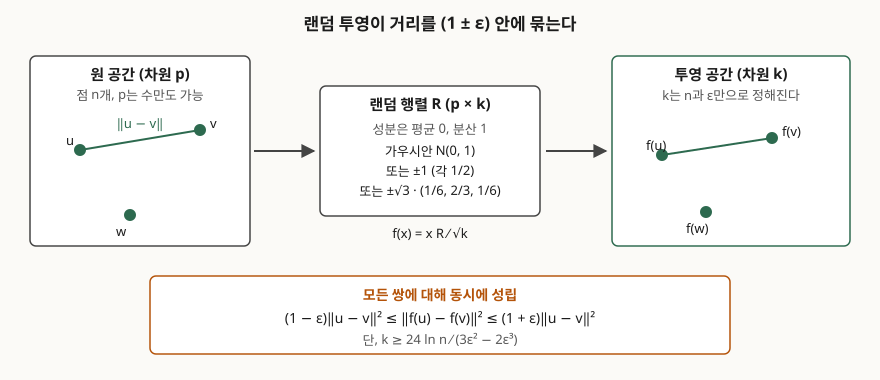

> 보조정리의 진술과 하한식은 원 논문을 근거로 했고, 하한을 지킬 때와 어길 때의
> 왜곡은 표준 라이브러리만으로 전수 계산해 확인했다. 기록은
> [code/output.txt](code/output.txt)에 있다.

## 들어가며

임베딩 차원이 1,000을 넘는 벡터 검색 색인을 운영하다 보면 메모리도 메모리지만
거리 계산 자체가 비싸진다. 차원을 줄이고 싶은데, 줄이면 "가까운 것이 가깝다"는
순위가 흐트러질까 봐 손을 못 댄다. 주성분분석처럼 데이터를 봐야 하는 방법은
새 벡터가 계속 들어오는 환경에서 다시 계산해야 하는 부담이 있다. 존슨-린덴스트라우스
보조정리는 **데이터를 보지 않고 무작위로 뽑은 행렬 하나로** 차원을 줄여도 쌍별
거리가 정해진 오차 안에 남는다는 것을 보장한다. 기술사 시험에서는 차원 축소·스케치·
양자화를 묻는 문항의 이론 근거로 등장하므로, 진술과 하한식을 정확히 쓸 수 있어야 한다.

## 정의

**존슨-린덴스트라우스 보조정리는, 임의의 0 < ε < 1에 대해 유클리드 공간의 n개 점을
k = O(ln n / ε²) 차원으로 보내면서 모든 쌍의 거리를 (1 ± ε) 배 안에서 보존하는
선형 사상이 존재한다는 정리다.** 원 논문은 립시츠 사상의 확장을 다루면서 이 결과를
제시했고, 사상을 무작위 직교 투영으로 잡을 수 있다는 것까지 보였으나 명시적인
구성은 주지 않았다.

정의에서 끊어 읽어야 할 자리가 둘이다. 첫째, 보존되는 것은 **쌍별 거리**이지 좌표나
방향이 아니다. 둘째, 목표 차원 k에 **원 차원 p가 들어가지 않는다.** p가 1,000이든
100만이든 n과 ε가 같으면 같은 k가 나온다.

## 등장 배경

차원 축소의 고전적 수단인 주성분분석은 공분산 행렬의 고유벡터를 구하므로 데이터
전체를 한 번 봐야 하고, 새 데이터가 들어오면 축이 달라진다. 축소된 좌표가 무엇을
뜻하는지는 설명되지만, **어느 쌍의 거리가 얼마나 틀어졌는지는 보장되지 않는다.**
좌표를 몇 개 골라 쓰는 방식은 더 나쁘다. 두 점이 단 한 좌표에서만 크게 다를 수 있으므로
그 좌표를 버리면 거리가 0에 가까워진다.

보조정리는 이 둘과 다른 종류의 약속을 한다. 데이터를 보지 않는 대신 **오차 한계를
쌍 단위로** 보장하고, 그 대가로 목표 차원이 ε에 대해 1/ε²로 커진다. 원 증명은 무거운
기하학적 근사를 썼고, 이후 프랭클-마에하라가 k개의 무작위 정규직교 벡터로의 투영으로
바꿔 증명을 단순화했다. 인디크-모트와니와 다스굽타-굽타가 독립적으로 i.i.d. 표준정규
성분의 행렬을 써서 사상을 명시적으로 주었고, 다스굽타-굽타는 적률생성함수 기법으로
하한을 k ≥ 24 ln n / (3ε² − 2ε³)까지 좁혔다. 아클리옵타스는 여기서 한 걸음 더 나가
행렬 성분을 동전던지기로 뽑아도 같은 하한이 성립함을 보였다.

## 구성요소 — 4가지

랜덤 투영을 하나 세우려면 정해야 할 것이 **4가지**다.

1. **왜곡 허용치 ε** — (1 ± ε)의 ε. 작을수록 거리가 정확하지만 k가 1/ε²로 커진다
2. **목표 차원 k** — 다스굽타-굽타 하한은 `k ≥ 24 ln n / (3ε² − 2ε³)`
3. **성분 분포** — 평균 0, 분산 1이면 되고, 아래 3가지가 대표적이다
4. **스케일** — 투영 결과를 1/√k로 나눠야 기댓값이 원래 제곱거리와 같아진다

아클리옵타스의 정리는 성분 분포를 **3가지** 중 아무것이나 써도 된다고 말한다.
표준정규 N(0,1), ±1을 각 1/2로 뽑는 분포, 그리고 ±√3을 각 1/6으로 0을 2/3으로 뽑는
희소 분포다. 셋째 분포는 **좌표의 2/3이 0**이므로 곱셈이 3분의 1로 준다. 같은 논문은
이 셋째 분포가 데이터베이스 안에서 집계 연산만으로 계산된다는 점을 강조한다. 원
속성의 2/3을 버리고 남은 것을 무작위로 두 묶음으로 나눈 뒤, 묶음별 합의 차를 새 속성
하나로 삼으면 된다.

성공 확률도 같이 적어야 한다. 다스굽타-굽타 판의 진술은 위 하한에서 한 쌍이 범위를
벗어나지 않을 확률을 1 − 2/n² 이상으로 둔다.

## 구조



> **출처**: [J. Rojo, T. S. Nguyen, "Improving the Johnson-Lindenstrauss Lemma", arXiv:1005.1440 (2010)](https://arxiv.org/abs/1005.1440) — §2의 JL 보조정리 진술과 다스굽타-굽타 판 하한, §1의 아클리옵타스 분포

## 동작 원리 — 하한을 지킬 때와 어길 때

보조정리는 존재만 말하지만, 증명은 **무작위로 뽑은 행렬이 높은 확률로 그 사상이
된다**는 형태다. 그래서 숫자로 확인할 수 있다. 표준정규 성분으로 1,000차원 점 50개를
만들고, ε = 0.5에서 하한이 주는 k₀ = 188 차원으로 투영한 뒤 1,225개 쌍 전부의
제곱거리 비를 쟀다.

```text
[1] 목표 차원 하한 k0 = ceil(24 ln n / (3e^2 - 2e^3))
           n | e=0.1  | e=0.2  | e=0.3  | e=0.5
         100 |   3948 |   1063 |    512 |    222
        1000 |   5921 |   1595 |    768 |    332
       10000 |   7895 |   2126 |   1024 |    443
     1000000 |  11842 |   3189 |   1536 |    664
  1000000000 |  17763 |   4783 |   2303 |    995
  원 차원 p 는 식에 들어가지 않는다
```

점이 100개에서 10억 개로 1,000만 배 늘어도 k₀는 222에서 995로 4.5배밖에 늘지 않는다.
ln n이기 때문이다. 반대로 ε을 0.5에서 0.1로 줄이면 같은 n에서 k₀가 18배가 된다.
**비용은 점 개수가 아니라 정확도가 끌어올린다.**

```text
[2] n=50, p=1000, epsilon=0.5 -> k0=188
  가우시안 N(0,1)              최소 0.6612  최대 1.4462  허용 밖 0/1225 쌍
  동전던지기 +-1                최소 0.6895  최대 1.3439  허용 밖 0/1225 쌍
  희소 +-sqrt(3), 0          최소 0.7652  최대 1.3561  허용 밖 0/1225 쌍

[3] 하한을 무시하고 k=20 로 줄이면 (k0=188)
  가우시안 N(0,1)              최소 0.2901  최대 2.4542  허용 밖 107/1225 쌍
```

세 분포 모두 1,225쌍이 전부 [0.5, 1.5] 안에 들어왔고, 실제 최악값은 0.66~1.45로
허용치보다 여유가 있었다. 하한이 보수적이라는 뜻이다. 반면 k를 20으로 내리자
**1,225쌍 중 107쌍이 범위를 벗어났고** 최악의 쌍은 제곱거리가 2.45배로 늘어났다.
하한식이 장식이 아니라는 것이 여기서 보인다. 전체 코드는
[code/jl_check.py](code/jl_check.py)에 있다.

## 비교 — 주성분분석·무작위 좌표 선택과의 대비

| 항목 | 랜덤 투영 | 주성분분석(PCA) | 무작위 좌표 선택 |
|---|---|---|---|
| 데이터 열람 | 필요 없음 | 전체 1회 필요 | 필요 없음 |
| 축의 결정 | 무작위 행렬 | 공분산 고유벡터 | 무작위 선택 |
| 거리 보존 보장 | 쌍별 (1 ± ε), 확률 보장 | 없음(분산 설명률만) | 없음 |
| 새 데이터 유입 | 같은 행렬 재사용 | 축 재계산 필요 | 같은 선택 재사용 |
| 목표 차원 근거 | ln n / ε² | 누적 분산 설명률 | 없음 |
| 축의 해석 | 불가 | 가능 | 원 속성 그대로 |

표의 마지막 줄이 실무에서 자주 걸린다. 랜덤 투영의 축은 원 속성의 무작위 가중합이라
**"이 축이 무엇이다"라고 말할 수 없다.** 설명이 필요한 분석에는 맞지 않고, 거리만
쓰면 되는 검색·군집·스케치에 맞는다.

## 적용 시 고려사항 — 5가지

1. **p가 작으면 쓸 이유가 없다.** k₀는 p와 무관하므로 p가 k₀보다 작거나 비슷하면
   차원이 오히려 늘어난다. 위 실험도 p = 1,000에 k₀ = 188로 5.3배 줄였을 뿐이다
2. **n은 "질의할 점의 개수"로 잡아야 한다.** 하한의 n은 거리를 보존하고 싶은 점의
   개수다. 색인 1억 건에 질의 벡터까지 포함하려면 n을 그만큼 잡아야 하고, ln n이라
   다행히 k는 크게 늘지 않는다
3. **하한은 보수적이므로 실측을 같이 한다.** 위에서 최악 왜곡이 0.66~1.45로 ±0.5
   한계에 못 미쳤다. 운영에서는 k를 하한보다 낮춰 쓰는 경우가 많은데, 그러면
   보장이 사라지므로 **대표 표본으로 왜곡을 직접 재고 그 수치를 근거로 삼아야 한다**
4. **보존되는 것은 거리의 비이지 순위가 아니다.** 1위와 2위의 거리 차가 ε보다 작으면
   순위는 뒤집힐 수 있다. 근사 최근접 이웃 탐색에서 투영 후 후보를 넉넉히 뽑아
   원 차원에서 다시 재는 재순위(re-ranking) 단계를 두는 이유다
5. **희소 분포를 먼저 검토한다.** 같은 보장을 주면서 곱셈이 3분의 1이고 성분이
   {−1, 0, +1}이라 정수 연산으로 처리된다. 스케일 1/√k는 곱셈 뒤로 미룰 수 있다

## 정리

암기 단서는 **"ln n · 1/ε², p 없음"** 하나다. 목표 차원은 점 개수의 로그에 비례하고
정확도의 제곱에 반비례하며, 원 차원은 식에 없다.

- 진술: n개 점을 k = O(ln n / ε²) 차원으로 보내 모든 쌍 거리를 (1 ± ε) 배로 보존하는
  선형 사상이 존재한다
- 하한: k ≥ 24 ln n / (3ε² − 2ε³), 한 쌍의 성공 확률 1 − 2/n² 이상 (다스굽타-굽타 판)
- 구성요소 4가지: 왜곡 허용치 ε, 목표 차원 k, 성분 분포, 스케일 1/√k
- 성분 분포 3가지: N(0,1) / ±1 각 1/2 / ±√3을 각 1/6과 0을 2/3
- 고려사항 5가지: p가 커야 이득, n은 질의 포함, 하한은 보수적이라 실측 병행,
  순위는 보장 안 됨, 희소 분포 우선 검토

> 기출 답안: [기출문제 — 터보퀀트와 벡터 양자화](../../exam/2026-10-14-turboquant-vector-quantization/index.md)

## 참고 자료

- [W. B. Johnson, J. Lindenstrauss, "Extensions of Lipschitz mappings into a Hilbert space", Contemporary Mathematics 26, pp. 189–206 (1984)](https://doi.org/10.1090/conm/026/737400) — 보조정리의 원 출처
- [S. Dasgupta, A. Gupta, "An elementary proof of a theorem of Johnson and Lindenstrauss", Random Structures & Algorithms 22(1), pp. 60–65 (2003)](https://doi.org/10.1002/rsa.10073) — 적률생성함수 기법으로 하한을 좁힌 판
- [D. Achlioptas, "Database-friendly random projections: Johnson-Lindenstrauss with binary coins", Journal of Computer and System Sciences 66(4), pp. 671–687 (2003)](https://doi.org/10.1016/S0022-0000(03)00025-4) — Theorem 1.1의 두 동전던지기 분포와 집계 연산 구현
- [J. Rojo, T. S. Nguyen, "Improving the Johnson-Lindenstrauss Lemma", arXiv:1005.1440 (2010-05-10)](https://arxiv.org/abs/1005.1440) — §2가 JL 보조정리와 다스굽타-굽타 판 하한을 함께 진술한다
- [P. Frankl, H. Maehara, "The Johnson-Lindenstrauss lemma and the sphericity of some graphs", Journal of Combinatorial Theory Series B 44(3), pp. 355–362 (1988)](https://doi.org/10.1016/0095-8956(88)90043-3) — 무작위 정규직교 벡터로의 투영으로 증명을 단순화한 판
