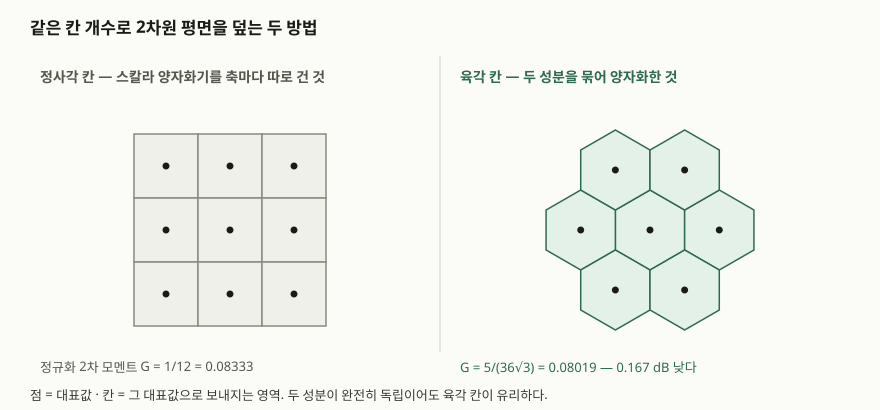

## 들어가며

모델 가중치를 4비트로 눌러 담았다거나 벡터 색인을 8배 줄였다는 이야기는
이제 흔하다. 그런데 "줄였다"는 말만으로는 답안이 되지 않는다. 시험이 묻는
것은 **얼마나 줄이면 얼마를 잃는지, 그 교환비를 정하는 것이 무엇인지**다.
그 답을 주는 이론이 율-왜곡 이론이고, 그 이론이 정한 한계에 다가가려고
고안된 방식이 벡터 양자화다.

이 글은 스칼라 양자화의 한계가 어디서 오는지, 벡터로 묶으면 무엇이 달라지는지,
그리고 차원이 커질 때 왜 통짜 벡터 양자화를 포기하고 부분공간으로 쪼개는지를
순서대로 정리한다. 수치는 전부 직접 계산해 확인했다.

## 정의

**양자화는 연속적이거나 값이 많은 원천을 유한 개의 대표값으로 보내는
사상이고, 벡터 양자화는 그 사상을 성분마다 따로 하지 않고 벡터의 모든
성분에 대해 동시에 수행하는 것이다.**

그레이와 노이호프의 양자화 개관은 벡터 양자화를 **3가지 요소**로 규정한다.
k차원 분할, k차원 코드북(대표 벡터들의 모음), 그리고 분할의 각 칸에 이진
부호어를 배정하는 사상이다. 스칼라 양자화는 k = 1인 특수한 경우이고,
변환 부호화도 벡터 양자화의 한 경우로 포함된다.

짝이 되는 정의가 하나 더 필요하다.

**율-왜곡 함수 R(D)는 평균 왜곡을 D 이하로 유지하면서 원천을 기술하는 데
필요한 최소 비트율이다.**

섀넌이 1959년 논문에서 독립 동일분포 원천과 가법적 왜곡 척도를 두고
증명한 결과이고, 그 역함수가 왜곡-율 함수 D(R)이다. 핵심은 이 값이
**어떤 양자화기로도 넘을 수 없는 하한**이라는 데 있다. 분산 σ²인 가우스
원천을 제곱오차로 재면 D(R) = σ²·2<sup>−2R</sup>이다. 답안에서는 이 한 줄을
세워 두고 "실제 양자화기가 여기서 몇 dB 떨어져 있는가"로 이야기를 끌면 된다.

## 등장 배경

스칼라 양자화기는 축마다 따로 동작한다. 로이드와 맥스가 정리한 최적 조건
**2가지**를 번갈아 적용하면 주어진 레벨 수에서 가장 좋은 스칼라 양자화기가
나온다.

| 조건 | 내용 |
|---|---|
| ① 최근접 이웃 조건 | 칸의 경계는 이웃한 두 대표값의 중점에 둔다 |
| ② 중심 조건 | 대표값은 그 칸의 조건부 평균(무게중심)에 둔다 |

이 두 조건을 수렴할 때까지 번갈아 돌리는 것이 로이드 알고리즘이고, 차원을
올려도 그대로 성립한다. 통계학에서 k-평균이라 부르는 절차와 같은 것이다.

문제는 **최적으로 만들어도 한계에 닿지 않는다**는 점이다. 분산 1인 가우스
원천에 로이드 반복을 직접 돌려 보면 이렇다. 계산 소스는 [`code/`](code/)에,
돌린 기록은 [`code/output.txt`](code/output.txt)에 있다.

```text
[A] 로이드-맥스 고정률 스칼라 양자화기 (분산 1인 가우스 원천)
   levels | bits R |   D(Lloyd) |    D(R) 한계 |    격차 dB
  --------------------------------------------------------
        2 |      1 |   0.363380 |   0.250000 |    1.624
        4 |      2 |   0.117482 |   0.062500 |    2.741
        8 |      3 |   0.034548 |   0.015625 |    3.446
       16 |      4 |   0.009501 |   0.003906 |    3.860
       32 |      5 |   0.002505 |   0.000977 |    4.091
       64 |      6 |   0.000644 |   0.000244 |    4.214
  2레벨 닫힌 형태 1 - 2/π = 0.363380  (위 표 첫 줄과 대조)
  고해상도 이론값 10log10(√3·π/2) = 4.347 dB
```

**비트를 늘릴수록 격차가 오히려 벌어져 약 4.35 dB로 수렴한다.** 2레벨 값이
닫힌 형태 1 − 2/π와 소수점 여섯 자리까지 같으므로 계산 자체는 믿을 수 있다.
비트를 늘려도 좁혀지지 않는 격차가 있다는 것, 그 격차를 좁히려면 양자화기의
구조를 바꿔야 한다는 것이 벡터 양자화가 등장한 이유다.

격차의 일부는 구조를 크게 바꾸지 않고도 걷어낼 수 있다. 대표값을 균등
간격으로 두고 출력에 엔트로피 부호화를 붙이면 이렇게 된다.

```text
[B] 균일 스칼라 양자화기 + 엔트로피 부호화
   step Δ |          D |     엔트로피 H |    D(H) 한계 |    격차 dB
  --------------------------------------------------------
  1.00000 |   0.076915 |     2.1048 |   0.054046 |    1.532
  0.50000 |   0.020408 |     3.0620 |   0.014339 |    1.533
  0.25000 |   0.005181 |     4.0508 |   0.003640 |    1.533
  0.12500 |   0.001300 |     5.0480 |   0.000914 |    1.533
```

**1.533 dB에서 멈춘다.** 이 값은 기시와 피어스가 1968년에 밝힌 결과로,
독립 동일분포 원천에서 고해상도 균일 양자화 + 엔트로피 부호화가 어떤
양자화 방식이 낼 수 있는 최선에서 1.53 dB(표본당 0.255비트) 떨어져 있다는
것이다. 비트 할당을 아무리 잘해도 **스칼라로 끊는 한 남는 격차**이고,
이것이 벡터 양자화가 가져가는 몫이다.

## 구성요소 — 벡터로 묶어 얻는 이득 3가지

같은 비트율에서 벡터 양자화가 스칼라 양자화보다 나은 이유는 **3갈래**로
갈린다. 답안에서는 이 세 가지를 개수와 함께 쓰는 것이 안전하다.

| 이득 | 무엇에서 오는가 | 성분이 독립이어도 생기나 |
|---|---|---|
| ① 공간 채움 이득 | 칸의 **모양**. 정육면체보다 둥근 칸이 2차 모멘트가 작다 | 생긴다 |
| ② 모양 이득 | 대표값의 **밀도**를 원천 분포에 맞추는 것 | 생긴다 |
| ③ 기억 이득 | 성분 사이의 **상관**을 함께 없애는 것 | 생기지 않는다 |

①이 가장 설명하기 까다로운데, 2차원에서는 숫자로 확인된다.

## 도식



> **출처**: [Gray & Neuhoff, "Quantization", IEEE Trans. Inf. Theory 44(6), 1998, p.2337](https://doi.org/10.1109/18.720541) — Fejes Tóth(1959)가 보인 2차원 최적 분할과 육각 격자

스칼라 양자화기를 두 축에 따로 걸면 평면은 정사각 칸으로 덮인다. 두 성분을
묶어 양자화하면 칸 모양을 고를 수 있고, 2차원에서 가장 좋은 것은 육각형이다.
칸의 모양이 좋은 정도는 **정규화 2차 모멘트 G**로 재는데, 직접 계산해 보면
이렇다.

```text
[C] 2차원 격자 모양이 만드는 차이 — 정규화 2차 모멘트 G
  정사각 격자  G = 1/12            = 0.0833333
  육각 격자    G = 5/(36√3)        = 0.0801875
  육각 격자    격자 합으로 다시 계산 = 0.0801875
    (적분한 육각형 넓이 2.59803, 닫힌 형태 2.59808)
  정사각 대비 육각의 이득 = 0.1671 dB
```

0.167 dB는 작아 보이지만 **두 성분이 완전히 독립일 때의 값**이라는 데 뜻이
있다. 지울 상관이 없어도 묶는 것만으로 이득이 난다. 개관 논문은 바로 이
점을 짚어, 중복이 전혀 없는 두 독립 균등 변수에서도 육각 격자 분할이 균일
스칼라 양자화보다 엄밀하게 낫다고 적는다. 차원을 올리면 이 이득은 커져서
앞서 본 1.53 dB 전체에 점근한다.

③은 반대로 상관이 있을 때만 나온다. 상관계수 ρ인 두 성분을 주축으로 돌려
놓고 같은 비트를 쓰면 왜곡이 이렇게 줄어든다.

```text
[D] 상관된 두 성분 — KLT 로 돌리고 얻는 이득
     상관 ρ |                고유값 |      왜곡 비 |    이득 dB
  --------------------------------------------------
     0.00 |    1.000,   1.000 |   1.00000 |   0.0000
     0.50 |    1.500,   0.500 |   0.86603 |   0.6247
     0.90 |    1.900,   0.100 |   0.43589 |   3.6062
     0.95 |    1.950,   0.050 |   0.31225 |   5.0550
```

상관이 0이면 이득이 정확히 0이다. **기억 이득은 상관에서만 나온다**는 것이
표 첫 줄에 그대로 찍힌다.

## 비교 — 스칼라 · 벡터 · 곱 양자화

| 항목 | 스칼라 양자화 | 벡터 양자화 | 곱 양자화 |
|---|---|---|---|
| 단위 | 성분 1개 | 벡터 전체 D차원 | D차원을 m개 부분공간으로 쪼갠 뒤 각각 |
| 코드북 크기 | 레벨 수 k | k<sup>D</sup>에 해당하는 항목 수 | m × k\* |
| 얻는 이득 | 모양 이득만 | ①②③ 전부 | 부분공간 안에서 ①②③ |
| 한계 | 1.53 dB 격차가 남는다 | 차원이 커지면 학습·저장이 불가능하다 | 부분공간을 넘는 상관은 못 쓴다 |

벡터 양자화는 차원이 커지면 그대로는 쓸 수 없다. 코드 비트를 b비트로 두면
코드북 항목이 2<sup>b</sup>개 필요한데, 색인에서 쓰는 128비트짜리 코드라면
항목이 2<sup>128</sup>개다. 학습할 데이터도, 저장할 공간도 없다.

제구 외 2인의 곱 양자화는 **공간을 저차원 부분공간의 데카르트 곱으로
분해하고 부분공간마다 따로 양자화하는 방식**으로 이 벽을 넘는다. 벡터는
부분공간별 양자화 색인을 이어 붙인 짧은 코드로 표현되고, 두 벡터 사이의
유클리드 거리는 그 코드만으로 추정된다. 질의 벡터는 양자화하지 않고 코드와
직접 거리를 재는 비대칭 방식을 쓰면 정밀도가 더 올라간다.

쪼개면 코드북이 얼마나 작아지는지는 곱셈 한 번으로 나온다.

```text
[E] 곱 양자화 — 코드북 항목 수
  벡터 차원 D = 128, 부분공간마다 코드북 항목 k* = 256
     분할 m |      부분공간 차원 |       저장할 항목 수 |     코드 비트
  ----------------------------------------------------
        1 |          128 |            256 |         8
        4 |           32 |          1,024 |        32
       16 |            8 |          4,096 |       128
  같은 코드 비트를 통짜 벡터 양자화로 내려면 코드북 항목이
  2^128 개 필요하다 — 학습도 저장도 불가능하다.
```

항목 수가 지수에서 곱셈으로 내려온다. **대가는 ③이다.** 부분공간을 가로지르는
상관은 각 부분공간 안에서 보이지 않으므로 기억 이득이 그만큼 깎인다.
쪼개기 전에 회전을 한 번 거는 기법들이 나온 이유가 여기에 있다.

## 적용 시 고려사항

**첫째, 목표를 왜곡으로 적을지 정확도로 적을지 먼저 정한다.** 율-왜곡
이론이 다루는 것은 제곱오차 같은 왜곡이지, 검색 재현율이나 생성 품질이
아니다. 제곱오차에 최적인 양자화기가 내적이나 유사도 기준에서는 편향을
낼 수 있다. 쓰려는 연산이 무엇인지에 맞춰 척도를 고른다.

**둘째, 상관이 없으면 ③을 기대하지 않는다.** 이미 백색화된 특징이나 서로
독립인 좌표를 벡터 양자화로 묶으면 남는 것은 ①②뿐이고, 2차원에서는
0.167 dB다. 구현 복잡도를 들일 값어치가 있는지는 상관 구조를 먼저 재 보고
판단할 일이다.

**셋째, 코드북을 학습 데이터에 맞춘다는 점을 잊지 않는다.** 로이드 반복은
주어진 분포에 맞춘 대표값을 내놓는다. 운영 데이터의 분포가 학습 때와
달라지면 왜곡이 조용히 커진다. 분포 변화를 감시하고 재학습 주기를 정해 둬야
한다.

**넷째, 초기값에 따라 국소 최적에 갇힌다.** 로이드 반복은 왜곡이 줄어드는
방향으로만 움직이므로 전역 최적을 보장하지 않는다. 이 글의 계산에서도 초기
대표값을 균등 간격으로 두면 꼬리 쪽 칸의 질량이 0에 가까워져 값이 무너졌고,
등확률 분위수로 바꾸고 나서야 알려진 값에 맞았다. 실무에서도 초기화 방식과
다중 시작이 결과를 가른다.

## 정리

- **정의 두 줄**: 벡터 양자화는 성분을 동시에 대표값으로 보내는 사상.
  율-왜곡 함수 R(D)는 왜곡 D를 지키는 최소 비트율이며 **넘을 수 없는 하한**
- **구성요소 3가지**: k차원 분할 · k차원 코드북 · 칸마다의 이진 부호어
- **최적 조건 2가지**: 최근접 이웃 조건(경계는 중점) · 중심 조건(대표값은 무게중심).
  둘을 번갈아 돌리는 것이 로이드 알고리즘
- **이득 3가지**: 공간 채움 · 모양 · 기억. 앞 둘은 독립이어도 생기고
  **기억 이득만 상관에서 나온다**
- **숫자 세 개**: 가우스 원천 한계 D(R) = σ²2<sup>−2R</sup> · 고해상도 스칼라의
  남는 격차 1.53 dB · 2차원 육각 칸의 이득 0.167 dB
- **곱 양자화**: 코드북을 k<sup>D</sup>에서 m × k\*로 내리는 대신 부분공간을
  넘는 상관을 포기한다

> 기출 답안: [기출문제 — 터보퀀트(TurboQuant) 벡터 양자화](../../exam/2026-10-14-turboquant-vector-quantization/index.md)

> 함께 보기: [근사 최근접 이웃 탐색과 HNSW 색인 — 정확한 답을 포기하고 얻는 것](../../database/2026-09-22-approximate-nearest-neighbor-hnsw/index.md)

## 참고 자료

- [R. M. Gray, D. L. Neuhoff, "Quantization", *IEEE Transactions on Information Theory* 44(6), pp.2325–2383, 1998](https://doi.org/10.1109/18.720541) — §II-D 벡터 양자화의 정의와 섀넌 왜곡-율 함수, p.2334 기시·피어스의 1.53 dB, p.2337 Fejes Tóth의 육각 분할
- [C. E. Shannon, "Coding theorems for a discrete source with a fidelity criterion", *IRE Nat. Conv. Rec.*, Part 4, pp.142–163, 1959](https://ieeexplore.ieee.org/document/1057777) — 왜곡-율 함수의 원 증명
- [S. P. Lloyd, "Least Squares Quantization in PCM", *IEEE Transactions on Information Theory* IT-28(2), pp.129–137, 1982 (1957년 벨 연구소 원고)](https://doi.org/10.1109/TIT.1982.1056489) — 최적 조건과 반복 알고리즘
- [J. Max, "Quantizing for Minimum Distortion", *IRE Transactions on Information Theory* IT-6(1), pp.7–12, 1960](https://doi.org/10.1109/TIT.1960.1057548) — 가우스 원천에 대한 최적 양자화기 수치표
- [H. Jégou, M. Douze, C. Schmid, "Product Quantization for Nearest Neighbor Search", *IEEE TPAMI* 33(1), pp.117–128, 2011](https://doi.org/10.1109/TPAMI.2010.57) — 부분공간 분해와 비대칭 거리 계산
- [T. D. Lookabaugh, R. M. Gray, "High-resolution quantization theory and the vector quantizer advantage", *IEEE Transactions on Information Theory* 35(5), pp.1020–1033, 1989](https://doi.org/10.1109/18.42217) — 이득을 공간 채움·모양·기억으로 가르는 분해
