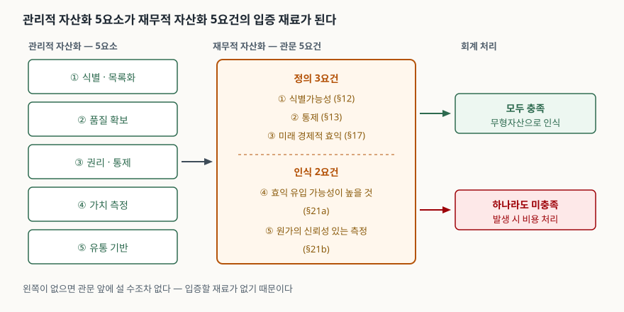
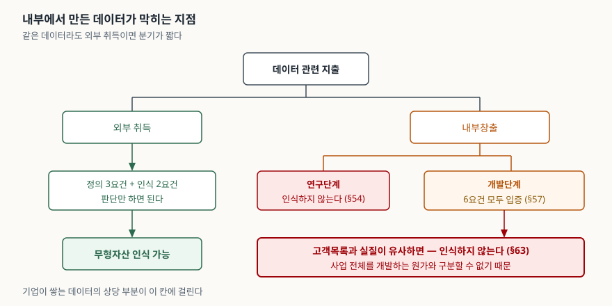

> 실행 검증 없음. 회계기준 문단은 IAS 38과 같은 문언을 채택한 호주회계기준위원회(AASB)의
> **AASB 138 공표본**(호주 연방 법령정보 수록)으로 문단 번호까지 확인했다. IFRS Foundation의
> IAS 38 원문은 열람이 제한되어 공개 요약 페이지만 함께 대조했다.
> **관리적 자산화·재무적 자산화라는 2분법 자체는 단일 표준의 용어가 아니다.** 국내 실무와
> 시험에서 쓰이는 구분이므로, 각 갈래의 내용만 표준·법령 근거로 채웠다.

## 들어가며

데이터가 자산이라는 말은 10년 넘게 반복됐는데 정작 재무상태표에는 거의 올라가지 않는다.
시험에서 이 주제가 나오면 "데이터는 중요한 자산이다"로 시작하는 답안이 가장 많이 쏟아지고,
그런 답안은 점수를 받지 못한다. 묻는 쪽이 보려는 것은 **왜 아직 안 올라가는가**이기 때문이다.
실무에서도 같은 질문이 먼저 온다. 데이터 플랫폼에 3년간 쓴 돈을 자산으로 잡을 수 있는지
회계팀에 물으면 대개 안 된다는 답이 돌아오는데, 그 이유를 아는 것이 데이터 거버넌스 과제의
출발점이 된다.

## 정의

**데이터 자산화**: 조직이 보유한 데이터를 식별·통제·측정이 가능한 단위로 정리해 **관리 대상인
자산으로 다루는 일(관리적 자산화)** 과, 그중 회계기준의 요건을 충족하는 것을 **무형자산으로
장부에 인식하는 일(재무적 자산화)** 을 묶어 부르는 말이다.

두 갈래의 관계는 한 방향이다. **관리적 자산화가 선행하고 재무적 자산화가 뒤따른다.** 무엇이
자산인지 목록이 없고 누가 통제하는지 정해지지 않은 데이터는 회계기준이 요구하는 식별가능성과
통제를 입증할 방법이 없다. 반대로 관리적 자산화만 해 두고 장부에 올리지 않는 경우는 흔하며,
그래도 자산화는 성립한다.

## 등장 배경

회계기준은 무형항목에 대한 지출을 **원칙적으로 비용으로 인식**하도록 한다. 데이터 수집·정제·
적재에 쓴 인건비와 인프라 비용은 그래서 발생 연도의 비용으로 사라지고, 그 결과물인 데이터는
장부 어디에도 남지 않는다. 기업이 데이터로 돈을 벌어도 그 원천이 재무제표에 보이지 않는
어긋남이 여기서 생긴다.

제도 쪽에서 먼저 움직인 것은 **권리**였다. 데이터산업법은 데이터자산 보호 조항(제12조)에서
인적·물적으로 상당한 투자와 노력으로 생성한 경제적 가치를 가지는 데이터를 데이터자산으로
보고, 공정한 상거래 관행에 반하는 무단 취득·사용·공개를 부정사용으로 금지한다. 같은 법은
데이터 가치평가 조항(제14조)으로 평가 제도의 근거도 두었다. **통제할 수 없는 것은 자산이
아니므로, 권리 보호가 자산화의 전제가 된다.**

회계 쪽에서 제도를 바꾼 사례도 있다. 중국 재정부는 기업 데이터자원의 회계처리에 관한 규정을
2023년 8월 공표해 **2024년 1월 1일부터 시행**했고, 기업이 데이터자원을 재무제표의 하위 항목으로
구분해 표시하고 공시하도록 했다. 세부 인식 조문까지는 원문으로 확인하지 못했으므로 답안에는
"국제회계기준이 바뀐 것이 아니라 개별 국가가 공시 체계를 먼저 손댄 사례"까지만 쓰는 편이 안전하다.

## 구성요소 / 절차

### 재무적 자산화가 통과해야 하는 관문 — 5가지

무형자산으로 인식하려면 **정의 3요건과 인식 2요건**을 모두 넘어야 한다.

| 구분 | 요건 | 근거 문단 | 데이터에서 걸리는 지점 |
|---|---|---|---|
| 정의 | ① **식별가능성** — 분리해 팔거나 이전·라이선스할 수 있거나, 계약상·법적 권리에서 발생 | §12 | 다른 업무 자산과 뒤섞여 경계를 못 긋는 경우 |
| 정의 | ② **통제** — 미래 경제적 효익을 얻고 타인의 접근을 제한할 힘 | §13 | 제3자 제공 데이터, 동의 범위가 불명확한 개인정보 |
| 정의 | ③ **미래 경제적 효익** — 판매 수익 또는 원가 절감 등 | §17 | 효익을 그 데이터에 귀속시킬 근거가 없는 경우 |
| 인식 | ④ **효익 유입 가능성이 높을 것** | §21(a) | 활용 실적이 쌓이지 않아 입증이 안 되는 경우 |
| 인식 | ⑤ **원가를 신뢰성 있게 측정할 수 있을 것** | §21(b) | 공통 인프라 비용에서 그 데이터 몫을 못 떼는 경우 |

### 내부에서 만든 데이터에만 붙는 관문 — 연구·개발 구분과 6요건

기준서는 내부창출 무형자산을 다시 **연구단계와 개발단계**로 나눈다. 연구단계에서 생긴 무형자산은
**인식하지 않고**(§54), 개발단계의 지출은 다음 **6가지를 모두 입증할 때만** 자산으로 인식한다(§57).

1. 사용하거나 판매할 수 있도록 **완성할 기술적 실현 가능성**
2. 완성해 사용하거나 판매하려는 **의도**
3. 사용하거나 판매할 **능력**
4. **미래 경제적 효익을 창출하는 방법**
5. 개발을 완료하는 데 필요한 기술적·재무적 **자원의 확보**
6. 개발 기간 중 그 자산에 귀속되는 **지출을 신뢰성 있게 측정하는 능력**

### 통과해도 막히는 칸 — 내부창출 고객목록

여기가 데이터 자산화 문항의 핵심이다. 기준서는 **내부적으로 창출한 브랜드, 제호, 출판표제,
고객목록, 그리고 이와 실질이 유사한 항목은 무형자산으로 인식하지 않는다**고 못 박는다(§63).
사업 전체를 개발하는 원가와 구분할 수 없다는 이유다.

기업이 쌓는 데이터의 상당 부분은 **고객목록과 실질이 유사한 항목**이다. 그래서 앞의 다섯 요건과
개발단계 여섯 요건을 모두 입증해도 이 칸에서 막힌다. 같은 데이터라도 **외부에서 사 온 것**은
취득원가가 분명하고 거래로 통제가 이전되므로 인식 가능성이 달라진다. 답안에서 "데이터는
자산으로 인식하기 어렵다"고 쓸 때는 **내부창출인 경우**라는 단서를 반드시 붙인다.

### 관리적 자산화의 구성요소 — 5가지

재무적 관문을 통과하든 못 하든, 데이터를 자산으로 다루려면 아래 다섯을 갖춰야 한다.
각 요소가 위 관문의 어느 칸에 대응하는지가 두 갈래를 잇는 고리다.

| 요소 | 갖추는 것 | 정보시스템 구현 수단 | 근거 | 대응하는 관문 |
|---|---|---|---|---|
| ① **식별·목록화** | 데이터의 경계를 긋고 이름·의미·구조를 등록 | 메타데이터 레지스트리, 데이터 카탈로그, 계보 추적 | ISO/IEC 11179-1:2023 | 식별가능성(§12) |
| ② **품질 확보** | 품질 특성을 정의하고 주기적으로 측정 | 품질 규칙 엔진, 프로파일링, 품질 지표 | ISO/IEC 25012:2008 | 효익 유입 가능성(§21a) |
| ③ **권리·통제** | 생성·수집 단계부터 소유와 책임을 지정 | 접근통제, 분류체계, 감사로그 | ISO/IEC 38505-1:2026, 데이터산업법 제12조 | 통제(§13) |
| ④ **가치 측정** | 용도를 정하고 평가 가능한 형태로 근거 축적 | 이용 실적·과금 이력·효익 지표 수집 | 데이터산업법 제14조 | 미래 효익(§17), 원가 측정(§21b) |
| ⑤ **유통 기반** | 교환·거래할 수 있는 형식과 계약 | 표준 식별체계, 개방형 포맷·API, 라이선스 | 데이터 가치평가 제도(평가 결과의 거래·담보 활용) | 식별가능성 중 분리가능성(§12) |

데이터 거버넌스 국제표준은 책임 소재를 생애주기 **6단계**(수집·저장·보고·결정·배포·폐기)로
나눠 적는 데이터 책임 지도를 다룬다(§6). 위 다섯 요소는 이 여섯 단계 위에 얹히는 것이지
별도의 프로젝트가 아니다.

## 도식

> **출처**: [AASB 138 Intangible Assets §12·§13·§17·§21 (2015-09-30 공표본, 호주 연방 법령정보)](https://www.legislation.gov.au/F2015L01558/asmade/2015-09-30/text/original/epub/OEBPS/document_1/document_1.html) · [ISO/IEC 38505-1:2026 §6 Data accountability](https://www.iso.org/standard/87195.html)

답안지에는 왼쪽에 다섯 요소를 세로로 쌓고, 가운데에 관문 하나를 두고, 오른쪽에 인식과 비용
두 갈래를 그린다. **왼쪽이 없으면 관문 앞에 설 수조차 없다**는 것이 이 그림이 말하는 전부다.

> **출처**: [AASB 138 Intangible Assets §54·§57·§63 (2015-09-30 공표본, 호주 연방 법령정보)](https://www.legislation.gov.au/F2015L01558/asmade/2015-09-30/text/original/epub/OEBPS/document_1/document_1.html)

외부 취득과 내부창출을 먼저 가르고, 내부창출 쪽에만 연구·개발 구분과 고객목록 조항을 붙인다.
답안에서 이 분기 하나를 그려 두면 "데이터는 자산화가 어렵다"는 문장이 근거를 갖는다.

## 비교

### 관리적 자산화와 재무적 자산화

| 비교 항목 | 관리적 자산화 | 재무적 자산화 |
|---|---|---|
| 목적 | 데이터를 관리·활용 대상으로 다룬다 | 장부에 무형자산으로 올린다 |
| 판단 기준 | 거버넌스 체계와 표준 충족 | 회계기준의 정의 3요건 + 인식 2요건 |
| 근거 | ISO/IEC 38505-1, 11179, 25012, 데이터산업법 | IAS 38 / 기업회계기준서 제1038호 |
| 결과물 | 데이터 목록, 품질 지표, 책임 지도, 라이선스 | 재무상태표의 무형자산 금액 |
| 판정하는 쪽 | 데이터 거버넌스 조직 | 회계·감사 |
| 대상 범위 | 조직이 보유한 데이터 전체 | 요건을 통과한 일부 |
| 선후 관계 | 먼저 | 뒤 |

### 외부 취득 데이터와 내부창출 데이터

| 비교 항목 | 외부 취득 | 내부창출 |
|---|---|---|
| 원가 측정 | 취득 대가로 명확 | 공통 비용에서 배분해야 함 |
| 통제 입증 | 계약으로 이전된 권리 | 수집 단계의 동의·출처 기록에 의존 |
| 단계 구분 | 적용되지 않음 | 연구단계 비용 / 개발단계 6요건 |
| 고객목록류 금지 조항 | 적용되지 않음 | **적용된다(§63)** |
| 실무상 인식 가능성 | 상대적으로 높다 | 상대적으로 낮다 |

## 적용 시 고려사항

- **수집 단계에서 결정된다.** 동의 범위와 출처를 남기지 않고 모은 데이터는 뒤에서 아무리 품질을
  올려도 통제를 입증할 수 없어 팔 수도 담보로 쓸 수도 없다. 데이터 책임 지도의 첫 단계가
  수집인 이유다. 자산화 과제를 품질 개선부터 시작하면 순서가 뒤바뀐다.
- **원가를 떼어낼 수 있게 회계 계정을 먼저 설계한다.** 인식 요건 중 실무에서 가장 자주 걸리는
  칸이 원가의 신뢰성 있는 측정(§21b)과 개발 지출의 측정(§57-6)이다. 데이터 플랫폼 인건비가
  전사 공통비로 묶여 있으면 사후에 배분 근거를 만들 수 없다.
- **장부에 못 올린다고 자산화가 실패한 것은 아니다.** 재무적 인식은 회계기준이 정한 결과이고,
  관리적 자산화의 산출물인 데이터 목록·품질 지표·권리 관계는 그 자체로 거래와 담보의 근거가
  된다. 데이터산업법의 가치평가 결과가 담보·투자 유치에 쓰이는 경로가 여기다.
- **내부창출과 외부 취득을 섞어 쓰지 않는다.** 외부에서 산 데이터를 내부 데이터와 합쳐 하나의
  데이터셋으로 만들면 원가와 권리가 뒤섞여 둘 다 인식이 어려워진다. 결합 산출물은 별도 단위로
  관리하고 원천별 계보를 남긴다.

## 정리

- **정의 1줄**: 데이터를 관리 대상 자산으로 정리하는 일(관리적)과 요건을 충족한 것을 무형자산으로
  인식하는 일(재무적)을 묶은 것. **관리적이 먼저, 재무적이 뒤.**
- **재무 관문 3+2**: 정의 3(식별가능성·통제·미래 효익) + 인식 2(효익 유입 가능성·원가의 신뢰성
  있는 측정).
- **내부창출에만 붙는 관문**: 연구단계는 인식 금지, 개발단계는 **6요건**(실현 가능성·의도·능력·
  효익 창출 방법·자원 확보·지출 측정) 전부 입증.
- **막는 조항 하나**: 내부창출 **고객목록과 실질이 유사한 항목**은 인식하지 않는다. 데이터
  자산화가 어려운 이유를 한 줄로 대라면 이것이다.
- **관리적 자산화 5요소**: 식별·품질·권리·측정·유통. 각각이 위 관문의 입증 재료가 된다.

> 기출 답안: [기출문제 — 데이터 가치평가와 데이터 자산화](../../exam/2026-10-15-data-valuation-and-assetization/index.md)

> 같은 분야의 개념 글: [데이터 가치평가 — 수익·원가·시장접근법과 데이터산업법 가치평가 제도](../2026-10-05-data-valuation-income-cost-market-approach/index.md)

## 참고 자료

- [AASB 138 Intangible Assets (2015-09-30 공표본, 호주 연방 법령정보)](https://www.legislation.gov.au/F2015L01558/asmade/2015-09-30/text/original/epub/OEBPS/document_1/document_1.html) — §8 정의, §12 식별가능성, §13 통제, §17 미래 경제적 효익, §21 인식 기준, §54~56 연구단계, §57 개발단계 6요건, §63 내부창출 브랜드·고객목록. IAS 38과 같은 문언을 채택한 공표본이다
- [IFRS Foundation — IAS 38 Intangible Assets](https://www.ifrs.org/issued-standards/list-of-standards/ias-38-intangible-assets/) — 기준서 개요와 인식 요건 요약 (원문 전문은 열람 제한)
- [한국회계기준원 — 기업회계기준서 제1038호 무형자산](https://www.kasb.or.kr/front/board/ingAccountingList.do) — K-IFRS 판의 발행처
- [국가법령정보센터 — 데이터 산업진흥 및 이용촉진에 관한 기본법](https://www.law.go.kr/법령/데이터산업진흥및이용촉진에관한기본법) — 데이터자산 보호(제12조), 데이터 가치평가(제14조)
- [한국데이터산업진흥원 — 데이터 가치평가 사업안내](https://www.kdata.or.kr/kr/contents/value01/view.do) — 평가 대상·절차 6단계·3가지 접근법, 금융·이전·전략 활용 분야
- [ISO/IEC 38505-1:2026, Governance of data — Part 1](https://www.iso.org/standard/87195.html) — §6 데이터 책임 생애주기 6단계
- [ISO/IEC 25012:2008, Data quality model](https://www.iso.org/standard/35736.html) — 데이터 품질 특성
- [ISO/IEC 11179-1:2023, Metadata registries (MDR) — Part 1: Framework](https://www.iso.org/standard/78914.html) — 메타데이터 레지스트리 프레임워크
- [중국 국무원 포털 — 기업 데이터자원 관련 회계처리 임시규정 (재정부, 2024-01-01 시행)](https://www.gov.cn/lianbo/bumen/202308/content_6899425.htm) — 데이터자원의 재무제표 하위 항목 표시·공시 요구
