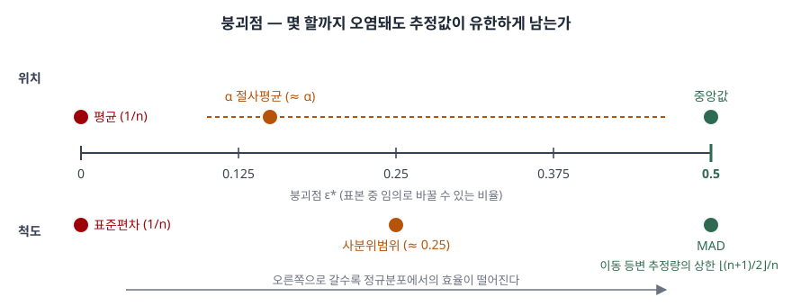

> 붕괴점의 정의와 대표 추정량의 붕괴점 값은 동료심사 논문(Davies·Gather 2005)을,
> 추정량의 정의와 검출 기준은 NIST/SEMATECH *e-Handbook* 을 근거로 했다. 본문의 모든
> 수치는 가상 표본과 고정 시드 난수로 직접 계산해 확인했고, 기록은
> [code/output.txt](code/output.txt)에 있다.

## 들어가며

데이터 품질과 이상치를 묻는 문항에는 "평균 대신 중앙값을 쓴다"는 문장이 거의 빠지지
않는다. 그런데 왜 중앙값인지, 절사평균은 어디쯤인지, 척도 쪽에서는 무엇이 중앙값에
해당하는지를 수치로 말할 수 있어야 답안이 선다. 그 수치가 **붕괴점**이다. 실무에서는
이상치 검출 규칙 자체가 이상치에 오염되는 문제, 즉 검출 기준이 검출 대상에 끌려가는
문제를 막는 근거가 된다.

## 정의

**강건 통계량은 표본의 일부가 임의의 값으로 바뀌어도 추정값이 유한한 범위에 머무르는
추정량이고, 그 견딜 수 있는 오염 비율의 최솟값을 붕괴점이라 한다.**

유한표본 붕괴점은 Donoho·Huber(1983)가 정식화한 것을 Davies·Gather(2005)가 다시 적은
형태로 쓴다. 표본 n 개 가운데 최대 k 개를 마음대로 바꾼 표본들에 대해, 추정값과 원래
추정값의 거리가 한없이 커질 수 있는 **가장 작은 k를 n으로 나눈 값**이다.

```text
fsbp(T, xₙ) = (1/n) · min{ k : 최대 k 개를 바꾼 표본들에서 sup |T(원표본) − T(바꾼 표본)| = ∞ }
```

붕괴점 개념 자체는 Hampel(1968 박사논문, 1971 논문)이 처음 세웠다.

## 등장 배경

평균과 표준편차는 정규분포를 가정하면 가장 효율이 좋은 추정량이다. 문제는 그 가정이
**데이터 한 건으로 깨진다**는 데 있다. *e-Handbook* 의 위치 측도 항목(§1.3.5.1)은 꼬리의
극단값이 평균을 왜곡하고, 중앙값은 순위에 기반하므로 왜곡되지 않는다고 적는다. 척도
측도 항목(§1.3.5.6)도 표준편차가 꼬리의 극단값에 왜곡된다고 적는다.

"얼마나 덜 흔들리는가"를 비교하려면 공통의 잣대가 필요했다. 붕괴점은 그 잣대를
**분포 가정 없이 한 숫자로** 준다. 한 점이 추정값을 끝없이 끌고 갈 수 있으면 붕괴점은
1/n이고, 표본의 절반 가까이를 바꿔야 무너지면 1/2에 가깝다.

## 구성요소 — 추정량 6가지와 붕괴점

위치 추정량 3가지와 척도 추정량 3가지로 나눈다. 각각의 정의는 *e-Handbook* 의 두
항목을 따른다.

| 구분 | 추정량 | 정의 | 붕괴점 |
|---|---|---|---|
| 위치 | 평균 | 합 ÷ 개수 | 1/n |
| 위치 | α 절사평균 | 양 끝에서 α씩 버리고 평균 | 대략 α |
| 위치 | 중앙값 | 가운데 순위의 값 | ⌊(n+1)/2⌋/n, 극한 1/2 |
| 척도 | 표준편차 | 평균 편차 제곱의 제곱근 | 1/n |
| 척도 | 사분위범위(IQR) | 75 백분위수 − 25 백분위수 | 대략 1/4 |
| 척도 | MAD | median(\|xᵢ − 중앙값\|) | 동점이 없으면 1/2 |

평균 1/n, 중앙값 1/2은 Davies·Gather의 결론 절(§6)에 있다. 이동 등변 위치 추정량이 가질 수
있는 **가장 높은 붕괴점이 1/2**이라는 것은 같은 논문의 상한 정리(정리 3.1)에서 나오고,
유한표본에서는 그 상한이 ⌊(n+1)/2⌋/n이 된다(§4). MAD의 붕괴점은 같은 논문의 척도 추정량
절(§5.2)이 `max(0, 1/2 − Δ)`로 적는데, Δ는 표본에서 한 값에 몰린 비율의 최댓값이다.
**동점이 많으면 MAD의 붕괴점이 그만큼 내려간다.**
절사평균과 IQR의 값은 아래 계산에서 확인한 것이다.

## 도식



> **출처**: [P. L. Davies, U. Gather, "Breakdown and groups", Annals of Statistics 33(3), pp. 977–988 (2005) §2 A definition of breakdown point, §5.2 Scatter functionals, §6 Final remarks](https://arxiv.org/abs/math/0508497), [NIST/SEMATECH e-Handbook §1.3.5.1 Measures of Location, §1.3.5.6 Measures of Scale](https://www.itl.nist.gov/div898/handbook/eda/section3/eda351.htm). 절사평균·IQR 위치는 본문 계산값

답안에는 수평선 하나에 0과 0.5를 찍고, 왼쪽 끝에 평균·표준편차, 오른쪽 끝에
중앙값·MAD, 그 사이에 절사평균·IQR을 놓으면 된다.

## 계산으로 확인 — 붕괴점과 그 대가

가상의 응답시간 20건에서 앞의 k 개를 10⁶ 배 크기로 바꾸고, 다시 10¹² 배로 키웠을 때
추정값도 따라 커지면 붕괴로 판정했다.

```text
  추정량         종류         붕괴하는 최소 k     붕괴점 k/n
  평균          위치                 1        0.05
  10% 절사평균    위치                 3        0.15
  25% 절사평균    위치                 6        0.30
  중앙값         위치                10        0.50
  표준편차        척도                 1        0.05
  사분위범위       척도                 5        0.25
  MAD         척도                10        0.50
```

중앙값의 0.50은 상한 ⌊21/2⌋/20 = 10/20과 정확히 맞는다. 절사평균은 n=20에서
⌊αn⌋ 개를 버리므로 **버린 개수보다 하나 더** 오염돼야 무너진다. 10%는 2개를 버려 3/20,
25%는 5개를 버려 6/20이고, n이 커지면 α에 수렴한다. 오염이 9개일 때까지 중앙값은
195.5에서 204.0으로 움직였을 뿐이고, 10개가 되는 순간 500102.5로 무너졌다.

이상치 검출에서 이 차이가 그대로 드러난다. 4200ms짜리 값을 1~4개 넣었다.

```text
  Z 점수 최댓값의 상한 (n-1)/sqrt(n) = 4.249
     이상치 수    Z>3 검출     Z 최댓값      수정Z>3.5 검출
         1         1     4.248               1
         2         0     2.924               2
         3         0     2.320               3
         4         0     1.949               4
```

**이상치가 2개만 돼도 Z 점수는 하나도 잡지 못한다.** 이상치가 평균과 표준편차를 함께
끌어올려 자기 자신의 Z 점수를 낮추기 때문이다. 이것을 은폐(masking)라고 부른다.
중앙값과 MAD로 계산하는 수정 Z 점수(*e-Handbook* §1.3.5.17, 임계값 3.5)는 넣은 개수를
그대로 잡았다.

대가도 있다. 정규분포 표본에서는 강건할수록 추정값이 더 흩어진다.

```text
  추정량               추정값 분산      평균 대비 효율
  평균                 4.944         1.000
  10% 절사평균           5.240         0.944
  25% 절사평균           5.892         0.839
  중앙값                7.316         0.676
  (참고) 중앙값의 점근 효율 2/pi = 0.637
```

같은 실험에서 보정한 MAD의 분산은 표준편차의 약 2.5배(6.454 대 2.622)였다. 보정 상수
1.4826은 표준정규분포의 75 백분위수 0.6745의 역수이고, 수정 Z 점수 식의 0.6745가 바로
이 값이다.

## 비교 — 강건성을 재는 다른 잣대

| 잣대 | 묻는 것 | 단위 | 붕괴점과의 관계 |
|---|---|---|---|
| 붕괴점 | 몇 할까지 오염돼도 유한한가 | 비율 0~1/2 | 전역적 강건성 |
| 타당성 강건성 | 분포가 정규가 아니어도 추정이 믿을 만한가 | 정성적 | *e-Handbook* 의 척도 측도 항목(§1.3.5.6)이 MAD·IQR에 있다고 적는 성질 |
| 효율 강건성 | 분포가 바뀌어도 분산이 작게 유지되는가 | 분산비 | 같은 항목이 MAD·IQR은 이 점이 강하지 않다고 적는다 |
| 효율 | 가정한 분포에서 분산이 얼마나 작은가 | 분산비 | 강건성과 맞바꾸는 대가 |

붕괴점은 **오염이 얼마나 많아도 버티는가**를 한 숫자로 주고, 효율은 **오염이 없을 때 무엇을
잃는가**를 준다. 중앙값은 붕괴점이 최고지만 효율이 낮고, 평균은 효율이 가장 좋지만 붕괴점이
최저다. 절사평균은 α로 그 사이의 어느 지점을 고르는 장치다.

## 적용 시 고려사항 — 4가지

1. **검출 기준부터 강건하게 만든다.** 이상치를 평균·표준편차로 찾으면 위 계산처럼 이상치
   두 개에 검출이 멈춘다. 파이프라인의 정제 규칙은 중앙값·MAD나 사분위 울타리로 둔다
2. **동점이 많은 데이터에서는 MAD를 조심한다.** 정수 초 단위로 반올림한 지연 시간처럼
   같은 값이 몰리면 MAD가 0이 될 수 있고, 그러면 수정 Z 점수의 분모가 사라진다.
   붕괴점 `1/2 − Δ`가 이 현상을 수식으로 보여준다
3. **절사 비율은 예상 오염률보다 크게 잡는다.** 절사평균의 붕괴점은 대략 α이므로, 오염이
   15% 들어올 수 있는 원천에 10% 절사평균을 쓰면 무너진다. 반대로 α를 키울수록 효율이
   떨어지므로 원천별 오염 이력을 근거로 정한다
4. **강건 추정은 이상치를 지우는 것이 아니다.** 추정값만 덜 흔들리게 할 뿐 값은 남는다.
   모집단의 꼬리를 정보로 남겨야 하는 경우에 삭제 대신 쓰는 수단이다

## 정리

암기 단서는 **"평균·표준편차 1/n, 절사평균 α, IQR 1/4, 중앙값·MAD 1/2"** 다.

- 정의: 표본 일부가 임의로 바뀌어도 추정값이 유한하게 남는 추정량. 견디는 오염 비율의
  최솟값이 붕괴점
- 상한: 이동 등변 위치 추정량의 붕괴점은 1/2을 넘지 못하고, 중앙값이 그 상한에 닿는다
- 검출: Z 점수는 이상치 두 개에 은폐되고, 중앙값·MAD 기반 수정 Z 점수는 견딘다
- 대가: 정규분포에서 중앙값의 효율은 평균의 약 0.64~0.68배. 강건성과 효율은 맞바꾼다
- 고려사항 4가지: 검출 기준의 강건화, 동점과 MAD, 절사 비율과 오염률, 삭제와의 구분

> 기출 답안: [기출문제 — 데이터분석에서 이상치와 편향](../../exam/2026-10-16-outlier-and-bias-in-data-analysis/index.md)

## 참고 자료

- [P. L. Davies, U. Gather, "Breakdown and groups", Annals of Statistics 33(3), pp. 977–988 (2005)](https://doi.org/10.1214/009053604000001138) — §2 유한표본 붕괴점 정의(Donoho·Huber 1983 인용), §3 상한, §5.2 MAD의 붕괴점, §6 평균 1/n·중앙값 1/2. [arXiv 사본](https://arxiv.org/abs/math/0508497)
- F. R. Hampel, "A General Qualitative Definition of Robustness", Annals of Mathematical Statistics 42(6), pp. 1887–1896 (1971) — 붕괴점 개념의 원 출처
- D. L. Donoho, P. J. Huber, "The notion of breakdown point", *A Festschrift for Erich L. Lehmann*, pp. 157–184, Wadsworth (1983) — 유한표본 붕괴점의 정식화
- [NIST/SEMATECH e-Handbook of Statistical Methods §1.3.5.1 Measures of Location](https://www.itl.nist.gov/div898/handbook/eda/section3/eda351.htm) — 평균·중앙값·절사평균의 정의와 극단값에 대한 성질
- [NIST/SEMATECH e-Handbook of Statistical Methods §1.3.5.6 Measures of Scale](https://www.itl.nist.gov/div898/handbook/eda/section3/eda356.htm) — 표준편차·IQR·MAD의 정의
- [NIST/SEMATECH e-Handbook of Statistical Methods §1.3.5.17 Detection of Outliers](https://www.itl.nist.gov/div898/handbook/eda/section3/eda35h.htm) — 수정 Z 점수와 임계값 3.5
