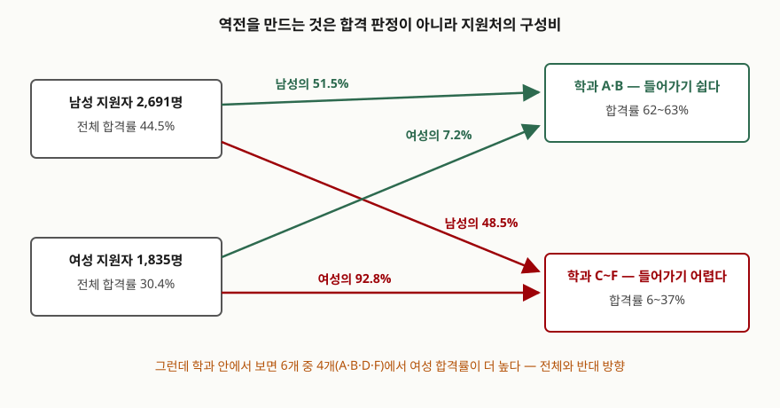

> 정의와 합산 가능 조건은 원 논문을 근거로 했고, 본문의 모든 수치는 발표된 분할표를
> 그대로 넣어 표준 라이브러리만으로 계산해 확인했다. 기록은
> [code/output.txt](code/output.txt)에 있다.

## 들어가며

지표를 비교하다 보면 이상한 일이 생긴다. 신규 화면이 전환율을 떨어뜨렸다고 나왔는데
모바일에서도 오르고 데스크톱에서도 올랐다. 둘 다 올랐는데 합치면 어떻게 떨어지는가.
처음 보면 집계 버그를 의심하게 되지만, 버그가 없어도 이 일은 일어난다. 심슨의 역설은
집계 실수가 아니라 **분할표를 합칠 때 생기는 구조적 성질**이고, 데이터 품질·편향·
통계 해석을 묻는 문항에서 그 구조를 설명할 수 있어야 하는 자리에 나온다.

## 정의

**심슨의 역설은, 세 번째 분류로 나눈 모든 부분표에서 같은 방향으로 나타나는 두 변수
사이의 연관이, 그 분류를 숨기고 합친 표에서는 사라지거나 반대 방향으로 나타나는
현상이다.** 율(Yule)이 1903년에 이미 비슷한 현상을 지적했으므로 **율-심슨 효과**라고도
부른다.

이름이 붙은 계기는 심슨의 1951년 논문이다. 다만 **그 논문은 이것을 "역설"이라고
부르지 않는다.** 바틀릿(Bartlett)의 기준으로 2차 상호작용이 없을 때 "역설과 오류의
여지가 상당하다"고 적고, 인위적 예 하나를 만들어 보인 것이 전부다. 이름은 나중에
굳었고, 1972년 블라이스(Blyth)의 논문은 제목에 이미 이 이름을 달고 있다.

## 등장 배경

1951년 당시 통계 교재들은 이런 지침을 싣고 있었다. **2차 상호작용이 없으면 2×2×2
표를 세 방향 어느 쪽으로든 합쳐서 독립성을 검정해도 된다**는 것이다. 심슨의 논문은
이 지침이 **거짓임을 보이려고** 쓰였다. 반례는 카드 한 벌이다.

```text
층            색        그림패  숫자패   그림패 비율
----------------------------------------------------------------------------
더러운 카드   빨강           4       8         33.3%
더러운 카드   검정           3       5         37.5%
              → 교차비(빨강 그림패 / 검정 그림패) = 0.8333
----------------------------------------------------------------------------
깨끗한 카드   빨강           2      12         14.3%
깨끗한 카드   검정           3      15         16.7%
              → 교차비(빨강 그림패 / 검정 그림패) = 0.8333
```

두 층의 교차비가 같으므로 2차 상호작용은 없다. 그리고 두 층 모두 0.8333이므로
**빨강일수록 숫자패 쪽**이라는 연관이 양쪽에 똑같이 있다. 그런데 층을 지우고 합치면
빨강도 검정도 그림패 6장·숫자패 20장이 되어 교차비가 정확히 1이 된다. 연관이
사라진다. 합쳐도 된다는 지침이 틀렸다는 뜻이다.

## 구성요소 — 역전의 3가지 성립 조건

역전은 아무 때나 생기지 않는다. **3가지**가 동시에 성립해야 한다.

1. **숨겨진 제3의 분류가 있다** — 비교에서 빠진 변수 C가 존재한다
2. **비교하는 두 집단의 C 구성비가 다르다** — 한쪽이 C의 특정 수준에 몰려 있다
3. **C가 결과율과 연관돼 있다** — C의 수준마다 결과율이 다르다

셋 중 하나라도 빠지면 합쳐도 방향이 유지된다. 그래서 2와 3을 함께 만족하는 변수를
**교란변수(confounder)** 라고 부르고, 심슨의 역설은 교란이 분할표에서 드러나는
한 형태다.

심슨 자신은 더 정확한 조건을 유도했다. **2차 상호작용이 없을 때, 합친 표의 연관도가
부분표와 같으려면 숨기는 분류 C가 두 변수 중 하나와 독립이어야 한다** — C가 A와
독립이거나 C가 B와 독립이어야 한다는 것이다. 위 카드 예에서 확인해 보면 둘 다
깨진다.

```text
더러움 × 빨강         실제 12.0/52    독립이라면 10.0/52   → 독립 아님
더러움 × 그림패        실제 7.0/52     독립이라면 4.6/52   → 독립 아님
```

"아기가 빨간 카드와 그림패를 좋아했다"는 설정이 바로 이 두 독립성을 깨뜨린 장치다.
조건이 깨졌으니 합쳤을 때 교차비가 보존되지 않는 것은 당연한 결과다. 역전은 우연이
아니라 **합산 가능 조건의 위반**이다.

## 구조 — 역전을 만드는 것은 구성비다

가장 많이 인용되는 사례는 1973년 버클리 대학원 지원 자료다. 전체로는 남성 합격률이
여성보다 14.2 포인트 높은데, 학과별로 보면 6개 중 4개에서 여성 합격률이 더 높다.



> **출처**: [P. J. Bickel, E. A. Hammel, J. W. O'Connell, "Sex Bias in Graduate Admissions: Data from Berkeley", Science 187(4175), pp. 398–404 (1975)](https://doi.org/10.1126/science.187.4175.398) — 1973년 상위 6개 학과의 성별 지원·합격 수. 같은 표가 R 표준 데이터셋 `datasets::UCBAdmissions`로도 배포된다

숫자로 보면 이렇다.

```text
학과    남 지원  남 합격   남 합격률  여 지원  여 합격   여 합격률   차이(여-남)
----------------------------------------------------------------------------
A           825      512       62.1%      108       89       82.4%        +20.3p
B           560      353       63.0%       25       17       68.0%         +5.0p
C           325      120       36.9%      593      202       34.1%         -2.9p
D           417      138       33.1%      375      131       34.9%         +1.8p
E           191       53       27.7%      393       94       23.9%         -3.8p
F           373       22        5.9%      341       24        7.0%         +1.1p
----------------------------------------------------------------------------
전체       2691     1198       44.5%     1835      557       30.4%        -14.2p
```

여기서 숨겨진 분류는 **학과**다. 합격률이 62~63%인 A·B에 남성 지원자의 51.5%가
몰렸고, 합격률이 6~37%인 C~F에 여성 지원자의 92.8%가 몰렸다. 조건 2와 3이 모두
성립한다. 구성비를 한쪽으로 맞춰 표준화하면 격차가 어떻게 되는지가 그대로 드러난다.

```text
관측된 그대로               남 44.5% vs 여 30.4%   → 여성이 -14.2 포인트
여성의 학과 구성비로 맞추면 남 30.2% vs 여 30.4%   → 여성이 +0.1 포인트
남성의 학과 구성비로 맞추면 남 44.5% vs 여 51.6%   → 여성이 +7.1 포인트
```

어느 쪽 구성비로 맞추든 부호가 뒤집힌다. 14.2 포인트를 만든 것은 학과별 합격 판정이
아니라 **어느 학과에 지원했는가**였다.

## 비교 — 어느 표가 맞는 답인가

여기가 이 개념의 핵심이고, 시험에서 가장 깊이 들어가는 지점이다. 심슨은 숫자가
**완전히 같은** 표 두 개를 나란히 놓아 이 질문을 던졌다. 카드 표의 라벨만 바꿔
"더러움/깨끗함"을 "남성/여성"으로, "색"을 "처치/미처치"로, "패 종류"를 "생존/사망"으로
읽은 것이다.

```text
층      구분         생존   사망     생존율
남성    미처치          4      3      57.1%
남성    처치            8      5      61.5%
                  → 처치의 생존 교차비 = 1.2000
여성    미처치          2      3      40.0%
여성    처치           12     15      44.4%
                  → 처치의 생존 교차비 = 1.2000
전체    미처치          6      6      50.0%
전체    처치           20     20      50.0%
                  → 처치의 생존 교차비 = 1.0000
```

카드 예에서는 **합친 표가 타당한 답**이었다. 색과 패 종류 사이에 연관이 없다는 것이
맞고, 아기가 묻힌 얼룩은 그 사실과 무관한 잡음이기 때문이다. 그런데 같은 숫자를
처치 실험으로 읽으면 결론이 뒤집힌다. 남성에게도 여성에게도 이로운 처치를 "전체로는
효과 없음"이라고 버릴 수는 없다. 심슨의 문장이 이 대비를 그대로 짚는다.

**같은 숫자인데 타당한 답이 반대라는 것은, 어느 표를 믿을지가 데이터 안에 들어 있지
않다는 뜻이다.** 그것은 제3의 변수가 비교 대상보다 **앞에 오는지 뒤에 오는지**로
정해진다. 성별은 처치보다 앞에 오므로 나눠 봐야 하고, 얼룩은 색·패 종류와 무관한
덧칠이므로 합쳐 봐야 한다. 이 판단을 형식화한 것이 뒤의 인과 추론 문헌이다.

혼동하기 쉬운 이웃 개념들과의 대비는 다음과 같다.

| 개념 | 무엇이 문제인가 | 심슨의 역설과의 관계 |
|---|---|---|
| 심슨의 역설 | 부분표의 연관이 합치면 사라지거나 뒤집힌다 | — |
| 교란 (confounding) | 비교 집단과 결과 양쪽에 걸린 변수가 추정을 치우치게 한다 | 심슨의 역설은 교란이 분할표에서 드러나는 한 형태 |
| 합산 가능성 (collapsibility) | 층을 합쳐도 연관도가 보존되는가 | 보존 조건이 깨진 결과가 역전 |
| 생태학적 오류 | 집단 수준의 관계를 개인 수준으로 그대로 옮긴다 | 방향이 반대. 역설은 합칠 때, 오류는 쪼갤 때 |
| 선택 편향 | 표본이 모집단을 대표하지 못한다 | 구성비를 비틀어 역전의 조건 2를 만든다 |

## 적용 시 고려사항 — 5가지

1. **전체 지표 하나로 결론 내지 않는다.** 집단별 분해는 선택 절차가 아니라 기본
   절차다. 분해해서 같은 방향이면 전체 지표를 그대로 쓰면 되고, 갈리면 그 사실
   자체가 보고할 내용이다
2. **분해 축은 분석 전에 정한다.** 결과를 보고 나서 역전이 나오는 축을 찾으면 그것은
   분해가 아니라 편의적 선택이다. 축은 "결과에 영향을 주면서 집단마다 구성비가
   다를 만한 변수"로 사전에 정하고 기록해 둔다
3. **나눌 변수와 합칠 변수를 구분한다.** 비교 대상보다 **앞에 오는** 변수(성별,
   연령, 지역, 유입 경로)는 나눠 봐야 하고, 처치 **뒤에** 생긴 변수를 나눠 보면
   오히려 효과가 왜곡된다. 데이터만으로는 이 구분이 안 되므로 도메인 지식이 필요하다
4. **역전이 안 나와도 안심할 수 없다.** 성립 조건 3가지가 동시에 필요하므로,
   역전이 없다는 것은 "이번 축에서는 조건이 다 맞지 않았다"는 뜻일 뿐이다. 다른
   축에서 교란이 남아 있을 수 있다
5. **쪼갤수록 표본이 작아진다.** 층을 잘게 나누면 각 칸의 수가 줄어 추정이 불안정해
   진다. 버클리 예에서도 B 학과의 여성 지원자는 25명뿐이다. 분해와 표본 크기는
   맞바꾸는 관계이므로, 표준화처럼 **층별 결과를 다시 가중 합산하는 방법**을 함께 쓴다

## 정리

암기 단서는 **"제3의 변수 · 구성비 차이 · 결과와의 연관"** 세 가지다. 셋이 모이면
합칠 때 방향이 뒤집힌다.

- 정의: 부분표마다 같은 방향으로 나타난 연관이, 그 분류를 숨기고 합친 표에서는
  사라지거나 반대로 나타나는 현상. 율-심슨 효과라고도 한다
- 역전의 성립 조건 3가지: 숨겨진 제3의 분류, 집단 간 구성비 차이, 그 분류와
  결과율의 연관
- 합산 가능 조건: 2차 상호작용이 없을 때, 숨기는 분류가 두 변수 중 **하나와는
  독립**이어야 연관도가 보존된다
- 판정의 열쇠: 어느 표가 맞는지는 데이터가 아니라 **제3의 변수가 비교 대상보다
  앞에 오는지 뒤에 오는지**가 정한다
- 이웃 개념 4가지: 교란, 합산 가능성, 생태학적 오류, 선택 편향
- 고려사항 5가지: 전체 지표 단독 금지, 축은 사전 결정, 나눌 변수와 합칠 변수 구분,
  역전 부재가 안전의 근거는 아님, 분해와 표본 크기의 맞바꿈

> 기출 답안: [기출문제 — 데이터분석에서 이상치와 편향](../../exam/2026-10-16-outlier-and-bias-in-data-analysis/index.md)

## 참고 자료

- [E. H. Simpson, "The Interpretation of Interaction in Contingency Tables", Journal of the Royal Statistical Society Series B 13(2), pp. 238–241 (1951)](https://doi.org/10.1111/j.2517-6161.1951.tb00088.x) — §9의 카드 예, §10의 처치 예, §11의 합산 가능 조건
- [G. U. Yule, "Notes on the Theory of Association of Attributes in Statistics", Biometrika 2(2), pp. 121–134 (1903)](https://doi.org/10.1093/biomet/2.2.121) — 같은 현상을 먼저 지적한 논문
- [C. R. Blyth, "On Simpson's Paradox and the Sure-Thing Principle", Journal of the American Statistical Association 67(338), pp. 364–366 (1972)](https://doi.org/10.1080/01621459.1972.10482387) — 제목에 이 이름이 쓰인 초기 문헌
- [P. J. Bickel, E. A. Hammel, J. W. O'Connell, "Sex Bias in Graduate Admissions: Data from Berkeley", Science 187(4175), pp. 398–404 (1975)](https://doi.org/10.1126/science.187.4175.398) — 1973년 상위 6개 학과 자료의 원 출처
- [J. Pearl, "Comment: Understanding Simpson's Paradox", The American Statistician 68(1), pp. 8–13 (2014)](https://doi.org/10.1080/00031305.2014.876829) — 어느 표를 믿을지가 인과 구조로 정해진다는 논의
- [R Documentation, `datasets::UCBAdmissions`](https://stat.ethz.ch/R-manual/R-devel/library/datasets/html/UCBAdmissions.html) — 버클리 자료의 표준 배포본과 전체 집계값
