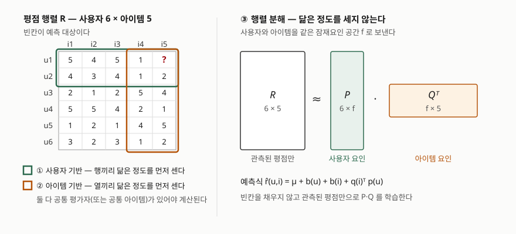

> 정의·수식·용어는 전부 원 논문(CSCW 1994, WWW10 2001, IEEE Computer 2009)에서 확인했다.
> 본문의 계산값은 가상의 6×5 평점 행렬에 그 수식을 그대로 적용해 직접 계산한 것이고,
> 기록은 [code/output.txt](code/output.txt)에 있다. 원 출처를 확인하지 못한 성능 수치는 쓰지 않았다.

## 들어가며

추천 시스템을 묻는 문항은 거의 언제나 "내용 기반과 협업 필터링을 비교하라"로 시작한다.
그런데 협업 필터링 쪽으로 한 단계만 더 들어가면 사용자 기반·아이템 기반·행렬 분해가
한꺼번에 쏟아지고, 셋을 나란히 나열하기는 쉬워도 **무엇이 다른지**를 한 줄로 끊기는
어렵다. 실무에서도 이 구분이 설계를 가른다. 평점은 똑같이 하나의 행렬에 쌓이는데,
그 행렬에서 무엇을 먼저 계산하느냐에 따라 사전 계산량이 어디로 몰리고 어느 쪽이
운영 중에 늘어나는지가 달라지기 때문이다.

## 정의

**협업 필터링은 항목의 내용 속성으로 프로필을 만들지 않고, 사용자와 아이템 사이에
쌓인 과거 상호작용 기록만으로 선호를 예측하는 추천 기법이다.**

Koren·Bell·Volinsky는 이것을 내용 기반 필터링의 대안으로 세우면서 "명시적 프로필을
만들 필요 없이 과거 사용자 행동에만 의존한다"고 적고, 용어 자체는 최초의 추천 시스템인
Tapestry 개발자들이 만들었다고 밝힌다. 그래서 협업 필터링은 **도메인에 매이지 않는다**.
영화든 뉴스 기사든 상품이든, 평점 행렬의 모양만 같으면 같은 알고리즘이 돈다.

예측의 근거가 되는 가정은 GroupLens 논문이 한 문장으로 적어 두었다. 과거의 주관적
평가에서 의견이 일치한 사람들은 앞으로도 일치할 가능성이 높다는 것이다. 이 가정 하나가
세 접근 모두의 바닥에 깔려 있다.

## 등장 배경

1994년 GroupLens는 넷뉴스 기사에 이 가정을 자동화해 적용했다. 사용자 쌍마다 **-1에서
1 사이의 가중치**를 내고, 예측하려는 기사에 매겨진 다른 사람들의 평점을 그 가중치로
가중평균한다. 논문이 내건 설계 목표는 **5가지** — 개방성, 사용 편의성, 호환성,
확장성, 프라이버시다.

문제는 이 방식이 커지면서 드러났다. Sarwar 등은 사용자 기반 협업 필터링의 난점을
**2가지**로 정리한다.

- **희소성** — 활동적인 사용자조차 전체 아이템의 1% 미만을 구매한 상태일 수 있다.
  논문은 "200만 권의 1%는 2만 권"이라는 숫자로 이것을 보인다. 최근접 이웃을 찾지
  못해 아예 추천을 내지 못하는 사용자가 생긴다.
- **확장성** — 최근접 이웃 알고리즘의 계산량은 **사용자 수와 아이템 수 양쪽에 따라
  늘어난다.** 수백만 명·수백만 개 규모에서는 심각한 확장성 문제가 생긴다고 적는다.

핵심은 병목이 **사용자-사용자 유사도 계산 단계**에 있다는 점이다. 사용자는 계속
늘고 취향도 바뀌므로 이 계산을 미리 해 두기 어렵다. 그래서 Sarwar 등은 비교의 축을
사용자에서 아이템으로 옮긴다. 아이템 사이의 관계는 상대적으로 정적이므로 **미리
계산해 모델로 저장할 수 있다**는 것이 아이템 기반의 출발점이다.

2006년 넷플릭스가 **1억 개가 넘는 평점**(약 50만 명, 1만 7천 편 이상, 1~5점)을 공개하고
경진대회를 열면서 세 번째 갈래가 전면에 나온다. 이웃을 세는 대신 사용자와 아이템을
같은 잠재요인 공간에 올려 두는 **잠재요인 모델**이고, 그 대표가 행렬 분해다.

## 구성요소 — 두 갈래, 세 접근

Koren 등은 협업 필터링의 주요 영역을 **2가지**로 나눈다. 이웃 방법(neighborhood
methods)과 잠재요인 모델(latent factor models)이다. 이웃 방법이 다시 사용자 지향과
아이템 지향으로 갈리므로, 실제로 비교하게 되는 것은 **3가지 접근**이다.

### ① 사용자 기반 — 3단계

1. 대상 사용자와 다른 사용자들 사이의 상관계수를 **공통으로 평가한 아이템만으로** 낸다
2. 가중치가 높은 이웃을 고른다
3. 이웃들이 대상 아이템에 매긴 평점의 **평균 편차**를 가중평균해 대상 사용자의 평균에 더한다

3단계에서 평점을 그대로 쓰지 않고 각자의 평균에서 얼마나 벗어났는지를 쓰는 것이
중요하다. 후하게 주는 사람의 3점과 박하게 주는 사람의 3점은 같은 뜻이 아니기 때문이다.

### ② 아이템 기반 — 2단계

1. **아이템 유사도 계산** — 두 아이템을 **모두 평가한 사용자**를 찾아 그들의 평점으로 유사도를 낸다
2. **예측 계산** — 대상 사용자가 이미 평가한 아이템들의 평점을 유사도로 묶는다

1단계의 유사도 식이 **3가지**다. 코사인, 상관, 조정 코사인. 조정 코사인은 기본 코사인이
**사용자마다 평점 척도가 다른 것을 반영하지 못한다**는 결함을 메우려고 각 평점에서 그
사용자의 평균을 빼고 계산한다. 논문은 실험에서 사용자 평균을 상쇄한 쪽이 분명히
유리했고 MAE가 뚜렷이 낮았다고 적은 뒤, 나머지 실험을 조정 코사인으로 진행한다.

2단계의 예측 식은 **2가지**다. **가중합**은 유사도로 가중한 평점을 유사도 절댓값의
합으로 나눈다. 논문은 이 나눗셈이 예측값을 정해진 범위 안에 두기 위한 것이라고 적는다.
**회귀**는 같은 틀을 쓰되 이웃의 원평점 대신 선형회귀로 근사한 값을 넣는다. 유클리드
거리로는 멀리 떨어진 두 평점 벡터가 코사인 유사도는 매우 높게 나올 수 있고, 이때
원평점을 그대로 쓰면 예측이 나빠지기 때문이다.

### ③ 행렬 분해 — 구성요소 4가지

사용자와 아이템을 차원 f의 **같은 잠재요인 공간**으로 보내고, 그 내적으로 평점을
근사한다. 아이템 i는 벡터 q(i), 사용자 u는 벡터 p(u)를 갖고 예측은 q(i)ᵀp(u)다.
논문은 영화에서 발견되는 요인의 예로 코미디 대 드라마, 액션의 양, 아동 지향성을 들고,
요인 수를 **20~100개** 정도로 잡는다고 적는다.

| # | 구성요소 | 내용 |
|---|---|---|
| 1 | 잠재요인 공간 | 차원 f. 사용자 행렬 P(6×f)와 아이템 행렬 Q(5×f) |
| 2 | 편향 | b(u,i) = μ + b(i) + b(u). 전체 평균, 아이템 편차, 사용자 편차 |
| 3 | 목적함수 | 관측된 평점에 대한 정규화 제곱오차. λ가 정규화 강도를 정한다 |
| 4 | 학습 알고리즘 | 확률적 경사하강법(SGD) 또는 교대최소제곱(ALS) |

편향을 넣으면 예측식은 **4성분**으로 쪼개진다. 전체 평균, 아이템 편향, 사용자 편향,
사용자-아이템 상호작용이다. 논문은 각 성분이 자기에게 해당하는 신호만 설명하게
하려는 분해라고 적는다.

SVD를 그대로 쓰지 못하는 이유도 여기서 나온다. 평점 행렬은 결측이 많아 **전통적
SVD가 정의되지 않고**, 빈칸을 채워 넣는 대치(imputation)는 데이터양을 크게 늘려
비싸며 부정확한 대치는 데이터를 왜곡한다. 그래서 최근 연구들은 **관측된 평점만
직접 모델링하고** 정규화로 과적합을 막는 쪽을 택했다.

## 도식



> **출처**: [Koren Y., Bell R., Volinsky C., *Matrix Factorization Techniques for Recommender Systems*, IEEE Computer 42(8), pp.30-37, "A Basic Matrix Factorization Model" 및 "Adding Biases" (2009)](https://ieeexplore.ieee.org/document/5197422) · [Sarwar B., Karypis G., Konstan J., Riedl J., *Item-based Collaborative Filtering Recommendation Algorithms*, WWW10, §3.1 Item Similarity Computation (2001)](https://archives.iw3c2.org/www10/cdrom/papers/519/node11.html)

## 직접 계산해 확인한 것

6명·5개짜리 평점 행렬을 두고 u1의 i5를 세 방식으로 예측했다. u1·u2·u4는 i1~i3을
좋아하고 i4를 싫어하며, u3·u5는 취향이 반대다. u6은 u1과 선호 순서가 같지만 전체적으로
낮게 주는 사용자로 두었다. 전체 출력은 [code/output.txt](code/output.txt)에 있다.

### 조정 코사인이 실제로 바꾸는 것

```text
[2] 아이템 유사도 세 가지 — 같은 쌍에 세 식을 적용
  쌍                코사인        상관        조정 코사인
  i1-i3          0.995     0.971         0.948
  i1-i2          0.975     0.860         0.695
  i1-i5          0.610    -0.962        -0.944
  i1-i4          0.581    -0.746        -0.911
```

i1과 i5는 취향이 정반대인 아이템 쌍이다. 그런데 **기본 코사인은 0.610이라는 양수**를
낸다. 평점이 모두 1~5의 양수라 두 벡터가 같은 사분면에 놓이고, 각도가 벌어져도
내적이 양수로 남기 때문이다. 사용자 평균을 빼면 부호가 뒤집혀 **-0.944**가 된다.
논문이 말한 "평점 척도 차이를 반영하지 못한다"가 이 자리에서 숫자로 드러난다.

### 가중합이 범위를 벗어나는 경우

```text
[3] 아이템 기반 — 조정 코사인 + 가중합
  sim(i5,i1) = -0.944  × 평점 5  = -4.719
  sim(i5,i2) = -0.819  × 평점 4  = -3.278
  sim(i5,i3) = -0.839  × 평점 5  = -4.196
  sim(i5,i4) = +0.815  × 평점 1  = +0.815

  (가) 원 논문 식 그대로 — 분모는 유사도 절댓값의 합
      (-11.377) / (3.418) = -3.329   ← 1~5 범위 밖
```

가중합을 유사도 절댓값의 합으로 나누면 예측이 범위 안에 든다는 논문의 설명은
**유사도가 음수가 아닐 때만 성립한다.** 조정 코사인은 음수를 내므로 분자만 음수로
커지고 분모는 커지지 않아 -3.329가 나온다. 실무에서 이 자리를 메우는 방법은 둘인데,
양수 이웃만 남기면 이웃이 i4 하나로 줄어 1.000이 되고, 사용자 평균에 편차를 더하는
형태로 바꾸면 2.382가 된다. 후자는 논문의 식이 아니므로 그 사실을 밝히고 써야 한다.

### 세 접근이 같은 칸에 낸 값

```text
[6] 세 접근이 같은 칸에 낸 값
  사용자 기반             2.403
  아이템 기반 (가) 원 식  -3.329
  아이템 기반 (나) 양수만 1.000
  아이템 기반 (다) 편차형 2.382
  행렬 분해               1.865
```

행렬 분해는 잠재요인 2개로 4000회 학습해 학습 RMSE 0.2914, 예측 1.865를 냈다.
μ 2.897에 사용자 편향 +0.420, 아이템 편향 -0.043, 상호작용 -1.409가 더해진 값이다.
**u1이 후하게 주는 사용자라는 사실(+0.420)과 i5를 싫어할 것이라는 사실(-1.409)이
서로 다른 항에 분리되어 들어간다.** 이웃 방법에는 이렇게 쪼갤 자리가 없다.

## 비교

| 구분 | 사용자 기반 | 아이템 기반 | 행렬 분해 |
|---|---|---|---|
| 먼저 계산하는 것 | 사용자 쌍의 유사도 | 아이템 쌍의 유사도 | 잠재요인 행렬 P, Q |
| 비교 단위 | 평점 행렬의 행 | 평점 행렬의 열 | 행·열을 같은 공간으로 |
| 사전 계산 가능성 | 어렵다 — 사용자가 계속 는다 | 쉽다 — 아이템 관계가 비교적 정적 | 학습은 일괄, 예측은 내적 한 번 |
| 모델 크기 | 없음(메모리 기반) | 아이템마다 상위 k개 | (사용자 수+아이템 수) × f |
| 척도 차이 보정 | 평균 편차로 예측 | 조정 코사인으로 유사도 보정 | 사용자 편향 b(u)로 분리 |
| 설명 가능성 | "비슷한 사람이 좋아했다" | "비슷한 아이템을 좋아했다" | 요인 축의 의미가 불명확할 수 있다 |
| 약점 | 희소성·확장성 | 유사도 음수 처리, 모델 크기 선택 | 콜드스타트, 요인 수·λ 조정 |

Koren 등은 요인이 코미디 대 드라마처럼 명확한 축일 수도 있지만 **전혀 해석되지 않는
축**일 수도 있다고 적는다. 설명 가능성이 요구되는 서비스에서 이웃 방법이 남아 있는
이유 중 하나다.

## 적용 시 고려사항 — 5가지

1. **조정 코사인을 쓰면 가중합 식을 그대로 쓸 수 없다.** 위에서 본 대로 유사도가
   음수인 이웃이 섞이면 예측이 평점 범위를 벗어난다. 양수 이웃만 남길지, 편차 형태로
   바꿀지를 정해야 하고, 후자는 원 논문의 식이 아니므로 근거를 따로 밝혀야 한다.
2. **희소성은 유사도 계산 단계에서 먼저 터진다.** 두 아이템의 유사도는 둘을 **모두**
   평가한 사용자로만 계산된다. 행렬이 비면 분모에 들어갈 사용자부터 사라지므로,
   예측이 나빠지기 전에 유사도 자체가 정의되지 않는다.
3. **콜드스타트에서는 내용 기반이 낫다.** Koren 등은 협업 필터링이 일반적으로 내용
   기반보다 정확하지만 새 상품·새 사용자를 다루지 못하는 콜드스타트 문제를 겪으며,
   **이 점에서는 내용 기반이 우월하다**고 명시한다. 신규 유입이 많은 서비스라면
   두 방식을 섞는 설계가 전제된다.
4. **모델 크기는 품질과 성능의 맞교환이다.** 아이템 기반은 아이템마다 유사한 상위
   k개만 저장한다. 전체 아이템 쌍을 다 들고 있으면 조회는 빠르지만 아이템 수의
   제곱에 비례하는 공간이 든다. 논문은 품질을 확보하려면 모델이 커야 하는
   맞교환이 있다고 적고, 작은 모델로도 쓸 만한 품질이 나오는지를 실험으로 확인한다.
5. **SGD와 ALS는 상황으로 고른다.** 일반적으로 SGD가 더 쉽고 빠르지만, Koren 등은
   ALS가 유리한 경우를 **2가지**로 든다. 병렬화가 가능할 때(각 q(i)와 p(u)를 서로
   독립적으로 계산할 수 있다), 그리고 암묵적 피드백 중심 시스템일 때다. 후자는
   학습 집합이 희소하지 않아 모든 사례를 하나씩 도는 경사하강이 현실적이지 않다.

## 정리

**"행·열·공간"** — 사용자 기반은 **행**끼리, 아이템 기반은 **열**끼리 재고,
행렬 분해는 행과 열을 같은 **공간**에 올린다. 같은 평점 행렬 하나를 어느 방향으로
자르느냐가 세 접근의 전부다.

- 협업 필터링의 주요 영역은 **2가지**(이웃 방법, 잠재요인 모델), 실제 비교 대상은 **3가지 접근**
- 사용자 기반의 난점은 **2가지**: 희소성, 확장성. 병목은 사용자-사용자 유사도 계산
- 아이템 기반은 **2단계**(유사도 계산 → 예측), 유사도 **3가지**, 예측 **2가지**
- 행렬 분해의 구성요소는 **4가지**, 편향 포함 예측식은 **4성분**(μ + b(i) + b(u) + q(i)ᵀp(u))
- 학습 알고리즘은 **2가지**(SGD, ALS), ALS가 유리한 경우도 **2가지**(병렬화, 암묵적 피드백)
- 콜드스타트에서는 **내용 기반이 우월**하다고 원 논문이 명시한다

> 기출 답안: [기출문제 — 빅데이터 분석의 클러스터링·필터링·이상치 탐지](../../exam/2026-10-21-bigdata-clustering-filtering-outlier-detection/index.md)

## 참고 자료

- [Resnick P., Iacovou N., Suchak M., Bergstrom P., Riedl J., *GroupLens: An Open Architecture for Collaborative Filtering of Netnews*, CSCW '94 Proceedings, pp.175-186 (1994)](https://presnick.people.si.umich.edu/papers/cscw94/GroupLens.htm) — 예측 휴리스틱, 사용자 쌍 가중치와 가중평균 예측, 5가지 설계 목표의 1차 자료
- [Sarwar B., Karypis G., Konstan J., Riedl J., *Item-based Collaborative Filtering Recommendation Algorithms*, WWW10 Proceedings, pp.285-295 (2001)](https://archives.iw3c2.org/www10/cdrom/papers/519/) — 사용자 기반의 희소성·확장성 문제, 유사도 3가지와 예측 2가지, 모델 크기 맞교환의 1차 자료
- [Koren Y., Bell R., Volinsky C., *Matrix Factorization Techniques for Recommender Systems*, IEEE Computer 42(8), pp.30-37 (2009)](https://ieeexplore.ieee.org/document/5197422) — 협업 필터링의 정의와 두 갈래, 잠재요인 모델, 편향·정규화·SGD·ALS, 콜드스타트 서술의 1차 자료
