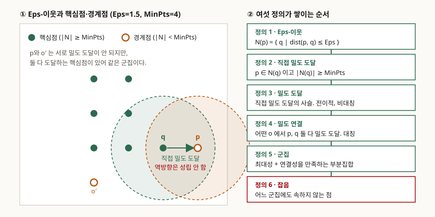

> 정의·보조정리·복잡도·파라미터 값은 전부 원 논문(KDD-96)에서 확인했다. 본문에 실은
> 판정값과 군집 결과는 20점짜리 가상 표본에 정의를 그대로 적용해 직접 계산한 것이고,
> 기록은 [code/output.txt](code/output.txt)에 있다. 근거를 찾지 못한 성능 수치는 쓰지 않았다.

## 들어가며

군집화를 묻는 문항은 거의 언제나 k-means부터 나열하게 만든다. 그런데 같은 문항이
이상치 탐지를 함께 묻는 경우가 많고, 이때 k-means로는 쓸 말이 없다. 모든 점을 어느
중심엔가 배정하므로 "이 점은 어느 군집도 아니다"를 말할 자리가 없기 때문이다.
DBSCAN은 그 자리를 정의 안에 만들어 둔 알고리즘이라 두 질문에 한 번에 답할 수 있고,
그래서 답안에서 가성비가 높다. 실무에서도 로그·센서처럼 정상 구간의 모양이 둥글지
않고 잡음이 섞여 들어오는 데이터에 먼저 걸어 보는 기법이다.

## 정의

**DBSCAN은 반경 Eps 안에 최소 MinPts개의 점을 갖는 밀도 조건을 만족하는 점들을
밀도 도달 관계로 이어 군집을 만들고, 어느 군집에도 이어지지 않은 점을 잡음으로
정의하는 밀도 기반 군집화 알고리즘이다.**

원 논문은 알고리즘을 먼저 쓰지 않는다. **군집이 무엇인지를 여섯 개의 정의로 먼저
세우고**, 그 정의를 만족하는 집합을 찾아내는 절차로 알고리즘을 유도한다. 이 순서가
DBSCAN의 성격을 결정한다. 군집의 개수 k가 입력으로 들어가지 않는 것도, 잡음이
별도 후처리가 아니라 정의 6으로 나오는 것도 여기서 비롯된다.

## 등장 배경

1996년 당시 공간 데이터베이스의 군집화는 분할(partitioning)과 계층(hierarchical)
두 갈래였고, 논문은 둘 다 큰 데이터베이스에서 쓰기 어렵다고 적는다.

- **분할 방식**은 k를 미리 알아야 하고, 찾아내는 군집의 모양이 볼록(convex)하다는
  제약이 있다. 논문이 비교 대상으로 삼은 CLARANS는 잡음이라는 개념 자체가 없어
  모든 점을 가장 가까운 메도이드에 배정한다.
- **계층 방식**은 k가 필요 없는 대신 병합·분할을 멈출 종료 조건을 정해야 하는데,
  모든 자연 군집을 분리할 만큼 작으면서 하나의 군집을 쪼개지 않을 만큼 큰 임계값을
  고르기가 어렵다.

공통점은 **사람이 넣어야 하는 값이 군집의 결과를 좌우하는데 그 값을 고를 근거가
없다**는 것이다. DBSCAN은 파라미터를 두 개 받지만 그중 MinPts를 2차원에서 4로
고정할 근거를 실험으로 제시하고, 남은 Eps 하나를 그래프로 고르게 해서 사실상
입력 파라미터를 하나로 줄인다.

## 구성요소 — 여섯 정의

논문의 정의 1부터 6까지가 그대로 구성요소다. 앞의 정의가 뒤의 정의에 쓰이므로
순서를 바꿀 수 없다.

| # | 정의 | 내용 | 성질 |
|---|---|---|---|
| 1 | Eps-이웃 | N(p) = { q ∈ D \| dist(p,q) ≤ Eps } | 거리 함수는 무엇이든 가능 |
| 2 | 직접 밀도 도달 | p ∈ N(q) 이고 \|N(q)\| ≥ MinPts | 핵심점끼리는 대칭, 핵심점–경계점은 비대칭 |
| 3 | 밀도 도달 | 직접 밀도 도달을 잇는 사슬이 존재 | 전이적, 일반적으로 비대칭 |
| 4 | 밀도 연결 | 어떤 o에서 p와 q가 둘 다 밀도 도달 | 대칭 |
| 5 | 군집 | 최대성 + 연결성을 만족하는 공집합 아닌 부분집합 | 최소 MinPts개 포함 |
| 6 | 잡음 | 어느 군집에도 속하지 않는 점 | 군집이 정해진 뒤에 결정됨 |

정의 2의 두 번째 조건을 **핵심점 조건**이라 부르고, 이를 만족하는 점이 **핵심점**,
핵심점의 이웃이지만 자신은 조건을 못 채우는 점이 **경계점**이다. 점의 종류는
핵심점·경계점·잡음점 **3가지**다.

정의 3과 정의 4를 따로 둔 이유가 시험에서 자주 갈린다. 같은 군집의 **두 경계점은
서로 밀도 도달이 되지 않는다** — 사슬이 핵심점을 통해서만 이어지는데 경계점은
핵심점이 아니기 때문이다. 그래서 "같은 군집"을 밀도 도달만으로 정의하면 경계점들이
빠진다. 정의 4가 중간에 핵심점 o를 하나 세워 이 문제를 메운다.

### 절차 — 2단계

정의 위에 보조정리 두 개가 붙어 알고리즘이 나온다. 보조정리 1은 핵심점 p에서
밀도 도달 가능한 점들의 집합이 군집임을 말하고, 보조정리 2는 한 군집 C는 **C에
속한 어느 핵심점에서 출발해도 같은 집합**으로 전개된다고 말한다. 그래서 절차는
2단계로 끝난다.

1. 아직 분류되지 않은 점 중 핵심점 조건을 만족하는 점 하나를 씨앗으로 고른다
2. 그 씨앗에서 밀도 도달 가능한 점을 전부 거두어 하나의 군집으로 확정한다

영역 질의(region query)를 R\*-트리 같은 공간 색인으로 처리하면 질의 한 번이
평균 O(log n)이고, 점마다 많아야 한 번 질의하므로 **DBSCAN의 평균 수행 복잡도는
O(n log n)**이다.

## 도식



> **출처**: [Ester M., Kriegel H.-P., Sander J., Xu X., *A Density-Based Algorithm for Discovering Clusters in Large Spatial Databases with Noise*, KDD-96 Proceedings, pp.226-231, §3 A Density Based Notion of Clusters (Definitions 1-6)](https://cdn.aaai.org/KDD/1996/KDD96-037.pdf)

## 직접 계산해 확인한 것

Eps=1.5, MinPts=4로 두고 20점짜리 2차원 표본에 정의를 그대로 적용했다. 전체 출력은
[code/output.txt](code/output.txt)에 있다.

```text
[2] 정의 5·6 — DBSCAN이 낸 군집과 잡음
  잡음      3점
    핵심점  0:
  군집 1    9점
    핵심점  7: ( 1, 1) ( 1, 2) ( 1, 3) ( 2, 1) ( 2, 2) ( 2, 3) ( 3, 2)
    경계점  2: ( 1, 0) ( 4, 2)
  군집 2    8점
    핵심점  7: ( 8, 1) ( 8, 2) ( 8, 3) ( 9, 1) ( 9, 2) ( 9, 3) (10, 2)
    경계점  1: (11, 2)
```

정의 2의 비대칭과 정의 4의 역할도 값으로 확인된다. 경계점 (4,2)는 핵심점 (3,2)에서
직접 밀도 도달되지만 반대는 성립하지 않고, 경계점 (1,0)과 (4,2)는 **서로 밀도
도달이 되지 않는데도** 둘 다 도달하는 핵심점이 7개 있어 같은 군집이 된다.
보조정리 2도 그대로 나온다 — 군집 1의 핵심점 7개에서 각각 전개한 결과가 모두
같은 9점 집합이었다.

잡음을 따로 낼 수 있다는 차이는 같은 표본에 k-means(k=2)를 돌려 보면 드러난다.
DBSCAN이 잡음으로 뺀 (5,5)·(5,6)·(6,8) 세 점은 k-means에서 전부 오른쪽 군집에
배정되어 그 군집의 중심을 (8.00, 3.18)로 끌어올렸다. 점을 버릴 수 없으니
**이상치가 중심 추정에 섞여 들어간다.**

### 파라미터를 하나로 줄이는 k-dist 그래프

논문 4.2절의 휴리스틱은 간단하다. 점 p에서 k번째 최근접 이웃까지의 거리를
k-dist(p)라 하고, 모든 점을 k-dist 내림차순으로 늘어놓는다. Eps를 어떤 점의
k-dist 값으로, MinPts를 k로 잡으면 **그 값 이하의 점은 전부 핵심점**이 된다.
따라서 가장 희박한 군집의 최대 k-dist를 찾으면 그것이 원하는 Eps다. 그 자리가
정렬된 그래프의 **첫 번째 골짜기**이고, 왼쪽은 잡음, 오른쪽은 군집이다.

k는 4로 고정한다. 논문은 2차원 데이터에서 k > 4인 k-dist 그래프가 4-dist 그래프와
크게 다르지 않으면서 계산량만 늘기 때문이라고 적는다. 골짜기를 자동으로 찾기는
어렵다고 밝히고, 사용자가 잡음 비율을 입력하면 임계점을 제안하는 대화식 방식을
제안한다.

표본에서 계산한 4-dist 값은 이 어려움을 그대로 보여 준다.

```text
[7] 4.2절 — 정렬된 k-dist 그래프 (k=4)
  ( 6, 8)  4-dist= 5.83  ###################################
  ( 5, 6)  4-dist= 4.24  #########################
  ( 5, 5)  4-dist= 3.61  ######################
  (11, 2)  4-dist= 2.24  #############
  ( 4, 2)  4-dist= 2.24  #############
  ( 1, 0)  4-dist= 2.24  #############
  ( 8, 3)  4-dist= 2.00  ############
```

잡음 3점이 위쪽에 분명히 떨어져 있는 것까지는 좋은데, 그 바로 아래 2.24 자리에
경계점 3개가 놓인다. 여기를 임계점으로 잡으면 Eps가 2.24가 되어 경계점이 핵심점으로
올라서고 군집의 모양이 달라진다. **골짜기가 한 군데로 보이지 않는 상황이 실제로
생긴다**는 뜻이고, 논문이 자동 탐지 대신 사람이 보고 고르게 한 이유가 이것이다.

## 비교 — 세 갈래 군집화

| 구분 | 분할 (k-means, CLARANS) | 계층 | 밀도 (DBSCAN) |
|---|---|---|---|
| 사람이 넣는 값 | 군집 개수 k | 종료 조건(임계 거리 등) | Eps, MinPts (2차원은 MinPts=4 고정) |
| 군집 모양 | 볼록 형태로 제약 | 임계값에 따라 달라짐 | 제약 없음 |
| 이상치 처리 | 모든 점을 어느 중심엔가 배정 | 말단에 단독 군집으로 남음 | 정의 6으로 잡음 분리 |
| 결과의 순서 의존성 | 초기값에 의존 | 병합 순서에 의존 | 경계점 소속을 제외하면 없음 |
| 약점 | 이상치가 중심을 끌어당김 | 임계값 근거를 잡기 어려움 | 밀도가 크게 다른 군집이 섞이면 전역 파라미터 한 벌로 분리 불가 |

DBSCAN의 순서 의존성은 **두 군집에 동시에 걸치는 경계점**에서만 생긴다. 논문은
이런 점이 먼저 발견된 군집에 배정되며, 이 드문 경우를 빼면 보조정리 2에 의해
방문 순서와 무관하다고 적는다. 표본에서도 점 순서를 뒤집어 다시 돌렸을 때 20점
전부 잡음/비잡음 판정이 같았다.

## 적용 시 고려사항 — 4가지

1. **밀도가 크게 다른 군집이 공존하면 전역 파라미터 한 벌로 분리되지 않는다.**
   Eps와 MinPts가 데이터 전체에 하나씩만 적용되므로, 가장 희박한 군집에 맞추면
   조밀한 군집들이 하나로 붙는다. 논문도 이 경우 발견된 군집에 더 큰 MinPts로
   DBSCAN을 **재귀 호출**하는 방식을 든다.
2. **거리 함수가 곧 이웃의 모양이다.** 유클리드면 원, 맨해튼이면 사각형이 된다.
   범주형·혼합형 속성이 섞인 데이터에서는 거리 정의부터 합의해야 하고, 그 선택이
   Eps 값의 의미를 바꾼다.
3. **영역 질의를 받쳐 줄 색인이 없으면 복잡도 이점이 사라진다.** O(n log n)은
   공간 색인이 질의당 평균 O(log n)을 낸다는 가정 위에 있다. 색인 없이 전수
   비교하면 O(n²)이다.
4. **고차원에서는 k-dist 그래프의 모양부터 다시 봐야 한다.** 논문 스스로 결론에서
   고차원 특징 공간 적용과 그때의 k-dist 그래프 형태를 앞으로 살펴볼 과제로 남겼다.
   MinPts=4라는 값도 2차원 실험에서 나온 것이다.

## 정리

**"이·직·도·연·군·잡"** — Eps-**이**웃, **직**접 밀도 도달, 밀도 **도**달, 밀도
**연**결, **군**집, **잡**음의 여섯 정의 순서로 외운다. 답안에서는 이 순서를
그대로 쓰면 채점자가 항목을 셀 수 있다.

- 점의 종류는 **3가지**: 핵심점, 경계점, 잡음점
- 절차는 **2단계**: 핵심점 씨앗 선택 → 밀도 도달 점 전개
- 파라미터는 **2개**이나 2차원에서는 MinPts=4로 고정해 **사실상 1개**
- 평균 수행 복잡도는 **O(n log n)**, 공간 색인이 있을 때
- 분할 방식과의 결정적 차이는 **잡음이 정의 6으로 나온다**는 것

> 기출 답안: [기출문제 — 빅데이터 분석의 클러스터링·필터링·이상치 탐지](../../exam/2026-10-21-bigdata-clustering-filtering-outlier-detection/index.md)

## 참고 자료

- [Ester M., Kriegel H.-P., Sander J., Xu X., *A Density-Based Algorithm for Discovering Clusters in Large Spatial Databases with Noise*, KDD-96 Proceedings, pp.226-231 (1996)](https://cdn.aaai.org/KDD/1996/KDD96-037.pdf) — 정의 1~6, 보조정리 1·2, 알고리즘, 4.2절 k-dist 휴리스틱, 복잡도의 1차 자료
- [Sander J., Ester M., Kriegel H.-P., Xu X., *Density-Based Clustering in Spatial Databases: The Algorithm GDBSCAN and its Applications*, KDD-97 Proceedings (1997)](https://cdn.aaai.org/KDD/1997/KDD97-002.pdf) — 밀도 연결 집합 개념으로 DBSCAN을 일반화한 후속 논문
