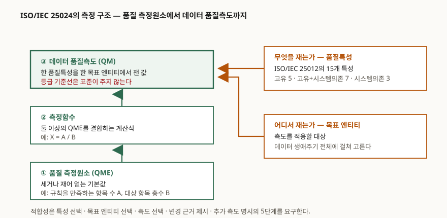

> 실행 검증 없음. 표준 문서를 다루는 개념 글이므로 예제를 돌리지 않았다.
> 범위·적합성 조항·목차·용어는 ISO/IEC 25024·25020·25012의 **공개 미리보기 원문**에서
> 확인했다. 15개 품질특성을 세 묶음으로 나눈 경계는 미리보기에 본문이 없어
> 동료심사를 거친 단행본 장(§비교 절의 주석)으로 보완했고, 그 사실을 아래에 밝혀 둔다.

## 들어가며

데이터 품질·데이터 거버넌스·AI 학습데이터 문항은 거의 언제나 "품질을 지표로
관리한다"는 문장에 도달한다. 문제는 그다음이다. 무엇을 세고, 센 값을 어떻게 묶어
하나의 지표로 만들며, 그 지표를 데이터의 어느 단위에 붙이는가. 여기서 막히면
답안이 "정확성·완전성·일관성을 측정한다"는 나열에서 끝난다. ISO/IEC 25024는 바로
그 세 질문에 답하려고 만든 표준이고, 구조가 세 층으로 단순해서 답안에 옮기기 좋다.

## 정의

**ISO/IEC 25024는 ISO/IEC 25012가 정의한 데이터 품질특성을 정량적으로 측정하기 위한
데이터 품질측도(QM)를, 측정해 얻은 품질 측정원소(QME)와 그것들을 결합하는 측정함수로
구성하도록 규정한 SQuaRE 계열 국제표준이다.**

표준의 범위 조항은 자신이 담은 것을 **4가지**로 적는다.

1. 각 품질특성별 데이터 품질측도의 기본 집합
2. 데이터 생애주기에서 품질측도를 적용할 목표 엔티티(target entity)의 기본 집합
3. 데이터 품질측도를 적용하는 방법에 대한 설명
4. 조직이 자신의 데이터 품질 요구사항과 평가를 위해 측도를 직접 정의할 때의 지침

범위 조항은 **하지 않는 것**도 못 박는다. 이 표준은 측도 값의 구간을 등급이나
수준으로 나누지 않는다. 그 값은 시스템의 성격과 사용자의 필요에 따라 시스템마다
정해지기 때문이라고 이유까지 적혀 있다.

## 등장 배경

SQuaRE 계열은 ISO/IEC 9126과 ISO/IEC 14598을 대체하면서 **품질모델과 측정을 분할로
나눠** 놓았다. 품질모델 분할(2501n)은 "무엇이 품질인가"를 정의하고, 품질측정
분할(2502n)은 "그것을 어떻게 재는가"를 맡는다.

데이터 쪽에서는 2008년에 ISO/IEC 25012가 데이터 품질모델을 먼저 내놓았다. 구조화된
형태로 컴퓨터 시스템 안에 보존되는 데이터를 대상으로 품질특성을 정의하는 표준이다.
그런데 모델만으로는 "정확성이 충분한가"에 답할 수 없다. 세는 단위도, 결합하는
식도, 붙이는 대상도 사람마다 다르게 잡히기 때문이다. 2015년의 25024가 그 자리를
메운다.

품질측정 분할은 25024 발행 시점 기준 **5개 표준**으로 구성된다. 25020이 측정의 틀을
주고, 25021이 QME를 적는 형식을 주며, 25022·25023·25024가 각각 사용품질·시스템 및
소프트웨어 제품품질·데이터품질의 측도를 준다. 2019년 25020 2판에서 IT 서비스
품질 측정(ISO/IEC TS 25025)이 더해져 **6개**가 됐다.

## 구성요소 — 측정의 3층

25020 2판은 측정을 다루는 6장을 **참조모델 → 측도 유형 간 관계 → 측도 선택 →
측도 구성 → 측정 계획과 수행 → 측정 결과 활용**의 **6절**로 짠다. 이 가운데
답안에 그대로 쓰는 뼈대는 측도가 어떻게 조립되는지를 말하는 3층 구조다.

| 층 | 이름 | 무엇인가 | 예 |
|---|---|---|---|
| ① | 품질 측정원소 (QME) | 세거나 재어 직접 얻는 기본값 | 규칙을 만족하는 항목 수 A, 대상 항목 총수 B |
| ② | 측정함수 | 둘 이상의 QME를 결합하는 알고리즘 또는 계산식 | X = A / B |
| ③ | 데이터 품질측도 (QM) | 한 품질특성을 한 목표 엔티티에서 나타낸 값 | 해당 특성의 충족 비율 X |

측정함수를 "둘 이상의 기본 측도 또는 품질 측정원소를 결합하기 위해 수행되는
알고리즘이나 계산"으로 규정하는 쪽은 용어 표준 ISO/IEC/IEEE 24765다. 25020은
이 개념을 그대로 받아 **정규화된 측정함수**를 부속서 D에 따로 둔다.

세 층 말고 하나가 더 필요하다. **목표 엔티티**다. 같은 "완전성"이라도 데이터 항목
하나에 붙이느냐 파일 전체에 붙이느냐에 따라 세는 대상과 분모가 달라진다. 25024가
품질측도를 (품질특성 × 목표 엔티티)의 짝으로 정리하고, 부속서 B를 통째로 그 대응
표에 쓰는 이유다.

### 품질특성 — 15개, 세 묶음

25024 본문 8장은 **15개 품질특성**에 대해 측도를 제시한다. 25012가 이들을 고유
관점과 시스템 의존 관점의 두 시점으로 나누고, 특성 조항을 **세 묶음**으로 쪼갠다.

| 묶음 | 개수 | 품질특성 |
|---|---|---|
| 고유(inherent) | 5 | 정확성, 완전성, 일관성, 신뢰성, 최신성 |
| 고유 + 시스템 의존 | 7 | 접근성, 준거성, 기밀성, 효율성, 정밀성, 추적성, 이해성 |
| 시스템 의존 | 3 | 가용성, 이식성, 복구성 |

고유 품질은 **데이터 자체**가 가진 성질이고, 시스템 의존 품질은 데이터가 쓰이는
시스템의 하드웨어·소프트웨어 능력으로 달성되는 성질이다. 그래서 같은 품질 문제라도
고유 쪽은 데이터 정제·규칙 정비로, 시스템 의존 쪽은 저장소·백업·권한 설계로 간다.
**어느 묶음인지가 곧 조치 주체를 가른다**는 점이 답안에서 쓸 만한 대목이다.

> 세 묶음의 경계와 묶음별 특성 이름은 Springer 단행본의 동료심사 장
> [Felderer·Russo·Auer, *On Testing Data-Intensive Software Systems* §2.2](https://arxiv.org/pdf/1903.09413)에서
> 확인했다. 이 장은 고유 묶음에서 일관성을 빠뜨려 14개만 적고 있어, 빠진 자리는
> 25024 8장이 측도를 배열한 순서(8.2 정확성 → 8.3 완전성 → 8.4 일관성 → 8.5 신뢰성
> → 8.6 최신성)에 맞춰 채웠다.

### 적합성 — 5단계

25024를 "적용했다"고 말하려면 다음 **5단계**를 밟아야 한다고 적합성 조항이 규정한다.

1. 25012에 정의된 데이터 품질특성 중 명세·평가할 것을 고른다
2. 그 특성을 측정할 목표 엔티티를 고른다
3. 그 특성과 목표 엔티티에 맞는 데이터 품질측도를 8장에서 고른다
4. 측도를 수정했다면 변경의 근거를 제시한다
5. 표준에 없는 추가 품질측도나 QME를 썼다면 그 목록을 적는다

1단계와 2단계는 순서를 바꿔도 된다. 4·5단계가 핵심이다. 표준은 측도를 고치는 것을
막지 않는 대신, **무엇을 왜 바꿨는지 남기는 것**을 적합성의 조건으로 삼는다.

## 도식

> **출처**: [ISO/IEC 25024:2015, Systems and software engineering — SQuaRE — Measurement of data quality](https://www.iso.org/standard/35749.html) (발행처: ISO/IEC) — §1 Scope, §2 Conformance, §8 Data QMs, Annex A·B ([공개 미리보기 PDF](https://assets.vde-verlag.de/iec-normen/preview-pdf/info_isoiec25024%7Bed1.0%7Den.pdf), 제3자 전재)

## 비교 — 네 표준이 맡은 자리

| 표준 | 판 | 맡은 자리 | 답안에서 구분점 |
|---|---|---|---|
| ISO/IEC 25012 | 2008-12-15 1판 | 데이터 품질**모델** — 무엇이 품질인가 | 15개 특성을 정의만 한다. 재는 법은 없다 |
| ISO/IEC 25020 | 2019-07 2판 | 품질측정 **프레임워크** | 측도를 고르고 만드는 일반 절차. 데이터 전용이 아니다 |
| ISO/IEC 25024 | 2015-10-15 1판 | 데이터 품질**측도** | 25012의 15개 특성별 측도와 목표 엔티티 |
| ISO/IEC 5259-2 | 2024-11-05 1판 | 분석·ML용 데이터 품질모델과 측도 | 학습·검증 데이터를 겨냥해 모델과 측도를 따로 규정 |

ISO/IEC 5259-2는 데이터 품질모델과 품질측도, 그리고 품질 보고 지침을 **분석과
기계학습의 맥락에서** 규정한다고 범위에 적는다. 25024가 "구조화된 형태로 보존되는
모든 데이터"를 대상으로 삼는 것과 달리 대상이 좁고, 그 대신 학습 데이터에서만
문제가 되는 성질까지 들어간다. 다만 **5259-2가 25024의 측도를 어디까지 그대로
가져다 쓰고 어디를 고쳤는지는 본문을 봐야 알 수 있고, 두 표준 모두 유료라
여기서는 확인하지 못했다.** 확인하지 못한 것은 적지 않는다.

## 적용 시 고려사항 — 4가지

1. **기준선은 표준에 없다.** 25024는 측도 값의 등급 구간을 정의하지 않는다고 범위
   조항에 명시한다. "완전성 95% 이상"은 표준이 준 숫자가 아니라 조직이 문맥을 보고
   정해 근거를 남겨야 하는 숫자다. 답안에서 기준선을 들 때는 출처를 함께 적는다.
2. **목표 엔티티를 먼저 고정한다.** 같은 특성이라도 대상이 데이터 항목이냐 레코드냐
   파일이냐에 따라 분모가 달라져 값이 비교 불가능해진다. 두 기간, 두 시스템의
   품질 수치를 비교하려면 목표 엔티티가 같아야 한다.
3. **표준이 스스로 한계를 적어 두었다.** 적합성 조항은 이 표준에 실린 품질측도 중
   일부가 아직 경험적으로 검증되지 않았고 산업계의 모범 사례에 기반하지 않은 것도
   있다고 밝힌다. 그대로 계약상 KPI로 올리기 전에 조직 데이터로 타당성을 확인해야
   한다는 뜻이다.
4. **측정은 QME 수집 설계에서 끝난다.** 측정함수는 나눗셈 한 번이지만 분자 A를 어떻게
   세는지가 전부다. 규칙을 만족하는 항목을 세려면 규칙이 먼저 있어야 하고, 그 규칙은
   25012가 말하는 "업무 규칙"으로 조직이 정의한다. 측정 체계를 만들자는 제안은
   사실상 **데이터 규칙을 문서화하자는 제안**이다.

## 정리

**"측·함·측도 + 엔티티"** — 측정원소(QME)를 세고, 측정**함**수로 묶고, 품질**측도**를
얻되, 그 값은 항상 **목표 엔티티** 위에서만 뜻을 갖는다.

- 측정 구조는 **3층**: QME → 측정함수 → QM
- 품질특성은 **15개**, 고유 **5** · 고유+시스템 의존 **7** · 시스템 의존 **3**
- 25024 범위가 담은 것은 **4가지**, 적합성은 **5단계**
- 품질측정 분할(2502n)은 25020 2판 기준 **6개 표준**
- 표준이 주지 않는 것은 **등급 기준선** — 조직이 문맥으로 정하고 근거를 남긴다

> 기출 답안: [기출문제 — AI 학습용 데이터 품질관리 지표와 활동](../../exam/2026-10-20-ai-training-data-quality-indicators/index.md)

## 참고 자료

- [ISO/IEC 25024:2015 Systems and software engineering — SQuaRE — Measurement of data quality](https://www.iso.org/standard/35749.html) (발행처: ISO/IEC) — 범위, 적합성, 8장 품질특성별 측도, 부속서 A~E. 본문 확인은 [공개 미리보기 PDF](https://assets.vde-verlag.de/iec-normen/preview-pdf/info_isoiec25024%7Bed1.0%7Den.pdf)(제3자 전재)
- [ISO/IEC 25020:2019 SQuaRE — Quality measurement framework](https://www.iso.org/standard/72117.html) (발행처: ISO/IEC) — 품질측정 참조모델, 6장 6개 절, 부속서 D 정규화된 측정함수. [공개 미리보기 PDF](https://assets.vde-verlag.de/iec-normen/preview-pdf/info_isoiec25020%7Bed2.0%7Den.pdf)(제3자 전재)
- [ISO/IEC 25012:2008 SQuaRE — Data quality model](https://www.iso.org/standard/35736.html) (발행처: ISO/IEC) — 데이터 품질모델, 고유·시스템 의존 두 시점. [공개 미리보기 PDF](https://assets.vde-verlag.de/iec-normen/preview-pdf/info_isoiec25012%7Bed1.0%7Den.pdf)(제3자 전재)
- [ISO/IEC 5259-2:2024 Artificial intelligence — Data quality for analytics and ML — Part 2: Data quality measures](https://www.iso.org/standard/81860.html) (발행처: ISO/IEC) — 범위와 발효일은 [EVS 표준 목록](https://www.evs.ee/en/iso-iec-5259-2-2024)에서 확인
- [Felderer M., Russo B., Auer F., *On Testing Data-Intensive Software Systems* §2.2 Data Quality (2019)](https://arxiv.org/pdf/1903.09413) — 25012 품질특성의 세 묶음 구분을 옮겨 적은 동료심사 단행본 장
- [AKIT, measurement function](https://akit.cyber.ee/term/10292) — ISO/IEC/IEEE 24765의 측정함수 정의를 전재한 용어집
