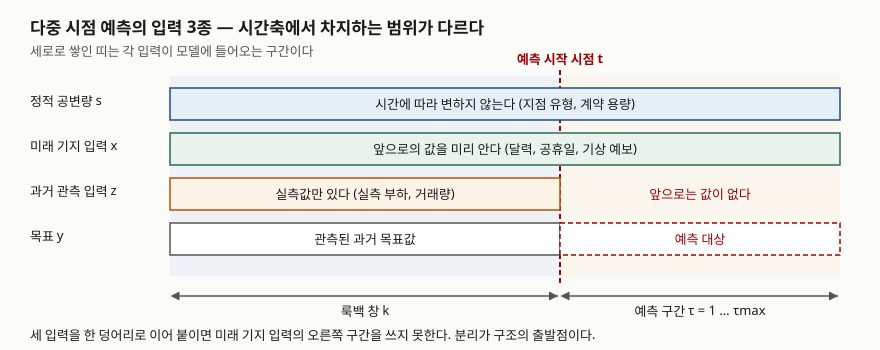
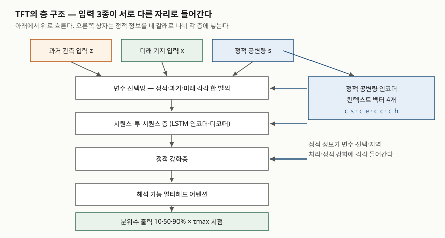

## 들어가며

시계열 예측 문제를 받으면 과거값을 넣고 다음 값을 받는 구조부터 떠올리게 된다. 그런데
전력 수요나 매장 매출을 하루 앞서 예측하는 일에는 **값을 이미 아는 미래 변수**가 섞여
있다. 내일이 공휴일인지, 기상청 예보가 몇 도인지는 지금 안다. 과거값만 받는 구조는 이
정보를 쓸 자리가 없고, 반대로 모든 입력을 미래까지 안다고 가정하는 구조는 실측 부하처럼
미래값이 없는 변수를 처리하지 못한다. 시험에서 시계열 딥러닝을 물을 때 구조 이름을 나열하면
점수가 안 붙고, **입력의 성질에 따라 구조가 갈린다**는 축을 세워야 답안이 된다.

> 실행 검증 없음. 모델을 직접 학습시키지 않았고, 원 논문에 적힌 구조와 정의만 정리했다.
> 논문이 보고한 실험 수치는 데이터셋에 묶인 값이므로 옮기지 않았다.

## 정의

**다중 시점 예측(multi-horizon forecasting)은 한 시점 t에서 앞으로 τ = 1부터 τmax까지
여러 시점의 목표값을 동시에 내는 문제다.** TFT 논문은 이 문제를 과거 k개 구간의 목표값·
과거 관측 입력과, 전 구간에 걸친 미래 기지 입력, 그리고 정적 공변량을 받아 분위수를
내는 함수로 정의한다.

**TFT(Temporal Fusion Transformer)는 정적 공변량·미래 기지 입력·과거 관측 입력을
구조적으로 분리해 받고, 변수 선택과 어텐션으로 해석 가능성을 갖춘 어텐션 기반 다중 시점
예측 모형이다.** 논문의 초록은 지역 패턴을 다루는 순환층, 장기 의존성을 배우는 해석 가능
셀프 어텐션층, 쓸모 있는 변수를 고르는 변수 선택망, 불필요한 구성요소를 눌러 두는 게이팅층을
구성요소로 든다.

## 등장 배경

### 순환 구조의 한계와 LSTM

기본 RNN은 오차를 시간 축으로 거슬러 전파한다. LSTM 원 논문은 첫 문장에서 문제를 짚는다.
긴 시간 간격의 정보를 저장하도록 학습시키는 데 오래 걸리는 이유가 **부족하고 사그라드는
오차 역류**라는 것이다. 해법은 **상수 오차 회전자**(CEC)를 둔 특수 단위 안에서 오차가
일정하게 흐르게 하고, **곱셈 게이트**가 그 흐름에 대한 접근을 열고 닫게 하는 것이다.
논문은 이 구조로 1,000 시간 단계가 넘는 시차를 이을 수 있고, 가중치·시간 단계당 계산
복잡도가 O(1)이라고 적는다.

여기서 자주 틀리는 대목이 **게이트 개수**다. 1997년 원 논문의 기억 셀은 입력 게이트와
출력 게이트 **2개**다. 오늘날 교과서가 그리는 **망각 게이트**는 2000년 Gers 등이
덧붙인 것으로, 끝이 표시되지 않은 연속 입력 스트림에서 셀 상태가 한없이 커져 망이
망가지는 문제를 풀기 위한 장치다. 셀이 스스로 상태를 비우는 시점을 배운다.

### 순차 처리를 벗어나려는 두 갈래

LSTM도 결국 한 단계씩 상태를 넘긴다. 이를 벗어나려는 시도가 두 갈래로 갈린다.
**합성곱 계열**은 과거 창을 한 번에 본다. TCN 논문이 든 두 원칙은 ① 출력 길이가 입력과
같을 것, ② 미래에서 과거로 정보가 새지 않을 것이다. 첫째는 1차원 완전 합성곱망에 커널
크기 − 1만큼 영을 덧대어, 둘째는 시각 t의 출력을 **t 이하의 입력하고만** 합성곱하는
인과 합성곱으로 만족시킨다. 논문은 이를 "TCN = 1차원 FCN + 인과 합성곱"이라고 줄여
적는다. 다만 단순 인과 합성곱은 과거를 보는 길이가 망의 깊이에 비례할 뿐이라, **팽창
합성곱**으로 수용 영역을 지수적으로 키우고 **잔차층**으로 깊이를 감당한다.

**어텐션 계열**은 한 걸음 더 간다. Transformer 논문은 순환과 합성곱을 **완전히 걷어내고**
어텐션만으로 구조를 세웠다고 적으며, 그 결과 병렬화가 쉽고 학습 시간이 크게 줄었다고 말한다.

### 그래도 남은 문제 — 입력의 이질성

TFT 논문은 기존 구조들이 **다중 시점 예측에 흔히 나타나는 입력 종류의 차이를 고려하지
않는다**고 지적한다. 외생 입력이 전부 미래까지 알려져 있다고 가정하거나(자기회귀 모형이
흔히 겪는 문제), 정적 공변량을 무시하고 시점마다 다른 특징과 그냥 이어 붙인다는 것이다.
TFT의 출발점이 여기다.

## 구성요소

### 입력 3종

| 구분 | 기호 | 성질 | 예 |
|---|---|---|---|
| **정적 공변량** | s | 시간에 따라 변하지 않는다 | 지점 유형, 계약 용량, 품목 번호 |
| **미래 기지 입력** | x | 미래 값을 미리 정할 수 있다 | 요일, 공휴일, 판촉 기간, 기상 예보 |
| **과거 관측 입력** | z | 매 시점 측정될 뿐 사전에 모른다 | 실측 부하, 방문객 수, 거래량 |

> **출처**: [Lim, Arık, Loeff & Pfister, Temporal Fusion Transformers for Interpretable Multi-horizon Time Series Forecasting, arXiv:1912.09363 — §3 Multi-horizon Forecasting, Fig. 1](https://arxiv.org/abs/1912.09363)

### TFT의 구성요소 5가지

1. **게이팅 구성요소** — 게이트 선형 단위(GLU)와 게이트 잔차망(GRN)으로 쓰이지 않는
   경로를 눌러 둔다. 데이터가 작거나 잡음이 많을 때 모형 크기를 사실상 줄이는 장치다
2. **변수 선택망** — 정적·과거·미래 입력에 **각각 한 벌씩** 따로 붙는다. 어떤 변수가
   예측에 기여하는지 보여 주는 동시에, 예측력 없는 잡음 입력을 덜어 낸다
3. **정적 공변량 인코더** — 정적 정보를 **컨텍스트 벡터 4개**(c_s, c_e, c_c, c_h)로
   나눠 각 층에 꽂는다. c_c와 c_h는 시퀀스-투-시퀀스 층의 LSTM 셀 상태와 은닉 상태를
   초기화하고, c_e는 정적 강화층에, c_s는 변수 선택망에 들어간다
4. **시퀀스-투-시퀀스 층과 정적 강화층** — LSTM 인코더·디코더로 지역 패턴을 처리하며,
   이것이 **위치 인코딩을 대신**해 시간 순서를 알려 준다. 그 위에 정적 강화층이 정적
   정보를 시점별 특징에 섞는다
5. **해석 가능 멀티헤드 어텐션** — 여러 헤드가 공통 입력 특징을 보면서 서로 다른 시간
   패턴을 배우게 해, 어텐션 가중치를 변수·시점 기여도로 읽을 수 있게 만든다

> **출처**: [Lim et al., arXiv:1912.09363 — §4.2 Variable Selection Networks, §4.3 Static Covariate Encoders, §4.5 Temporal Fusion Decoder](https://arxiv.org/abs/1912.09363)

### 출력 2가지

- **다중 시점 동시 출력**: τ = 1부터 τmax까지를 한 번에 낸다. 한 시점씩 되먹여 반복하는
  방식과 달라 예측 오차가 누적되지 않는다
- **분위수 출력**: 점 하나가 아니라 분위수 회귀로 여러 값을 낸다. 논문은 각 시점에서
  10·50·90 백분위수를 내는 예를 든다

## 비교

| | 시간 의존성을 잡는 방식 | 미래 기지 입력 | 정적 공변량 | 해석 단서 |
|---|---|---|---|---|
| **LSTM** | 은닉 상태를 한 단계씩 넘긴다. CEC와 게이트로 긴 시차를 잇는다 | 구조에 자리가 없어 과거 입력과 섞어 넣게 된다 | 시점 특징에 이어 붙인다 | 없다 |
| **TCN** | 인과·팽창 합성곱으로 과거 창을 한 번에 본다 | 같다 | 같다 | 없다 |
| **Transformer** | 셀프 어텐션으로 먼 시점을 직접 잇는다 | 같다 | 같다 | 어텐션 가중치 |
| **TFT** | 지역은 LSTM 인코더·디코더, 장기는 셀프 어텐션 | 전 구간 입력으로 따로 받는다 | 컨텍스트 벡터 4개로 각 층에 넣는다 | 변수 선택 가중치 + 어텐션 |

비교의 축은 **어느 쪽이 정확한가**가 아니라 **입력의 성질을 구조가 받아 주는가**다.
TCN 논문도 순환 구조의 "무한 기억"이 실제로는 그만큼 길지 않다는 점을 지적할 뿐,
모든 문제에서 합성곱이 낫다고 주장하지 않는다.

## 적용 시 고려사항

1. **입력을 분류하는 일이 모델 선택보다 앞선다.** 변수를 정적·미래 기지·과거 관측으로
   먼저 가른 뒤, 미래 기지 입력이 많고 중요하다면 그 자리를 가진 구조를 고른다.
   분류를 건너뛰고 구조부터 고르면 기상 예보와 공휴일을 과거 입력 칸에 밀어 넣게 된다
2. **필요한 과거 길이를 먼저 정한다.** TCN은 수용 영역이 깊이·커널 크기·팽창 계수로
   정해지므로, 하루 주기를 보려면 그만큼의 수용 영역이 나오도록 세 값을 맞춰야 한다.
   룩백 창 k도 같은 판단이다. 주기보다 짧게 잡으면 구조가 아무리 좋아도 못 본다
3. **분위수 출력은 뒤 단계가 쓸 때만 값이 있다.** 예비력 산정이나 재고 안전계수처럼
   "얼마나 틀릴 수 있는가"를 받아 쓰는 결정이 있어야 분위수가 뜻을 갖는다.
   받는 쪽이 중앙값만 쓸 거라면 학습 비용만 늘어난다
4. **어텐션 가중치는 설명이지 인과가 아니다.** TFT가 내놓는 변수 선택 가중치와 어텐션은
   모형이 무엇을 봤는지를 보여 줄 뿐, 그 변수가 결과를 **일으켰다**는 근거가 아니다.
   운영자에게 전달할 때 이 구분을 같이 전달하지 않으면 잘못된 조치로 이어진다

## 정리

**"입력 3종, 구성요소 5가지, 컨텍스트 4개"**로 묶으면 답안에서 빠뜨리지 않는다.

- **입력 3종** — 정적 공변량 s, 미래 기지 입력 x, 과거 관측 입력 z. 시간축에서
  차지하는 범위가 다르다는 것이 핵심
- **구성요소 5가지** — 게이팅, 변수 선택망, 정적 공변량 인코더, 시퀀스-투-시퀀스·정적
  강화층, 해석 가능 멀티헤드 어텐션
- **컨텍스트 4개** — c_s·c_e·c_c·c_h. 정적 정보가 한 자리가 아니라 네 자리로 들어간다
- **LSTM 게이트는 원래 2개**(입력·출력)였고 망각 게이트는 2000년에 붙었다
- **TCN의 원칙 2가지** — 입력과 같은 출력 길이, 미래에서 과거로 새지 않는 인과성
- 수치는 쓰지 않는다. 논문의 실험 결과는 데이터셋에 묶여 일반화할 수 없다

> 기출 답안: [기출문제 — 가상발전소 전력수요 예측의 AI 기법](../../exam/2026-10-23-vpp-demand-forecasting-ai-techniques/index.md)

## 참고 자료

- [Lim, Arık, Loeff & Pfister, Temporal Fusion Transformers for Interpretable Multi-horizon Time Series Forecasting, arXiv:1912.09363 (2019-12, v3 2020-09)](https://arxiv.org/abs/1912.09363) — 입력 3종 정의, 변수 선택망, 정적 컨텍스트 벡터 4개, 분위수 출력
- [Hochreiter & Schmidhuber, Long Short-Term Memory, Neural Computation 9(8), 1997, pp. 1735–1780](https://doi.org/10.1162/neco.1997.9.8.1735) — 오차 역류 문제, 상수 오차 회전자, 곱셈 게이트 2개, O(1) 복잡도
- [Gers, Schmidhuber & Cummins, Learning to Forget: Continual Prediction with LSTM, Neural Computation 12(10), 2000, pp. 2451–2471](https://doi.org/10.1162/089976600300015015) — 망각 게이트
- [Bai, Kolter & Koltun, An Empirical Evaluation of Generic Convolutional and Recurrent Networks for Sequence Modeling, arXiv:1803.01271 (2018)](https://arxiv.org/abs/1803.01271) — §3 Temporal Convolutional Networks, 인과 합성곱·팽창 합성곱·잔차층
- [Vaswani et al., Attention Is All You Need, NeurIPS 2017 (arXiv:1706.03762)](https://arxiv.org/abs/1706.03762) — 순환·합성곱을 걷어낸 어텐션 전용 구조
