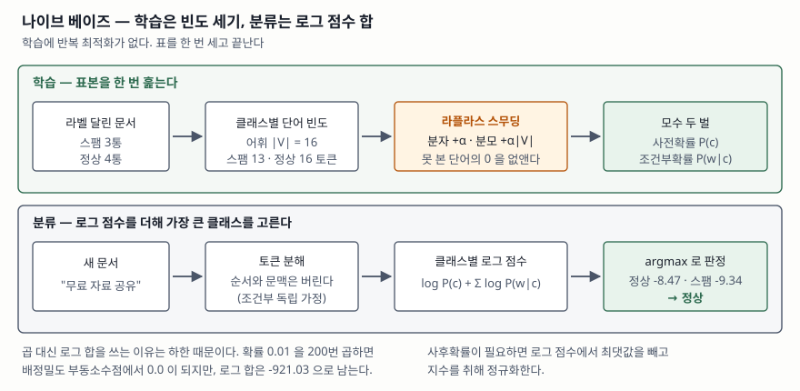

## 들어가며

베이즈 정리를 묻는 문항은 식 한 줄로 끝나지만, 분류기를 묻는 문항은 그 식을 **단어
수천 개짜리 문서에 어떻게 적용하는가**를 묻는다. 둘 사이에는 건너뛸 수 없는 간격이
하나 있다. 문서 전체의 가능도 P(문서|클래스)는 단어 조합의 수만큼 경우가 생겨 표본으로
추정할 수 없다. 그 간격을 메우는 것이 **조건부 독립 가정** 하나이고, 그래서 이 분류기의
이름에 '나이브(naive, 순진한)'가 붙는다. 스팸 필터, 문서 분류, 감성 분석이 전부 이
가정 위에 서 있다.

> 계산이 들어가는 주제이므로 분류기를 직접 구현해 검산했다. 본문의 모든 수치는
> `code/output.txt`에 남은 실행 기록에서 가져왔다. 학습에 쓴 메일 7통은 계산 과정을
> 드러내려고 만든 가상의 문서다.

---

## 정의

**나이브 베이즈 분류기(naive Bayes classifier)** 는 베이즈 정리로 사후확률을 계산하되,
**모든 특징이 클래스가 주어졌을 때 서로 조건부 독립이라고 가정해** 가능도를 각 특징의
확률의 곱으로 분해하는 확률적 분류기다.

판정은 사후확률이 가장 큰 클래스를 고르는 것이다. 분모 P(d)는 클래스에 무관하므로
비교에서 빠진다.

> ĉ = argmax<sub>c</sub> P(c) · Π<sub>t</sub> P(w<sub>t</sub>|c)

답안에 쓸 때는 **가정의 위치**를 정확히 적어야 한다. 흔한 오답이 "단어들이 독립이라고
가정한다"로 쓰는 것인데, 독립이 아니라 **클래스를 조건으로 한 독립**이다. '무료'와
'대출'은 전체 문서 집합에서는 함께 나타나므로 독립이 아니다. 다만 "스팸이라는 사실을
알고 난 뒤에는" 서로 무관하다고 보는 것이다.

## 등장 배경 — 왜 가정을 넣어야 했는가

Maron이 1961년 *Journal of the ACM*에 실은 자동 색인 실험이 이 계열의 출발점이다.
단서어(clue word)의 출현을 근거로 베이즈 공식을 써서 문서를 주제 범주에 배정하는
방식이었다.

가정이 필요한 이유는 **모수의 개수**다. 어휘가 |V|개인 이진 특징 공간에서 가능도
P(d|c)를 가정 없이 추정하려면 클래스마다 2<sup>|V|</sup>−1개의 모수가 필요하다.
어휘가 1,000개만 되어도 추정할 수 없는 수다. 조건부 독립을 넣으면 클래스마다 |V|개로
줄어든다. **지수가 선형이 된다.**

McCallum과 Nigam(1998)은 이 분해가 두 가지 서로 다른 생성 모형에서 나올 수 있음을
정리했다. 어느 쪽을 택하느냐에 따라 모수 추정식이 달라지는데, 당시 문헌이 둘을 섞어
쓰고 있다는 것이 그 논문의 문제의식이었다.

## 구성요소 — 모수 2벌, 절차 4단계, 가정 2가지

### 모수 2벌

| 모수 | 무엇 | 개수 |
|---|---|---|
| **사전확률** P(c) | 각 클래스의 문서 비율 | 클래스 수만큼 |
| **조건부확률** P(w|c) | 클래스 c에서 단어 w가 나올 확률 | 클래스 수 × \|V\| |

### 절차 4단계

1. **토큰화** — 문서를 단어 단위로 쪼갠다. 순서와 문맥은 버린다
2. **빈도 집계** — 클래스별 문서 수와 단어 빈도를 센다
3. **모수 추정** — 비율로 확률을 내되 라플라스 스무딩을 적용한다
4. **분류** — 로그 확률을 더해 가장 큰 클래스를 고른다

**학습에 반복 최적화가 없다.** 표를 한 번 세고 끝난다. 이것이 이 분류기가 지금까지
쓰이는 가장 큰 이유다.



> **출처**: [A. McCallum, K. Nigam, *A Comparison of Event Models for Naive Bayes Text Classification*, AAAI-98 Workshop on Learning for Text Categorization, pp. 41–48 — 식 (4) 사전확률, 식 (6) 다항 모델 조건부확률, 식 (7) 분류](https://www.cs.tufts.edu/~nr/cs257/archive/andrew-mccallum/event-models.pdf)

### 가정 2가지

① **조건부 독립** — 클래스가 주어지면 단어들이 서로 무관하다
② **위치 무관** — 같은 단어는 문서의 어디에 나와도 같은 확률을 갖는다 (bag of words)

## 동작 원리

### 라플라스 스무딩 — 0을 없앤다

학습 집합에 없던 단어가 시험 문서에 나오면 그 클래스의 가능도가 0이 된다. 곱셈이므로
**단어 하나가 나머지 전부를 무효로 만든다.** McCallum과 Nigam은 라플라스 사전분포로
각 단어의 빈도를 1씩 올려 이 문제를 없앤다. 다항 모델의 추정식(식 6)은 다음과 같다.

> P(w|c) = (단어 w의 빈도 + α) / (클래스 c의 전체 토큰 수 + α·|V|)

분모에 α·|V|를 더하는 것이 중요하다. 이것이 있어야 어휘 전체에 대한 확률의 합이 1이
된다. 실행 기록에서 이 성질을 확인했다.

```text
  sum_w P(w|스팸) = 1.000000   (어휘 전체에 대해 1 이 되어야 한다)
  sum_w P(w|정상) = 1.000000   (어휘 전체에 대해 1 이 되어야 한다)
```

α를 키우면 못 본 단어에 확률이 생기는 대신 본 단어의 확률이 깎인다. 어휘에 '할인'을
넣고 α를 바꿔 가며 본 결과다.

```text
     alpha        P(할인|스팸)        P(무료|스팸)
      0.00        0.000000        0.307692
      0.01        0.000759        0.304480
      0.10        0.006803        0.278912
      1.00        0.033333        0.166667
```

α=1에서 '무료'의 확률이 0.308에서 0.167로 거의 절반이 된다. 학습 표본이 작을수록 이
희석이 세므로, scikit-learn 문서는 **α=1을 라플라스 스무딩, α<1을 리드스톤(Lidstone)
스무딩**으로 구분해 부른다.

### 로그 확률 합산 — 하한을 피한다

곱으로 계산하면 토큰이 늘수록 값이 0으로 가라앉는다. 직접 확인한 결과다.

```text
      토큰 수                       곱          로그 합
        10            1.000000e-20        -46.05
       100           1.000000e-200       -460.52
       160           9.999889e-321       -736.83
       200            0.000000e+00       -921.03

  float 의 최소 정규값 = 2.225074e-308
  0.01 ** 200 == 0.0 ? True
```

160번째 곱에서 이미 비정규수 영역에 들어가 유효숫자를 잃고, 200번째에서 0이 된다.
0이 되면 두 클래스 점수가 모두 0이라 비교 자체가 불가능해진다. 로그를 취하면 곱이
합이 되므로 같은 지점에서도 −921.03으로 남는다. **실무 구현이 예외 없이 로그를 쓰는
이유가 이것이다.** 사후확률이 필요하면 로그 점수에서 최댓값을 빼고 지수를 취해
정규화한다.

실제 분류 과정은 이렇게 찍힌다.

```text
  스팸: log P(스팸)=-0.8473 log P(무료|스팸)=-1.7579 log P(자료|스팸)=-3.3673 log P(공유|스팸)=-3.3673
       합계 = -9.3397
  정상: log P(정상)=-0.5596 log P(무료|정상)=-3.4657 log P(자료|정상)=-2.3671 log P(공유|정상)=-2.0794
       합계 = -8.4719

  정상: 로그점수 -8.4719  사후확률 0.7043
  스팸: 로그점수 -9.3397  사후확률 0.2957
  -> 판정: 정상
```

'무료'는 스팸 쪽 증거지만 '자료'와 '공유'가 정상 쪽으로 더 세게 당겨 판정이 뒤집힌다.
**증거가 더해지는 모습이 로그 항 하나씩에 그대로 보인다.** 이것이 답안에서 쓸 수 있는
이 모형의 설명력이다.

## 비교

### 사건 모델 2가지

McCallum과 Nigam이 가른 두 생성 모형이다.


> **출처**: [A. McCallum, K. Nigam, *A Comparison of Event Models for Naive Bayes Text Classification*, AAAI-98 — 식 (2)·(3) 다변량 베르누이, 식 (5)·(6) 다항](https://www.cs.tufts.edu/~nr/cs257/archive/andrew-mccallum/event-models.pdf)

| | 다항 (multinomial) | 다변량 베르누이 |
|---|---|---|
| **문서를 무엇으로 보는가** | 단어 사건의 열 | 어휘 길이의 0/1 벡터 |
| **빈도** | 센다. 두 번 나오면 두 번 곱한다 | 안 센다. 있나 없나만 |
| **곱하는 항** | 문서에 나온 단어만 | 어휘 전부. 안 나온 단어는 1−P(w\|c) |
| **스무딩 분모** | 클래스 총 토큰 + α·\|V\| | 클래스 문서 수 + 2 |
| **원 논문의 결론** | 어휘가 클 때 대체로 낫다 | 어휘가 작을 때 나을 때가 있다 |

같은 문서 "무료 자료 공유"를 두 모형으로 돌린 결과다.

| 모형 | 로그점수(정상) | 로그점수(스팸) | 사후확률(정상) | 곱한 항의 수 |
|---|---|---|---|---|
| 다항 | -8.4719 | -9.3397 | 0.7043 | 3 |
| 다변량 베르누이 | -8.6507 | -10.1327 | 0.8149 | 16 |

판정은 둘 다 '정상'이지만 확신의 정도가 다르다. 베르누이는 **'쿠폰'·'대출'이 없다는
사실**까지 증거로 세기 때문이다. McCallum과 Nigam은 다섯 개 말뭉치에서 다항 모형이
베르누이 대비 평균 27%의 오류 감소를 보였다고 보고한다.

### 다른 분류기와의 대비

| | 나이브 베이즈 | 로지스틱 회귀 | 의사결정나무 |
|---|---|---|---|
| **추정 대상** | 생성 모형 P(d,c) | 판별 모형 P(c\|d) | 분할 규칙 |
| **학습 비용** | 빈도 한 번 집계 | 반복 최적화 | 반복 분할 |
| **특징 상관** | 가정으로 무시 | 가중치로 흡수 | 분할로 흡수 |
| **작은 표본** | 상대적으로 강하다 | 과적합하기 쉽다 | 과적합하기 쉽다 |
| **확률 보정** | 나쁘다 | 상대적으로 낫다 | 나쁘다 |

## 적용 시 고려사항

**첫째, 가정이 깨져도 분류는 자주 맞는다.** Domingos와 Pazzani(1997)는 이 분류기가
**독립 가정이 크게 어긋나는 영역에서도 0-1 손실 기준으로는 최적일 수 있음**을 보였다.
순위만 맞으면 argmax는 같은 답을 내기 때문이다. 그래서 "독립 가정이 비현실적이므로
쓸 수 없다"는 문장은 답안에서 감점 요인이다. **정확히 무엇이 망가지는지**를 써야 한다.

**둘째, 망가지는 것은 확률값이다.** 상관된 단어가 여럿 들어오면 같은 증거를 여러 번
곱하게 되어 사후확률이 0이나 1 쪽으로 몰린다. scikit-learn 문서도 나이브 베이즈를
**괜찮은 분류기지만 나쁜 추정기**로 설명하며 `predict_proba`의 출력을 그대로 믿지 말라고
적는다. 임계값을 확률로 거는 설계(예: "0.9 이상이면 자동 차단")는 이 지점에서 깨진다.

**셋째, 클래스 불균형에 약하다.** 사전확률과 토큰 수가 모두 다수 클래스 쪽으로 기운다.
scikit-learn은 이를 위해 각 클래스의 **여집합** 통계로 가중치를 계산하는
ComplementNB를 따로 제공하며, 불균형 데이터셋에 특히 맞는다고 설명한다.

**넷째, 어휘 밖 단어는 버려진다.** 예제에서 "무료 쿠폰 할인"을 분류할 때 '할인'은
어휘에 없어 그냥 빠졌다. 운영 중인 필터라면 **어휘를 갱신하지 않는 동안 새 표현이
계속 무시된다.** 스팸 발신자가 표기를 바꾸는 것만으로 필터를 피하는 경로가 여기다.

**다섯째, 전처리가 모형보다 크게 작용한다.** 한국어는 조사가 붙어 '무료'와 '무료로'가
다른 토큰이 된다. 형태소 분석을 거치느냐에 따라 어휘 크기와 |V|가 달라지고, 그러면
스무딩의 세기까지 달라진다. **모형을 바꾸기 전에 토큰화를 본다.**

## 정리

- **가정의 위치를 정확히 쓴다** — 단어의 독립이 아니라 **클래스를 조건으로 한**
  조건부 독립이다
- **가정이 필요한 이유는 모수 개수다** — 2<sup>\|V\|</sup>−1개가 \|V\|개로 줄어든다.
  지수가 선형이 된다
- **가정 2가지** — 조건부 독립, 위치 무관(bag of words)
- **절차 4단계** — 토큰화 → 빈도 집계 → 모수 추정(스무딩) → 로그 합 argmax
- **스무딩의 분모를 잊지 않는다** — 분자 +α, 분모 +α·\|V\|. 확률의 합이 1이 되어야 한다
- **로그를 쓰는 이유는 하한이다** — 0.01을 200번 곱하면 0.0, 로그 합은 −921.03
- **사건 모델 2가지** — 다항은 빈도를 세고 나온 단어만, 베르누이는 0/1로 어휘 전부
- **가정이 깨져도 판정은 맞되 확률이 틀어진다** (Domingos·Pazzani 1997)

> 기출 답안: [기출문제 — 베이즈 정리](../../exam/2026-10-25-bayes-theorem/index.md)

## 참고 자료

- [A. McCallum, K. Nigam, *A Comparison of Event Models for Naive Bayes Text Classification*, AAAI-98 Workshop on Learning for Text Categorization, pp. 41–48 (1998)](https://www.cs.tufts.edu/~nr/cs257/archive/andrew-mccallum/event-models.pdf) — 두 사건 모델의 생성 과정, 라플라스 사전분포, 다섯 말뭉치 비교
- [P. Domingos, M. Pazzani, *On the Optimality of the Simple Bayesian Classifier under Zero-One Loss*, Machine Learning 29, pp. 103–130 (1997)](https://doi.org/10.1023/A:1007413511361) — 독립 가정이 어긋나도 0-1 손실 기준으로 최적일 수 있는 조건
- [M. E. Maron, *Automatic Indexing: An Experimental Inquiry*, Journal of the ACM 8(3), pp. 404–417 (1961)](https://doi.org/10.1145/321239.321245) — 단서어와 베이즈 공식으로 문서를 주제 범주에 배정한 초기 실험
- [scikit-learn User Guide §1.9 Naive Bayes](https://scikit-learn.org/stable/modules/naive_bayes.html) — 변형 5가지, 라플라스·리드스톤 구분, ComplementNB, 확률 추정의 한계
- 예제 전체 소스: [`code/naive_bayes.py`](code/naive_bayes.py) · 실행 기록: [`code/output.txt`](code/output.txt)
