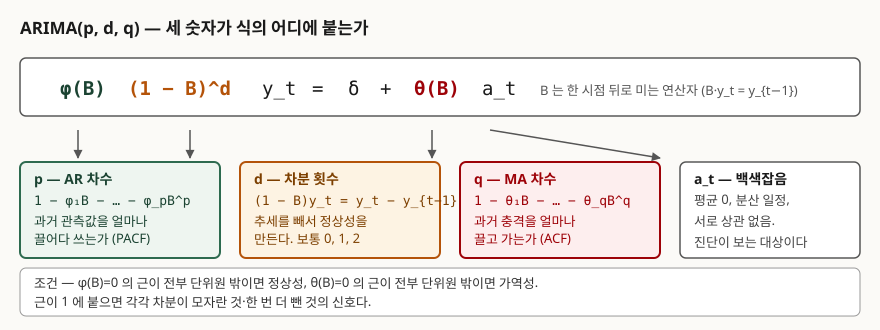
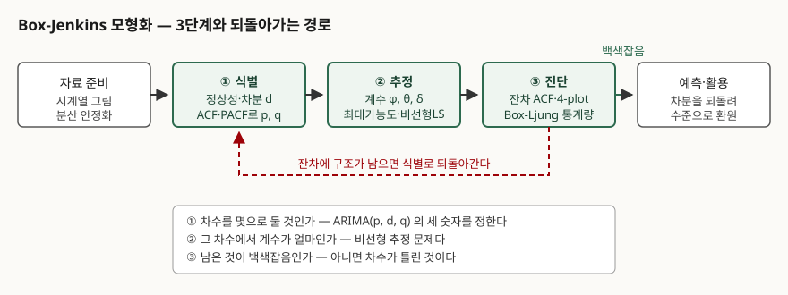

## 들어가며

시계열 문항은 두 갈래로 나온다. 하나는 "AR과 MA를 비교하라"처럼 모형 자체를 묻고,
다른 하나는 "수요 예측 모형을 어떻게 수립할 것인가"처럼 **절차**를 묻는다. 뒤쪽에서
점수가 갈리는 지점은 모형식이 아니라 **차수를 어떻게 정했고 그 선택이 맞는지를 무엇으로
확인했는가**다. Box와 Jenkins가 정리한 3단계가 그 답이고, 실무에서도 수요 예측·용량
산정·이상탐지 기준선을 만들 때 그대로 쓰인다. 모형을 한 번에 고르는 것이 아니라
**진단에서 떨어지면 식별로 되돌아가는 순환**이라는 점이 이 절차의 핵심이다.

> 계산으로 확인할 수 있는 주제이므로 ARIMA(1,1,1) 표본경로를 만들어 3단계를 직접
> 따라갔다. 본문의 모든 수치는 `code/output.txt`에 남은 실행 기록에서 가져왔다.
> statsmodels 없이 표준 라이브러리만 썼고, 난수는 선형합동법으로 만들어 어느 기계에서
> 돌려도 같은 표본경로가 나온다.

---

## 정의

**ARIMA(p, d, q)** 는 **d회 차분해 정상성을 확보한 시계열을 p차 자기회귀항과 q차
이동평균항의 합으로 설명하는 모형**이고, **Box-Jenkins 모형화 절차**는 그 모형을
식별·추정·진단 **3단계의 순환**으로 세우는 방법론이다.

NIST/SEMATECH 핸드북은 Box-Jenkins 모형을 AR과 MA를 결합한 형태로 적고, 비정상
계열은 정상이 될 때까지 한 번 이상 차분하라는 Box와 Jenkins의 권고를 따르면 'I'가
'Integrated'를 뜻하는 ARIMA 모형이 된다고 설명한다. 같은 쪽의 **모형화 단계 항목**
(§6.4.4.5)이 3단계를 모형 식별, 모형 추정, 모형 검증으로 나열한다.

답안 첫 줄에는 **세 숫자가 각각 무엇을 세는지**까지 붙이는 편이 안전하다. p는 과거
관측값의 개수, d는 차분 횟수, q는 과거 충격의 개수다.

## 등장 배경 — 왜 '절차'가 필요했는가

AR 모형과 MA 모형 자체는 Box-Jenkins 이전부터 있었다. 문제는 **주어진 자료에서 차수를
어떻게 정하느냐**였다. 평활법이나 추세선 적합은 모형을 사람이 먼저 가정하고 들어가므로
가정이 틀렸을 때 그것을 알아낼 방법이 없었다.

Box와 Jenkins가 바꾼 것은 세 가지다.

1. **정상성을 전제로 삼고, 안 되면 차분으로 만든다** — 추세를 제거하는 일을 모형 밖
   전처리가 아니라 모형의 d로 집어넣었다
2. **차수를 자료가 고르게 한다** — ACF와 PACF의 모양을 식별 규칙으로 정리했다
3. **고른 결과를 잔차로 검증하고, 틀리면 되돌아간다** — 모형화를 한 방향 작업이 아니라
   순환으로 만들었다

핸드북은 표본 크기에 대해서도 인용을 남긴다. Chatfield(1996)는 최소 50개, 그 밖의
여러 문헌은 최소 100개를 권한다고 적는다. **표본이 짧으면 ACF 자체를 믿을 수 없다**는
뜻이고, 답안에서 전제 조건으로 쓸 수 있는 문장이다.

## 구성요소 — 식의 네 조각과 절차 3단계

### 식의 네 조각



> **출처**: [NIST/SEMATECH e-Handbook of Statistical Methods §6.4.4.5, Box-Jenkins Models](https://www.itl.nist.gov/div898/handbook/pmc/section4/pmc445.htm) — AR·MA 결합 형태, 차분과 'Integrated'의 의미, 계절 항으로의 확장

| 조각 | 기호 | 무엇을 센다 | 어디서 읽는다 |
|---|---|---|---|
| **AR 다항식** | φ(B), p개 | 과거 **관측값**을 몇 개 끌어 쓰는가 | PACF가 끊기는 시차 |
| **차분 연산자** | (1−B)^d | 추세를 몇 번 빼는가 | 원계열 ACF의 감쇠 속도 |
| **MA 다항식** | θ(B), q개 | 과거 **충격**을 몇 개 끌고 가는가 | ACF가 끊기는 시차 |
| **백색잡음** | a_t | 설명되지 않고 남는 것 | 진단 단계가 보는 대상 |

부호 규약은 자료마다 다르다. 핸드북은 MA 항을 `−θ₁a_{t−1}`로 빼는 쪽으로 쓰고,
이 글의 예제 코드는 `+θ₁a_{t−1}`로 더하는 쪽으로 썼다. **같은 모형이고 θ의 부호만
반대**이므로, 답안에 식을 쓸 때는 어느 규약인지를 한 줄 밝히는 편이 안전하다.

### 절차 3단계



> **출처**: [NIST/SEMATECH e-Handbook of Statistical Methods §6.4.4.5, Box-Jenkins Models](https://www.itl.nist.gov/div898/handbook/pmc/section4/pmc445.htm) — 모형화 단계 항목의 3단계 목록 · [§6.4.4.8, Box-Jenkins Model Diagnostics](https://www.itl.nist.gov/div898/handbook/pmc/section4/pmc448.htm) — 가정이 깨지면 모형 식별 단계로 되돌아간다는 서술

① **식별(Model Identification)** — 정상성을 판정해 d를 정하고, ACF·PACF로 p와 q를 정한다
② **추정(Model Estimation)** — 그 차수에서 φ, θ, δ를 구한다
③ **진단(Model Validation / Diagnostics)** — 잔차가 백색잡음인지 본다. 아니면 ①로 돌아간다

핸드북의 목록은 세 번째를 '모형 검증'으로 부르고, 해당 절의 제목은 '모형 진단'이다.
**답안에는 둘 다 통하지만 하나로 통일해 쓴다.**

## 동작 원리 — 3단계를 직접 돌려 본다

ARIMA(1,1,1)로 300개를 만들었다. 만든 값은 φ=0.7, θ=0.4다. **이 값을 모른다고 치고**
절차만으로 되찾아 오는 것이 목표다.

### ① 식별 — 차분이 필요한가

정상성 판정의 첫 수단은 눈과 요약통계다. 구간을 갈라 평균과 분산을 비교한다.

```text
  (1) 구간별 평균·분산 — 정상성이면 구간을 갈라도 비슷해야 한다
    원계열 y        전반부(150) 평균   128.162 분산   539.594
                 후반부(150) 평균   105.056 분산   529.849
                 평균 차이 23.106
    1차 차분 ∇y     전반부(149) 평균     0.272 분산     2.713
                 후반부(150) 평균    -0.321 분산     2.899
                 평균 차이 0.593
```

원계열은 평균이 구간마다 23.1이나 움직인다. 한 번 차분하면 0.59로 줄고 분산도
비슷해진다. **d=1이 이 지점에서 정해진다.**

ACF가 더 분명한 신호를 준다. 핸드북은 비정상성이 **아주 느리게 감쇠하는 자기상관
그림**으로 자주 드러난다고 적고, 유의대역을 ±2/√N으로 근사한다.

```text
     시차   ACF(y)  판정      ACF(∇y)  판정     PACF(∇y)  판정
       1    0.9957  유의       0.7896  유의       0.7896  유의
       2    0.9883  유의       0.5009  유의      -0.3253  유의
       3    0.9791  유의       0.3098  유의       0.1261  유의
       4    0.9690  유의       0.1935  유의      -0.0419  .
       5    0.9580  유의       0.1417  유의       0.0755  .
```

원계열 ACF는 시차 10까지 0.89로 거의 줄지 않는다. 이것이 핸드북의 식별 표에서
**"0으로 감쇠하지 않음 → 계열이 정상이 아님"** 에 해당하는 모양이다. 차분 후에는
0.79에서 시작해 빠르게 내려간다.

차분을 몇 번 할지는 **한 번 더 해 보고 판단**한다.

```text
    차분 1회  ARMA(1, 1)  분산   2.8941  theta1=+0.5109  최소 MA 근 |z| = 1.9573
    차분 2회  ARMA(1, 2)  분산   1.1902  theta1=-0.3972  theta2=-0.4723  최소 MA 근 |z| = 1.0941
```

흔히 "과대차분하면 분산이 커진다"고 외우는데, **이 자료에서는 분산이 오히려 줄었다.**
차분계열의 자기상관이 0.79로 높아 한 번 더 빼면 변동이 작아지기 때문이다. 분산 규칙은
보조 신호일 뿐이다. 확실한 표식은 **MA 근**이다. 차분이 맞을 때 1.96이던 근이 한 번 더
빼면 1.09로 내려앉는다. 차분으로 넣은 (1−B) 인자가 MA 쪽에 그대로 남아 이론상 근이
정확히 1이 되기 때문이고, 그 자리에서 가역성이 깨진다.

p와 q는 ACF·PACF의 모양으로 좁힌다. 핸드북의 식별 규칙은 다음과 같다.

| ACF 모양 | 가리키는 모형 |
|---|---|
| 지수적으로 0에 수렴 | 자기회귀. 차수는 PACF로 읽는다 |
| 부호를 바꾸며 0에 수렴 | 자기회귀. 차수는 PACF로 읽는다 |
| 한두 개만 튀고 나머지는 0 | 이동평균. 0이 되는 시차가 차수다 |
| 몇 시차 뒤부터 감쇠 시작 | AR·MA 혼합 |
| 전부 0에 가까움 | 사실상 무작위 |
| 일정 간격마다 큰 값 | 계절 AR 항을 넣는다 |
| 0으로 감쇠하지 않음 | 정상이 아니다 |

> **출처**: [NIST/SEMATECH e-Handbook of Statistical Methods §6.4.4.6, Box-Jenkins Model Identification](https://www.itl.nist.gov/div898/handbook/pmc/section4/pmc446.htm) — 자기상관함수 모양별 식별 표, ±2/√N 유의대역, PACF가 MA 차수 식별에는 도움이 되지 않는다는 서술

혼합 모형은 **ACF·PACF만으로 잘 안 잡힌다.** 핸드북도 혼합 모형의 식별이 특히 어렵다고
적으면서 FPE·AIC 같은 정보기준이 선호되어 왔다고 밝힌다. 이 예제가 바로 그 경우다.
차분계열의 PACF가 시차 2·3·6에서 유의하게 나와 **PACF만 보면 AR(3)이나 AR(6)으로 읽힌다.**
정답은 ARMA(1,1)이다.

한 가지는 ACF만으로도 단정할 수 있다. **q=1은 불가능하다.**

```text
    MA(1) 의 이론 ACF(1) = theta/(1+theta²) 이고 최댓값은 theta=1 에서 0.5 다
      theta= 0.5  ->  rho1 = +0.4000
      theta= 1.0  ->  rho1 = +0.5000
      theta= 3.0  ->  rho1 = +0.3000
    관측된 ACF(1) = +0.7896 는 이 상한을 넘으므로 q=1 만으로는 설명되지 않는다.
```

MA(1)의 시차 1 자기상관은 θ를 아무리 키워도 0.5를 못 넘는다. 관측값이 0.79이므로
**AR 항이 반드시 들어간다.**

### ② 추정 — 차수를 정보기준으로 고른다

핸드북은 추정이 상당히 복잡한 비선형 문제이고 최대가능도 추정이 대체로 선호된다고
적는다. 여기서는 패키지 없이 돌리려고 **Hannan-Rissanen 방식**을 썼다. 긴 AR을 먼저
적합해 그 잔차를 충격항 대용으로 쓰고, 시차 관측값과 그 잔차에 회귀한다. 적합된 계수로
잔차를 다시 되짚어 계산하고 재회귀하기를 세 번 반복했다.

```text
      p   q      n      sigma^2          AIC          BIC   모수   AR근   MA근  가역
      0   1    291    3.956e+37    25196.152    25203.498      2    inf   0.85   X
      0   2    291        1.005        7.326       18.346      3    inf   1.23   O
      1   0    291         1.05       18.280       25.626      2   1.26    inf   O
      1   1    291       0.8871      -28.847      -17.827      3   1.58   1.93   O
      1   2    291       0.8838      -27.957      -13.264      4   1.64   2.22   O
      2   0    291       0.9149      -19.882       -8.862      3   1.67    inf   O
      2   1    291       0.8845      -27.718      -13.024      4   1.64   2.14   O
      2   2    291       0.8856      -25.343       -6.977      5   1.64   1.86   O
```

읽을 것이 네 가지 있다.

**첫째, 표본 구간을 고정했다.** 차수가 다르면 쓸 수 있는 관측 수가 달라지는데, n이 다른
AIC는 비교할 수 없다. 모든 적합을 t≥8로 맞춰 n=291로 통일했다. 답안에서도 "같은 표본에
대해 비교한다"는 단서는 적어 두는 편이 좋다.

**둘째, σ²는 차수를 늘릴수록 줄기만 한다.** (1,1)의 0.887에서 (2,2)의 0.886으로 더
내려가지만 모수는 3개에서 5개로 늘었다. AIC는 여기에 **모수 개수 벌점**을 붙여
`n·ln σ² + 2k`로 판정한다. (1,1)이 −28.85로 가장 낮다.

**셋째, 가역성을 어긴 적합은 뺀다.** (0,1)의 MA 근이 0.85로 단위원 안에 들어와 있고,
그 상태로 잔차를 되짚으면 계산이 발산해 σ²가 3.96×10³⁷까지 튄다. 위에서 본 ρ₁≤0.5
한계가 수치로 드러난 것이다. **가역성·정상성을 어긴 후보는 애초에 차수 선택에서
제외한다.**

**넷째, AIC와 BIC가 같은 답을 냈다.** 둘 다 (1,1)이다. 벌점이 다르므로 갈릴 때가 있고,
갈리면 BIC 쪽이 더 간결한 모형을 고른다.

```text
    선택 모형의 추정값 (자료를 만든 값: phi=0.7, theta=0.4)
      상수       -0.0224
      phi1       +0.6324
      theta1     +0.5180
```

φ는 0.70 대비 0.63, θ는 0.40 대비 0.52로 추정됐다. 300개 표본에서 이 정도 오차는
정상이다. **차수는 정확히 되찾았고 계수는 근처까지 왔다**가 이 단계의 결과다.

### ③ 진단 — 남은 것이 백색잡음인가

핸드북은 잔차가 **일정한 평균과 분산을 갖는 고정 분포에서 나온 백색잡음**이어야 한다고
적고, 잔차 ACF 그림과 함께 Box-Ljung 통계량을 볼 수 있다고 덧붙인다. 통계량의 식은
Ljung과 Box의 1978년 논문에 있다.

> Q = n(n+2) · Σ<sub>k=1..h</sub> r<sub>k</sub>² / (n−k),  귀무가설 아래에서 자유도 h−p−q의 카이제곱 분포를 따른다

꼬리확률을 쓰려면 카이제곱 분포함수가 필요한데 패키지가 없으므로 직접 구현했다.
구현이 맞는지부터 검산했다.

```text
    카이제곱 꼬리확률 구현 검산 — 교과서 임계값을 넣어 0.05 가 나오는지 본다
      df= 1  x= 3.841  →  p=0.0500
      df= 5  x=11.070  →  p=0.0500
      df=10  x=18.307  →  p=0.0500
      df=20  x=31.410  →  p=0.0500
```

널리 쓰이는 5% 임계값 네 개를 넣어 모두 0.0500이 나왔다. 이제 잔차를 본다.

```text
     모형        잔차 ACF(1)   Ljung-Box Q(12)   자유도      p값   판정
     ARMA(1,0)       +0.2838            64.255       11   0.0000   기각(구조 남음)
     ARMA(2,0)       +0.0638            25.828       10   0.0040   기각(구조 남음)
     ARMA(1,1)       -0.0000            16.102       10   0.0967   기각 못 함(백색잡음)
```

AR만으로 맞춘 두 모형은 기각된다. AR(2)는 잔차 ACF(1)이 0.064까지 내려와 **시차 1만
보면 통과할 것처럼 보이지만**, 12개 시차를 모아 보면 p=0.004로 걸린다. **Q 통계량이
한 시차가 아니라 시차 묶음을 보는 이유가 여기다.** 선택한 ARMA(1,1)만 p=0.097로
살아남았다.

자유도에서 추정 모수를 빼는 것도 중요하다. 12개 시차를 썼지만 ARMA(1,1)은 모수를 2개
추정했으므로 자유도가 10이다. **빼지 않으면 p값이 실제보다 커져 틀린 모형을 통과시킨다.**

### 예측 — 차분을 되돌린다

```text
     시점   ∇y 예측값     y 예측값
     +1       +0.3773       92.976
     +2       +0.2161       93.192
     +3       +0.1143       93.306
     +4       +0.0498       93.356
     +5       +0.0091       93.365
```

차분계열 예측이 빠르게 0으로 수렴하고, 그것을 누적한 수준 예측은 93.4 근처에서
평평해진다. **MA 항은 한 시점 뒤부터 기여가 사라지고**(미래 충격의 기댓값이 0이므로)
AR 항만 남아 φ의 거듭제곱으로 줄기 때문이다. d=1 모형의 장기 예측이 **마지막 값 근처의
수평선**이 되는 이유가 이것이고, 추세가 이어지길 기대하고 ARIMA를 쓰면 어긋나는
지점이기도 하다.

## 비교

### ARIMA와 이웃 모형

| | ARIMA(p,d,q) | 지수평활(Holt-Winters) | 회귀 기반 추세모형 |
|---|---|---|---|
| **정상성 요구** | 차분으로 만든다 | 요구하지 않는다 | 잔차 독립을 가정한다 |
| **차수 결정** | ACF·PACF + 정보기준 | 평활상수 최적화 | 설명변수 선택 |
| **잔차 검증** | 절차에 포함(③단계) | 선택 사항 | 회귀 진단 |
| **장기 예측 모양** | d=0 평균 회귀, d=1 수평선 | 추세·계절 유지 | 추세 연장 |
| **표본 요구** | 50~100개 이상 | 상대적으로 적게 | 설명변수에 달림 |

### d·p·q를 결정하는 근거

| 숫자 | 보는 것 | 과하면 생기는 일 |
|---|---|---|
| **d** | 원계열 ACF 감쇠, 구간별 평균 | MA 근이 1에 붙는다(과대차분) |
| **p** | 차분계열 PACF가 끊기는 시차 | 계수가 불안정해지고 AIC가 올라간다 |
| **q** | 차분계열 ACF가 끊기는 시차 | 가역성을 잃어 추정이 발산한다 |

### SARIMA로의 확장

핸드북은 Box-Jenkins 모형이 **계절 자기회귀항과 계절 이동평균항**을 포함하도록 확장될
수 있고, 가장 일반적인 형태는 계절 차분 연산자까지 더한다고 적는다. 통상의 표기는
**ARIMA(p,d,q)(P,D,Q)<sub>s</sub>** 로, 소문자가 비계절 차수, 대문자가 주기 s의 계절
차수다. 월 자료면 s=12, 분기 자료면 s=4다.

식별할 때는 **계절 주기 배수 시차의 ACF·PACF**를 따로 본다. 핸드북은 월 자료라면 계절
AR 12항이나 계절 MA 12항 중 하나를 넣는 것이 보통이고, 계절성을 모형 밖에서 미리
제거하지는 않는다고 설명한다.

## 적용 시 고려사항

**첫째, 식별 단계의 ACF·PACF는 후보를 좁히는 도구이지 결정하는 도구가 아니다.** 이
예제에서 PACF는 AR(3)이나 AR(6)을 가리켰지만 정답은 ARMA(1,1)이었다. 혼합 모형에서는
그림만으로 단정하지 말고 **정보기준으로 몇 개 후보를 견준 뒤 잔차로 확정**한다.

**둘째, 정보기준은 같은 표본에서만 비교된다.** 차수가 커질수록 쓸 수 있는 관측이 줄어
n이 달라지는데, 이것을 맞추지 않으면 AIC 비교가 무의미하다. 구현이나 패키지를 바꿀 때
이 조건이 지켜지는지 확인한다.

**셋째, 차수를 올려 σ²를 낮추는 일은 언제나 가능하다.** 모수를 늘리면 적합은 반드시
좋아진다. 벌점 항이 없는 비교, 예컨대 결정계수나 훈련 오차만으로 차수를 고르면 **과적합이
구조적으로 보장된다.** 정보기준이나 표본 외 검증 중 하나는 반드시 끼운다.

**넷째, 진단은 묶음으로 본다.** 잔차 ACF를 시차 하나씩 보면 AR(2)처럼 통과할 것 같은
모형이 생긴다. Ljung-Box가 시차 h개를 한꺼번에 묶고 자유도에서 추정 모수를 빼는 이유가
이것이다. 시차 수 h는 보통 계절 주기나 표본 크기에 맞춰 10~20 사이로 잡는다.

**다섯째, d=1 모형의 장기 예측은 수평선이다.** 추세가 계속될 것으로 보고 ARIMA를 쓰면
예측이 기대와 다르게 나온다. 추세를 모형이 이어가게 하려면 표류항(drift)을 두거나
d=2를 쓰는데, d=2는 과대차분의 위험이 바로 따라온다.

**여섯째, 구조가 바뀌면 절차 전체를 다시 돌린다.** ARIMA는 **계수가 시간에 따라
변하지 않는다**고 가정한다. 서비스 개편이나 정책 변경처럼 생성 구조가 바뀌는 사건이
있으면, 그 전후를 한 모형으로 묶는 순간 어떤 차수도 맞지 않는다. 구간을 나누거나
개입 변수를 넣는다.

## 정리

- **ARIMA(p,d,q)** — p는 과거 **관측값**의 개수, d는 **차분** 횟수, q는 과거 **충격**의
  개수. 셋이 식의 서로 다른 자리에 붙는다
- **3단계로 외운다** — **식별 → 추정 → 진단**, 그리고 **진단에서 떨어지면 식별로
  되돌아간다**. 순환이라는 점을 빠뜨리지 않는다
- **단계마다 묻는 것이 다르다** — ① 차수를 몇으로, ② 계수가 얼마로, ③ 남은 것이
  백색잡음인가
- **식별의 신호 3가지** — 원계열 ACF가 느리게 감쇠하면 차분, PACF가 끊기면 AR 차수,
  ACF가 끊기면 MA 차수. 유의대역은 ±2/√N
- **과대차분의 표식은 MA 근이 1로 붙는 것** — 분산 증가는 보조 신호일 뿐이다
  (이 예제에서는 분산이 2.89에서 1.19로 오히려 줄었다)
- **차수 선택은 정보기준** — AIC = n·ln σ² + 2k. 같은 표본에서만 비교한다
- **진단은 Ljung-Box** — Q = n(n+2)Σr<sub>k</sub>²/(n−k), 자유도 h−p−q.
  시차를 묶어 보고 추정 모수를 뺀다
- **조건 2가지** — AR 근이 전부 단위원 밖이면 정상성, MA 근이 전부 단위원 밖이면 가역성
- **계절 확장은 ARIMA(p,d,q)(P,D,Q)<sub>s</sub>** — 소문자 비계절, 대문자 계절

> 기출 답안: [기출문제 — 자기회귀모형(AR)과 이동평균모형(MA)](../../exam/2026-10-26-autoregressive-and-moving-average-models/index.md)

## 참고 자료

- [NIST/SEMATECH e-Handbook of Statistical Methods §6.4.4.5, Box-Jenkins Models](https://www.itl.nist.gov/div898/handbook/pmc/section4/pmc445.htm) — AR·MA 결합 형태, 차분과 'Integrated', 모형화 3단계 목록, 계절 항 확장, 표본 크기 권고 (1차)
- [NIST/SEMATECH e-Handbook of Statistical Methods §6.4.4.6, Box-Jenkins Model Identification](https://www.itl.nist.gov/div898/handbook/pmc/section4/pmc446.htm) — 정상성 판정, ACF 모양별 식별 표, ±2/√N 유의대역, 혼합 모형과 정보기준 (1차)
- [NIST/SEMATECH e-Handbook of Statistical Methods §6.4.4.7, Box-Jenkins Model Estimation](https://www.itl.nist.gov/div898/handbook/pmc/section4/pmc447.htm) — 추정이 비선형 문제라는 점, 비선형 최소제곱과 최대가능도 (1차)
- [NIST/SEMATECH e-Handbook of Statistical Methods §6.4.4.8, Box-Jenkins Model Diagnostics](https://www.itl.nist.gov/div898/handbook/pmc/section4/pmc448.htm) — 잔차 백색잡음 가정, 가정이 깨지면 식별로 되돌아간다는 서술, Box-Ljung 통계량 (1차)
- [G. M. Ljung, G. E. P. Box, *On a Measure of Lack of Fit in Time Series Models*, Biometrika 65(2), pp. 297–303 (1978)](https://doi.org/10.1093/biomet/65.2.297) — Q 통계량의 식과 자유도 (1차)
- [H. Akaike, *A New Look at the Statistical Model Identification*, IEEE Transactions on Automatic Control 19(6), pp. 716–723 (1974)](https://doi.org/10.1109/TAC.1974.1100705) — AIC의 정의와 모수 개수 벌점 (1차)
- [E. J. Hannan, J. Rissanen, *Recursive Estimation of Mixed Autoregressive-Moving Average Order*, Biometrika 69(1), pp. 81–94 (1982)](https://doi.org/10.1093/biomet/69.1.81) — 긴 AR의 잔차를 충격항 대용으로 쓰는 2단계 추정 (1차)
- Box, G.E.P., Jenkins, G.M., Reinsel, G.C. (1994). *Time Series Analysis: Forecasting and Control*, 3rd ed. Prentice Hall — 핸드북이 수학적 근거로 지목하는 원 문헌. 계절 모형은 9장
- 예제 전체 소스: [`code/box_jenkins.py`](code/box_jenkins.py) · 실행 기록: [`code/output.txt`](code/output.txt)
