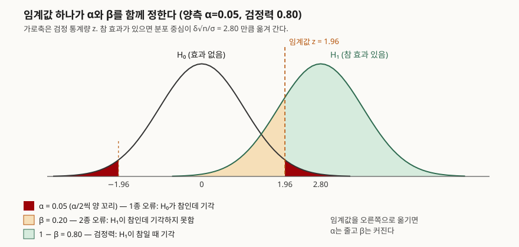

> 공식 값을 표준 라이브러리(`statistics.NormalDist`)로 계산하고, 같은 값을 시드 고정 난수 모의실험으로
> 다시 세어 검산했다. 계산 기록은 [code/output.txt](code/output.txt)에 있다. 정의와 공식은
> NIST/SEMATECH e-Handbook을 근거로 했다.

## 들어가며

A/B 테스트, 성능 개선 판정, 품질 관리의 합격 판정은 모두 "이 차이가 우연인가"를 묻는다. 기출에서는
유의수준과 검정력을 정의하라는 단답형부터, 표본 크기를 정하는 절차를 쓰라는 논술형까지 나온다.
답안에서 점수가 갈리는 곳은 **α와 β가 서로 맞물려 있고, 둘을 함께 낮추는 수단은 표본뿐**이라는
관계를 숫자로 쓸 수 있는지다.

## 정의

**가설 검정**은 귀무가설(H₀, 효과 없음)과 대립가설(H₁)을 한 쌍으로 세우고, 표본에서 계산한
검정 통계량이 H₀ 아래에서 나오기 어려운 영역(기각역)에 들어가면 H₀를 기각하는 판정 절차다
(NIST 핸드북 통계 검정 절, §7.1.3).

이 판정은 두 방향으로 틀릴 수 있다.

| 용어 | 정의 (NIST §1.3.5·§7.1.3) |
|---|---|
| 1종 오류 | H₀가 참인데 기각한다. 그 확률이 **유의수준 α** |
| 2종 오류 | H₀가 거짓인데 기각하지 못한다. 그 확률이 **β** |
| 검정력 | H₀가 거짓일 때 기각할 확률 **1 − β** |

NIST는 β를 **특정한 대립가설에 대해서만** 계산할 수 있다고 적는다. "효과가 있다"만으로는 β가
정해지지 않고, "효과가 δ만큼 있다"고 정해야 정해진다.

## 등장 배경

유의성만 보는 판정은 "H₀가 맞을 때 얼마나 드문가"만 묻는다. 효과가 실제로 있을 때 그것을 놓칠
확률은 계산하지 않으므로, 표본이 너무 작아 아무것도 못 잡는 실험도 "유의하지 않음"이라는 같은
결론을 낸다. 그래서 NIST 핸드북은 검정을 가설 한 쌍으로 세우고, α와 함께 β를 따로 이름 붙여
다룬다. 그리고 α를 줄이면 β가 커진다고 적는다. 이 틀에서는 **실험 전에** α·β·효과 크기를 정하고,
그 셋이 요구하는 표본을 모은 뒤에 판정한다.

## 구성요소 — 4개 값과 1개 공식

| 값 | 의미 | 누가 정하는가 |
|---|---|---|
| ① α | 감수할 1종 오류율. 보통 0.05 | 실험 설계자 |
| ② β (또는 1−β) | 감수할 2종 오류율. 검정력 0.80이면 β=0.20 | 실험 설계자 |
| ③ δ/σ (효과 크기) | 잡아내고 싶은 최소 차이를 표준편차 단위로 | 업무 판단 |
| ④ N (표본 크기) | 위 셋이 정해지면 계산된다 | 공식 |

넷 중 셋을 정하면 나머지 하나가 정해진다. 표본 크기 공식은 NIST 핸드북의 표본 크기 절(§7.2.2.2)이
σ를 알 때 다음처럼 준다.

```text
양측: N = (z₁₋α/₂ + z₁₋β)² · (σ/δ)²
단측: N = (z₁₋α   + z₁₋β)² · (σ/δ)²
```

**판정 절차 5단계**: ① 가설 한 쌍 설정 → ② α·검정력·δ 결정 → ③ N 계산 후 표본 수집 →
④ 검정 통계량 계산 → ⑤ 기각역과 비교해 판정.

## 도식



> **출처**: [NIST/SEMATECH e-Handbook §1.3.5 Quantitative Techniques](https://www.itl.nist.gov/div898/handbook/eda/section3/eda35.htm)(α·β·검정력 정의), [§7.1.3 What are statistical tests?](https://www.itl.nist.gov/div898/handbook/prc/section1/prc13.htm)(가설 한 쌍, α를 줄이면 β가 커짐), [§7.2.2.2 Sample sizes required](https://www.itl.nist.gov/div898/handbook/prc/section2/prc222.htm)(z₁₋α/₂ + z₁₋β). 곡선 좌표는 `code/probe_curve.py`로 계산했다.

답안지에는 종 모양 두 개, 세로선 하나, 칠한 영역 세 개면 된다. 두 분포 중심 사이 거리가
z₁₋α/₂ + z₁₋β = 1.96 + 0.84 = 2.80일 때 검정력이 0.80이 된다. 이것이 표본 크기 공식의 괄호 안이다.

## 계산으로 확인한 관계

**① NIST 예제 재현.** 단측 α=0.05, β=0.10, δ=1σ에서 핸드북은 8.567을 적는데, 직접 계산하면 8.564다.

```text
  단측 N = (1.645 + 1.282)^2 = 8.564 -> 9
  양측 N = (1.960 + 1.282)^2 = 10.507 -> 11
```

핸드북은 z를 소수 셋째 자리로 반올림한 1.645·1.282를 더해 제곱했다. 올림한 정수 9는 같다.
양측으로 바꾸면 11명이 된다.

**② 표본을 고정하면 α와 β는 반대로 움직인다** (n=16, δ=0.5σ).

```text
  alpha | 임계값 z | power  | beta
  0.100 |    1.645 | 0.6389 | 0.3611
  0.050 |    1.960 | 0.5160 | 0.4840
  0.010 |    2.576 | 0.2824 | 0.7176
```

**③ 효과가 절반이면 표본은 4배.** α=0.05 양측, 검정력 0.80일 때다.

```text
  δ/σ  | N 계산값  | 올림
  1.00 |      7.85 |     8
  0.50 |     31.40 |    32
  0.25 |    125.58 |   126
  0.10 |    784.89 |   785
```

N이 (σ/δ)²에 비례하기 때문이다. 상수 (1.96+0.84)² = 7.85를 2배 하면 두 집단 비교에서 쓰는 어림식
"n ≈ 16σ²/Δ²"의 16이 된다.

**④ 모의실험 검산** (n=32, 20,000회). 1종 오류율 0.0481(공식 0.05), 검정력 0.8101(공식 0.8074)로 맞았다.

## 비교

| 구분 | 1종 오류 (α) | 2종 오류 (β) |
|---|---|---|
| 상황 | 효과가 없는데 있다고 판정 | 효과가 있는데 없다고 판정 |
| 다른 이름 | 거짓 양성 | 거짓 음성 |
| 정하는 방법 | 설계자가 직접 고정 | δ와 N이 정해져야 계산된다 |
| 줄이는 방법 | 임계값을 멀리 둔다 | 표본을 늘리거나 큰 효과만 노린다 |
| 줄일 때 대가 | β가 커진다 | 비용과 기간이 는다 |

| 구분 | 유의수준 α | p-값 |
|---|---|---|
| 정하는 때 | 실험 **전** | 실험 **후** |
| 성격 | 기준선 | 관측값이 그 기준을 넘었는지 재는 값 |

## 적용 시 고려사항

**1. 다중 비교.** 서로 독립이고 모두 H₀가 참인 검정 m개를 각각 α=0.05로 보면 하나라도 기각될
확률은 1−(1−α)^m이다.

```text
   m  | 1-(1-α)^m | 모의(α 그대로) | 1-(1-α/m)^m | 모의(Bonferroni α/m)
    5 |    0.2262 |         0.2356 |      0.0490 | 0.0508
   20 |    0.6415 |         0.6530 |      0.0488 | 0.0536
```

지표 20개를 보면 64%의 확률로 무언가가 "유의"하게 나온다. α를 m으로 나누는 Bonferroni 방식은
전체를 0.05 아래로 묶는다. NIST 핸드북은 이 방식을 신뢰구간 g개에 1−α/g를 주는 형태로 설명한다
(Bonferroni 절, §7.4.7.3). 모의 0.0536은 이론값 0.0488보다 크지만 모의 5,000회의 표준오차 0.0031로
보면 1.5배 안쪽의 흔들림이다.

**2. 중간 확인(peeking).** H₀가 참인 데이터 200개를 k번 나눠 보다가 유의하면 멈추면 거짓 양성이 커진다.

```text
   k  | 거짓 양성
    1 | 0.0464
    5 | 0.1410
   20 | 0.2474
```

중간에 볼 계획이면 처음부터 순차 검정처럼 들여다보는 횟수를 반영한 방법을 쓴다.

**3. 검정력 부족.** n=16, δ=0.5σ면 검정력이 0.52다. "유의하지 않음"은 효과가 없다는 뜻이 아니라
절반 확률로 놓쳤다는 뜻일 수 있다. 결과 보고에 검정력과 N을 함께 적는다.

**4. σ를 모를 때.** 공식은 σ를 안다고 가정한다. NIST는 모를 때 t 분포로 바꾸고 자유도를 반복
계산하라고 적는다. 표본이 작을수록 z 공식이 N을 적게 잡는다.

## 정리

- **오류 2종**: 1종(α, 없는데 있다) · 2종(β, 있는데 없다). 검정력은 1−β.
- **값 4개**: α · β · δ/σ · N — 셋을 정하면 나머지 하나가 정해진다.
- **공식 1개**: N = (z₁₋α/₂ + z₁₋β)²(σ/δ)². α=0.05 양측·검정력 0.80이면 괄호 안 2.80, 제곱 7.85.
- **암기 단서**: "효과 절반 → 표본 4배", "검정 20개 → 거짓 양성 64%".
- **절차 5단계**: 가설 → α·검정력·δ → N → 통계량 → 판정.

> 기출 답안: [기출문제 — A/B 테스팅](../../exam/2026-11-09-ab-testing-online-controlled-experiments/index.md)

## 참고 자료

- [NIST/SEMATECH e-Handbook of Statistical Methods §1.3.5 Quantitative Techniques](https://www.itl.nist.gov/div898/handbook/eda/section3/eda35.htm)
- [NIST/SEMATECH e-Handbook §7.1.3 What are statistical tests?](https://www.itl.nist.gov/div898/handbook/prc/section1/prc13.htm)
- [NIST/SEMATECH e-Handbook §7.2.2.2 Sample sizes required](https://www.itl.nist.gov/div898/handbook/prc/section2/prc222.htm)
- [NIST/SEMATECH e-Handbook §7.4.7.3 Bonferroni's method](https://www.itl.nist.gov/div898/handbook/prc/section4/prc473.htm)
