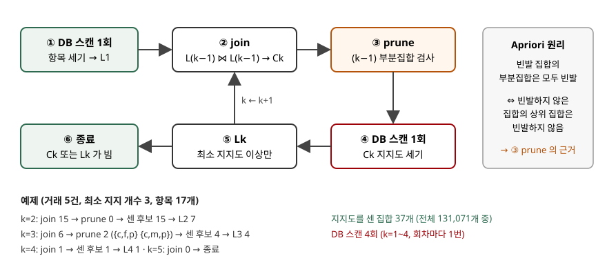

## 들어가며

연관 규칙 분석은 먼저 자주 함께 나오는 항목집합(빈발 항목집합)을 전부 찾고, 그다음 그 집합으로 규칙을 만든다. 항목이 d개면 가능한 항목집합이 2^d − 1개라 앞 단계가 전체 비용을 정한다. 시험에서는 Apriori 원리를 쓰고 후보 생성(join·prune) 절차를 설명하게 하거나, 거래 표를 주고 회차별 후보와 빈발 집합을 구하게 한다. 이 글은 원 논문으로 절차를 확인하고, FP-growth 논문의 예제 거래에 두 알고리즘을 직접 구현해 돌렸다.

> 실행 검증: 회차별 후보 수·빈발 항목집합·DB 스캔 횟수는 `code/` 의 구현으로 직접 계산했다(`executed`). Apriori 는 Agrawal·Srikant(1994) Figure 1 과 apriori-gen 을, FP-growth 는 Han·Pei·Yin(2000) 2·3절을 옮겼다.

## 정의

**Apriori 알고리즘**은 **빈발 항목집합의 모든 부분집합도 빈발하다는 성질을 이용해, 길이 k−1 의 빈발 항목집합만으로 길이 k 의 후보를 만들고 데이터베이스를 한 번 훑어 지지도를 세는 일을 후보가 없어질 때까지 반복하는 빈발 항목집합 탐색 알고리즘**이다.

원 논문은 핵심 직관을 "큰(large) 항목집합의 부분집합은 모두 크다"로 적는다. 논문은 빈발 항목집합을 large itemset 이라 부르는데, 지금 교재는 frequent itemset 이라 부른다. Tan·Steinbach·Kumar 슬라이드는 같은 내용을 **Apriori 원리**로 이름 붙이고, 그 근거를 지지도의 **반단조성**(anti-monotone property — 집합이 커지면 지지도가 늘지 않는다)으로 든다.

## 등장 배경

Agrawal·Imielinski·Swami(1993)가 연관 규칙 문제를 내놓으며 쓴 AIS 알고리즘, 그리고 SETM 은 거래를 읽으면서 그 거래에 든 항목으로 후보를 늘렸다. 원 논문은 이 방식이 "결국 작은 것으로 드러날 후보를 너무 많이 만들고 센다"고 지적한다. Apriori 는 후보를 거래가 아니라 **직전 회차의 빈발 집합만으로** 만들고, 부분집합 검사로 미리 지운다. 논문의 예에서 AIS·SETM 이 4번째 회차에 후보 5개를 만들 때 Apriori 는 1개만 센다.

그 뒤 Han·Pei·Yin(2000)은 Apriori 계열에 두 비용이 남는다고 짚었다. 빈발 1-항목집합이 10⁴개면 2-후보만 10⁷개가 넘고, 길이가 긴 패턴을 찾으려면 데이터베이스를 회차마다 반복해 훑어야 한다. 이것이 후보를 만들지 않는 FP-growth 가 나온 배경이다.

## 구성요소 / 절차

### Apriori 절차 6단계

원 논문 Figure 1 의 흐름이다.

1. **L1 생성** — DB 를 한 번 훑어 항목별 개수를 세고 최소 지지도 이상인 것을 남긴다
2. **join** — L(k−1) 의 두 집합이 앞 k−2개 항목이 같고 마지막 항목만 다르면 이어 k-후보를 만든다
3. **prune** — 후보의 (k−1) 부분집합 중 하나라도 L(k−1) 에 없으면 지운다
4. **지지도 세기** — DB 를 한 번 훑으며 각 거래에 든 후보의 개수를 올린다
5. **Lk 결정** — 최소 지지도 이상인 후보만 남긴다
6. **반복·종료** — k 를 1 늘려 2로 돌아가고, 후보나 Lk 가 비면 끝낸다. 답은 모든 Lk 의 합집합이다

join 은 정렬된 항목의 앞부분이 같은 것끼리만 이으므로 같은 후보가 두 번 나오지 않는다. prune 은 Apriori 원리를 그대로 적용한 것이다. 빈발하지 않은 부분집합이 하나라도 있으면 그 후보는 셀 필요가 없다.

### 구성요소 3가지

| 구성요소 | 역할 |
|---|---|
| 후보 집합 Ck | 빈발일 가능성이 있는 k-항목집합. 각각 지지 개수 칸을 갖는다 |
| 빈발 집합 Lk | 최소 지지도를 넘은 k-항목집합 |
| apriori-gen | L(k−1) → Ck 를 만드는 함수 (join + prune) |

## 도식



> **출처**: [Agrawal·Srikant, "Fast Algorithms for Mining Association Rules", VLDB 1994 — §2.1 Figure 1 Algorithm Apriori, §2.1.1 Apriori Candidate Generation](https://www.vldb.org/conf/1994/P487.PDF) · [Tan·Steinbach·Kumar, Introduction to Data Mining Ch.6 슬라이드 12 Reducing Number of Candidates](https://www-users.cse.umn.edu/~kumar001/dmbook/dmslides/chap6_basic_association_analysis.pdf)

답안지에는 상자 6개와 되돌아가는 화살표 하나, 옆에 원리 한 줄을 적으면 된다. DB 를 훑는 곳이 ①과 ④ 두 군데뿐이라는 점을 색으로 표시해 두면 FP-growth 와의 비교가 쉬워진다.

## 계산과 검산

전체 소스: [`code/apriori.py`](code/apriori.py) · 수행 기록: [`code/output.txt`](code/output.txt)

예제는 FP-growth 논문 Table 1 의 거래 5건이고 최소 지지 개수는 3이다. 논문처럼 지지도를 비율이 아니라 거래 건수로 셌다.

**① prune 이 지우는 것 — 원 논문의 예.**

```text
L3 = {1,2,3} {1,2,4} {1,3,4} {1,3,5} {2,3,4}
join 결과 = {1,2,3,4} {1,3,4,5}
prune 결과 = {1,2,3,4}  ({1,4,5} 가 L3 에 없어 {1,3,4,5} 삭제)
```

논문이 2.1.1절에 든 예와 같은 결과다. {1,3,4,5} 는 DB 를 읽기 전에 지워졌다.

**② Apriori 회차별 진행.**

```text
1회차: 항목 17개를 세어 L1 6개 -> {a}:3 {b}:3 {c}:4 {f}:4 {m}:3 {p}:3
2회차: join 15개, prune 0개, 센 후보 15개 -> L2 7개
3회차: join 6개, prune 2개 {c,f,p} {c,m,p}, 센 후보 4개 -> L3 4개
4회차: join 1개, prune 0개, 센 후보 1개 -> L4 1개
5회차: join 0개, prune 후 0개 -> 종료 (DB 를 읽지 않는다)
DB 스캔 4회, 지지도를 센 집합 37개, 빈발 항목집합 18개
```

항목이 17개라 가능한 항목집합은 2^17 − 1 = 131,071개다. Apriori 는 그중 37개만 셌다. 3회차에서 {c,f,p} 는 {f,p} 가, {c,m,p} 는 {m,p} 가 L2 에 없어 지워졌다. 2회차에서 prune 이 0개인 것은 정상이다. 2-후보의 1-부분집합은 모두 L1 에서 왔기 때문이다. **prune 이 실제로 일하는 것은 3회차부터다.**

**③ FP-growth — 같은 답을 DB 2번으로.**

```text
FP-tree (노드 11개, 거래 5건의 빈발 항목 총 20개):
  f:4
    c:3
      a:3
        m:2
          p:2
        b:1
          m:1
    b:1
  c:1
    b:1
      p:1
접미사별 조건부 패턴 기반 -> 그 안의 빈발 항목
  p: fcam:2; cb:1             -> c:3
  m: fca:2; fcab:1            -> a:3 c:3 f:3
DB 스캔 2회, 빈발 항목집합 18개
```

첫 스캔으로 빈발 항목과 빈도 순서(f, c, a, b, m, p)를 정하고, 두 번째 스캔에서 거래마다 빈발 항목만 그 순서로 정렬해 접두 트리에 넣는다. 만든 트리는 논문 Figure 1 과 노드·개수가 같았다. 빈발 항목 20개가 노드 11개로 줄었는데, 거래들이 f·c·a 접두를 공유하기 때문이다. 그 뒤 채굴은 DB 가 아니라 트리만 본다. p 의 조건부 패턴 기반(p 위의 경로)에서 c 만 3번 나오므로 {c,p} 하나가 나온다. 두 알고리즘의 결과는 항목집합과 지지 개수까지 18개 모두 같았다.

## 비교

**Apriori 대 FP-growth**

| 구분 | Apriori | FP-growth |
|---|---|---|
| 탐색 방식 | 길이별 너비 우선, 후보 생성 후 검사 | 접미사별 분할 정복, 후보 생성 없음 |
| DB 스캔 | 회차마다 1번 (예제 4번) | 트리 구축에 2번 |
| 핵심 자료구조 | 후보 집합 Ck (원 논문은 해시 트리) | FP-tree (접두 트리 + 항목별 노드 연결) |
| 메모리 | 후보 수에 비례 | 트리 크기에 비례. 공유 접두가 적으면 커진다 |
| 약점 | 빈발 1-항목이 많거나 패턴이 길 때 후보 폭증 | 트리가 메모리에 들어가야 한다 |
| 구현 난도 | 낮음 | 재귀적 조건부 트리로 높음 |

**같은 계열 알고리즘** — 원 논문이 함께 제안·비교한 것이다.

| 알고리즘 | 특징 |
|---|---|
| AIS·SETM | 거래를 읽으며 후보 확장. 불필요한 후보가 많다 |
| AprioriTid | 첫 회차 뒤로 DB 대신 후보를 인코딩한 집합으로 센다 |
| AprioriHybrid | 앞 회차는 Apriori, 인코딩이 메모리에 들어가면 AprioriTid 로 바꾼다 |

## 적용 시 고려사항

1. **최소 지지도가 비용을 정한다.** 낮출수록 L1 이 커지고 2-후보는 그 제곱에 가깝게 늘어난다. FP-growth 논문이 든 10⁴개 → 10⁷개가 이 경우다. 업무상 의미 있는 최저 빈도를 먼저 정하고 그보다 낮추지 않는다.
2. **DB 스캔 횟수는 가장 긴 패턴 길이를 따라간다.** Apriori 는 회차마다 DB 를 한 번 훑으므로, 디스크에 있는 대용량 거래 데이터에서 긴 패턴을 찾으면 I/O 가 지배한다. 이때는 FP-growth 나 AprioriTid 처럼 스캔을 줄이는 방법을 검토한다.
3. **FP-tree 는 공유 접두가 있어야 작아진다.** 예제는 20 → 11 로 줄었지만, 거래마다 항목 조합이 제각각이면 트리가 원래 데이터만큼 커진다. 메모리에 들어가는지 먼저 확인한다.
4. **빈발 항목집합은 규칙의 재료일 뿐이다.** 집합을 찾은 뒤 신뢰도·향상도로 규칙을 거르는 단계가 따로 있다. 지지도만 높은 집합에서 나온 규칙은 향상도 1 근처의 무의미한 규칙일 수 있다.
5. **항목 정의를 먼저 정한다.** 상품 코드 단위로 세면 지지도가 흩어지고, 범주 단위로 묶으면 빈발 집합은 늘지만 해석이 거칠어진다. 집계 수준이 결과를 바꾼다.

## 정리

- **정의**: 빈발 집합의 부분집합은 빈발하다는 성질로 후보를 줄이며 길이별로 빈발 항목집합을 찾는 알고리즘
- **원리 1개**: Apriori 원리 = 지지도의 반단조성 → 빈발하지 않은 집합의 상위 집합은 셀 필요가 없다
- **절차 6단계**: L1 생성 → join → prune → 지지도 세기 → Lk 결정 → 반복·종료
- **비교 축 3개**: DB 스캔 횟수(회차마다 대 2번), 후보 생성 유무, 메모리(후보 대 트리)
- 암기 단서: "**하위가 안 되면 상위도 안 된다, 잇고(join) 자르고(prune) 센다**"

> 기출 답안: [기출문제 — 연관 규칙 분석 지표](../../exam/2026-11-10-association-rule-metrics/index.md)

## 참고 자료

- [R. Agrawal, R. Srikant, "Fast Algorithms for Mining Association Rules", *Proc. VLDB* 1994, pp. 487–499](https://www.vldb.org/conf/1994/P487.PDF) — §2 직관과 AIS·SETM 비판, §2.1 Figure 1, §2.1.1 apriori-gen 의 join·prune 과 L3 예, AprioriTid·AprioriHybrid
- [J. Han, J. Pei, Y. Yin, "Mining Frequent Patterns without Candidate Generation", *Proc. ACM SIGMOD* 2000](https://www.cs.sfu.ca/~jpei/publications/sigmod00.pdf) — §1 Apriori 의 두 비용, §2 FP-tree 와 Table 1·Figure 1 예제, 두 번의 스캔, §3 FP-growth
- [P.-N. Tan, M. Steinbach, V. Kumar, *Introduction to Data Mining* Ch.6 Association Analysis 강의 슬라이드](https://www-users.cse.umn.edu/~kumar001/dmbook/dmslides/chap6_basic_association_analysis.pdf) — 슬라이드 11 후보 수 2^d, 12 Apriori 원리와 반단조성
- [R. Agrawal, T. Imielinski, A. Swami, "Mining Association Rules between Sets of Items in Large Databases", *Proc. ACM SIGMOD* 1993](https://doi.org/10.1145/170035.170072) — 연관 규칙 문제와 AIS 알고리즘. VLDB 1994 논문의 인용으로 확인, 원문 미열람
