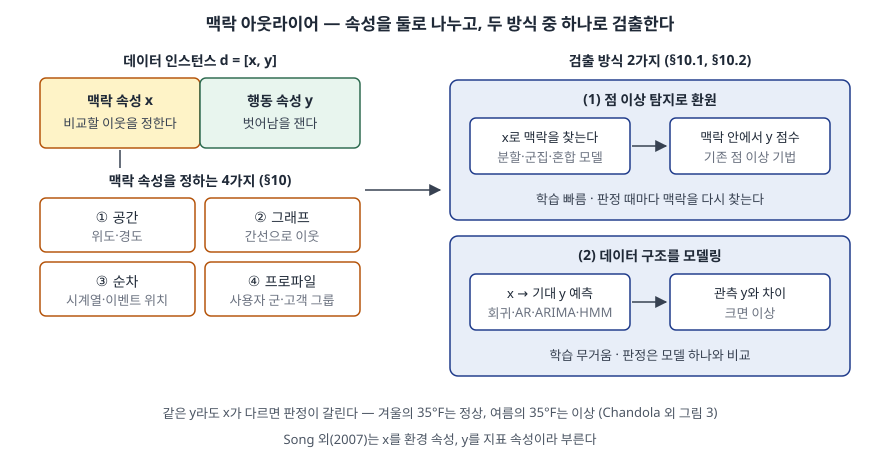

> 정의·속성 구분·검출 방식은 Chandola 외(ACM Computing Surveys 2009) 본문의 맥락 이상 절(§2.2.2)과
> 맥락 이상 처리 절(§10)에서 확인했다. "맥락을 잘게 나눌수록 오탐이 는다"는 부분은 출처의 주장이 아니라 직접 계산한 결과다.
> 데이터는 가상이고, 코드와 실행 기록은 `code/` 아래에 있다.

## 들어가며

모니터링 경보 규칙을 "요청 수가 평소보다 크게 벗어나면"으로 걸어 두면, 새벽 3시에 낮 수준의 요청이
몰려도 경보가 울리지 않는다. 그 값은 하루 전체로 보면 평범하기 때문이다. 그래서 "같은 시각끼리
비교하자"로 고치는데, 이번에는 주말 낮마다 경보가 쏟아진다. 맥락 아웃라이어는 이 두 실수 사이에서
**무엇과 비교할지를 설계하는 문제**이고, 시험에서는 전역·맥락·군집 유형 비교의 한 칸으로, 또는
맥락 속성과 행동 속성의 구분을 직접 묻는 형태로 나온다.

## 정의

Chandola 외는 맥락 아웃라이어를 **특정 맥락에서는 이상이지만 그 밖에서는 이상이 아닌 데이터
인스턴스**로 정의하고, 조건부 이상(conditional anomaly)이라고도 부른다(§2.2.2). 맥락은 데이터
구조가 만들어 내는 것이며 **문제를 정의할 때 함께 명시해야 한다**고 적는다.

이 정의를 쓰려면 각 인스턴스의 속성을 **2가지**로 나눈다.

| 속성 | 역할 | 예 |
|---|---|---|
| **맥락 속성** (contextual) | 인스턴스의 맥락, 즉 비교할 이웃을 정한다 | 공간 데이터의 위도·경도, 시계열의 시각 |
| **행동 속성** (behavioral) | 맥락이 아닌 특성. 벗어났는지를 이 값으로 판정한다 | 지역별 강수량, 시각별 요청 수 |

행동 속성이 똑같은 두 인스턴스도 맥락이 다르면 하나는 이상, 하나는 정상이 된다. 이 성질이 두 속성을
가르는 기준이다. Song 외(2007)는 같은 구분을 환경 속성·지표 속성이라 부른다(§10에서 재인용).

## 등장 배경

이상 탐지 연구 대부분은 전체 데이터와 비교해 벗어난 **점 이상**을 다룬다(§2.2.1). 그런데 기온·
트래픽·카드 결제처럼 계절과 시각에 따라 정상 범위가 움직이는 데이터에서는 전체 분포 하나로 경계를
그으면 겨울 기온의 범위 안에 여름의 이상 저온이 숨는다. Chandola 외 그림 3의 예가 이것이다 —
35°F는 겨울에 정상이고 여름에 이상이다. 점 이상 기법이 **데이터 전체를 한 번에 보기 때문에** 놓치는
경우를 잡으려고 맥락 속성을 따로 다루는 기법이 나왔다(§10 장단점).

## 구성요소 — 맥락 정의 4가지, 검출 방식 2가지

맥락 속성을 정하는 방식은 **4가지**다(§10).

| 방식 | 맥락을 정하는 것 | 적용 예 |
|---|---|---|
| ① **공간** | 위치 속성이 정하는 공간 이웃 | 지역별 기상·교통 |
| ② **그래프** | 노드를 잇는 간선이 정하는 이웃 | P2P 네트워크 노드 |
| ③ **순차** | 시퀀스 안의 위치. 시계열과 간격이 고르지 않은 이벤트 열 | 시스템 호출, 웹 로그 |
| ④ **프로파일** | 명시적 구조는 없지만 맥락 속성으로 묶은 그룹 | 사용자 군별 통화·카드 사기 탐지 |

검출 방식은 **2가지**다.

1. **점 이상 탐지로 환원**(§10.1) — 맥락 속성으로 인스턴스의 맥락을 찾고, 그 맥락 안에서 기존 점 이상
   기법으로 점수를 매기는 2단계다. 휴대전화 사용자를 맥락으로 묶는 통화 사기 탐지, 같은 무리끼리
   비교하는 동료 집단 분석이 이 방식이다
2. **데이터 구조 활용**(§10.2) — 맥락을 쪼개기 어려운 시계열·이벤트 열에서 쓴다. 맥락이 주어졌을 때의
   기대 행동을 예측하는 모델(회귀, AR·ARMA·ARIMA, 마르코프 모델)을 학습하고, 관측값이 기대와 크게
   다르면 이상으로 본다

## 도식



> **출처**: [Chandola, Banerjee & Kumar, Anomaly Detection: A Survey, ACM Computing Surveys 41(3), Article 15, 2009 §2.2.2 Contextual Anomalies, §10 Handling Contextual Anomalies](https://doi.org/10.1145/1541880.1541882)

답안지에는 [x | y]로 나뉜 상자 하나, 그 아래 맥락 4가지, 오른쪽 검출 방식 두 줄만 옮기면 된다.

## 맥락 단위에 따른 검출 결과 — 직접 계산

가상의 시간대별 요청 수 56일치(1,344점)를 만들었다. 하루 곡선은 03시 30, 15시 180이고 주말은
평일의 70%이며 표준편차 5의 노이즈를 더했다. 20일차(수요일) 03시에 값 120을 심었다. 맥락 정의를
5가지로 바꿔 가며 맥락마다 수정 Z 점수(중앙값·MAD 기반, 임계값 3.5)로 검출했다. 코드는
[`code/context_granularity.py`](code/context_granularity.py), 기록은 [`code/output.txt`](code/output.txt)에 있다.

```text
[한 번 실행 — seed 7, 심은 점 1개]
  맥락 정의                         맥락수     표본크기      심은점 Z     그 외 검출
  L0 맥락 없음(전역)                    1     1344      +0.41          0
  L1 시각                          24       56     +12.85        188
  L2 시각 x 평일/주말                  48    16~40     +29.26          6
  L3 시각 x 요일                    168        8     +39.70         36
  L4 시각 x 요일 x 전후 4주            336        4     +71.97         59

[반복 실행 — seed 1~200, 심은 점 없음: 검출된 것은 전부 오탐]
  맥락 정의                           평균 오탐 수  오탐률(1,344점 중)
  L0 맥락 없음(전역)                       0.00          0.00%
  L1 시각                            182.34         13.57%
  L2 시각 x 평일/주말                      5.89          0.44%
  L3 시각 x 요일                        30.08          2.24%
  L4 시각 x 요일 x 전후 4주                57.58          4.28%
```

세 가지가 보인다.

① **맥락이 없으면 심은 점을 못 잡는다.** 120은 전체 중앙값 92.1 근처라 Z가 +0.41이다.
② **맥락 속성을 빠뜨리면 오탐이 쏟아진다.** 시각만 맥락으로 쓴 L1은 심은 점을 잡았지만, 주말 낮 값이
   평일과 한 묶음에 들어가 반복 실행 평균 182건이 오탐이었다. 요일이 맥락 속성인데 빠진 것이다.
③ **맥락을 실제보다 잘게 나누면 다시 오탐이 는다.** 데이터를 만든 구조와 같은 L2가 오탐이 가장
   적었고, 표본이 8개(L3), 4개(L4)로 줄수록 오탐률이 2.24%, 4.28%로 올랐다. 작은 표본에서는 중앙값과
   MAD가 흔들려 노이즈 한 점이 큰 Z를 받는다. 심은 점의 Z가 커지는 것도 같은 이유라 검출력이 좋아진
   것으로 읽으면 안 된다.

## 비교

| 구분 | 전역(점) 아웃라이어 | 맥락 아웃라이어 | 군집 아웃라이어 |
|---|---|---|---|
| 판정 단위 | 개별 인스턴스 | 개별 인스턴스 | 관련된 인스턴스의 묶음 |
| 비교 대상 | 데이터 전체 | 같은 맥락의 인스턴스 | 묶음의 정상 패턴 |
| 데이터 전제 | 없음 | 맥락 속성이 있어야 한다 | 인스턴스 간 관계가 있어야 한다 |
| 대표 예 | 평소보다 훨씬 큰 단건 결제 | 7월의 1,000달러 주간 지출 | 낮은 심전도 값이 비정상적으로 길게 이어짐 |

| 구분 | 점 이상 탐지로 환원 | 데이터 구조 활용 |
|---|---|---|
| 맞는 데이터 | 맥락이 쉽게 나뉘는 공간·프로파일 데이터 | 맥락을 쪼개기 어려운 시계열·이벤트 열 |
| 학습 비용 | 분할은 빠르고 군집·혼합 모델은 느리다 | 대체로 환원 방식보다 높다 |
| 판정 비용 | 인스턴스마다 맥락을 찾아야 해서 비싸다 | 모델 하나와 비교해 빠르다 |

비용 비교는 Chandola 외 §10 계산 복잡도 문단을 따랐다.

## 적용 시 고려사항

| 고려사항 | 판단 기준 |
|---|---|
| **맥락 속성이 있는가, 의미가 있는가** | Chandola 외는 맥락 기법 적용 여부를 그 영역에서 맥락 이상이 의미 있는지와 맥락 속성을 쓸 수 있는지로 정한다고 적는다. 적재 단계에서 시각·위치·사용자 군을 버리면 검출이 원리적으로 불가능하다 |
| **맥락을 데이터 생성 구조에 맞춘다** | 계산 결과처럼 맥락 속성을 하나 빠뜨려도, 하나 더 붙여도 오탐이 는다. 요일·휴일·지역처럼 정상 범위를 실제로 바꾸는 속성만 고른다 |
| **맥락당 표본 크기의 하한** | 맥락을 나눌 때마다 비교 표본이 줄어든다. 맥락별 표본 수를 함께 기록하고, 하한보다 작으면 상위 맥락으로 합치거나 모델 기반 방식으로 바꾼다 |
| **맥락 정의의 변화** | 휴일 체계, 서비스 개편, 계절이 바뀌면 맥락 정의도 다시 봐야 한다. 맥락 정의를 코드가 아닌 설정으로 두고 바꾼 이력을 남긴다 |
| **판정 근거 기록** | 경보마다 어떤 맥락(키 값)과 비교했는지, 그 맥락의 표본 수와 중앙값을 함께 남겨야 분석자가 오탐을 가릴 수 있다 |

## 정리

- **정의** — 특정 맥락에서만 이상인 인스턴스, 조건부 이상
- **속성 2가지 = 맥·행** — 맥락 속성은 이웃을 정하고, 행동 속성은 벗어남을 잰다
- **맥락 정의 4가지 = 공·그·순·프** — 공간, 그래프, 순차, 프로파일
- **검출 방식 2가지** — 점 이상 탐지로 환원(맥락 찾기 → 점 기법), 데이터 구조 모델링(기대값 예측 → 차이)
- **설계의 쟁점** — 맥락이 모자라면 놓치거나 오탐이 쏟아지고, 넘치면 표본이 줄어 오탐이 는다

> 기출 답안: [기출문제 — 아웃라이어의 개념, 노이즈와의 차이, 전역·맥락·군집 유형](../../exam/2026-11-27-outlier-noise-global-contextual-collective/index.md)
>
> 관련 글: [강건 통계량 — 중앙값, MAD, 절사평균의 붕괴점](../2026-10-23-robust-statistics-breakdown-point/index.md)

## 참고 자료

- [Chandola, Banerjee & Kumar, Anomaly Detection: A Survey, ACM Computing Surveys 41(3), Article 15, July 2009](https://doi.org/10.1145/1541880.1541882) — §2.2 이상 유형 3가지(그림 3 기온 예, 카드 지출 예), §2.2.2 맥락 속성·행동 속성, §10 맥락 정의 4가지, §10.1 점 이상 탐지로 환원, §10.2 데이터 구조 활용, 계산 복잡도와 장단점. Song 외(2007) 조건부 이상 탐지의 환경·지표 속성도 이 절에서 재인용했다
- [NIST/SEMATECH e-Handbook of Statistical Methods §1.3.5.17 Detection of Outliers](https://www.itl.nist.gov/div898/handbook/eda/section3/eda35h.htm) — 수정 Z 점수와 임계값 3.5
