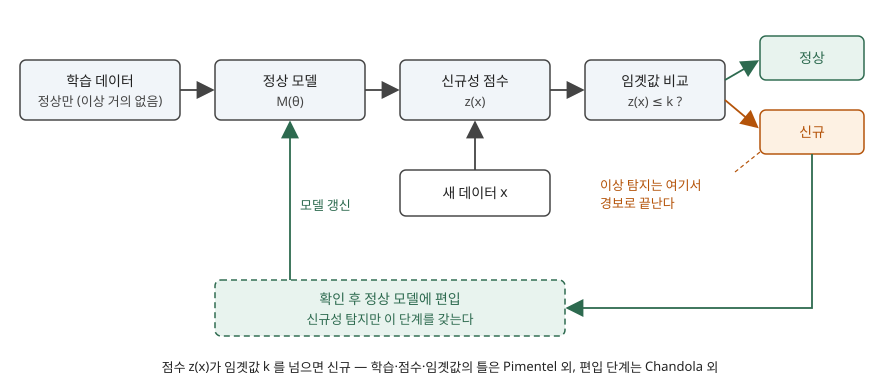

> 정의·구성요소·방법 5범주는 Pimentel 외(Signal Processing 2014) 본문 1절에서 확인했다. 출판사
> 페이지는 열리지 않아 **강의 자료 사이트에 올라온 사본(제3자 전재)으로 본문을 읽었고**, 아래
> 링크는 DOI와 옥스퍼드 기관 저장소로 단다. "학습 데이터가 오염되면 놓친다", "편입하면 경보가
> 멈춘다"는 결과는 출처의 주장이 아니라 직접 계산한 값이다. 데이터는 가상이고 코드와 실행 기록은 `code/` 아래에 있다.

## 들어가며

공장 설비 감시 시스템을 만들 때 고장 데이터는 거의 없다. 고장 사례를 모으려면 같은 설비를 여러
방식으로 망가뜨려야 하기 때문이다. 그래서 정상 운전 데이터만으로 "정상이 어떤 모습인지"를 배우고,
거기서 벗어나는 것을 잡는다. 이것이 신규성 탐지다. 시험에서는 이상 탐지·아웃라이어 탐지와 무엇이
다른지를 묻는 형태로 나오고, 답이 갈리는 곳은 **학습 데이터가 깨끗하다는 전제**와 **검출 뒤에
정상 모델을 고치느냐**의 두 지점이다.

## 정의

Pimentel 외는 신규성 탐지를 **시험 데이터가 학습 때 쓸 수 있던 데이터와 어떤 면에서 다르다는 것을
인식하는 작업**으로 정의하고, 이를 **단일 클래스 분류**(one-class classification)의 틀로 본다(§1, §1.1).
정상 클래스 하나만 충분히 표본이 있고 나머지는 표본이 매우 적다고 가정한다.

Chandola 외는 같은 작업의 특징으로 **검출된 새 패턴이 대개 정상 모델에 편입된다**는 점을 든다(§1.1).
두 출처를 묶으면 답안 첫 줄이 된다. **신규성 탐지는 정상 데이터만으로 학습한 모델에서 벗어나는 새
패턴을 찾고, 확인된 패턴을 정상 모델에 반영하는 단일 클래스 분류 작업이다.**

용어는 통일돼 있지 않다. Pimentel 외는 이상 탐지·아웃라이어 탐지가 신규성 탐지와 바꿔 쓰이는
동의어로 흔히 쓰이며 보편적으로 합의된 정의가 없다고 적는다(§1.1). 다만 같은 절에서 둘의 목표가
다르다고 짚는다. 아웃라이어 탐지는 **데이터를 오염시킨 관측값을 모델을 만드는 단계에서 견디는 것**이고,
신규성 탐지는 **정상으로 간주한 데이터로 정상 모델을 배우는 것**이다.

## 등장 배경

전통적인 패턴 인식은 둘 이상의 클래스를 나누는 다중 클래스 분류다(§1.1). 이 방식은 클래스마다
학습 표본이 있어야 한다. 그런데 Pimentel 외가 든 감시 대상(의료 진단, 산업 설비 고장, 신용카드
사기, 영상 감시)은 **비정상 모드가 많고 그중 일부는 미리 알 수 없다**(§1). 모르는 클래스는 학습시킬
수 없으므로 다중 클래스 분류가 맞지 않고, 정상 하나만 모델로 만들어 거기서 멀어진 정도를 재는
방식이 대안으로 나왔다.

## 구성요소 — 4가지, 방법 범주 5가지

Pimentel 외의 단일 클래스 분류 절(§1.1)에 나오는 기호를 그대로 쓰면 신규성 탐지는 **4가지** 요소로 이뤄진다.

| 요소 | 기호 | 역할 |
|---|---|---|
| ① 정상 학습 데이터 | X | 정상 패턴만, 또는 신규 클래스가 거의 없는 데이터 |
| ② 정상 모델 | M(θ) | 학습 데이터로 추정한 정상의 모습. θ는 모델의 자유 매개변수 |
| ③ 신규성 점수 | z(x) | 새 데이터 x가 정상 모델에서 벗어난 정도. 클수록 비정상 |
| ④ 신규성 임곗값 | k | z(x) ≤ k 면 정상, 넘으면 신규. 이 식이 결정 경계다 |

정상 모델을 어떻게 만드느냐로 방법은 **5범주**로 나뉜다(§1.3).

| 범주 | 정상 모델과 점수 | 대표 기법 (해당 절) |
|---|---|---|
| (i) 확률 기반 | 정상의 밀도를 추정, 밀도가 낮은 곳이 신규 | 혼합 모델, 커널 밀도 추정 (2절) |
| (ii) 거리 기반 | 정상은 촘촘히 모이고 신규는 이웃에서 멀다 | 최근접 이웃, 군집화 (3절) |
| (iii) 재구성 기반 | 정상으로 학습한 모델의 재구성 오차가 점수 | 신경망(오토인코더), 부분공간 (4절) |
| (iv) 영역 기반 | 정상 데이터를 감싸는 경계를 정한다 | SVDD, 단일 클래스 SVM (5절) |
| (v) 정보이론 기반 | 신규 데이터가 정보량을 크게 바꾼다 | 엔트로피, 콜모고로프 복잡도 (6절) |

## 도식



> **출처**: [Pimentel 외, A review of novelty detection, Signal Processing 99 (2014) §1.1 Novelty detection as one-class classification](https://doi.org/10.1016/j.sigpro.2013.12.026) (M(θ)·z(x)·k), [Chandola 외, Anomaly Detection: A Survey, ACM CSUR 41(3) 2009 §1.1](https://doi.org/10.1145/1541880.1541882) (검출 후 정상 모델 편입)

답안지에는 상자 일곱 개와 되돌아가는 화살표 하나로 옮긴다. 이상 탐지와의 차이는 아래쪽
점선 상자 하나로 드러난다.

## 두 갈림길 — 직접 계산

전체 소스: [`code/`](code/) · 실행 기록: [`code/output.txt`](code/output.txt)

평균 100, 표준편차 5인 정상 데이터 500건을 만들고, 평균·표준편차로 정상 모델을 세웠다. 점수는
z(x) = |x − 중심| / 척도, 임곗값은 k = 3이다. 시험 데이터는 정상 200건과 평균 122인 새 패턴 20건이다.

```text
[1~3] 같은 시험 데이터(정상 200, 새 패턴 20)를 세 모델로 판정
  1) 깨끗한 학습 + 평균·표준편차        중심  100.13  척도   4.77  임계 범위   85.82~ 114.44  신규 검출 20/20  오경보 2/200
  2) 오염된 학습 + 평균·표준편차        중심  102.80  척도   9.63  임계 범위   73.91~ 131.68  신규 검출 0/20  오경보 0/200
  3) 오염된 학습 + 중앙값·MAD        중심  101.14  척도   5.62  임계 범위   84.28~ 118.00  신규 검출 19/20  오경보 0/200
```

**갈림길 ① 학습 데이터.** 2)는 학습 데이터에 평균 130짜리 이상값 50건(약 9%)을 섞은 것이다.
표준편차가 4.77에서 9.63으로 두 배가 되면서 임계 범위가 131.68까지 넓어졌고, 새 패턴 20건을 하나도
못 잡았다. 깨끗한 학습 데이터를 전제로 한 방법을 오염된 데이터에 그대로 쓰면 이렇게 된다.
3)은 중앙값과 MAD(중앙값 절대 편차)처럼 이상값에 덜 흔들리는 강건 추정으로 바꾼 것으로, 아웃라이어
탐지가 오염을 견디는 방식이다. 19건을 잡았다.

```text
[4] 새 패턴이 t=200 부터 정상으로 자리 잡는 흐름 — 100건 단위 경보 수
  경보로 끝냄               [0, 0, 88, 86, 82, 86]  합계 342
  편입함 (신규성 탐지)         [0, 0, 30, 0, 0, 0]  합계 30
    편입 시점 t=234, 정상 성분 2개: 중심 100.0, 중심 122.1
```

**갈림길 ② 편입.** 데이터 흐름의 평균이 t=200부터 120으로 옮겨 가고 그대로 유지된다. 경보로 끝내는
모델은 이후 100건마다 82~88건씩 경보를 냈다. 신규 판정이 30건 쌓이고 서로 모여 있으면 그것으로
두 번째 정상 성분을 만들도록 한 모델은 t=234에 편입한 뒤 경보가 0이 됐다.

## 비교

| 구분 | 아웃라이어 탐지 | 신규성 탐지 | 개념 드리프트 탐지 |
|---|---|---|---|
| 학습 데이터 | 이상값이 섞여 있다 | 이상값이 섞이지 않았다 | 시간 순서의 흐름 |
| 학습 방식 | 비지도 | 준지도 (정상만 레이블) | 감시 대상에 따라 다르다 |
| 판정 대상 | 학습 데이터 안의 관측값 | 학습 뒤 들어오는 새 관측값 | 분포 자체의 변화 |
| 검출 뒤 | 제거하거나 견딘다 | 확인되면 정상 모델에 편입 | 모델을 적응시킨다 |
| 근거 | scikit-learn §2.7, Pimentel §1.1 | scikit-learn §2.7, Chandola §1.1 | Lu 외 §2.1 |

scikit-learn 사용자 안내서는 이 구분을 학습 데이터가 오염됐는가로 긋고, 아웃라이어 탐지를 비지도
이상 탐지, 신규성 탐지를 준지도 이상 탐지라고도 부른다(§2.7). 같은 이유로 `LocalOutlierFactor`는
`novelty=True`를 줘야 새 데이터에 `predict`를 쓸 수 있다.

개념 드리프트는 Lu 외가 시점 t와 t+1 사이에 결합 분포 P(X, y)가 달라지는 것으로 정의한다(§2.1).
P(X)만 바뀌면 가상 드리프트, P(y|X)가 바뀌면 실제 드리프트다. 신규성 탐지는 **개별 관측값**이
새로운지를 묻고 드리프트 탐지는 **분포**가 바뀌었는지를 묻는다. 위 [4]처럼 새 패턴이 계속 들어와
자리 잡으면 같은 현상을 두 관점에서 본 것이 되고, 편입은 드리프트에 대한 적응의 한 형태가 된다.

## 적용 시 고려사항

**① 학습 데이터가 정말 깨끗한지 먼저 확인한다.** 운영 로그를 그대로 학습시키면 그 안의 장애 구간이
정상으로 들어간다. 계산 2)에서 9% 오염이 검출을 20건에서 0건으로 떨어뜨렸다. 깨끗함을 보장할 수
없으면 강건 추정이나 아웃라이어 탐지 방법을 쓰고, 그 선택을 설계 문서에 남긴다.

**② 편입은 사람이든 규칙이든 확인을 거친다.** 검출된 것을 확인 없이 정상에 넣으면 공격자가 조금씩
흘려보낸 이상 행위가 정상으로 학습된다. 편입 조건(건수, 응집도, 담당자 승인)을 명시하고 편입 이력을
남겨 되돌릴 수 있게 한다.

**③ 편입한 성분은 치우쳐 있다.** 계산 [4]에서 실제 새 패턴의 평균은 120인데 편입된 성분의 중심은
122.1이었다. 임곗값 114를 넘은 관측값만 모였기 때문이다. 편입 뒤에는 그 구간의 데이터 전체로 모델을
다시 추정한다.

**④ 임곗값 k는 탐지율과 오경보율의 교환이다.** Pimentel 외는 신규 데이터를 맞힌 비율과 정상을
신규로 잘못 판정한 비율(오경보율)을 함께 평가하고 ROC 곡선으로 그 교환을 나타낸다고 적는다(§1.3).
k를 정할 때는 경보 한 건을 처리하는 비용과 한 건을 놓치는 비용을 같이 놓고 본다.

## 정리

- **정의**: 정상만으로 학습한 모델에서 벗어난 새 패턴을 찾는 단일 클래스 분류. 확인되면 정상 모델에 편입한다.
- **4요소** — 학습 데이터 X, 정상 모델 M(θ), 점수 z(x), 임곗값 k. "**데·모·점·임**"으로 외운다.
- **5범주** — 확률·거리·재구성·영역·정보이론. "**확·거·재·영·정**".
- **이상 탐지와 갈리는 2지점** — 학습 데이터가 깨끗한가(오염되면 아웃라이어 탐지), 검출 뒤 모델을 고치는가(편입하면 신규성 탐지).
- 개념 드리프트와는 개별 관측값을 보느냐, 분포 변화를 보느냐로 구분한다.

## 참고 자료

- [Pimentel, Clifton, Clifton & Tarassenko, A review of novelty detection, Signal Processing 99 (2014) 215–249](https://doi.org/10.1016/j.sigpro.2013.12.026) — §1 정의, §1.1 단일 클래스 분류와 M(θ)·z(x)·k, 아웃라이어 탐지와의 목표 차이, §1.3 방법 5범주와 평가 지표. 기관 저장소 기록: [Oxford University Research Archive](https://ora.ox.ac.uk/objects/uuid:947eb5ef-ea04-4156-840a-ae957d35d4f6)
- [Chandola, Banerjee & Kumar, Anomaly Detection: A Survey, ACM Computing Surveys 41(3), Article 15, July 2009](https://doi.org/10.1145/1541880.1541882) — §1.1 신규성 탐지는 검출된 새 패턴을 정상 모델에 편입한다
- [scikit-learn 1.9.1 User Guide §2.7 Novelty and Outlier Detection](https://scikit-learn.org/stable/modules/outlier_detection.html#novelty-and-outlier-detection) — 학습 데이터 오염 여부로 가르는 구분, §2.7.4 `LocalOutlierFactor(novelty=True)`
- [Lu, Liu, Dong, Gu, Gama & Zhang, Learning under Concept Drift: A Review, arXiv:2004.05785](https://arxiv.org/abs/2004.05785) — §2.1 결합 분포 변화로서의 개념 드리프트, 가상·실제 드리프트
- 같은 저장소: [기출문제 — 아웃라이어의 개념, 노이즈와의 차이, 전역·맥락·군집 유형](../../exam/2026-11-27-outlier-noise-global-contextual-collective/index.md)(이 개념이 나온 답안), [맥락 아웃라이어 탐지 — 맥락 속성과 행동 속성을 나누는 설계](../2026-11-28-contextual-outlier-context-behavioral-attributes/index.md), [오토인코더 기반 이상 탐지 — 재구성 오차로 정상에서 벗어난 것을 찾는 원리](../2026-10-07-autoencoder-reconstruction-anomaly-detection/index.md), [강건 통계량 — 중앙값, MAD, 절사평균의 붕괴점](../2026-10-23-robust-statistics-breakdown-point/index.md)
